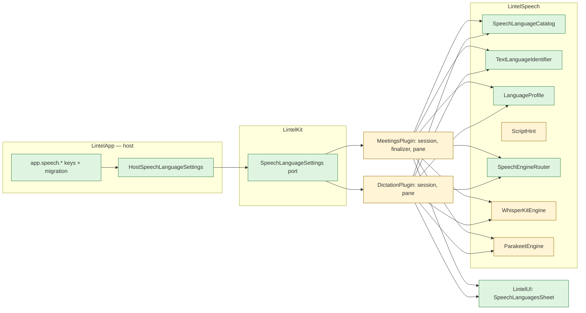

# Automatic language detection for Meetings and Dictation

> Status: **design, owner decisions of 2026-11-23 applied** (issue #210, also addresses #132). Nothing here is implemented.
> Research input: the language-detection report of 2026-11-23 (competitors, user complaints, technical options; its section 4 is the design followed here). The report is not in the repository; its findings that this spec relies on are summarised in "Problem Statement" and "Market".
> Mockups: none. This is a native settings change; the browser provider and the test-environment descriptor needed to render mockups are not set up, so the UI is described in text only (see "UI/UX").

## 📝 TLDR

**Who:** everyone who records meetings or dictates in a language other than Polish, or in more than one language, and everyone hit by #132 (short segments in the wrong language or script).
**Today:** a hidden setting `speechLanguage` defaults to `pl`. In Meetings it is sent to Parakeet as a script hint, so every Parakeet meeting is decoded as Latin script only (Ukrainian or Russian speech comes out as garbled Latin letters), and it pins Whisper to Polish or English. Dictation pins Whisper to `pl`/`en` and sends Parakeet nothing. There is no way to say "I speak Ukrainian" or "Japanese".
**Proposed (future behaviour):** the language is **Automatic** by default for new and existing users. One shared list, **Languages I speak** (prefilled from the Mac's languages), is used by both Meetings and Dictation as a prior. The rule is: **a short fragment never picks the language by itself; the meeting (or the dictation) does.** Long segments build a language profile from the transcribed text; once it is settled, Parakeet gets the matching script hint (Latin, Cyrillic or Greek, never an assumed one); short suspicious segments are decoded again at the end of the meeting. A language Parakeet cannot transcribe switches the session to Whisper automatically.

## ✅ Owner decisions 2026-11-23 (final)

| # | Decision | Consequence in this spec |
|---|---|---|
| D1 | **"Automatic" becomes the default, also for existing users.** The hidden `pl` default was an assumption, not a user choice. Migrate it per `BACKWARD_COMPATIBILITY.md`. | `app.speech.languageMode` defaults to `auto`; a one-time migration moves `plugins.meetings.speechLanguage` and `plugins.dictation.speechLanguage` into the shared list and removes them (section "Data Model"). The behaviour change for users who never touched the setting is approved by this decision; it goes into the release notes. |
| D2 | **One shared "Languages I speak" list** for Meetings and Dictation. | The list is a host-owned `app.speech.*` setting reached through a new additive `LintelKit` port; both panes edit the same value. |
| D3 | **Automatic switch to Whisper** for languages Parakeet does not support. | `SpeechEngineRouter` chooses Whisper for a session whose languages Parakeet cannot transcribe, when the Whisper model is installed; otherwise the pane banner asks for it. Lintel never downloads on its own. |

Standing direction (owner, #210, 2026-11-23): the product is global with an English core and is never restricted to one script.

## 📝 Problem Statement

1. **#210:** restricting Parakeet meetings to the Latin script is not acceptable; it breaks every Cyrillic or Greek speaker and is invisible (the language row is shown only for Whisper).
2. **#132:** on two real Polish meetings, 7.0% of segments are in the wrong language or script. All of them are short: 34 of 37 are 2 s or shorter, none has 10 words or more. About 60% are a wrong decoding language (a Polish word spelled as a foreign word, or in Cyrillic), about 40% are English back-channel hallucinations ("Thank you.", "yeah") on short acknowledgements or noise. The Latin hint from #203 removed only the Cyrillic cases (19%).
3. Long segments in #132 were 100% correct, so the text of long segments is a reliable source for "the language of this meeting".
4. Whisper pinned to `pl`/`en` makes Whisper useless for any other language, although it supports about 99.

## 📝 Market (from the research report)

- Default is automatic (Wispr Flow, Granola, Fireflies, tl;dv on Whisper, MacWhisper).
- A list of "languages I speak" narrows detection and helps short utterances (Wispr Flow, Granola up to 10 languages). Wispr itself says manual selection is more accurate, so an explicit single-language mode stays available.
- Detection happens per session (meeting or dictation), not per short fragment (Fireflies auto-detect, Aqua, Wispr). Word-level code-switching is beta/premium even at the leaders: out of scope here.
- A mismatch produces a suggestion, not a silent change (Wispr "Speaking a different language?", Google Meet's nudge after ~30 s).
- Complaints to avoid: wrong language on short clips, translation into English instead of transcription, stray Cyrillic in a Latin-script language (exactly #132).

What we skip: a separate audio language-ID model (SpeechBrain VoxLingua107, ~40 MB, no measurement on 1–3 s clips, a new dependency for a signal we get from text for free) and word-level code-switching.

## 📝 Proposed Solution

### Principle

A segment shorter than about 3 s or 8 words never decides the language. The session decides, from the text of its long segments, weighted by length, narrowed by the user's list.

### Settings model (shared by both plugins)

- **Mode:** `Automatic (recommended)` (default) or `Always one language: <language>` (today's pinning, for people whose speech Automatic gets wrong).
- **Languages I speak:** an ordered list of up to 10 languages from `SpeechLanguageCatalog` (the Whisper languages; Parakeet's 25 are a subset, marked per entry). While the user has never edited it, it is derived at read time from `Locale.preferredLanguages` intersected with the catalog, and English when nothing matches; nothing is written until the user edits it.

### Meetings, Parakeet (the default engine)

1. The session starts **without** a script hint.
2. Every accepted segment of at least 3 s and 8 words goes to `TextLanguageIdentifier` (Apple's `NLLanguageRecognizer`, offline, system framework) with the user's list as hints and the catalog as constraints. The result (language, confidence) feeds a `LanguageProfile` weighted by segment duration.
3. The profile is **settled** after 30 s of confident speech (confidence ≥ 0.8). From then on, if every language that holds at least 15% of the profile is written in one script, the next segments get that script hint (`ScriptHint`: Latin, Cyrillic or Greek, through FluidAudio's `TokenLanguageFilter`). A mix of scripts (for example Polish and Ukrainian) sends no hint.
4. **Finalization** (`MeetingFinalizer`, before `ready`, while the spool still exists): a segment is **suspect** when it is ≤ 3 words or ≤ 2 s and (its script is not a profile script, or its text language is confidently outside the profile, or it matches the back-channel list while the dominant language is not English). Suspect segments are decoded again from the spool audio with 0.5 s of context on each side: with Whisper pinned to the dominant language of the neighbouring segments when the Whisper model is installed, else with Parakeet and the profile's script hint. The new text replaces the old **only** when it agrees with the profile (script and, for ≥ 2 words, language); otherwise the original stays. Segments longer than 2 s and 3 words are never rewritten, so real English inside a Polish meeting stays.
5. A meeting resumed after a crash (`MeetingResumer`, `RecoveryJob`) rebuilds the profile from its stored segment texts, so no new column is needed.

### Meetings and Dictation, Whisper

- **Always one language:** Whisper pinned to it, as today.
- **Automatic:** until the profile is settled, a segment of at least 3 s runs WhisperKit's `detectLanguage(audioArray:)`; its probabilities are restricted to the user's list and the best one is pinned for that segment. Shorter segments are pinned to the profile's dominant language, or to the first language of the list while there is no profile. After the profile is settled, segments are pinned to the dominant language, and every 10th long segment is checked again (one detection pass), so a meeting that changes language follows within a few segments. Detection is never run on short segments (Whisper pads them and guesses badly, see the OpenAI forum reports in the research).

### Automatic switch to Whisper (D3)

`SpeechEngineRouter` (pure) decides the engine when a recording or dictation starts, from the selected model, the language settings and what is installed:

| Selected model | Languages | Whisper installed | Engine |
|---|---|---|---|
| Whisper | any | yes | Whisper |
| Parakeet | single language Parakeet supports, or every listed language Parakeet supports | any | Parakeet |
| Parakeet | single language or any listed language Parakeet does not support | yes | **Whisper** |
| Parakeet | same | no | Parakeet without hint, and the pane banner "Get Whisper to transcribe Japanese" |

The engine is fixed per recording, as today (`MeetingsRuntime.makeEngine`), and the meeting's stored model id is the engine actually used. A Polish+Japanese list therefore records every meeting with Whisper; that is slower but correct, and it is the user's list that asks for it.

### Dictation

- One language per dictation (like Wispr Flow). Parakeet: no hint while recording; when the result is a short dictation (< 8 words) whose script is not a script of the list, it is decoded again once with the hint of the list's first script. Whisper: as above, with the first long segment deciding for the rest of the dictation; segments before it are re-decoded at the end only when the decision differs from what they were pinned to.
- **Different language suggestion:** when a dictation of at least 8 words is identified with confidence ≥ 0.9 as a catalog language not in the list, the Dictation pane banner offers "Lintel heard Ukrainian. Add it to Languages I speak?" (Add / Dismiss). Nothing changes without the click. The suggestion lives in memory only (one language code), never with text.

### Alternatives considered

- **Keep `pl` as the hidden default and show the row for Parakeet:** rejected by the owner (#210).
- **Per-segment Whisper LID:** wrong on exactly the short segments of #132.
- **Audio LID model (VoxLingua107):** a new dependency and download for a signal the text gives for free; no data on short clips.
- **Two lists (per plugin):** rejected by D2.

## 📝 Architecture



Takeaway: the host owns the one shared setting and hands it to plugins through a port; all language logic is pure code in `LintelSpeech`, which both plugins already import; plugins still never import each other.

- **`LintelKit` (protected, additive):** `SpeechLanguageSelection` (value: `mode` `.automatic` / `.single(String)`, `languages: [String]`, `isDerived: Bool`), protocol `SpeechLanguageSettings: Sendable { func current() -> SpeechLanguageSelection; func update(_:) ; var changes: AsyncStream<Void> }`, and `PluginContext.speechLanguages` with a default `FixedSpeechLanguageSettings(.automatic, ["en"])` for contexts built without a host. Language values are ISO 639-1 strings, so `LintelKit` does not depend on `LintelSpeech`.
- **`LintelApp`:** `HostSpeechLanguageSettings` over `SettingsStore` (keys in `SettingsKeys.swift`), the derived list from `Locale.preferredLanguages`, and `Migration/SpeechLanguageMigration` run once at launch before the plugins activate.
- **`LintelSpeech` (pure unless noted):**
  - `SpeechLanguageCatalog`: code, script (`latin`/`cyrillic`/`greek`/`other`), `parakeetSupported`, `whisperSupported`. Parakeet TDT v3's 25: bg, cs, da, de, el, en, es, et, fi, fr, hr, hu, it, lt, lv, mt, nl, pl, pt, ro, ru, sk, sl, sv, uk. Display names come from `Locale.localizedString(forLanguageCode:)` in the UI, not from the catalog.
  - `ScriptHint` replaces `ParakeetLanguage`: maps a set of scripts to a FluidAudio `Language` of that script (`.english`, `.russian`, `.greek`), `nil` for a mix, `other` or an empty set. The rule of #203 ("send a hint only when every language is known and in one script") is kept and widened to Cyrillic and Greek.
  - `TextLanguageIdentifier` (port) + `NaturalLanguageIdentifier` (imports the system `NaturalLanguage` framework; `LintelSpeechTests`' dependency scan gets it added to the allowed imports).
  - `LanguageProfile`: duration-weighted accumulator, `settled`, `dominant`, `scripts(minimumShare:)`, rebuildable from stored texts.
  - `SuspectSegmentPolicy`: the finalization rule above, with the back-channel list per language as data.
  - `SpeechEngineRouter`: the table above.
  - `ParakeetEngine(hint:)`: takes `@Sendable () -> Language?` instead of a language code.
  - `WhisperKitEngine(language:)`: takes `@Sendable () -> WhisperLanguageChoice` (`.pinned(String)` or `.detect(candidates: [String], fallback: String)`); `.pinned` keeps today's decoding options byte for byte.
- **`MeetingsPlugin`:** `MeetingSession.accept` feeds the profile (text only, in memory); the engine's hint closure reads it; `MeetingFinalizer` gets a `LanguageRepair` stage after diarization that reads suspect ranges from the spool and goes through `SpeechEngineLease` at `background` priority. A lease `busy` (dictation running) waits up to 60 s, then the stage is skipped and the transcript stays as it is; it never blocks `ready` and never fails the meeting. `MeetingsSettings.speechLanguage` and the Whisper-only language row are removed.
- **`DictationPlugin`:** `DictationSession` holds a per-dictation profile; `DictationSettings.speechLanguage` and its row are removed; `settingsStatus` gains the suggestion and the "Get Whisper" item.
- **`LintelUI`:** `SpeechLanguagesRow` (one-line summary "Automatic · Polish, English") and `SpeechLanguagesSheet` (the editor), used by both panes.
- **Notes:** `NotesLanguage` detection is unchanged; a meeting in a language other than Polish or English already gets the neutral prompt wording.

## 📝 Data Model

No database change. Settings (protected surface, `BACKWARD_COMPATIBILITY.md` section 3), declared once in `Sources/LintelApp/SettingsKeys.swift`:

| Key | Type | Default | Meaning |
|---|---|---|---|
| `app.speech.languageMode` | String `auto` / `single` | missing = `auto` | Automatic detection, or one pinned language. An unknown value reads as `auto`. |
| `app.speech.languages` | [String] of catalog codes, ≤ 10, ordered | missing = derived from the system languages, else `["en"]` | Languages I speak. Unknown codes are dropped on read; an empty stored list reads as derived. |
| `app.speech.singleLanguage` | String catalog code | missing = first language of the list | Used only in `single` mode. |
| `app.speech.legacyLanguageMigrated` | Bool | false | Marker of the one-time migration. |

**Migration (`SpeechLanguageMigration`, once, before plugins activate):**

1. If the marker is set, do nothing.
2. Read `plugins.meetings.speechLanguage` and `plugins.dictation.speechLanguage`. A value exists only if the user picked it in the Whisper language row (nothing else writes these keys).
3. If at least one exists and `app.speech.languages` is missing: write `app.speech.languages` = the stored values (meetings first, no duplicates), then the derived system languages, capped at 10. The mode is **not** set: it stays `auto` (D1), so a former Whisper pin becomes a prior, not a pin.
4. Remove both old keys, set the marker. Keep the migration code for at least one minor release, with tests (fresh install, one key, both keys equal, both different, list already present, marker set).

Rollback: an older build finds the old keys missing and reads `pl`, which is exactly the pre-change default; the new keys are ignored by it. The only loss is a user's explicit `en` Whisper pin on a downgrade.

Sensitive data: none stored. The profile and the suggestion hold language codes and durations in memory only; transcript text is never logged or persisted by this feature beyond the existing segment rows. Logs carry closed codes and counts (`languageRepair.replaced=3 kept=5 skipped=busy`).

## 📝 API Contracts

`LintelKit` additions (additive, each with a default; `BACKWARD_COMPATIBILITY.md` section 1):

```swift
public struct SpeechLanguageSelection: Sendable, Equatable {
    public enum Mode: Sendable, Equatable { case automatic, single(String) }
    public var mode: Mode
    public var languages: [String]   // ISO 639-1, ordered, 1...10
    public var isDerived: Bool       // true while the user never edited the list
}
public protocol SpeechLanguageSettings: Sendable {
    func current() -> SpeechLanguageSelection
    func update(_ selection: SpeechLanguageSelection)
    var changes: AsyncStream<Void> { get }
}
// PluginContext.speechLanguages: any SpeechLanguageSettings (default FixedSpeechLanguageSettings)
```

Validation in the host: codes outside `SpeechLanguageCatalog` are dropped, the list is de-duplicated and capped at 10, `single` with an unknown code falls back to the first listed language. Plugins read `current()` when a session starts and when a segment is decoded; a change during a meeting affects hints immediately but never the engine of a running recording.

## 📝 UI/UX

Both the Dictation and the Meetings pane, Basics, the speech card:

- The Whisper-only **Language** row is removed. A new row **Languages** shows `Automatic · Polish, English` (or `Always Polish`) and an **Edit…** button; caption: "Shared by Dictation and Meetings."
- **Edit…** opens `SpeechLanguagesSheet`:
  - Radio: **Automatic (recommended)** — "Lintel recognises the language by itself. The list helps with short phrases." / **Always one language** with a picker of the listed languages.
  - **Languages I speak:** chips in order with a remove button each, an **Add Language…** searchable menu of the catalog (localized names), drag to reorder; while the list is derived the caption says "From your Mac's languages."
  - A line under a chip whose language Parakeet cannot transcribe: "Uses the Whisper model." plus "Get it in Models" when Whisper is not installed.
  - Done / Cancel; Cancel is the default button (`ConfirmSheet` conventions), Escape cancels, every control has a VoiceOver label.
- **Banner** (`settingsStatus`): a listed or single language that needs Whisper while Whisper is not installed and Parakeet is selected counts as one thing to do, action **Get It in Models** (`.models(packageID: whisper)`). The dictation suggestion "Lintel heard Ukrainian. Add it to Languages I speak?" is an attention banner with Add / Dismiss (plugin actions).
- All new strings get `en` and `pl` values in `Resources/Localizable.xcstrings`.
- Wording is for non-technical users: no "script", "LID" or model jargon in the UI; "Whisper" appears only where the user must get that model.
- The row and the sheet are added to the SwiftUI gallery (the UI source of truth) in step 2.2, so the owner reviews the real views before 2.3 places them.

## 📝 Edge Cases & Failure Scenarios

| Case | Behaviour |
|---|---|
| Meeting shorter than 30 s of confident speech | Profile never settles: no hint, finalization uses the unsettled profile only when it has ≥ 10 s; otherwise nothing is rewritten. |
| Bilingual meeting, same script (Polish + English) | Both in profile, Latin hint; real English long segments untouched; English back-channel on a short Polish acknowledgement is suspect only while Polish dominates. |
| Bilingual meeting, mixed scripts (Polish + Ukrainian) | No hint; suspect rule uses both scripts, so Cyrillic short segments are kept. |
| Close languages (cs/sk, uk/ru, hr/sr) | `NLLanguageRecognizer` mixes them; the user's list as hints/constraints decides; the script hint is the same anyway. |
| Language not in the catalog | Not offered; detection is constrained to the catalog; Parakeet gets no hint. |
| Whisper not installed, list needs it | Parakeet without hint + banner; never a download. |
| Lease busy at finalization (dictation running) | Waits up to 60 s, then skips the repair; transcript as live; logged as `skipped=busy`. |
| Spool unreadable / cancelled finalization | Repair skipped; the existing diarization fallback rules decide; `ready` is never blocked by the repair. |
| Crash during the meeting | `MeetingResumer` rebuilds the profile from stored texts and runs the repair. |
| User changes the list mid-meeting | Hints follow on the next segment; the engine stays. |
| Whisper translation instead of transcription | `task: .transcribe` stays fixed; detection only picks the language token. |
| Hallucination on silence in a short segment | Suspect by the back-channel rule; a re-decode that disagrees with the profile keeps the original (no new hallucination is introduced). |

## 📝 Risks & Impact Review

- **Default change for existing users (D1):** approved by the owner; release note: *Lintel now recognises the language of meetings and dictation automatically, with a "Languages I speak" list in Settings. Parakeet meetings are no longer limited to the Latin script.*
- **Protected surfaces touched by the implementation PRs:** `LintelKit` (additive port, risk R8), settings keys (`app.speech.*` added, two `plugins.*.speechLanguage` keys removed through the documented migration). Those PRs are `risk-high` and update `BACKWARD_COMPATIBILITY.md` sections 1 and 3 in the same PR.
- **Quality risk:** the first ~30 s of a Parakeet meeting have no script hint, so #132-style Cyrillic can appear live there; finalization targets exactly those short segments. Gate: the #132 method (`MeetingEvalTests`) before/after on one Polish meeting and one meeting with Cyrillic-script speech: wrong-language segments from 7.0% to ≤ 2% on the Polish meeting, 0 Latin-garbled Cyrillic segments on the second, and no change to any segment > 2 s.
- **Performance:** finalization gets longer (estimate ~160 short segments for an 84 min meeting); Whisper detection adds an encoder pass per checked segment. Budgets go into `docs/perf.md` as "not yet measured" and are measured in step 2.5.
- **One resident model:** the repair may swap Parakeet for Whisper in `SpeechEngineLease`; background priority keeps dictation first.
- **Rollback:** each phase is behind its own PR; reverting Phase 2 brings back the old keys' behaviour only for users who never ran the migration (see Data Model).

## 📝 Resolved assumptions (autonomous defaults)

These questions were open after the owner's three decisions; each answer is reversible before merge.

| # | Question | Applied default | Why |
|---|---|---|---|
| Q1 | One spec or two (Meetings / Dictation)? | One spec, shipped in separate phases and PRs. | D2 makes the shared setting one capability; each phase still ships alone. |
| Q2 | Where does the shared list live? | Host-owned `app.speech.*` keys behind a new additive `LintelKit` port `SpeechLanguageSettings`. | `PluginSettings` is scoped to `plugins.<id>.`; plugins must not import each other; the host is the composition root. |
| Q3 | What happens to an explicit Whisper pin (`en` or `pl` picked in the row)? | It becomes the first entry of the list; the mode is Automatic for everyone. | D1 says Automatic also for existing users; keeping the value as a prior loses no information. "Always one language" is one click away. |
| Q4 | Default content of the list? | Derived from `Locale.preferredLanguages` ∩ catalog, English if empty; not written until edited. | Matches Wispr/Granola; no stored assumption; English core. |
| Q5 | Whisper not installed but needed? | Parakeet without hint + banner "Get It in Models"; no automatic download. | Downloads only on the user's action (`ModelManager` rule). |
| Q6 | Switch engines mid-meeting when a non-Parakeet language is detected? | No: the engine is chosen at the start from the list (D3 router); mid-meeting only hints change. | Engine-per-recording is an existing invariant; a mid-meeting swap would split the transcript between engines. |
| Q7 | Text LID technology? | Apple `NaturalLanguage` (`NLLanguageRecognizer`). | System framework, offline, no new dependency or download. |
| Q8 | "Different language" suggestion in the HUD or in Settings? | Settings banner for Dictation only. | The HUD claims no clicks today; a banner is never a silent change. |
| Q9 | "Re-transcribe in another language" library action (Otter, tl;dv)? | Deferred to a separate spec. | Independently deployable; needs kept audio (MEET-1.1, off by default). |
| Q10 | Store the detected language per meeting? | No schema change; the profile is rebuilt from stored texts. | Smallest surface; nothing reads a stored language yet. |
| Q11 | Thresholds (3 s / 8 words / 0.8 / 30 s / 15% / ≤ 3 words or ≤ 2 s)? | As written, as named constants in `LintelSpeech`, tuned only through the step 2.5 measurement. | Derived from #132's length distribution and the research. |
| Q12 | Keep "Always one language"? | Yes, as the second mode. | Leaders keep a manual mode; some voices fool automatic detection. |

## 📋 Phasing

- **Phase 1 — Language building blocks (no user-visible change).** Pure parts in `LintelSpeech`.
- **Phase 2 — Shared setting and automatic Meetings.** The port, keys, migration, the sheet, the live profile and hint, the finalization repair, the Whisper switch, the measurement gate.
- **Phase 3 — Automatic Dictation.** Per-dictation detection and the suggestion banner.
- **Phase 4 — Docs and release.** AGENTS.md rows, ADR 0003 note, perf numbers, release note.

## 📋 Implementation Plan

### Phase 1 — Language building blocks

- **1.1** `SpeechLanguageCatalog` and `ScriptHint` (replaces `ParakeetLanguage` with the same behaviour for `pl`/`en`; adds Cyrillic and Greek). Tests: every Parakeet language has a script; mixed sets give `nil`; today's `ParakeetLanguageTests` cases still pass with the new type.
- **1.2** `TextLanguageIdentifier` port + `NaturalLanguageIdentifier`; allow `NaturalLanguage` in the `LintelSpeechTests` dependency scan. Tests: fixed sentences in pl/en/uk/ru/el/ja (invented text) give the expected language with hints; short text gives low confidence.
- **1.3** `LanguageProfile` (weighting, settled rule, scripts by share, rebuild from texts). Tests with a fake identifier.
- **1.4** `SuspectSegmentPolicy` with the back-channel lists. Tests over a synthetic segment table modelled on #132's length buckets (no real meeting text).
- **1.5** `SpeechEngineRouter`. Table-driven tests of every row.
- **1.6** `WhisperKitEngine(language: () -> WhisperLanguageChoice)`, `ParakeetEngine(hint:)`; existing call sites pass `.pinned(settings.speechLanguage)` and the old hint, so behaviour is unchanged. Tests: `.pinned` builds the same `DecodingOptions` as before; candidate restriction picks the best listed language from a fake probability map.

### Phase 2 — Shared setting and automatic Meetings

- **2.1** `LintelKit`: `SpeechLanguageSelection`, `SpeechLanguageSettings`, `PluginContext.speechLanguages` with default; `LintelApp`: `HostSpeechLanguageSettings`, keys in `SettingsKeys.swift`; `BACKWARD_COMPATIBILITY.md` sections 1 and 3. Nothing reads it yet. Tests: validation, derived list, change stream.
- **2.2** `LintelUI`: `SpeechLanguagesRow` + `SpeechLanguagesSheet` (not yet placed). Tests: model logic (add, remove, reorder, cap, derived caption); `StringCatalogTests` for the new strings.
- **2.3** The switch: `SpeechLanguageMigration`; Meetings reads the port, `MeetingSession` feeds `LanguageProfile`, the Parakeet hint comes from the profile; the Whisper pin of both Meetings and Dictation reads `single` or the first listed language (detection comes in 2.5 and 3.1); both panes replace the Whisper-only row with `SpeechLanguagesRow`; remove `speechLanguage` from both settings types. Tests: migration cases; a scripted session (fake engine and identifier) sends no hint before settling and the right script after; Cyrillic-dominant profile sends the Cyrillic hint; mixed sends none. Manual QA with screenshots (light and dark) of both panes and the sheet, per `docs/qa.md`.
- **2.4** `LanguageRepair` in `MeetingFinalizer` (spool read, lease at background, 60 s busy wait, replace-only-when-agreeing) and the resumer's profile rebuild. Tests: fake spool and engine; long segments never rewritten; busy lease skips; cancellation leaves the meeting `processing` as today.
- **2.5** Whisper switch for Meetings through `SpeechEngineRouter` and the banner item; Whisper Automatic detection with candidates. Then the **measurement gate**: `MeetingEvalTests` on one Polish meeting and one meeting with Cyrillic-script speech from the owner's evaluation volume, before/after table and timings in the PR body and `docs/perf.md`. If the gate fails, thresholds are tuned in this step; the step does not merge below the gate.

### Phase 3 — Automatic Dictation

- **3.1** Dictation reads the port: Parakeet without hint plus the short-dictation script re-decode; Whisper per-dictation detection from the first long segment, re-decode of earlier segments only on disagreement; router and banner item for Whisper. Tests with fake engine and identifier; manual QA dictating in two languages.
- **3.2** "Different language" suggestion banner (Add / Dismiss, memory only). Tests: threshold, language already listed, dismissed language not suggested again in the session.

### Phase 4 — Docs and release

- **4.1** AGENTS.md rows (LintelSpeech, Meetings, Dictation), a note in `docs/decisions/0003-speech-engine.md` (automatic language and the router), `CHANGELOG.md` release note, `docs/perf.md` numbers from 2.5.
