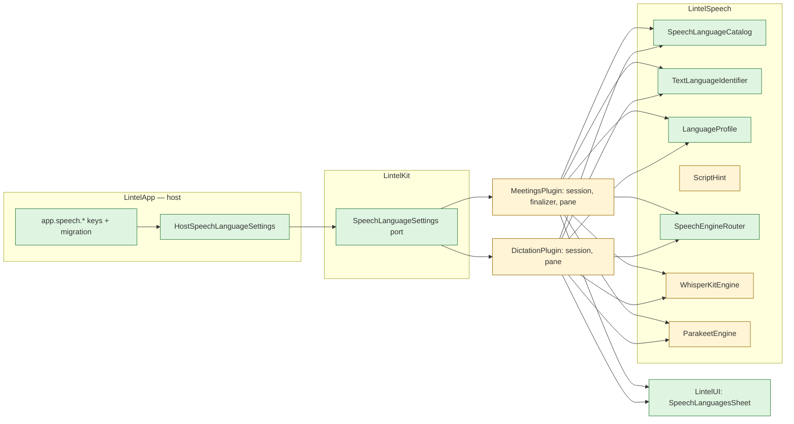

# Automatic language detection for Meetings and Dictation

> Status: **design, owner decisions of 2026-11-23 applied** (issue #210, also addresses #132). Nothing here is implemented.
> Research input: the language-detection report of 2026-11-23 (competitors, user complaints, technical options; its section 4 is the design followed here). The report is not in the repository; its findings that this spec relies on are summarised in "Problem Statement" and "Market".
> Mockups: none. This is a native settings change; the browser provider and the test-environment descriptor needed to render mockups are not set up, so the UI is described in text only (see "UI/UX").

## 📝 TLDR

**Who:** everyone who records meetings or dictates in a language other than Polish, or in more than one language, and everyone hit by #132 (short segments in the wrong language or script).
**Today:** a hidden setting `speechLanguage` defaults to `pl`. In Meetings it is sent to Parakeet as a script hint, so every Parakeet meeting is decoded as Latin script only (Ukrainian or Russian speech comes out as garbled Latin letters), and it pins Whisper to Polish or English. Dictation pins Whisper to `pl`/`en` and sends Parakeet nothing. There is no way to say "I speak Ukrainian" or "Japanese".
**Proposed (future behaviour):** the language is **Automatic** by default for new and existing users. One shared list, **Languages I speak** (prefilled from the Mac's languages), is used by both Meetings and Dictation as a prior. The rule is: **a short fragment never picks the language by itself; the meeting (or the dictation) does.** Long segments build a language profile from the transcribed text; once it is settled, Parakeet gets the matching script hint (Latin, Cyrillic or Greek, never an assumed one); short suspicious segments are decoded again at the end of the meeting. A language Parakeet cannot transcribe switches the session to Whisper automatically.

## ✅ Owner decisions 2026-11-23 (final)

| # | Decision | Consequence in this spec |
|---|---|---|
| D1 | **"Automatic" becomes the default, also for existing users.** The hidden `pl` default was an assumption, not a user choice. Migrate it per `BACKWARD_COMPATIBILITY.md`. | `app.speech.languageMode` defaults to `auto`; a one-time migration moves `plugins.meetings.speechLanguage` and `plugins.dictation.speechLanguage` into the shared list and removes them (section "Data Model"). The behaviour change for users who never touched the setting is approved by this decision for **Meetings**; it goes into the release notes. **Exception, owner 2026-11-26:** Whisper **dictation** keeps `pl` for a user who never stored a language or edited the list (the derived list does not pin it, so an English-only Mac does not move them to English) until Phase 3 makes dictation detect its language. |
| D2 | **One shared "Languages I speak" list** for Meetings and Dictation. | The list is a host-owned `app.speech.*` setting reached through a new additive `LintelKit` port; both panes edit the same value. |
| D3 | **Automatic switch to Whisper** for languages Parakeet does not support. | `SpeechEngineRouter` chooses Whisper for a session whose languages Parakeet cannot transcribe, when the Whisper model is installed; otherwise the pane banner asks for it. Lintel never downloads on its own. |

Standing direction (owner, #210, 2026-11-23): the product is global with an English core and is never restricted to one script.

## 📝 Problem Statement

1. **#210:** restricting Parakeet meetings to the Latin script is not acceptable; it breaks every Cyrillic or Greek speaker and is invisible (the language row is shown only for Whisper).
2. **#132:** on two real Polish meetings, 7.0% of segments are in the wrong language or script. All of them are short: 34 of 37 are 2 s or shorter, none has 10 words or more. About 60% are a wrong decoding language (a Polish word spelled as a foreign word, or in Cyrillic), about 40% are English back-channel hallucinations ("Thank you.", "yeah") on short acknowledgements or noise. The Latin hint from #203 removed only the Cyrillic cases (19%).
3. Long segments in #132 were 100% correct, so the text of long segments is a reliable source for "the language of this meeting".
4. Whisper pinned to `pl`/`en` makes Whisper useless for any other language, although it supports about 99.

## 📝 Market (from the research report)

- Default is automatic (Wispr Flow, Granola, Fireflies, tl;dv on Whisper, MacWhisper).
- A list of "languages I speak" narrows detection and helps short utterances (Wispr Flow, Granola up to 10 languages). Wispr itself says manual selection is more accurate, so an explicit single-language mode stays available.
- Detection happens per session (meeting or dictation), not per short fragment (Fireflies auto-detect, Aqua, Wispr). Word-level code-switching is beta/premium even at the leaders: out of scope here.
- A mismatch produces a suggestion, not a silent change (Wispr "Speaking a different language?", Google Meet's nudge after ~30 s).
- Complaints to avoid: wrong language on short clips, translation into English instead of transcription, stray Cyrillic in a Latin-script language (exactly #132).

What we skip: a separate audio language-ID model (SpeechBrain VoxLingua107, ~40 MB, no measurement on 1–3 s clips, a new dependency for a signal we get from text for free) and word-level code-switching.

## 📝 Proposed Solution

### Principle

A segment shorter than about 3 s or 10 words never decides the language. The session decides, from the text of its long segments, weighted by length, narrowed by the user's list. (10 words, not fewer: #132 has no wrong segment of 10 words or more, while the 4–9 word bucket of its meeting B has 4 wrong out of 80.)

The hint and the language choice are **per request, never per engine instance**. `SpeechEngineLease` shares one engine between Dictation and Meetings for the same `(model id, folder)` key and ignores the engine a second caller passes (`SpeechEngineLease.acquire`, `ModelResidency.acquire`), so a closure stored in an engine would be the closure of whoever loaded the model first: a meeting started while Dictation's model is still warm would never send its hint, and a dictation during a meeting would get the meeting's. Every decode therefore carries its own `SpeechRequestOptions` (see "Architecture").

### Settings model (shared by both plugins)

- **Mode:** `Automatic (recommended)` (default) or `Always one language: <language>` (today's pinning, for people whose speech Automatic gets wrong).
- **Languages I speak:** an ordered list of up to 10 languages from `SpeechLanguageCatalog` (the Whisper languages; Parakeet's 25 are a subset, marked per entry). While the user has never edited it, it is derived at read time from `Locale.preferredLanguages` intersected with the catalog, and English when nothing matches; nothing is written until the user edits it.

### Meetings, Parakeet (the default engine)

1. The session starts **without** a script hint.
2. Every accepted segment of at least 3 s and 10 words goes to `TextLanguageIdentifier` (Apple's `NLLanguageRecognizer`, offline, system framework) with the user's list as hints and the catalog as constraints. The result (language, confidence) feeds a `LanguageProfile` weighted by segment duration.
3. The profile is **settled** after 30 s of confident speech (confidence ≥ 0.8). From then on, if every language that holds at least 15% of the profile is written in one script, the next segments get that script hint (`ScriptHint`: Latin, Cyrillic or Greek, through FluidAudio's `TokenLanguageFilter`). A mix of scripts (for example Polish and Ukrainian) sends no hint.
4. **Finalization** (`MeetingFinalizer`, before `ready`, while the spool still exists): a segment is **suspect** when it is ≤ 3 words or ≤ 2 s and (its script is not a profile script, or its text language is confidently outside the profile, or it matches the back-channel list while the dominant language is not English). Suspect segments are decoded again from the spool audio: with Whisper pinned to the dominant language of the neighbouring segments when the Whisper model is installed, else with Parakeet and the profile's script hint. Up to 0.5 s of audio is added on each side, but only audio that belongs to no other segment of that track (the padding is cut at the neighbour's start or end), so a neighbour's words cannot enter the new text. Segments longer than 2 s and 3 words are never rewritten, so real English inside a Polish meeting stays.

   The new text replaces the old **only** when all of these hold; otherwise the original stays:
   - its script is a profile script;
   - it is not on the back-channel or known-hallucination list of **any** language, the dominant one included (Whisper pinned to Polish answers noise with Polish filler phrases, which would "agree" with the profile);
   - for a Whisper re-decode, `noSpeechProb` and `avgLogProb` pass the thresholds `LanguageRepair` names as constants (tuned in step 2.5);
   - `TextLanguageIdentifier` does not place it **confidently** in a language outside the profile. A short text the identifier is unsure about passes: the identifier is not reliable below about 8 words, so it may veto, never approve.

   The repair runs on **every** finalizer path that leaves a transcript: diarized, the diarization fallbacks (speaker model missing, over budget, failed) and diarization switched off. It does not run for `.cancelled` (the meeting stays `processing` with its spool for a later run) or `.nothingToLabel`. `SpoolReader` reads forward only, so the repair is one more decrypting pass over each track that has a suspect segment, collecting just the suspect ranges.
5. A meeting resumed after a crash (`MeetingResumer`, `RecoveryJob`) rebuilds the profile from its stored segment texts, so no new column is needed.

### Meetings and Dictation, Whisper

- **Always one language:** Whisper pinned to it, as today.
- **Automatic:** until the profile is settled, a segment of at least 3 s gets a **constrained detection**: the best language among the user's list is pinned for that segment. WhisperKit 1.1.1's own `detectLangauge(audioArray:)` (upstream spelling) cannot do this: it returns the single best of all languages, and its `langProbs` holds only that one entry. The engine therefore runs the same three calls itself (`featureExtractor.logMelSpectrogram`, `audioEncoder.encodeFeatures`, `textDecoder.detectLanguage(from:using:sampler:options:temperature:)`, all public) with its own `TokenSampling` that picks the highest logit among the language tokens of the candidates. If step 1.6 shows this does not work on the real model, the fallback is the unconstrained result when it is in the list, else the first listed language; the spec is then updated before Phase 2. Shorter segments are pinned to the profile's dominant language, or to the first language of the list while there is no profile. After the profile is settled, segments are pinned to the dominant language, and every 10th long segment is checked again (one detection pass), so a meeting that changes language follows within a few segments. Detection is never run on short segments (Whisper pads them and guesses badly, see the OpenAI forum reports in the research).

### Automatic switch to Whisper (D3)

`SpeechEngineRouter` (pure) decides the engine when a recording or dictation starts, from the selected model, the language settings and what is installed:

| Selected model | Languages | Whisper installed | Engine |
|---|---|---|---|
| Whisper | any | yes | Whisper |
| Parakeet | single language Parakeet supports, or every listed language Parakeet supports | any | Parakeet |
| Parakeet | single language or any listed language Parakeet does not support | yes | **Whisper** |
| Parakeet | same | no | Parakeet without hint, and the pane banner "Get Whisper to transcribe Japanese" |

The engine is fixed per recording, as today (`MeetingsRuntime.makeEngine`), and the meeting's stored model id is the engine actually used. A Polish+Japanese list therefore records every meeting with Whisper; that is slower but correct, and it is the user's list that asks for it. The sheet says so in plain words before the user confirms (see "UI/UX"). `modelUsage` of both plugins reports the model the router would pick now, so Settings → Models shows Whisper as used and needed, and its removal guard (`isInUse`, `reserveRemoval`) covers it.

### Dictation

- One language per dictation (like Wispr Flow). Parakeet: no hint while recording; when the result is a short dictation (< 8 words) whose script is not a script of the list, it is decoded again once with the hint of the list's first script (from the samples still in memory; nothing is written). The options go with each request, so a dictation made during a meeting is never decoded with the meeting's hint. Whisper: as above, with the first long segment deciding for the rest of the dictation; segments before it are re-decoded at the end only when the decision differs from what they were pinned to.
- **Different language suggestion:** when a dictation of at least 8 words is identified with confidence ≥ 0.9 as a catalog language not in the list, the Dictation pane banner offers "Lintel heard Ukrainian. Add it to Languages I speak?" (Add / Dismiss). Nothing changes without the click. The suggestion lives in memory only (one language code), never with text.

### Alternatives considered

- **Keep `pl` as the hidden default and show the row for Parakeet:** rejected by the owner (#210).
- **Per-segment Whisper LID:** wrong on exactly the short segments of #132.
- **Audio LID model (VoxLingua107):** a new dependency and download for a signal the text gives for free; no data on short clips.
- **Two lists (per plugin):** rejected by D2.
- **A hint closure stored in each engine (today's `ParakeetEngine(language:)`):** does not survive the shared lease (see "Principle").
- **Repair with Parakeet only (no model swap):** the script hint fixes only the other-script cases (19% of #132); the 60% "Polish word spelled as a foreign word" cases need a decoder pinned to a language, which is Whisper.

## 📝 Architecture



Takeaway: the host owns the one shared setting and hands it to plugins through a port; all language logic is pure code in `LintelSpeech`, which both plugins already import; plugins still never import each other.

- **`LintelKit` (protected, additive):** `SpeechLanguageSelection` (value: `mode` `.automatic` / `.single(String)`, `languages: [String]`, `isDerived: Bool`), protocol `SpeechLanguageSettings: Sendable { func current() -> SpeechLanguageSelection; func update(_:) ; var changes: AsyncStream<Void> }`, and `PluginContext.speechLanguages` with a default `FixedSpeechLanguageSettings(.automatic, ["en"])` for contexts built without a host. Language values are plain strings (Whisper's language codes: ISO 639-1 where one exists, plus a few three-letter ones such as `haw` and `yue`), so `LintelKit` does not depend on `LintelSpeech`. `changes` returns a **new** stream on every read (an `AsyncStream` has one consumer; two plugins and two panes listen).
- **`LintelApp`:** `HostSpeechLanguageSettings` over `SettingsStore` (keys in `SettingsKeys.swift`), the derived list from `Locale.preferredLanguages` (each identifier reduced to its language subtag, `pl-PL` → `pl`, `zh-Hans-CN` → `zh`, with the aliases the catalog lists, `nb`/`nn` → `no`; duplicates dropped, order kept), and `Migration/SpeechLanguageMigration` run once at launch before the plugins activate.
- **`LintelSpeech` (pure unless noted):**
  - `SpeechLanguageCatalog`: code, script (`latin`/`cyrillic`/`greek`/`other`), `parakeetSupported`, `whisperSupported`. Parakeet TDT v3's 25: bg, cs, da, de, el, en, es, et, fi, fr, hr, hu, it, lt, lv, mt, nl, pl, pt, ro, ru, sk, sl, sv, uk. Display names come from `Locale.localizedString(forLanguageCode:)` in the UI, not from the catalog.
  - `ScriptHint` replaces `ParakeetLanguage`: maps a set of scripts to a FluidAudio `Language` of that script (`.english`, `.russian`, `.greek`), `nil` for a mix, `other` or an empty set. The rule of #203 ("send a hint only when every language is known and in one script") is kept and widened to Cyrillic and Greek.
  - `TextLanguageIdentifier` (port) + `NaturalLanguageIdentifier` (imports the system `NaturalLanguage` framework; `LintelSpeechTests`' dependency scan gets it added to the allowed imports).
  - `LanguageProfile`: duration-weighted accumulator, `settled`, `dominant`, `scripts(minimumShare:)`, rebuildable from stored texts.
  - `SuspectSegmentPolicy`: the finalization rule above, with the back-channel list per language as data.
  - `SpeechEngineRouter`: the table above.
  - `SpeechRequestOptions` (value, `Sendable`): `scriptHint: ScriptHint?` and `whisperLanguage: WhisperLanguageChoice?` (`.pinned(String)` or `.detect(candidates: [String], fallback: String)`), default `.none` (no hint; Whisper falls back to the language the engine was built with). `SpeechEngine` gains `transcribe(_:options:)` with a protocol-extension default that calls `transcribe(_:)`, and `SpeechLease.transcribe(_:options:)` passes it through the turnstile. `LintelSpeech` is in-tree, so this is not a protected change, but every fake engine in the tests keeps compiling through the default.
  - `ParakeetEngine` and `WhisperKitEngine` read the options of the request. Their initializer closures stay only as the default for a request without options, so call sites that are not migrated yet behave as today; `.pinned` builds today's `DecodingOptions` byte for byte. `WhisperKitEngine` also holds the constrained detection described above and reports `noSpeechProb` / `avgLogProb` of a decode to the repair through `TranscriptSegment` (two optional fields, `nil` for Parakeet).
- **`MeetingsPlugin`:** `MeetingSession.accept` feeds the profile (text only, in memory, behind a lock so the track workers can read a snapshot); each segment is sent with the options built from that snapshot. `MeetingFinalizer` gets a `LanguageRepair` stage that runs after the speaker step on every path except `.cancelled` and `.nothingToLabel`, reads the suspect ranges from the spool and goes through `SpeechEngineLease` at `background` priority, one segment at a time (a `.spool` answer counts as a skipped segment). `MeetingsSettings.speechLanguage` and the Whisper-only language row are removed.
  - **What the lease really gives the repair.** The session has released its own lease before `beforeReady` runs, so the repair can load Whisper. Priority orders the queue of **one** resident model only. While the repair holds Whisper, a dictation that uses Parakeet is refused with `ModelLeaseError.busy` and shows the existing "speech model busy" HUD; it is not served first. A dictation that uses Whisper shares the model and does go first.
  - **Which model the repair takes** (issue #315): a model already in memory (`SpeechEngineLease.isWarm`), Whisper before Parakeet among the warm ones, because Whisper can be pinned and checks its own confidence. With none warm it takes Parakeet: a Parakeet dictation needs that model anyway, so it waits for nothing extra, where a cold Whisper would hold it off. A cold Whisper load is never started while Parakeet is installed — it held the lease for 143 s in the step 2.5 measurement and every Parakeet dictation in that window was `busy`. Whisper is used cold only when Parakeet is not installed (the Parakeet reload after a Whisper repair is still unmeasured, as `docs/perf.md` records).
  - **Bounds.** The repair therefore holds the lease for at most `LanguageRepair.timeLimit` (a named constant, 60 s to start with, tuned in step 2.5); segments not reached keep their text and are counted (`skipped=timeLimit`). When the lease is `busy` at the start (a dictation or another recording holds a different model) it waits up to 60 s, then skips the whole stage (`skipped=busy`). The stage runs inside `beforeReady`, so it delays `ready` and the start of the next recording by at most the wait plus the time limit (2 min worst case, on top of diarization); it never fails the meeting and never leaves it `processing` except on cancellation, as today.
- **`DictationPlugin`:** `DictationSession` holds a per-dictation profile; `DictationSettings.speechLanguage` and its row are removed; `settingsStatus` gains the suggestion and the "Get Whisper" item.
- **`LintelUI`:** `SpeechLanguagesRow` (one-line summary "Automatic · Polish, English") and `SpeechLanguagesSheet` (the editor), used by both panes. `LintelUI` may import only `LintelKit`, `LintelCore`, SwiftUI and AppKit (`LintelUITests/PackageGraphTests`), so it never sees `SpeechLanguageCatalog`: the sheet takes `[SpeechLanguageOption]` (a `LintelUI` value: `code`, `needsWhisper`) plus `whisperInstalled: Bool`, which each plugin builds from the catalog.
- **Notes:** `NotesLanguage` detection is unchanged; a meeting in a language other than Polish or English already gets the neutral prompt wording.

## 📝 Data Model

No database change. Settings (protected surface, `BACKWARD_COMPATIBILITY.md` section 3), declared once in `Sources/LintelApp/SettingsKeys.swift`:

| Key | Type | Default | Meaning |
|---|---|---|---|
| `app.speech.languageMode` | String `auto` / `single` | missing = `auto` | Automatic detection, or one pinned language. An unknown value reads as `auto`. |
| `app.speech.languages` | [String] of catalog codes, ≤ 10, ordered | missing = derived from the system languages, else `["en"]` | Languages I speak. Unknown codes are dropped on read; an empty stored list reads as derived. |
| `app.speech.singleLanguage` | String catalog code | missing = first language of the list | Used only in `single` mode. |
| `app.speech.legacyLanguageMigrated` | Bool | false | Marker of the one-time migration. |

**Migration (`SpeechLanguageMigration`, once, before plugins activate):**

1. If the marker is set, do nothing.
2. Read `plugins.meetings.speechLanguage` and `plugins.dictation.speechLanguage`. A value exists only if the user picked it in the Whisper language row (nothing else writes these keys).
3. If at least one exists and `app.speech.languages` is missing: write `app.speech.languages` = the stored values (meetings first, no duplicates), then the derived system languages, capped at 10. The mode is **not** set: it stays `auto` (D1), so a former Whisper pin becomes a prior, not a pin.
4. Remove both old keys, set the marker. Keep the migration code for at least one minor release, with tests (fresh install, one key, both keys equal, both different, list already present, marker set).

Rollback: an older build finds the old keys missing and reads `pl`, which is exactly the pre-change default; the new keys are ignored by it. The only loss is a user's explicit `en` Whisper pin on a downgrade. A value that older build writes afterwards is **not** migrated when the user upgrades again (the marker is set): it stays as an unread key, and the shared list the user already has wins. This is intended and has a test.

Who is affected beyond D1: a user who picked a language in the Whisper row made a choice, not an assumption. After the migration that language is the first entry of the list and the mode is Automatic (Q3), so Whisper may now write another listed language where it was pinned before. "Always one language" restores the old behaviour in one click, and the release note says so.

Sensitive data: none stored. The profile and the suggestion hold language codes and durations in memory only; transcript text is never logged or persisted by this feature beyond the existing segment rows. Logs carry closed codes and counts (`languageRepair.replaced=3 kept=5 keptReasons=noSpeech=4,outsideProfile=1 skipped=busy`).

## 📝 API Contracts

`LintelKit` additions (additive, each with a default; `BACKWARD_COMPATIBILITY.md` section 1):

```swift
public struct SpeechLanguageSelection: Sendable, Equatable {
    public enum Mode: Sendable, Equatable { case automatic, single(String) }
    public var mode: Mode
    public var languages: [String]   // catalog codes, ordered, 1...10
    public var isDerived: Bool       // true while the user never edited the list
}
public protocol SpeechLanguageSettings: Sendable {
    func current() -> SpeechLanguageSelection
    func update(_ selection: SpeechLanguageSelection)
    var changes: AsyncStream<Void> { get }   // a new stream per read
}
// PluginContext.speechLanguages: any SpeechLanguageSettings (default FixedSpeechLanguageSettings)
```

Validation in the host: codes outside `SpeechLanguageCatalog` are dropped, the list is de-duplicated and capped at 10, `single` with an unknown code falls back to the first listed language. Plugins read `current()` when a session starts and when a segment is decoded; a change during a meeting affects hints immediately but never the engine of a running recording.

## 📝 UI/UX

Both the Dictation and the Meetings pane, Basics, the speech card:

- The Whisper-only **Language** row is removed. A new row **Languages** shows `Automatic · Polish, English` (or `Always Polish`) and an **Edit…** button; caption: "Shared by Dictation and Meetings."
- **Edit…** opens `SpeechLanguagesSheet`:
  - Radio: **Automatic (recommended)** — "Lintel recognises the language by itself. The list helps with short phrases." / **Always one language** with a picker of the listed languages.
  - **Languages I speak:** chips in order with a remove button each, an **Add Language…** searchable menu of the catalog (localized names), drag to reorder; while the list is derived the caption says "From your Mac's languages."
  - A line under a chip whose language Parakeet cannot transcribe: "Needs the Whisper model." plus "Get It in Models" when Whisper is not installed.
  - While at least one such language is listed, a note above Done: "With this list, meetings and dictation use the Whisper model. It is slower than the standard one." The user reads it before confirming; nothing switches silently.
  - At 10 languages **Add Language…** is disabled with the caption "You can list up to 10 languages."
  - Removing the last language is allowed: the list goes back to "From your Mac's languages" (nothing stored).
  - Done / Cancel; Cancel is the default button (`ConfirmSheet` conventions), Escape cancels, every control has a VoiceOver label.
- **Banner** (`settingsStatus`): a listed or single language that needs Whisper while Whisper is not installed and Parakeet is selected counts as one thing to do, action **Get It in Models** (`.models(packageID: whisper)`). The dictation suggestion "Lintel heard Ukrainian. Add it to Languages I speak?" is an attention banner with Add / Dismiss (plugin actions).
- All new strings get `en` and `pl` values in `Resources/Localizable.xcstrings`. The `pl` strings:

  | English | Polish |
  |---|---|
  | Languages | Języki |
  | Automatic · Polish, English | Automatycznie · polski, angielski |
  | Always Polish | Zawsze polski |
  | Edit… | Zmień… |
  | Shared by Dictation and Meetings. | Wspólne dla dyktowania i spotkań. |
  | Automatic (recommended) | Automatycznie (zalecane) |
  | Lintel recognises the language by itself. The list helps with short phrases. | Lintel sam rozpoznaje język. Lista pomaga przy krótkich wypowiedziach. |
  | Always one language | Zawsze jeden język |
  | Languages I speak | Języki, którymi mówię |
  | Add Language… | Dodaj język… |
  | From your Mac's languages. | Z języków Twojego Maca. |
  | Needs the Whisper model. | Wymaga modelu Whisper. |
  | Get It in Models | Pobierz w Modelach |
  | With this list, meetings and dictation use the Whisper model. It is slower than the standard one. | Przy tej liście spotkania i dyktowanie używają modelu Whisper. Jest wolniejszy niż standardowy. |
  | You can list up to 10 languages. | Możesz dodać najwyżej 10 języków. |
  | Get Whisper to transcribe Japanese | Pobierz Whisper, aby transkrybować japoński |
  | Lintel heard Ukrainian. Add it to Languages I speak? | Lintel usłyszał ukraiński. Dodać go do języków, którymi mówisz? |
  | Add / Dismiss | Dodaj / Odrzuć |
- Wording is for non-technical users: no "script", "LID" or model jargon in the UI; "Whisper" appears only where the user must get that model.
- The row and the sheet are added to the SwiftUI gallery (the UI source of truth) in step 2.2, so the owner reviews the real views before 2.3 places them.

## 📝 Edge Cases & Failure Scenarios

| Case | Behaviour |
|---|---|
| Meeting shorter than 30 s of confident speech | Profile never settles: no hint, finalization uses the unsettled profile only when it has ≥ 10 s; otherwise nothing is rewritten. |
| Whisper constrained detection fails or throws | The segment is pinned to the profile's dominant language, else the first listed one; never an error for the meeting or dictation. |
| Bilingual meeting, same script (Polish + English) | Both in profile, Latin hint; real English long segments untouched; English back-channel on a short Polish acknowledgement is suspect only while Polish dominates. |
| Bilingual meeting, mixed scripts (Polish + Ukrainian) | No hint; suspect rule uses both scripts, so Cyrillic short segments are kept. |
| Close languages (cs/sk, uk/ru, hr/sr) | `NLLanguageRecognizer` mixes them; the user's list as hints/constraints decides; the script hint is the same anyway. |
| Language not in the catalog | Not offered; detection is constrained to the catalog; Parakeet gets no hint. |
| Whisper not installed, list needs it | Parakeet without hint + banner; never a download. |
| Lease busy at finalization (a dictation or recording holds another model) | Waits up to 60 s, then skips the repair; transcript as live; logged as `skipped=busy`. `ready` is later by that wait at most. |
| Dictation started while the repair holds Whisper | Dictation on Whisper shares the model and goes first. Dictation on Parakeet gets the existing "speech model busy" HUD until the repair ends (at most `LanguageRepair.timeLimit`). |
| Whisper installed but not in memory, or nothing warm | The repair decodes with Parakeet: a Parakeet dictation needs that model anyway and shares the key. A cold Whisper load is never started while Parakeet is installed (issue #315). |
| Meeting started while Dictation's model is still warm (or the reverse) | Same engine instance for both; each request carries its own options, so neither gets the other's hint or language. |
| Repair runs out of time | Segments not reached keep their text; logged as `skipped=timeLimit`. |
| Diarization off, speaker model missing, or diarization failed | The repair still runs; only `.cancelled` and an empty transcript skip it. |
| Mixed-script meeting and the notes | `NotesUtterance.make` already drops segments of up to 8 words in the minority script before the notes model sees them; unchanged here, the transcript keeps them. |
| First run on a Mac whose languages Parakeet lacks (Japanese, Turkish…) | The welcome steps still offer the standard model; the pane banner then asks for Whisper. Offering Whisper in the welcome step is a follow-up, not part of this spec. |
| Spool unreadable / cancelled finalization | Repair skipped; the existing diarization fallback rules decide; `ready` is never blocked by the repair. |
| Crash during the meeting | `MeetingResumer` rebuilds the profile from stored texts and runs the repair. |
| User changes the list mid-meeting | Hints follow on the next segment; the engine stays. |
| Whisper translation instead of transcription | `task: .transcribe` stays fixed; detection only picks the language token. |
| Hallucination on silence in a short segment | Suspect by the back-channel rule. A re-decode is refused when it disagrees with the profile, when it is itself on a hallucination list (the dominant language's included) or when Whisper reports no speech; the original then stays. A same-language hallucination that passes all three is possible and is what the step 2.5 audit of replaced segments counts. |

## 📝 Risks & Impact Review

- **Default change for existing users (D1):** approved by the owner; release note: *Lintel now recognises the language of meetings automatically, with a "Languages I speak" list in Settings (dictation follows later; until then Whisper dictation keeps Polish unless you edit the list). If you had picked a language for the Whisper model, it is now the first language on your list; choose "Always one language" to keep it fixed.*
- **Protected surfaces touched by the implementation PRs:** `LintelKit` (additive port, risk R8), settings keys (`app.speech.*` added, two `plugins.*.speechLanguage` keys removed through the documented migration). Those PRs are `risk-high` and update `BACKWARD_COMPATIBILITY.md` sections 1 and 3 in the same PR.
- **Quality risk:** the first ~30 s of a Parakeet meeting have no script hint, so #132-style Cyrillic can appear live there; finalization targets exactly those short segments. Gate: see "Measurement gate" below.
- **Performance:** finalization gets longer (estimate ~160 short segments for an 84 min meeting); Whisper detection adds an encoder pass per checked segment. Budgets go into `docs/perf.md` as "not yet measured" and are measured in step 2.5.
- **One resident model:** the repair may swap Parakeet for Whisper in `SpeechEngineLease`, but only for a Whisper that is already in memory (issue #315). For that time (bounded by `LanguageRepair.timeLimit`) a Parakeet dictation is refused as busy; afterwards the first dictation reloads Parakeet. A cold Whisper is never started by the repair, so the 143 s first load does not block a dictation. Both costs are measured in step 2.5 and go into `docs/perf.md`.
- **A repaired segment that is still wrong:** the gate counts wrong-language segments, so a same-language hallucination would look like a fix. The audit of replaced segments in the gate is what catches it.
- **Rollback:** each phase is behind its own PR; reverting Phase 2 brings back the old keys' behaviour only for users who never ran the migration (see Data Model).

## 🧪 Measurement gate (step 2.5)

`MeetingEvalTests` cannot measure this today: it builds the session with a fixed `_LANGUAGE` (`pl` or `en`) and hint, never runs `MeetingFinalizer` (it repeats the speaker assignment itself), and writes no language numbers. #132's 7.0% was counted by labelling segments on the owner's evaluation volume. Step 2.5 therefore first extends the harness, then measures.

**Harness changes (tests only):**
- `LINTEL_MEETING_EVAL_LANGUAGE=auto` with `LINTEL_MEETING_EVAL_LANGUAGES=pl,en` runs the session with the profile and per-request options, exactly as the app does; `pl` / `en` keep today's fixed behaviour for the baseline.
- The run calls the real `LanguageRepair` stage on the recorded spool (`LINTEL_MEETING_EVAL_WHISPER_FOLDER` for the repair model; without it the Parakeet path is measured).
- `EvalResult` gains an additive `language` block of numbers only: when the profile settled (ms), its shares per language, segments sent with each hint, suspect / re-decoded / replaced / kept / skipped counts with the reason, repair seconds and peak footprint. Each transcript row gets `repaired: Bool`.
- `scripts/meeting-eval` gets a small differ: given the before and after JSON it lists the segment ids whose text changed and fails when any of them is longer than 2 s and 3 words.

**Recordings** (on the evaluation volume, never in the repository): both #132 meetings, A (54 min) and B (30 min), because B holds the hard cases; one consented recording with Cyrillic-script speech (Ukrainian or Russian). If the owner has no such recording, the Cyrillic check runs on public FLEURS `uk` clips joined into one file and the PR says so; a real meeting is then a follow-up before the release note claims Cyrillic support.

**Runs:** baseline (`main`, Parakeet, `pl` hint) and after (`auto`), each recording once per engine setup; the wrong-language labels of #132 are reused for unchanged segments, and only changed segments are labelled again, by the same rules as #132 (fillers and "okay" are not errors). Counts only, no text, in the PR body and `docs/perf.md`.

**Pass, all of:**
1. Wrong-language segments ≤ 2% on meeting A **and** on meeting B (from 7.0% each). B has 3 wrong segments longer than 2 s (1.4%) that this design never rewrites, so B passes only if nearly every short one is fixed; if B misses, the suspect bounds are what step 2.5 tunes.
2. 0 segments of Cyrillic speech written in Latin letters on the Cyrillic recording after the profile settles, and the count before it settles reported.
3. No segment longer than 2 s and 3 words changed (the differ).
4. Audit of every replaced segment on A and B: at most 1 per meeting is wrong after the repair (a same-language hallucination or a wrong word). More than that fails the gate even when item 1 passes.
5. Whisper Automatic on meeting A (list `pl,en`): no more wrong-language segments than Whisper pinned to `pl`, and the added time per detected segment reported.
6. Timings recorded, not gated yet: repair seconds for A (the estimate is about 160 short segments for 84 min), the delay of `ready`, the reload of Parakeet for the next dictation.

## 📝 Resolved assumptions (autonomous defaults)

These questions were open after the owner's three decisions; each answer is reversible before merge.

| # | Question | Applied default | Why |
|---|---|---|---|
| Q1 | One spec or two (Meetings / Dictation)? | One spec, shipped in separate phases and PRs. | D2 makes the shared setting one capability; each phase still ships alone. |
| Q2 | Where does the shared list live? | Host-owned `app.speech.*` keys behind a new additive `LintelKit` port `SpeechLanguageSettings`. | `PluginSettings` is scoped to `plugins.<id>.`; plugins must not import each other; the host is the composition root. |
| Q3 | What happens to an explicit Whisper pin (`en` or `pl` picked in the row)? | It becomes the first entry of the list; the mode is Automatic for everyone. | D1 says Automatic also for existing users; keeping the value as a prior loses no information. "Always one language" is one click away. The alternative, `single` mode for exactly these users, keeps their choice untouched; it is the owner's call and a two-line change in the migration. |
| Q4 | Default content of the list? | Derived from `Locale.preferredLanguages` ∩ catalog, English if empty; not written until edited. | Matches Wispr/Granola; no stored assumption; English core. |
| Q5 | Whisper not installed but needed? | Parakeet without hint + banner "Get It in Models"; no automatic download. | Downloads only on the user's action (`ModelManager` rule). |
| Q6 | Switch engines mid-meeting when a non-Parakeet language is detected? | No: the engine is chosen at the start from the list (D3 router); mid-meeting only hints change. | Engine-per-recording is an existing invariant; a mid-meeting swap would split the transcript between engines. |
| Q7 | Text LID technology? | Apple `NaturalLanguage` (`NLLanguageRecognizer`). | System framework, offline, no new dependency or download. |
| Q8 | "Different language" suggestion in the HUD or in Settings? | Settings banner for Dictation only. | The HUD claims no clicks today; a banner is never a silent change. |
| Q9 | "Re-transcribe in another language" library action (Otter, tl;dv)? | Deferred to a separate spec. | Independently deployable; needs kept audio (MEET-1.1, off by default). |
| Q10 | Store the detected language per meeting? | No schema change; the profile is rebuilt from stored texts. | Smallest surface; nothing reads a stored language yet. |
| Q11 | Thresholds (3 s / 10 words / 0.8 / 30 s / 15% / ≤ 3 words or ≤ 2 s; repair time limit 60 s)? | As written, as named constants in `LintelSpeech`, tuned only through the step 2.5 measurement. | Derived from #132's length distribution (no wrong segment of 10 words or more) and the research. Dictation keeps 8 words for its own two rules: one dictation is one speaker and one language. |
| Q12 | Keep "Always one language"? | Yes, as the second mode. | Leaders keep a manual mode; some voices fool automatic detection. |

## 📋 Phasing

- **Phase 1 — Language building blocks (no user-visible change).** Pure parts in `LintelSpeech`.
- **Phase 2 — Shared setting and automatic Meetings.** The port, keys, migration, the sheet, the live profile and hint, the finalization repair, the Whisper switch, the measurement gate.
- **Phase 3 — Automatic Dictation.** Per-dictation detection and the suggestion banner.
- **Phase 4 — Docs and release.** AGENTS.md rows, ADR 0003 note, perf numbers, release note.

## 📋 Implementation Plan

### Phase 1 — Language building blocks

- **1.1** `SpeechLanguageCatalog` and `ScriptHint` (replaces `ParakeetLanguage` with the same behaviour for `pl`/`en`; adds Cyrillic and Greek). Tests: every Parakeet language has a script; mixed sets give `nil`; today's `ParakeetLanguageTests` cases still pass with the new type.
- **1.2** `TextLanguageIdentifier` port + `NaturalLanguageIdentifier`; allow `NaturalLanguage` in the `LintelSpeechTests` dependency scan. Tests: fixed sentences in pl/en/uk/ru/el/ja (invented text) give the expected language with hints; short text gives low confidence.
- **1.3** `LanguageProfile` (weighting, settled rule, scripts by share, rebuild from texts). Tests with a fake identifier.
- **1.4** `SuspectSegmentPolicy` with the back-channel lists. Tests over a synthetic segment table modelled on #132's length buckets (no real meeting text).
- **1.5** `SpeechEngineRouter`. Table-driven tests of every row.
- **1.6** `SpeechRequestOptions`, `SpeechEngine.transcribe(_:options:)` with its default, `SpeechLease.transcribe(_:options:)`; both engines read the request's options and keep their initializer closures as the default, so existing call sites are unchanged. Whisper constrained detection (candidate-restricted `TokenSampling`). Tests: `.pinned` builds the same `DecodingOptions` as before; the sampler picks the best listed language from fake logits and ignores a higher unlisted one; **two leases on one key with different options each get their own** (a fake engine records the options per call; this is the shared-engine case). A real-model test, off by default behind its own environment variable (the Whisper model folder), proves the constrained detection on invented speech samples in two languages; its result decides between the design and the fallback before Phase 2 starts.

### Phase 2 — Shared setting and automatic Meetings

- **2.1** `LintelKit`: `SpeechLanguageSelection`, `SpeechLanguageSettings`, `PluginContext.speechLanguages` with default; `LintelApp`: `HostSpeechLanguageSettings`, keys in `SettingsKeys.swift`; `BACKWARD_COMPATIBILITY.md` sections 1 and 3. Nothing reads it yet. Tests: validation, derived list, change stream.
- **2.2** `LintelUI`: `SpeechLanguagesRow` + `SpeechLanguagesSheet` over `SpeechLanguageOption` (not yet placed). Tests: model logic (add, remove, reorder, cap and its caption, removing the last language, derived caption, the Whisper note); `StringCatalogTests` for the new strings.
- **2.3** The switch: `SpeechLanguageMigration`; Meetings reads the port, `MeetingSession` feeds `LanguageProfile`, the Parakeet hint comes from the profile; the Whisper pin of Meetings reads `single` or the first listed language (detection comes in 2.5) and the one of Dictation reads `single`, else the first language of a list the user or the migration wrote, else `pl` while the list is derived (owner 2026-11-26; detection comes in 3.1); both panes replace the Whisper-only row with `SpeechLanguagesRow`; remove `speechLanguage` from both settings types. Tests: migration cases (also: a key written by an older build after the marker is set stays unread); a scripted session (fake engine and identifier) sends no hint before settling and the right script after; Cyrillic-dominant profile sends the Cyrillic hint; mixed sends none. Manual QA with screenshots (light and dark) of both panes and the sheet, per `docs/qa.md`.
- **2.4** `LanguageRepair` in `MeetingFinalizer` (one forward spool pass per track, padding cut at neighbours, lease at background, 60 s busy wait, the time limit, the four acceptance conditions) and the resumer's profile rebuild. Tests: fake spool and engine; long segments never rewritten; busy lease skips; the time limit stops and keeps the rest; a `.spool` answer skips one segment; the stage runs with diarization off, with the speaker model missing and after a failed diarization, and not after `.cancelled`; a re-decode on a hallucination list or with no speech is refused; a dictation on another model during the repair gets `busy` and the repair still ends; a dictation on the repair's own model is served; the repair takes a warm model and never starts a cold Whisper (issue #315); cancellation leaves the meeting `processing` as today.
- **2.5** Whisper switch for Meetings through `SpeechEngineRouter`, the banner item and `modelUsage`; Whisper Automatic detection with candidates. Then the **measurement gate** (section "Measurement gate"): the harness changes first, then both #132 meetings and the Cyrillic recording, before/after table and timings in the PR body and `docs/perf.md`. If the gate fails, thresholds are tuned in this step; the step does not merge below the gate.

### Phase 3 — Automatic Dictation

- **3.1** Dictation reads the port and sends its options per request: Parakeet without hint plus the short-dictation script re-decode; Whisper per-dictation detection from the first long segment, re-decode of earlier segments only on disagreement; router and banner item for Whisper. Tests with fake engine and identifier; manual QA dictating in two languages.
- **3.2** "Different language" suggestion banner (Add / Dismiss, memory only). Tests: threshold, language already listed, dismissed language not suggested again in the session.

### Phase 4 — Docs and release

- **4.1** AGENTS.md rows (LintelSpeech, Meetings, Dictation), a note in `docs/decisions/0003-speech-engine.md` (automatic language and the router), `CHANGELOG.md` release note, `docs/perf.md` numbers from 2.5.
