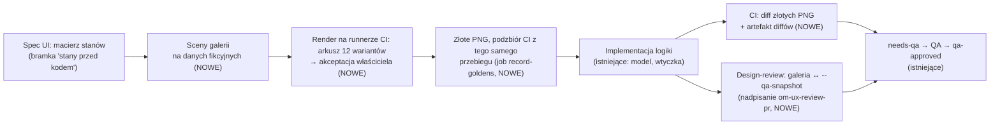

# Natywna galeria SwiftUI jako źródło prawdy UI, ze snapshotami w CI

Status: propozycja (spec, design-only). Decyzja właściciela 2026-11-23: bez Figma; źródłem prawdy UI przestaje być prototyp HTML.
Wejścia: raport przyczyn rund QA (`report-ui-rootcause.md`, sesja 2026-11-23), ocena Figma (`report-figma-eval.md`, ta sama sesja), `docs/qa.md`, `SDLC.md`, `.uxproof/`.

## 📝 TLDR

Dziś agent przepisuje ekran z prototypu HTML na SwiftUI, a różnice (zgrupowany `Form`, popovery, Liquid Glass, XL, polskie teksty) wychodzą dopiero na zrzutach w QA. To ok. 47% defektów UI i większość rund QA od 2026-11-01. Proponujemy, żeby źródłem prawdy była **galeria w aplikacji DEBUG** (`--qa-gallery`). Renderuje ona każdy ekran i stan z prawdziwych widoków `LintelUI` i wtyczek na danych fikcyjnych, w macierzy light/dark × S/M/XL × en/pl. Właściciel akceptuje **zrzuty z galerii**, a CI pilnuje ich złotymi PNG z progiem różnicy i obrazami diffu w artefaktach. Do tego dochodzą bramka „stany przed kodem”, `.uxproof/tokens.json` generowany ze Swifta z testem dryfu i agent design-review przed `needs-qa`. Pilotem jest wybór dostawcy notatek z PR #215.

## Resolved assumptions (autonomous defaults)

Spec był pisany w trybie autonomicznym. Poniższe odpowiedzi są domyślne, odwracalne i do nadpisania przed merge. Żadna nie osłabia bezpieczeństwa ani kontraktu z `BACKWARD_COMPATIBILITY.md`.

| # | Pytanie | Przyjęta odpowiedź | Dlaczego |
|---|---|---|---|
| Q1 | Jeden spec czy kilka (galeria, snapshoty w CI, tokeny, agent design-review, zmiana procesu działają osobno)? | Jeden spec, pięć faz, **każda faza osobnym PR-em** (zgodnie z `AGENTS.md`: „each spec phase ships on its own feat/ branch”). | Części mają jedno źródło (scena galerii) i bez niego nie mają sensu. Podział na fazy daje te same niezależne wdrożenia bez pięciu dokumentów. |
| Q2 | Galeria jako nowy target wykonywalny czy tryb `--qa` aplikacji? | Tryb **`--qa-gallery`** w `LintelApp` plus sceny w samych wtyczkach (`#if DEBUG`). Bez nowego targetu i bez nowej krawędzi między targetami produktu w `Package.swift`. Faza 1 zmienia manifest tylko w targecie testów: `MeetingsPluginTests` dostaje zależność `"LintelUI"` (dziś jej nie ma, a test woła `GalleryRenderer`) i deklarację katalogu `Gallery/Goldens` (`resources: [.copy(...)]` obok `Fixtures`, inaczej SwiftPM zgłasza nieobsłużone pliki PNG). | Nowy target musiałby importować wszystkie wtyczki, a dziś robi to tylko `LintelApp` (i tylko w `PluginRegistry`). Tryb QA korzysta z istniejącej izolacji (`QAOptions`, `QAIdentityGuard`) i znika w buildzie release. |
| Q3 | Gdzie powstają złote PNG: lokalnie czy w CI? | **Na runnerze CI** (`xcode-27`), przez ręcznie uruchamiany job `record-goldens`. Lokalne porównanie liczy się tylko przy zgodnym odcisku renderera, w przeciwnym razie test jest pomijany z komunikatem. | Renderowanie tekstu zależy od wersji systemu i fontów. Złote obrazy z Maca dewelopera dawałyby fałszywe czerwone testy w CI. |
| Q4 | Pełna macierz (12 wariantów na stan) w CI? | **Nie.** CI porównuje 3 warianty na stan: light·M·en, dark·M·en, light·XL·pl. Pełna macierz idzie do akceptacji właściciela jako eksport (artefakt), bez commitu. | Koszt CI i rozmiar repo. light·XL·pl łapie zawijanie i długie polskie teksty (#236, #52), dark łapie kolory. |
| Q5 | Git LFS dla PNG? | **Nie** na start. Zwykłe PNG w git, budżet 25 MB na katalog złotych obrazów, sprawdzany testem. Po przekroczeniu wracamy do decyzji. | LFS na GitHubie ma limity transferu i komplikuje klonowanie (już jest submoduł). Pilot to ok. 70 plików. |
| Q6 | Próg diffu? | Piksel różni się, gdy dowolny kanał RGBA różni się o więcej niż 3/255. Test pada, gdy różni się **> 0,1% pikseli** albo gdy rozmiar obrazu jest inny. | Tolerancja antyaliasingu bez przepuszczania zmiany odstępu o 1 pt (zmienia ona cały pas pikseli). Próg leży w jednym miejscu i łatwo go zmienić. |
| Q7 | Jak właściciel akceptuje zrzuty? | **Bez nowej etykiety.** PR zmieniający złote PNG ma `needs-qa`. Właściciel daje `qa-approved` z liniami `Gallery head: <sha>` i `Gallery run: <run id>` obok `QA head:`. Agent nie nagrywa złotych obrazów od nowa po to, żeby test przeszedł, bez sekcji „Golden changes” w PR. | Wykorzystuje istniejącą bramkę QA (`SDLC.md`) i nie zmienia taksonomii etykiet w `.ai/agentic.config.json`. |
| Q8 | Agent design-review: nowy skill czy nadpisanie istniejącego? | Repo-lokalne nadpisanie **`.ai/skills/om-ux-review-pr/SKILL.md`**: wejściem są pary galeria ↔ aplikacja, a różnice oznaczone „blokuje” wstrzymują `needs-qa`. | `SDLC.md` już przewiduje repo-lokalne nadpisania skilli. Nie instalujemy nic nowego. |
| Q9 | Co z prototypem HTML (`.ai/prototypes/lintel-app/`) i makietami per spec? | **Zamrożone jako historyczne**, z oznaczeniem „superseded by the gallery” w README. Nie usuwamy ich. HTML zostaje tylko do szkicu nowego kierunku i jest porzucany po akceptacji galerii. | Odwracalne. Usunięcie zniszczyłoby kontekst starszych PR-ów. |
| Q10 | Zakres pilota? | Tylko „Notes are written by” (Settings → Meetings) ze wszystkimi stanami z `qaProviderStatus`/`qaProviderScenario` oraz dwoma popoverami. HUD-y i reszta ekranów to faza 5, ekran po ekranie. | Najwięcej rund QA (3) i popovery, których dziś nie widać w `--qa-snapshot`. Najmniejszy zakres, który sprawdza cały mechanizm. |
| Q11 | Jak CI sprawdza wariant `light-xl-pl`? (dodane w recenzji R1, 2026-11-25) | **Z pakietu aplikacji, w osobnym procesie z `-AppleLanguages "(pl)"`.** Warianty `en` porównuje `swift test` (`GallerySnapshotTests`). Wariant `pl` porównuje krok CI „Gallery snapshots (pl)”: `CONFIGURATION=debug scripts/make-app.sh`, potem `Lintel.app/Contents/MacOS/Lintel --qa --qa-gallery-compare <katalog złotych PNG> --qa-gallery-language pl -AppleLanguages "(pl)"`, tym samym `GalleryRenderer` i `GalleryDiff`. Kod wyjścia ≠ 0 przy różnicy, `actual.png`/`diff.png` do `$LINTEL_SNAPSHOT_ARTIFACTS`. Złote PNG `pl` nagrywa ten sam mechanizm (`--qa-gallery-record`). Właściciel może to zmienić. | 330 wywołań `String(localized:)` w `Sources` nie ma `bundle:` ani `locale:`. Czytają `Bundle.main` i języki procesu, a `\.locale` pomijają. W `swift test` `Bundle.main` to runner testów bez `.lproj`. Odrzucone: podmiana `Bundle.main` w testach (`String(localized:)` i `Text` szukają tekstu przez wewnętrzne ścieżki Foundation/CFBundle, więc podmiana jest krucha i niewidoczna przy błędzie) oraz brak `pl` w CI (#236 i #52 to właśnie zawijanie polskich tekstów). Język jako oś procesu to praktyka z `docs/qa.md` (`-AppleLanguages "(pl)"` z pakietu aplikacji). |

## ❓ Open questions for the owner

| # | Pytanie | Propozycja | Status |
|---|---|---|---|
| OQ1 | Czy design-review (`om-ux-review-pr`) ma **blokować** `needs-qa`? Dziś `SDLC.md` (po #245) mówi, że ten przegląd „is advisory … does not hold the merge”. `SDLC.md` i nadpisania w `.ai/skills/` utrzymuje właściciel. | Faza 3 zmienia status na blokujący (różnica `blocks: yes` wstrzymuje `needs-qa`) i dopisuje to do `SDLC.md` razem z nadpisaniem `.ai/skills/om-ux-review-pr/SKILL.md`. | **Otwarte. Faza 3 nie startuje bez zgody właściciela na tę zmianę**, wyrażonej na tym PR-ze albo na PR-ze fazy 3. Fazy 1, 2 i 4 od tego nie zależą. |

## 📝 Problem Statement

Fakty z raportu przyczyn (PR-y z `needs-qa`/`qa-approved` od 2026-11-01, ok. 90 defektów sklasyfikowanych ręcznie):

- **ok. 47% defektów UI to rozjazd HTML ↔ SwiftUI**: niezgodność z prototypem (~28%), brak stanu w prototypie (~11%), natywność (~8%). Zwykły polish to tylko ~13%.
- Trzy klasy różnic są **nieusuwalne** przy HTML jako źródle: system rysuje zgrupowany `Form` po swojemu, glass, SF Symbols i natywne arkusze/popovery są w HTML-u tylko udawane, a S/M/XL to w prototypie skala CSS, a w aplikacji `dynamicTypeSize` (`TextSize.scale` 0,9/1/1,15/1,3).
- Prototyp `lintel-app/index.html` jest zamrożony od 2026-11-04 (48 figur). Nie ma w nim wyboru dostawcy, słownika, Updates, Windows ani większości stanów HUD. Makiety per spec (`.ai/specs/assets/*/index.html`) mają własne decyzje i nikt ich nie scala.
- `--qa-snapshot` (`cacheDisplay`) nie rysuje arkuszy, popoverów ani materiału glass (`docs/qa.md`, wiersze `--qa-hud`, `qaProviderScenario=menu`). 76 sekcji „NOT CHECKED” w 23 PR-ach.
- `.uxproof` nie jest kontraktem: `contract.json` wskazuje `Sources/LintelApp/Panel/TextSize.swift` (dziś `Sources/LintelUI/TextSize.swift`) i ma `fileCount: 0`. `tokens.json` ma 12 tokenów ze źródłem `"design"`, którego nie ma w kodzie.
- Porównanie „1:1 z prototypem” robi ten sam agent, na oko, bez diffu i bez progu. Różnice trafiają do właściciela jako lista „do akceptacji”.
- **#215 (pilot)**: 3 rundy. 6 tekstów spoza makiety v2, chip jako zwykły tekst zamiast pigułki, przycisk Use Local wypełniony zamiast obrysowanego, a popovery nie trafiają do snapshotu.

## 📝 Cel i nie-cele

**Cele**
1. Jedno źródło prawdy UI w repozytorium, renderowane tym samym kodem co produkt.
2. Każdy stan ekranu można wymusić i sfotografować bez mikrofonu, modelu, sieci ani uprawnień TCC.
3. Regresja layoutu, koloru, zawijania albo XL daje czerwony test z obrazem różnicy, zanim zobaczy ją człowiek.
4. Arkusze, popovery i HUD-y mają tryb renderu na nieprzezroczystym tle.
5. Tokeny w `.uxproof/tokens.json` pochodzą ze Swifta, a test łapie dryf.
6. Zmiana procesu: „stany przed kodem”, design-review przed `needs-qa` oraz reguła „1:1 z zaakceptowanymi snapshotami galerii”.

**Nie-cele**
- Figma, Code Connect ani sync tokenów do narzędzi projektowych (decyzja właściciela 2026-11-23).
- Wierne snapshoty Liquid Glass. Materiału nie da się narysować przez `cacheDisplay`, więc glass ocenia się na żywo, a snapshot pokazuje układ na tle.
- Testy VoiceOver i UI-testy XCUITest. Zostają manualne (`docs/qa.md`).
- Biblioteka snapshotów od stron trzecich. Mechanizm ma ok. 300 linii i używa tylko AppKit i CoreGraphics.
- Przepisanie wszystkich ekranów do galerii w tym specu. Faza 5 tylko opisuje kolejność.

## 📝 Proposed Solution

### Przepływ pracy nad UI (po wdrożeniu)



Najważniejsze: właściciel akceptuje obraz wyrenderowany tym samym kodem SwiftUI, który trafi do produktu, zanim powstanie logika. Galeria i aplikacja mogą się jeszcze różnić w podłączeniu (dane, kontener, rozmiar okna). To łapie design-review, a nie test pikseli.

### Rozważone alternatywy

| Opcja | Dlaczego odrzucona |
|---|---|
| Status quo (HTML) | Trzy nieusuwalne klasy różnic, prototyp się starzeje, ~47% defektów. |
| Figma jako źródło | Ocena 2026-11-23: MCP zwraca React plus screenshot, skill SwiftUI jest pod iOS, Code Connect wymaga planu Organization, glass jest przybliżony, to trzecia kopia UI dla solo deva. Decyzja właściciela: nie. |
| `#Preview` w Xcode | Projekt jest czysto SwiftPM (0 `#Preview` w `Sources`). Podglądu nie da się uruchomić w CI ani wyeksportować do PNG bez Xcode, a stanów nie ma jak wymusić spoza IDE. |
| Biblioteka (np. swift-snapshot-testing) | Nowa zależność wymaga uzasadnienia i licencji. Na macOS i tak trzeba własnego hosta (`NSHostingView` plus `cacheDisplay`), bo `ImageRenderer` nie rysuje kontrolek AppKit (`Form`, `Toggle`, `TextField`). Własny kod jest mały i pasuje do istniejącego `SnapshotBackdropHostingView`. |
| `ImageRenderer` | Nie rysuje widoków opartych na AppKit (zgrupowany `Form`, pola, przełączniki). Dziś testy (`MeetingsPaneTests`) sprawdzają tylko, że obraz nie jest `nil`. |

### Wzorce rynkowe

- **Point-Free swift-snapshot-testing / iOSSnapshotTestCase (Uber)**: złote obrazy obok testów, tryb nagrywania przez zmienną środowiskową, tolerancja per piksel, obraz różnicy przy porażce. Bierzemy te same zasady, bez zależności.
- **Storybook / Chromatic (web)**: katalog stanów komponentu jako źródło prawdy, akceptacja zmian wizualnych przez człowieka w PR. Odpowiednik u nas: `--qa-gallery` i eksport macierzy do akceptacji.
- **Pomijamy** wielourządzeniowe macierze iOS (rozmiary ekranów). Nasze osie to motyw, rozmiar tekstu i język.

## 📝 Architecture

### Zasady stałe

- Wszystko, co dotyczy galerii w kodzie produkcyjnym, jest w `#if DEBUG`. Build release nie zawiera scen, danych fikcyjnych ani renderera.
- **Graf zależności się nie zmienia.** `LintelUI` nie importuje wtyczek, wtyczki nie importują `LintelApp`, a `LintelTestSupport` nie zależy od żadnego targetu repozytorium.
- Sceny używają **prawdziwych widoków i modeli** wtyczki. Scena nie ma własnej kopii widoku. Gdy widoku nie da się zbudować z danych fikcyjnych, poprawia się widok (wstrzyknięcie zależności), a nie scenę.
- Scena nie uruchamia procesu, sieci, mikrofonu, Core Audio, Keychaina ani pliku poza katalogiem tymczasowym. To ten sam warunek, którego w testach pilnuje `MeetingsSystem.quiet` (`Tests/MeetingsPluginTests/Support/QuietSystem.swift`, kod tylko testowy). Sceny z niego nie korzystają, bo w ogóle nie budują `MeetingsSystem`, `MeetingsLibrary` ani `NotesService` (patrz `ProviderNotesControl`). Kod scen w `Sources/` nie importuje kodu testów ani `LintelApp`.
- Dane fikcyjne bez danych właściciela: bez nazwy konta, ścieżek z katalogu domowego i nazwy hosta (reguła „QA identity” z `docs/qa.md`).

### Komponenty

| Komponent | Gdzie | Stan | Rola |
|---|---|---|---|
| `GalleryScene`, `GalleryState`, `GalleryVariant`, `GalleryPresentation` | `Sources/LintelUI/Gallery/` (`#if DEBUG`) | nowe | Kontrakt in-tree: scena = id, tytuł, lista stanów. Stan = id, opis, `presentation`, `make: @MainActor () -> AnyView`. Wariant = `appearance × TextSize × locale`. |
| `GalleryProviding` | `Sources/LintelUI/Gallery/` (`#if DEBUG`) | nowe | `static var galleryScenes: [GalleryScene]`. Typ wtyczki deklaruje zgodność w swoim targecie (`extension MeetingsPlugin: GalleryProviding`). |
| `GalleryRenderer` | `Sources/LintelUI/Gallery/` (`#if DEBUG`) | nowe | Renderuje stan w wariancie do `NSBitmapImageRep`: niewidoczne `NSWindow` (borderless, poza ekranem, `appearance` z wariantu, skala 2×), `NSHostingView` z `.lintelTextSize`, `.environment(\.locale)` równym językowi procesu (teksty idą z języka procesu, patrz „Język” w API Contracts), czeka na układ, potem `cacheDisplay`. |
| Tryby prezentacji | `GalleryPresentation` | nowe | `.window(width:height:)` (pane w kontenerze o szerokości `SettingsLayout`, `height: nil` = wysokość dopasowana), `.sheet(width:)`, `.popover(width:)`, `.hud(shape:)` (sygnatury jak w API Contracts). Arkusz, popover i HUD renderują swoją treść w `SnapshotBackdropHostingView` (istnieje, PR #237) na nieprzezroczystym tle `LintelBrand.windowBackgroundColor`. Popover ma obrys i strzałkę narysowane przez renderer (przybliżenie chrome'u, opisane w podpisie). |
| `GalleryDiff` | `Sources/LintelUI/Gallery/` (`#if DEBUG`) | nowe | Czysta funkcja: dwa bitmapy → liczba i udział różnych pikseli (próg 3/255 na kanał) plus obraz diffu (zmienione piksele na czerwono na wyblakłym oryginale). Bez I/O, testowana na syntetycznych bitmapach. |
| `GalleryFingerprint` | jw. | nowe | Odcisk renderera: wersja macOS (build), build Xcode/SDK (z `xcodebuild -version`, przekazany przez `LINTEL_GALLERY_XCODE`; nowy SDK może zmienić układ SwiftUI przez zachowania „linked on or after”, a `ci.yml` używa `setup-xcode` z `latest-stable`), skala, wersja `GalleryRenderer`. Zapisany w `goldens.json` obok PNG. Bez `LINTEL_GALLERY_XCODE` porównanie jest pomijane z komunikatem. |
| `GalleryWindowController` (`--qa-gallery`) | `Sources/LintelApp/QA/` (`#if DEBUG`) | nowe | Okno z listą scen ze wszystkich `PluginRegistry.all` zgodnych z `GalleryProviding` plus scen powłoki (`LintelApp`), siatką wariantów i przełącznikami motywu, rozmiaru i języka. **Bez nowego miejsca, które zna konkretne wtyczki**: iteruje `PluginRegistry.all.compactMap { $0 as? any GalleryProviding.Type }`. |
| `--qa-gallery-export <dir>` | `QAOptions` (`#if DEBUG`) | nowe | Renderuje warianty pełnej macierzy **w języku procesu** (opcjonalnie `--qa-gallery-scene <id>`) do `<dir>/<scene>/<state>/<variant>.png`. Kończy proces po eksporcie. Pełną macierz (oba języki, 12 wariantów) i `index.html` (statyczny arkusz kontaktowy bez zewnętrznych zasobów) składa `scripts/gallery-export.sh <dir>`: uruchamia pakiet aplikacji dwa razy, z `-AppleLanguages "(en)"` i `"(pl)"`. Ten sam parser przyjmuje `--qa-gallery-compare <dir>` / `--qa-gallery-record <dir>` z `--qa-gallery-language <en|pl>` (Q11). |
| `scripts/gallery-export.sh` | `scripts/` | nowe | Buduje pakiet DEBUG (`CONFIGURATION=debug scripts/make-app.sh`), eksportuje en i pl w dwóch procesach i składa `index.html`. Używany lokalnie i w `gallery-goldens.yml`. |
| `MeetingsPlugin+Gallery.swift` (pilot) | `Sources/MeetingsPlugin/UI/` (`#if DEBUG`) | nowe | Sceny „Notes are written by”. `ProviderChoiceModel` z fałszywymi `probe`/`tryOut` (już wstrzykiwane w `init`), `GalleryNotesControl` zamiast `NotesService` i `MeetingsSettings` nad `GallerySettingsStore`. Stany z istniejących `qaProviderStatus`/`qaProviderScenario`. |
| `ProviderNotesControl` | `Sources/MeetingsPlugin/Notes/ProviderNotesControl.swift` | nowe (port) | `@MainActor protocol ProviderNotesControl: AnyObject { var board: NotesBoard { get }; func refreshAvailability() async; func selectionChanged(); func regenerate(_ meetingID: Int64); func writeOnThisMac(_ meetingID: Int64) }`. To dokładnie te wywołania, których `ProviderChoiceModel` dziś używa z `NotesService` (`ProviderChoiceModel.swift`, `service.…`). `extension NotesService: ProviderNotesControl {}` bez zmiany zachowania. `ProviderChoiceModel.init(settings:service:…)` przyjmuje `any ProviderNotesControl`. Kod produkcyjny przekazuje `NotesService` jak dziś, a testy (`ProviderChoiceRig`) bez zmian. Nie w `#if DEBUG`, bo to typ produkcyjny. Moduł wewnętrzny wtyczki, nie kontrakt `LintelKit`. |
| `GalleryNotesControl` | `Sources/MeetingsPlugin/UI/Gallery/GalleryNotesControl.swift` (`#if DEBUG`) | nowe | Fałszywa implementacja portu: trzyma prawdziwy `NotesBoard()` (klasa `Sendable` bez I/O z `NotesService.swift`), stan ustawiany przez scenę (`jobRunning`, `providerFailure`), pozostałe metody tylko liczą wywołania. Bez bazy, Keychaina, LLM i procesu. |
| `GallerySettingsStore` | `Sources/LintelUI/Gallery/GallerySettingsStore.swift` (`#if DEBUG`) | nowe | `public final class GallerySettingsStore: SettingsStore` (protokół z `LintelKit/Ports.swift`) nad słownikiem w pamięci, bez I/O. Leży w `LintelUI`, bo sceny wtyczek i powłoki już go importują. `InMemorySettingsStore` (`Sources/LintelApp/Ports/SettingsStores.swift`) jest w `LintelApp`, którego wtyczki nie importują. `LintelKit` zostaje kontraktem bez implementacji. |
| `ChoiceMenuList` | `Sources/MeetingsPlugin/Notes/ProviderChoiceViews.swift` | zmiana | Treść popovera (`ChoiceMenuButton.menu`, dziś `private`) wydzielona do własnego widoku, żeby galeria renderowała ją w trybie `.popover`. Zachowanie się nie zmienia. |
| `GallerySnapshotTests` | `Tests/<Target>Tests/Gallery/` | nowe | Per target testów wtyczki (`MeetingsPluginTests` dla pilota) i `LintelAppTests` dla powłoki. Dla każdego stanu i wariantu z podzbioru CI: render, porównanie ze złotym PNG, przy porażce zapis `actual.png` i `diff.png` do `$LINTEL_SNAPSHOT_ARTIFACTS`. |
| Złote PNG | `Tests/<Target>Tests/Gallery/Goldens/<scene>/<state>@<variant>.png` + `goldens.json` | nowe | Odcisk, data, próg i lista plików. Test `GoldenBudgetTests` pilnuje budżetu 25 MB i braku osieroconych plików. |
| `DesignTokens` + `DesignTokensTests` | `Sources/LintelUI/Brand/DesignTokens.swift`, `Tests/LintelUITests/` | nowe | Jedna lista tokenów zbudowana z `BrandPalette` (hex light/dark, alfy), `TextSize.scale`, `SettingsLayout` i `WelcomeLayout`. Test porównuje ją z `.uxproof/tokens.json` (dryf = czerwony test z poleceniem regeneracji). `LINTEL_WRITE_TOKENS=1` zapisuje plik. |
| `.uxproof/contract.json` | `.uxproof/` | zmiana | Poprawne ścieżki (`Sources/LintelUI/...`), `LintelUI` jako korzeń komponentów, odnośnik do galerii jako źródła prawdy. Znikają tokeny `"design"` bez źródła w kodzie. |
| CI: krok „Gallery snapshots” | `.github/workflows/ci.yml` | zmiana | **Bezpośrednio** po kroku „Test”, przed krokami TSan (`--sanitize=thread` buduje z innymi flagami, więc krok po nich przebudowałby wszystko), `scripts/test-with-watchdog.sh … -- swift test --filter GallerySnapshotTests` z `LINTEL_SNAPSHOTS=compare`, bez przebudowy (ten sam build). `timeout-minutes: 4`, `upload-artifact` z diffami tylko przy porażce. Porównuje warianty `en`. |
| CI: krok „Gallery snapshots (pl)” | `.github/workflows/ci.yml` | zmiana | Zaraz po „Gallery snapshots”, nadal przed TSan: `CONFIGURATION=debug scripts/make-app.sh`, potem porównanie `light-xl-pl` z pakietu aplikacji (Q11). `timeout-minutes: 6`, czas mierzy faza 1 (cel ≤ 3 min, bo build `swift build` jest już gotowy). Artefakt `gallery-diffs` wspólny z krokiem en. |
| CI: job `record-goldens` | `.github/workflows/gallery-goldens.yml` | nowe | Tylko `workflow_dispatch` na wskazanej gałęzi, bez sekretów. Na runnerze renderuje **pełną macierz** zmienionych scen (arkusz `index.html` do akceptacji) i z tego samego przebiegu złote PNG podzbioru CI. Każdy obraz powstaje mechanizmem, który go potem porównuje: `en` przez `LINTEL_SNAPSHOTS=record swift test`, `pl` przez `scripts/gallery-export.sh` i `--qa-gallery-record` z pakietu aplikacji (Q11). Ustawia `LINTEL_GALLERY_XCODE`. Jeden artefakt `gallery-record-<run id>` z obiema częściami; agent albo człowiek commituje złote PNG z niego na tę gałąź. Job nigdy sam nie pushuje. |
| Nadpisanie `om-ux-review-pr` | `.ai/skills/om-ux-review-pr/SKILL.md` | nowe | Wejście: pary (stan z galerii, `--qa-snapshot` aplikacji w tym samym stanie) plus checklista HIG/LintelUI. Wyjście: lista różnic z flagą `blocks`. Uruchamiane przez autora w osobnym kontekście, przed `needs-qa`. |
| `docs/design-gallery.md` | `docs/` | nowe | Jak dodać scenę, jak eksportować, jak nagrać złote obrazy, czego snapshot nie pokazuje (glass, ciemny HUD). |
| `SDLC.md`, `docs/qa.md`, `AGENTS.md`, `CODE_REVIEW.md` | repo | zmiana | Bramka „stany przed kodem”, krok design-review, reguła 1:1 z galerią, nowe argumenty QA, wiersz w tabeli „Task routing”. |

### Punkty styku z istniejącym kodem (`origin/main`, 2026-11-23)

- `Sources/LintelUI/QA/SnapshotBackdropHostingView.swift`: nieprzezroczyste tło przycięte do kształtu HUD-a. Renderer go używa i nie tworzy drugiego.
- `Sources/LintelApp/QA/QAOptions.swift`: parser `--qa…`. Nieznany argument zatrzymuje start, więc nowe argumenty trzeba tam dopisać.
- `Sources/MeetingsPlugin/Notes/ProviderChoiceModel.swift`: `init` przyjmuje już `probe`, `tryOut`, `openURL`, `copyText`, `chooseFile`, `now` i `lastMarked`, Wymaga też konkretnego `NotesService`, a test buduje go przez `NotesServiceRig` (`MeetingsHarness`, `MeetingsLibrary` z SQLCipher i fałszywym Keychainem, `ScriptedLLM`, `MemorySettingsStore`). Wszystko to jest kod tylko testowy, więc **nie** przenosimy go do `Sources/`. Faza 1 wprowadza port `ProviderNotesControl` (sześć wywołań, których model używa), a scena podaje `GalleryNotesControl`. `MeetingsSettings(_:physicalMemory:)` scena buduje nad `GallerySettingsStore` z `LintelUI`. `ProviderChoiceSupport.swift` zostaje w testach bez zmian.
- `Sources/MeetingsPlugin/Notes/ProviderChoiceViews.swift`: `NotesWrittenByRows`, `NotesWrittenByNotices`, `ProviderDetailsList`, `ChoiceMenuButton`. `openForQA` (otwiera popover po 1,5 s) zostaje dla `--qa` aplikacji. Galeria go nie potrzebuje.
- `Sources/LintelUI/TextSize.swift` (`scale` 0,9/1/1,15/1,3), `Sources/LintelUI/Brand/LintelBrand.swift` (`BrandPalette`), `Sources/LintelUI/SettingsLayout.swift`: źródła tokenów.
- `.github/workflows/ci.yml`: job ma `timeout-minutes: 60`, krok „Test” 16 min. Ostatnie zielone przebiegi na `main` trwały 23–26 min (2026-11-21).

## 📝 Data Model

Bez baz danych i bez kluczy ustawień. Jedyne nowe pliki:

- `goldens.json` (per target testów): `{ "version": 1, "fingerprint": { "os": "27.0 (…)", "xcode": "27.0 (…)", "scale": 2, "renderer": 1 }, "recordRun": "<id przebiegu gallery-goldens.yml>", "threshold": { "channel": 3, "share": 0.001 }, "files": { "<scene>/<state>@<variant>.png": { "width": …, "height": …, "sha256": "…" } } }`. `recordRun` wskazuje przebieg, którego arkusz właściciel zaakceptował.
- `.uxproof/tokens.json`: ten sam format co dziś (`name`, `value`, `kind`, `source`). `source` to zawsze ścieżka pliku Swift, nigdy `"design"`. Kolory jako `{ "light": "#267C6C", "dark": "#6BBDAB" }` (plus `alpha` tam, gdzie paleta ją ma). Plik jest generowany, ręczna edycja kończy się czerwonym testem.
- Nazwa wariantu: `<light|dark>-<s|m|l|xl>-<en|pl>`, np. `dark-m-en`. Podzbiór CI: `light-m-en`, `dark-m-en`, `light-xl-pl`. Pełna macierz pomija `l` (skala 1,15 leży między M i XL, a XL wyznacza górną granicę zawijania), stąd 2 × 3 × 2 = 12. Nazwa `l` zostaje w formacie, żeby scena mogła ją dodać jawnie.

Żaden z tych plików nie jest chronionym kontraktem (`BACKWARD_COMPATIBILITY.md`). Klucze QA (`--qa-gallery`, `--qa-gallery-export`, `--qa-gallery-scene`) są tylko w DEBUG i nie są kontraktem, tak samo jak pozostałe `--qa…`.

## 📝 API Contracts (in-tree, DEBUG)

```swift
#if DEBUG
public struct GalleryVariant: Hashable, Sendable {
    public enum Appearance: String, CaseIterable, Sendable { case light, dark }
    public var appearance: Appearance
    public var textSize: TextSize
    public var language: String          // "en" | "pl"
    public static let ciSubset: [GalleryVariant]   // light-m-en, dark-m-en, light-xl-pl
    public static let fullMatrix: [GalleryVariant] // 2 × {s, m, xl} × 2 = 12
}

public enum GalleryPresentation: Sendable {
    case window(width: CGFloat, height: CGFloat? = nil)  // nil = fitting height
    case sheet(width: CGFloat)
    case popover(width: CGFloat)
    case hud(shape: GalleryHUDShape)                     // .capsule | .rounded(radius:)
}

public struct GalleryState: Identifiable, Sendable {
    public let id: String                 // kebab-case, stable: the golden file name
    public let summary: String            // what the owner approves, English
    public let presentation: GalleryPresentation
    public let variants: [GalleryVariant] // default .ciSubset for tests; export always uses .fullMatrix
    public let make: @MainActor @Sendable () -> AnyView
}

public struct GalleryScene: Identifiable, Sendable {
    public let id: String                 // "meetings.notes-provider"
    public let title: String
    public let states: [GalleryState]
}

public protocol GalleryProviding { @MainActor static var galleryScenes: [GalleryScene] { get } }

@MainActor public enum GalleryRenderer {
    public static func render(_ state: GalleryState, _ variant: GalleryVariant) async throws -> NSBitmapImageRep
}

public enum GalleryDiff {
    public struct Result: Sendable { public let differingShare: Double; public let sizeMatches: Bool }
    public static func compare(_ a: NSBitmapImageRep, _ b: NSBitmapImageRep, channelTolerance: UInt8)
        -> (Result, diffImage: NSBitmapImageRep?)
}
#endif
```

Zasady walidacji: `GalleryState.id` i `GalleryScene.id` pasują do `^[a-z0-9.-]+$` i są unikalne (test). Każdy stan ma niepusty `summary`. Render, który po 2 s nadal ma zerowy rozmiar, zgłasza `GalleryError.emptyRender` zamiast pustego PNG.

Język jest **osią procesu, nie środowiska widoku**. Większość tekstów to `String(localized:)` bez `bundle:` i `locale:` (330 wywołań w `Sources`). Czytają one `Bundle.main` i języki procesu, a `\.locale` pomijają. Renderer renderuje więc tylko warianty w języku procesu (`Bundle.main.preferredLocalizations.first`). Dla zgodności formatów ustawia też `\.locale` na ten sam język, ale nie przełącza nim tekstów. Wariant w innym języku kończy się `GalleryError.languageMismatch` zamiast obrazu z połową tłumaczeń. W `swift test` `Bundle.main` to runner testów bez skompilowanego katalogu (`AGENTS.md`: „`swift run` shows English”), więc tam są tylko warianty `en`. Klucze są angielskim tekstem źródłowym, więc `en` jest wierny. Warianty `pl` renderuje pakiet aplikacji z `-AppleLanguages "(pl)"`, tak jak dziś w `docs/qa.md`: lokalnie `scripts/gallery-export.sh`, w CI krok „Gallery snapshots (pl)” (Q11).

## 📝 UI/UX

### Okno galerii (`--qa-gallery`, DEBUG, narzędzie dewelopera)

- Pasek boczny: sceny pogrupowane po wtyczce (powłoka, Meetings, …), z liczbą stanów.
- Treść: stan po stanie, z podpisem (`summary`) i siatką wybranych wariantów (domyślnie podzbiór CI, przełącznik „Full matrix”).
- Pasek narzędzi: motyw, rozmiar tekstu i język dla podglądu na żywo (prawdziwy `NSHostingView`, nie PNG), żeby właściciel zobaczył też glass na żywo.
- Okno używa `LintelBrand` i `SettingsLayout`. Nie jest produktem i nie jest tłumaczone (en), ale sceny w nim są tłumaczone.

### Akceptacja przez właściciela

1. Autor dodaje albo zmienia sceny i iteruje lokalnie (`--qa-gallery`, `--qa-gallery-export`). Lokalny eksport jest roboczy: inny build systemu renderuje tekst inaczej niż runner.
2. Gdy sceny są gotowe, autor uruchamia `gallery-goldens.yml` na gałęzi PR-a i linkuje w PR artefakt `gallery-record-<run id>` (arkusz pełnej macierzy plus złote PNG z **tego samego renderu**).
3. Właściciel ogląda arkusz z artefaktu i daje `qa-approved` z `Gallery head: <sha>` oraz `Gallery run: <run id>` albo prosi o zmiany.
4. Złote PNG z tego artefaktu trafiają do tego samego PR-a, z `recordRun` w `goldens.json`. Taki commit dotyka tylko `Tests/` i nie unieważnia akceptacji na zasadach wyjątku dla commitów tylko z testami z `SDLC.md` (reguła właściciela z 2026-11-20: dowód niezmienionego kodu aplikacji, niezależny recenzent Opus, zielone CI), z dodatkowym warunkiem: `sha256` w `goldens.json` zgadzają się z plikami artefaktu zaakceptowanego przebiegu (sprawdza to recenzent w sekcji „Golden changes”). Każdy inny commit po akceptacji podlega zwykłym regułom bramki QA. Od tej chwili zaakceptowane snapshoty są referencją 1:1.

### Pilot: Settings → Meetings → „Notes are written by”

Stany (id = nazwa pliku), każdy z istniejących kluczy QA:

| Id stanu | Odpowiednik dziś | Prezentacja |
|---|---|---|
| `local` | Local, notatki włączone | window |
| `local-notes-off` | Local, notatki wyłączone (sekcja ukryta zgodnie z `surfacesProvider`) | window |
| `ready-sonnet` / `ready-opus` | `qaProviderStatus=ready`, model sonnet/opus | window |
| `not-installed`, `not-signed-in`, `incompatible-version`, `newer-version` | `qaProviderStatus=…` | window |
| `checking` | sprawdzanie w toku | window |
| `job-running` | `qaProviderScenario=running` | window |
| `confirm-use-local` | `confirm` | window |
| `details-expanded` | `details` | window |
| `earlier-mark` | `earlier` | window |
| `failed-timed-out`, `failed-network`, `failed-rate-limited`, `failed-other`, `failed-too-long`, `failed-model-not-available` | `qaProviderScenario=…` | window |
| `manual-binary` | `notesProviderBinary=/opt/lintel-qa/bin/claude` (Restore Default) | window |
| `try-running`, `try-worked`, `try-failed` | „Test” w toku / zadziałał / błąd | window |
| `provider-menu` | `menu` (dziś niewidoczny w snapshocie) | popover |
| `model-menu` | `modelMenu` | popover |
| `banner-*` | `ProviderStatusBanner` dla każdego powodu błędu | window (sam baner) |

Razem ok. 25 stanów × 3 warianty = ok. 75 złotych PNG w CI. Pełny eksport: ok. 300 PNG do akceptacji, bez commitu.

### Bramka „stany przed kodem”

Spec, który dodaje albo zmienia UI, ma przed fazą implementacji tabelę stanów z co najmniej: **default, empty, loading, error, no permission, long Polish text, XL, dark** oraz stanem nieudanego zapisu, jeśli ekran zapisuje. Brakujący stan trzeba wpisać jako „nie dotyczy, bo …”. Pierwszy krok implementacji każdej takiej fazy to sceny galerii dla tych stanów, eksport i akceptacja właściciela. `om-code-review` (przez `CODE_REVIEW.md`) odrzuca PR z UI, którego stany z tabeli nie mają sceny.

## 📝 Edge Cases & Failure Scenarios

| Sytuacja | Co się dzieje | Co widzi autor |
|---|---|---|
| Runner CI dostał nową wersję macOS (inne fonty) | Odcisk w `goldens.json` ≠ odcisk runnera, więc test **pada** z komunikatem „renderer fingerprint changed: run gallery-goldens.yml”. Nie porównuje pikseli. Krok jest czerwony na **każdym** otwartym PR-ze, dopóki PR z nowym nagraniem nie trafi na `main` (patrz Ryzyka). | Jeden czytelny błąd zamiast 75 diffów. Nagranie od nowa to osobny PR z arkuszem z artefaktu do przejrzenia. |
| Lokalny Mac ma inny build systemu niż CI | Testy galerii są **pomijane** (`.disabled` z powodem) poza `LINTEL_SNAPSHOTS=compare-anyway`. Okno i eksport działają normalnie. | Brak fałszywych czerwonych testów lokalnie. |
| Diff ponad próg | Test pada. `actual.png` i `diff.png` trafiają do `$LINTEL_SNAPSHOT_ARTIFACTS`, a CI wrzuca je jako artefakt `gallery-diffs`. | Obraz różnicy w artefakcie, nazwa stanu i wariantu w błędzie. |
| Scena rzuca albo widok ma zerowy rozmiar | `GalleryError` z id stanu, a test pada. Okno galerii pokazuje kartę błędu zamiast stanu. | Konkretny stan, nie cały zestaw. |
| Scena próbuje dotknąć realnego systemu (proces, Keychain) | Sceny Meetings nie budują `MeetingsSystem`, `MeetingsLibrary` ani `NotesService`, tylko `GalleryNotesControl` i `GallerySettingsStore`. Test `GalleryNoRealSystemTests` (wzorem `NoRealSystemTests`, z `MeetingsSystem.installQuiet()` w teście) renderuje wszystkie sceny i sprawdza, że `MeetingsSystem.liveUses` jest puste. | Czerwony test. |
| Wariant w innym języku niż proces | `GalleryError.languageMismatch` z id stanu i wariantu. `GallerySnapshotTests` pomija warianty `pl` (porównuje je krok „Gallery snapshots (pl)”). | Brak obrazu z połową tłumaczeń. |
| Popover lub arkusz | Renderowana jest treść w trybie `.popover`/`.sheet` na tle, a chrome systemu jest przybliżony. | Podpis stanu mówi „content only; system chrome approximated”. |
| Glass i ciemny HUD | `cacheDisplay` nie rysuje materiału (`docs/qa.md`). Snapshot pokazuje treść na tle. | Podpis „glass not drawn; check live in --qa-gallery”. Pozycja trafia do listy manualnej. |
| Animacje | Renderer wyłącza animacje (`NSAnimationContext` i `Transaction` bez animacji) i czeka na jeden cykl układu. | Deterministyczny obraz. |
| Daty i czas względny („2 min ago”) | Sceny wstrzykują stały `now` (`ProviderChoiceModel.init(now:)`). | Stały tekst. |
| Budżet 25 MB przekroczony | `GoldenBudgetTests` pada. | Decyzja: LFS albo mniej wariantów (Q5). |
| Osierocony złoty PNG (stan usunięty) | `GoldenBudgetTests` pada, z listą plików do usunięcia. | — |
| Ręczna edycja `.uxproof/tokens.json` albo zmiana `BrandPalette` bez regeneracji | `DesignTokensTests` pada z różnicą i poleceniem `LINTEL_WRITE_TOKENS=1 swift test --filter DesignTokensTests`. | — |

## 📝 Risks & Impact Review

- **Czas CI (budżet).** Cel: krok „Gallery snapshots” ≤ 90 s, w tym ≤ 60 s porównań na pilocie. Szacunek dla renderu jednego stanu przez `NSHostingView` plus `cacheDisplay` (50–150 ms) daje ok. 10 s na 75 obrazów, a reszta to start procesu testów bez przebudowy. Faza 1 mierzy czas i zapisuje go w `docs/perf.md`. Twardy limit: `timeout-minutes: 4`. Gdy pełny katalog ekranów przekroczy 3 min, dzielimy go na shardy albo ograniczamy podzbiór (decyzja, a nie domyślne zachowanie). Snapshoty **nie** biegną w głównym `swift test` (są wyłączone bez `LINTEL_SNAPSHOTS`), więc nie wydłużają kroku „Test” (16 min). Nie biegną też pod TSan.
- **Determinizm renderu.** Największe ryzyko techniczne: kursor tekstowy, fokus, tło okna, subpikselowy antyaliasing. Faza 1 ma kryterium wyjścia: ten sam stan wyrenderowany 20 razy w jednym procesie i w 3 osobnych procesach daje 0% różnicy. Jeśli tego nie osiągniemy, próg zostaje, ale spec wraca do właściciela przed fazą 2.
- **Polskie teksty.** Katalog `.xcstrings` kompiluje tylko `scripts/make-app.sh`, a teksty zależą od języka procesu. Dlatego `pl` idzie przez pakiet aplikacji (Q11). Koszt to `make-app.sh` w CI (build `swift build` jest gotowy, zostają kopiowanie zasobów, `xcstringstool` i podpis ad hoc). Faza 1 mierzy go i zapisuje w `docs/perf.md`. Powyżej 3 min właściciel decyduje między tym krokiem a `pl` tylko w arkuszu do akceptacji.
- **Rozmiar repo.** Ok. 75 PNG po 40–80 KB na pilota. Przy 30 ekranach × 10 stanów × 3 warianty to ok. 900 PNG, czyli 50–70 MB w historii przy każdym nagraniu od nowa. Budżet 25 MB na katalog wymusi decyzję (LFS, rzadsze warianty) zanim to nastąpi.
- **Aktualizacja obrazu runnera.** Zmiana odcisku blokuje krok „Gallery snapshots” na wszystkich PR-ach naraz. To świadomy wybór: ciche pominięcie porównania osłabiłoby bramkę bez śladu. Mitigacja: komunikat wskazuje jedną komendę naprawczą, a PR z nowym nagraniem dotyka tylko `Tests/` i nie wymaga zmian w kodzie. Jeśli zdarza się to częściej niż raz w miesiącu, faza 1 dopisuje do `docs/perf.md` decyzję o przypięciu wersji obrazu runnera.
- **Przyzwyczajenie do „record”.** Ryzyko, że agent nagra złote obrazy od nowa, żeby test przeszedł. Mitigacja: zmiana złotych PNG wymaga `needs-qa` i `Gallery head:` (Q7), `CODE_REVIEW.md` każe porównać sekcję „Golden changes” z diffem, a job nagrywający działa tylko ręcznie.
- **Kierunek produktu, nie defekt:** reguła „1:1 z prototypem HTML” (pamięć właściciela 2026-11-05) zmienia się w „1:1 z zaakceptowanymi snapshotami galerii”. To decyzja właściciela z 2026-11-23. Spec ją tylko zapisuje w `SDLC.md` i `CODE_REVIEW.md`.
- **Brak zmian chronionych kontraktów.** `LintelKit`, klucze ustawień, formaty na dysku i graf targetów produktu w `Package.swift` zostają bez zmian. Faza 1 dotyka manifestu tylko w `MeetingsPluginTests` (zależność `LintelUI` i zasoby `Gallery/Goldens`, patrz Q2). `SDLC.md` liczy zmiany grafu w `Package.swift` do `risk-high`, więc PR fazy 1 uzasadnia w opisie wybraną etykietę ryzyka. `GalleryProviding` żyje w `LintelUI` pod `#if DEBUG`, a `LintelUI` nie jest chronionym kontraktem.
- **Wycofanie:** usunięcie kroku z `ci.yml` wyłącza bramkę natychmiast. Kod galerii jest DEBUG-only i nie wpływa na produkt.

## 📋 Phasing

1. **Faza 1: renderer i pilot (dowód determinizmu).** `GalleryScene`/`GalleryRenderer`/`GalleryDiff` w `LintelUI`, sceny „Notes are written by” z popoverami, `--qa-gallery` i eksport, złote PNG pilota, krok CI. Działa sam: CI pilnuje jednego ekranu. **Od merge'a fazy 1 sekcja „Akceptacja przez właściciela” tego speca obowiązuje każdy PR z UI**, w tym fazy UI #253, #254 i #255. Te PR-y wymagają tylko fazy 1. Faza 3 przepisuje ten protokół do `SDLC.md` i `CODE_REVIEW.md`, ale nie jest warunkiem wstępnym.
2. **Faza 2: tokeny i `.uxproof`.** `DesignTokens` z testem dryfu, regeneracja `tokens.json`, poprawka `contract.json`. Niezależne od fazy 1.
3. **Faza 3: proces.** Bramka „stany przed kodem”, nadpisanie `om-ux-review-pr`, reguła 1:1 z galerią, `docs/design-gallery.md`, zamrożenie prototypu HTML. Wymaga fazy 1 (potrzebna jest galeria, do której reguła się odnosi) oraz **zgody właściciela na OQ1** (blokujący design-review). Bez tej zgody faza 3 nie startuje.
4. **Faza 4: HUD-y i arkusze.** Sceny dla HUD dyktowania i spotkania (stany z `--qa-hud`), arkuszy `ConfirmSheet` i usuwania notatek. Wykorzystuje tryby `.hud` i `.sheet`.
5. **Faza 5: pozostałe ekrany (stopniowo).** Każdy ekran dotykany przez nowy PR z UI dostaje sceny w tym PR-ze (zasada skauta). Kolejność według liczby rund QA z raportu: główne okno (#52), Notes (#56), słownik (#157), Windows (#68), Updates (#227/#230).

## 📋 Implementation Plan

### Faza 1: renderer, galeria i pilot

1. **1.1 Kontrakt i diff.** Dodać `Sources/LintelUI/Gallery/` (`#if DEBUG`): `GalleryVariant`, `GalleryPresentation`, `GalleryState`, `GalleryScene`, `GalleryProviding`, `GalleryDiff`. Testy `LintelUITests/GalleryDiffTests`: identyczne bitmapy → 0, przesunięcie o 1 pt → ponad próg, szum ≤ 3/255 → 0, różny rozmiar → `sizeMatches == false`, obraz diffu ma czerwone piksele tylko w zmianach. `PackageGraphTests` dalej zielone.
2. **1.2 Renderer.** `GalleryRenderer` (okno poza ekranem, skala 2×, wygląd, `lintelTextSize`, `\.locale` równy językowi procesu, `GalleryError.languageMismatch`, wyłączone animacje, `cacheDisplay`, tryby `.window`/`.sheet`/`.popover`/`.hud` przez `SnapshotBackdropHostingView`). Test: prosta scena z `Form`, `Toggle` i `TextField` daje niepuste piksele kontrolek (różnica względem pustego tła), a 20 renderów daje 0% różnicy. **Pomiar:** czas renderu i determinizm między 3 procesami, zapisane w `docs/perf.md`. Test: wariant `pl` w `swift test` daje `languageMismatch`. Do tego `GallerySettingsStore` w `Sources/LintelUI/Gallery/` z testem w `LintelUITests`.
3. **1.3 Popover do wydzielenia.** Wydzielić `ChoiceMenuList` z `ChoiceMenuButton` bez zmiany zachowania. Istniejące `ProviderChoiceTests` i `MeetingsPaneTests` bez zmian i zielone.
4. **1.4 Port i sceny pilota.** (a) `ProviderNotesControl` w `Sources/MeetingsPlugin/Notes/ProviderNotesControl.swift`, `extension NotesService: ProviderNotesControl {}`, a `ProviderChoiceModel` trzyma `any ProviderNotesControl` zamiast `NotesService`. Bez zmiany zachowania: istniejące `ProviderChoiceTests`, `ProviderReviewFixTests` i `MeetingsPaneTests` bez zmian i zielone. (b) `GalleryNotesControl` w `Sources/MeetingsPlugin/UI/Gallery/` (`#if DEBUG`). (c) `MeetingsPlugin+Gallery.swift` (`extension MeetingsPlugin: GalleryProviding`): model z fałszywymi `probe`/`tryOut`/`openURL`/`copyText`/`chooseFile`, stałym `now`, `GalleryNotesControl` i `MeetingsSettings(GallerySettingsStore(...))`, wszystkie stany z tabeli UI/UX. Kod w `Sources/` nie importuje niczego z `Tests/` ani `LintelApp`. Testy: unikalne id, niepuste `summary`, `GalleryNoRealSystemTests`, test, że `GalleryNotesControl` nie dotyka `MeetingsSystem.liveUses`.
5. **1.5 Okno i eksport.** `--qa-gallery`, `--qa-gallery-export <dir>`, `--qa-gallery-scene <id>`, `--qa-gallery-language`, `--qa-gallery-compare`, `--qa-gallery-record` w `QAOptions` i `GalleryWindowController`, plus `scripts/gallery-export.sh` (en i pl w osobnych procesach). Test parsera opcji. Ręcznie: zrzut okna `--qa-gallery` i lokalny eksport pilota jako dowód działania narzędzia. Arkusz do akceptacji właściciela pochodzi z przebiegu CI z kroku 1.6.
6. **1.6 Testy złotych obrazów i CI.** `MeetingsPluginTests/Gallery/GallerySnapshotTests` (`LINTEL_SNAPSHOTS=compare|record`, odcisk, artefakty), `GoldenBudgetTests`, `goldens.json`, `.github/workflows/gallery-goldens.yml` (dispatch, bez sekretów, jeden artefakt z arkuszem pełnej macierzy i złotymi PNG z tego samego renderu, `recordRun` w `goldens.json`), krok „Gallery snapshots” w `ci.yml` bezpośrednio po „Test” (przed TSan), przez `scripts/test-with-watchdog.sh`, z `timeout-minutes: 4` i `upload-artifact` przy porażce. W `Package.swift`: `"LintelUI"` w zależnościach `MeetingsPluginTests` i zasoby `Gallery/Goldens`. Krok „Gallery snapshots (pl)” (Q11: `make-app.sh`, potem `--qa-gallery-compare` z `-AppleLanguages "(pl)"`, `timeout-minutes: 6`). `LINTEL_GALLERY_XCODE` w obu workflow. Złote PNG z joba CI. Dowód w PR: celowo zepsuty odstęp w gałęzi próbnej daje czerwony krok i artefakt `diff.png` (zrzut w PR, potem revert). Czas kroku w PR.
7. **1.7 Dokumentacja.** `docs/design-gallery.md`, nowe argumenty w `docs/qa.md`, wiersz w `AGENTS.md` (Task routing: „Design gallery”).

### Faza 2: tokeny ze Swifta

1. **2.1** `Sources/LintelUI/Brand/DesignTokens.swift`: lista tokenów z `BrandPalette`, `TextSize.scale`, `SettingsLayout`, `WelcomeLayout`. Testy: każdy publiczny kolor `BrandPalette` ma token, a wartości zgadzają się z paletą.
2. **2.2** `DesignTokensTests` (porównanie z `.uxproof/tokens.json`, tryb `LINTEL_WRITE_TOKENS=1`), regeneracja pliku, poprawka `contract.json` (ścieżki `LintelUI`, bez źródła `"design"`, odnośnik do galerii). Test celowo zmienionej wartości daje czytelny komunikat.

### Faza 3: proces

1. **3.1** `SDLC.md`: etap Design wymaga tabeli stanów i scen galerii zaakceptowanych przez właściciela. QA gate: dla UI „zgodność z zaakceptowanymi snapshotami galerii”. `Gallery head:` i `Gallery run:` obok `QA head:`. Sekcja „Golden changes” w PR, który zmienia złote PNG.
2. **3.2** `.ai/skills/om-ux-review-pr/SKILL.md` (repo-lokalne nadpisanie): wejście to pary galeria ↔ `--qa-snapshot` dla każdego zmienionego stanu, checklista (HIG macOS, komponenty `LintelUI`, `lineLimit` na licznikach i chipach, kontrast, XL, pl), wyjście to tabela różnic z `blocks: yes/no`. Autor nie oznacza różnicy jako „accepted gap”. Robi to tylko właściciel, w specu. Blokujący charakter przeglądu wymaga zgody właściciela (OQ1).
3. **3.3** `CODE_REVIEW.md`: PR z UI bez scen dla stanów z tabeli speca → blocker. Zmiana złotych PNG bez „Golden changes” → blocker.
4. **3.4** `.ai/prototypes/lintel-app/README.md` i `lintel-brand/README.md`: „Superseded by the SwiftUI gallery (spec 2026-11-23-swiftui-design-gallery); kept for history”.

### Faza 4: HUD-y i arkusze

1. **4.1** Sceny `DictationPlugin` i `MeetingsPlugin` dla wszystkich stanów `--qa-hud` (tryb `.hud`, kształt z `SnapshotBackdropHostingView.roundedPath`). Podpis o glass. Złote PNG tylko light (ciemny HUD nie jest wierny, zgodnie z `docs/qa.md`), a ciemny pozostaje w eksporcie do oglądania.
2. **4.2** Sceny arkuszy `ConfirmSheet`/`DestructiveConfirmation` i `NoteDeleteConfirmation` (tryb `.sheet`).

### Faza 5: pozostałe ekrany

Każdy kolejny PR z UI dodaje sceny dotykanego ekranu. Ten spec nie planuje osobnych kroków. Kolejność priorytetów jest w Phasing.

## 📝 Testy (podsumowanie)

- Jednostkowe: `GalleryDiffTests`, `GalleryRendererTests` (kontrolki AppKit rysowane, determinizm), testy id i `summary` scen, `GalleryNoRealSystemTests`, testy `GallerySettingsStore` i `languageMismatch`, `GoldenBudgetTests`, `DesignTokensTests`, test parsera `QAOptions`.
- Złote obrazy: `GallerySnapshotTests` per target (warianty `en`), tylko z `LINTEL_SNAPSHOTS`, w osobnym kroku CI. Warianty `pl` porównuje pakiet aplikacji w kroku „Gallery snapshots (pl)” (Q11).
- Ręczne (w PR): eksport pełnej macierzy pilota, okno `--qa-gallery` w light i dark, glass na żywo, celowo zepsuty diff jako dowód artefaktu.
- Bramka walidacji (`swift build`, `swift test`, `swift format lint --strict -r Sources Tests`) dla każdej fazy, która dotyka Swifta. Faza 3 jest docs-only.
