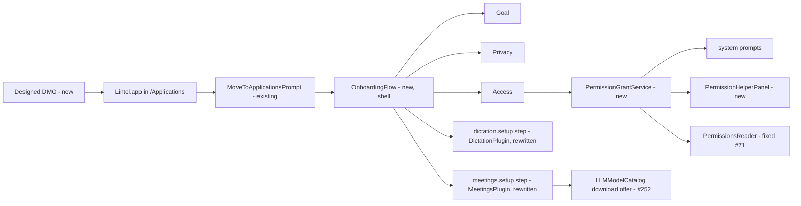

# First-run installer, onboarding and permission granting

> Status: draft for review, 2026-11-24. Design only. Inputs: the accepted UX direction (PR #247, `.ai/specs/research/2026-11-23-lintel-ux-direction.md`, sketch `.ai/prototypes/lintel-direction/lintel.html`, owner decisions of 2026-11-24 on #247), the three research reports of 2026-11-24 (competitors UI, foolproof UI with the C1–C19 checklist, settings IA), PR #251 (core on, add-ons off), issue #252 (notes on by default with the model on this Mac), issue #71 (stale Accessibility state) and spec PR #248 (SwiftUI design gallery).

## 📝 TLDR

Proposed: a non-technical person should get from the downloaded file to their first dictation in under 3 minutes without help. Today the DMG is a plain Finder window, the welcome screen is a list of plugin steps with jargon, and granting a permission means finding Lintel in System Settings on your own (and Lintel sometimes doesn't notice the grant until a restart, #71). This spec covers three things that ship as four PRs:

1. A designed DMG window with the brand background and an arrow to Applications.
2. The 5-step onboarding from #247: goal, privacy, access, try dictation, first meeting. It includes the default shortcuts (dictation ⌥ Space, meeting ⌃⌥M), shortcut recorders and the offer to download the notes model (#252).
3. Permission granting in the style of Wispr Flow and Granola: the system prompt wherever macOS offers one, a floating helper with the Lintel icon to drag into the list where it doesn't, and live detection of every grant.

## 📝 Problem Statement

- **Install.** `scripts/make-dmg.sh` stages `Lintel.app` and an `Applications` link with no layout and no background. The user sees two icons in a default Finder window, with nothing that tells them what to do. Running from the DMG (App Translocation) also breaks permission grants, because TCC records the translocated path.
- **Onboarding.** `Sources/LintelApp/Onboarding/OnboardingController.swift` shows intro → Shortcut → each enabled plugin's `onboardingSteps` → "You're set". It doesn't ask what the user wants, says nothing about privacy before asking for access, and names system concepts ("Accessibility", "Full Disk Access") instead of what they do. The audit (`research-foolproof-ui.md`, violation 10) found a false promise ("No microphone handy? Press and hold the button instead.") and a greyed-out Continue with no reason. With #251 the add-ons are off, so the Shortcut page is skipped, but dictation still defaults to ⌃⌥D, not the ⌥ Space the owner chose.
- **Permissions.** Allow buttons deep-link to a System Settings pane and leave the user there. For Full Disk Access, Lintel isn't even in the list, so the user has to press "+" and find it in a file dialog. Grant detection is partly stale: `SystemPermissionsReader.status(of: .accessibility)` uses `CGPreflightPostEventAccess()` (`Sources/LintelApp/Ports/SystemClients.swift:319`), which can keep answering "denied" until a restart (#71). `EventPoster` guards paste with the same call (`SystemClients.swift:115`).
- **Evidence.** Wispr Flow advances to the next permission card on its own when a grant arrives, and asks for privacy before permissions (`research-competitors-ui.md` §1). PermissionFlow (MIT, below) shows the drag helper is a known, small pattern. Persona "Kasia" must finish setup in 3 minutes (#247 validation plan).

## 📝 Proposed Solution

### 1. Designed DMG

- A 660 × 400 pt Finder window: the Lintel icon on the left, an Applications alias on the right, and the brand art between them, which is the cut ring and a hand-drawn arrow in Verdigris on warm neutral #F8F6F2. **The art has no words**, so there is nothing to translate and nothing to get out of date.
- **Retina:** `background.tiff` holds a 1× (660 × 400) and a 2× (1320 × 800) representation (`tiffutil -cathidpicheck`). The volume icon is the app icon (`.VolumeIcon.icns`). The icons are 128 pt with 13 pt text, the toolbar and sidebar are hidden, and nothing else in the window is visible.
- **Light and dark:** Finder draws the icon names itself, in white or black depending on the user's appearance. The art therefore puts each icon name on a mid-tone warm band whose colour gives **at least 4.5:1 with both white and black text** (around #77706A; the exact value is computed and tested). The background is otherwise opaque and works in both appearances.
- **Tool: `dmgbuild`** (MIT, actively maintained; its helpers `ds_store` and `mac_alias` are MIT too). It writes `.DS_Store` and the background alias directly, **without Finder or AppleScript**, so it runs headless on the `xcode-27` runner. It is a build-time tool and is never shipped in the app.
- **Alternatives considered:**
  - `create-dmg/create-dmg` (MIT, shell) and `sindresorhus/create-dmg` (MIT, Node) drive Finder through AppleScript. They need a GUI session and Automation permission, which makes them flaky on CI.
  - `appdmg` (MIT, Node) has had no commits since 2023 and needs Node.
  - A committed `.DS_Store` template with no tool breaks silently when the volume name or the background alias changes.
- **Vendored, not installed:** the release `sign` job (Environment `release`, with the Developer ID key in a temporary keychain) runs `scripts/make-dmg.sh --skip-build`, and ADR 0012 and `BACKWARD_COMPATIBILITY.md` §4 allow only Apple's tools and the repository's scripts next to the key. So `dmgbuild`, `ds_store` and `mac_alias` (MIT, pure Python) are **vendored** at one pinned release under `scripts/dmg/vendor/` (each with its `LICENSE`, its version and the SHA-256 of the source archive it came from in `scripts/dmg/vendor/VERSIONS.txt`), and their licence notices stay next to the code (they are never shipped in the app, so `Resources/THIRD_PARTY_NOTICES.txt` doesn't list them). `make-dmg.sh` runs them with `/usr/bin/python3 -I` (Command Line Tools; no Homebrew) and `PYTHONPATH` set to the vendor folder. There is **no pip, no venv, no network and no `actions/cache`** in any job, so the script tests run offline. Updating the vendored code is a normal reviewed PR that changes `VERSIONS.txt`.
- **Alternative the owner may choose instead:** install `dmgbuild` with `pip --require-hashes` in the `build` job only, and amend ADR 0012 to say so (the `sign` job would then need the layout without running dmgbuild, which the background alias makes fragile). The vendored default needs no ADR change.
- **Unchanged:** signing (`codesign` of the DMG), notarizing and stapling the DMG, the ULFO format, the versioned copy, `hdiutil verify`, the release `sign` job's `--skip-build` path and the list of code that runs next to the key (the vendored files are repository scripts). Only the step that creates the image changes.

### 2. Onboarding (one window, step rail on the left, 820 × 580 pt as sketched)

The steps follow the sketch's `onbSteps()`. Goal "Dictation" skips First meeting and "Hear other people in a call". Goal "Meeting notes" skips Try dictation and "Type into other apps". **Continue is never greyed out (C10)**, and every primary button names its result (owner decision 5).

| # | Step | Content (en; pl in the sketch's `onb` table) | Primary button |
|---|---|---|---|
| 1 | Your goal | "What would you like Lintel to do?": Type what I say / Write my meeting notes / Both (default). "You can change this later in Settings." | "Set Up Both" / "Set Up Dictation" / "Set Up Meeting Notes" |
| 2 | Privacy | "Your words stay on this Mac", three points (saved on this Mac, encrypted; nothing sent anywhere, Claude only if chosen later and Lintel asks first; no account). With meetings: the consent sentence. | "Next: Allow Access" |
| 3 | Access | "Lintel needs your OK for a few things": one row per permission the chosen goal needs, each with the reason in plain words and a 3-state control (C14, same words as Settings → Privacy & data in the settings IA v2 spec): **Allowed ✓** / **Needs your OK** with an Allow button / **Not needed now**. "You can skip any of these and allow them later in Settings → Privacy & data." | "Next: Try Dictation" (or the next step's name) |
| 4 | Try dictation | The sample email, Hold to Talk or the shortcut (⌥ Space) with **Change Shortcut** (the plugin's shortcut recorder), success line and Try Again. "Can't talk right now? Continue, and try it later from the menu bar." If the speech files are still downloading: progress in place of the Hold button. | "Next: First Meeting" / "Open Lintel" |
| 5 | First meeting | A picture of the call suggestion (not a live button), "You can also press Record Meeting in the Lintel window.", the Record a meeting shortcut (⌃⌥M) with Change Shortcut, **Check call audio**, **Notes on this Mac** with a download offer (#252), and the consent sentence. | "Open Lintel" (lands on the empty notes view) |

- **The goal decides which core feature is on.** "Both" leaves Dictation and Meetings on (the #251 defaults). "Dictation" and "Meeting notes" write `plugins.meetings.enabled = false` or `plugins.dictation.enabled = false`, as an explicit user value that can be switched back in Settings. Add-ons are never mentioned.
- **Downloads.** Leaving step 1 starts the download of the speech files the chosen goal needs (the ones the plugins report through `modelUsage`). It runs in the background, and the step rail shows "Getting dictation ready · 40 %". It never blocks Continue. The notes model (about 2.5 GB, the size from `LLMModelCatalog` for this Mac's memory) is **only offered**, in step 5: "Notes on this Mac: Lintel writes your meeting notes here, without the internet. Download (2.5 GB)". Before either download, the free disk space is checked, and an error follows the R9 pattern.
- **Shortcuts.** On a new install dictation defaults to **⌥ Space** (owner decision 7). Today it is ⌃⌥D (`DictationPlugin.swift:295`). Record a meeting stays ⌃⌥M. If ⌥ Space can't be registered (the registrar reports a refusal, or `SymbolicHotkeys` shows the system holds it), Lintel registers ⌃⌥D instead, and step 4 says "⌥ Space is used by another app, so Lintel uses ⌃⌥D. Change Shortcut". **macOS usually does not refuse:** a Carbon hot key held by another app without the exclusive option registers fine for Lintel too, and either app may get the key. For that undetectable case step 4 always shows the active shortcut with Change Shortcut, and when the user presses it and no key-down reaches Lintel (the user clicks "It didn't work", or presses Hold to Talk instead after trying the shortcut), it says "Nothing happened? Another app may use ⌥ Space. Change Shortcut", with the recorder open. The same line appears in Settings → Dictation after a "didn't work" report. The same recorders stay in Settings → Dictation and Meetings & notes.
- **When it shows.** The new flow opens automatically **only when `app.onboarding.flowVersion` is absent**. On the first launch of the build that adds this flow, an install that finished the old welcome screen (`app.onboarding.shortcutCompleted` or `app.onboarding.completedSteps` stored) gets `flowVersion = 1` written once, so it never sees the new flow on its own. Everything else keeps the key absent and sees the flow until it is finished or closed (`2`). The `ranking.sqlite` test of `PluginDefaultsMigration` is **not** reused: it is only valid on the one launch the migration runs, so a new user whose first launch ended without closing the window (quit from the menu bar, crash, logout) would be treated as an old install on the next launch. Settings → About & help → **Show welcome again** (today: Settings → Advanced → Show Again, `AdvancedPane.showWelcome`; it moves to About & help with settings IA v2 Phase 1) opens it at any time and never repeats a download that already finished.
- **Setup checklist row (owned here; the notes explorer spec #255, Q11, reserves its slot above the notes list).** "Finish setting up · 3 of 5" / "Dokończ konfigurację · 3 z 5", one line with the cut ring as progress and **Continue Setup**, which opens the onboarding window at the first unfinished step. The count is `OnboardingFlow`'s steps for the chosen goal; a step counts as done when it was finished, or for Access when every needed permission is Allowed (a skipped step stays unfinished). States: hidden on a new install while the onboarding window is open; shown after the window was closed with steps unfinished; a running speech download replaces the text with "Getting dictation ready · 40 %"; **Hide** (×) hides it for good (`app.onboarding.checklistHidden`, Bool). It disappears for good when every step is done. It never shows on an install with `flowVersion = 1`. The row is a shell view that #255's list hosts in its slot; the shell knows no plugin to draw it.
- **Before step 3:** if Lintel runs from the DMG or a translocated path, `MoveToApplicationsPrompt` (existing) runs first, because grants given to a translocated copy are lost.

### 3. Permission granting

One shell service, **`PermissionGrantService`** (`Sources/LintelApp/Permissions/`), is used by the onboarding Access step, the "Allow" rows in Settings → Privacy & data (today's Permissions pane until the settings rebuild) and the plugins' status banners. It picks the mechanism per permission:

| Permission (plain name) | How it is asked | Lintel added to the list automatically? | Drag helper | Grant detected by |
|---|---|---|---|---|
| Microphone | `AVCaptureDevice.requestAccess(for: .audio)`, the system prompt | Yes (by the prompt) | No. After a denial the prompt never comes back, so Allow opens `Privacy_Microphone` with the helper's "Turn on Lintel" text but **no drag tile**, because the list doesn't accept drops (spike 2.1, macOS 27.0.1: the list has no "+" and a dropped app does nothing, no password sheet after 7 s). | `AVCaptureDevice.authorizationStatus`, live |
| Type into other apps (Accessibility) | `AXIsProcessTrustedWithOptions([kAXTrustedCheckOptionPrompt: true])`, then the `Privacy_Accessibility` pane | Yes. The prompt adds Lintel with its switch off (spike 2.1: confirmed for an app that Launch Services knows; an unregistered probe in `/tmp` was not listed). | Yes, as a fallback: shown when Lintel is missing from the list (after `tccutil reset`, a moved app, or a prompt the user dismissed). Spike 2.1: the list accepts a dropped `.app`, and macOS then asks for the user's password ("Privacy & Security is trying to modify your system settings"). Not verified: that the app then lands in the list, and with which switch state (no password was entered); step 2.7's manual QA checks it. | `AXIsProcessTrusted()`, live (**fixes #71**). Spike 2.1 could **not** confirm that it flips without a restart: toggling the switch needs the owner's password, which an agent must not enter. Step 2.2's manual check (grant while running) settles it. |
| Hear other people in a call (System Audio Recording) | The call-audio self-test starts a Core Audio process tap, and the system prompts on the first tap (`NSAudioCaptureUsageDescription`) | Yes (by the prompt) | **Yes** (spike 2.1, macOS 27.0.1): the "System Audio Recording Only" list accepts a dropped `.app` up to the password sheet; that the app then lands in the list is not verified (no password was entered). `Privacy_AudioCapture` opens the "Screen & System Audio Recording" pane, where that list is a second section **below the fold**, so the helper's sentence names it and the drop target is not visible until the user scrolls. | No public read API (`Permission.isReadable == false`). The **self-test result** is the state: "Allowed ✓" after a passing test, otherwise "Allow". |
| Search everywhere on this Mac (Full Disk Access, Files add-on only) | No API. Opens `Privacy_AllFiles`. | **No** | **Yes, always**: the only way besides "+" and a file dialog. Spike 2.1: the list accepts a dropped `.app` up to the password sheet; that the app then lands in the list is not verified (no password was entered). | Reading a protected path (FilesPlugin's existing probe), live |
| Input Monitoring | Not needed: shortcuts are Carbon hot keys (KeyboardShortcuts), and hold-to-talk reads their key-up events | — | — | — |

**Floating helper panel** (built in Lintel, not a dependency; PermissionFlow's MIT source is the reference):

- An `NSPanel` (non-activating, `.floating`, joins all Spaces) that follows the System Settings window. It finds that window with `CGWindowListCopyWindowInfo` and reads **only bounds, layer and owner PID** of `com.apple.systempreferences`, never window names, so it needs no Screen Recording permission. It polls 4 times a second while it is open.
- Content: the Lintel app icon as a native drag source (`NSItemProvider` with `Bundle.main.bundleURL`), and one sentence: "Drag Lintel into the list, then turn on its switch." / "Przeciągnij Lintel na listę, a potem włącz przełącznik." Where no drag is needed, the sentence is "Turn on the switch next to Lintel." The panel also has **Show Lintel in Finder** (the keyboard and VoiceOver path for the "+" button, C17) and **Done**.
- It slides in from the Allow button to the edge of the System Settings window. Only one panel exists at a time, and Reduce Motion turns the slide into a fade. It closes when the grant is detected (with a 1 s "Allowed ✓" state), when System Settings quits, on Done, or after 10 minutes. If no System Settings window is found within 3 s (a moved pane, another macOS), it sits next to Lintel's own window with the same content.
- **Detection without restart:** while the panel or the Access step is visible, the service re-reads the permission every second. It also re-reads when Lintel becomes the active app. The change stays **in the shell**: the service is an `@Observable` shell object whose state the Access step, the Privacy & data rows and the plugin banners' host views observe, so they redraw on a change. `PermissionsReader` stays pull-only and unchanged (no `LintelKit` change): plugins keep reading `context.permissions.status(of:)` when their `settingsStatus` is drawn or when Lintel becomes active, which the redraw triggers. The onboarding Access step then moves to the next row by itself, as Wispr Flow does.

## 📝 Architecture

- **`LintelApp` (shell, composition root):**
  - `Onboarding/` is rebuilt: `OnboardingFlow` (pure state machine: goal → steps, button titles, skip rules, completion), `OnboardingWindowController`, and the pages Goal, Privacy and Access, all shell-owned.
  - Steps 4 and 5 are **plugin-contributed** `OnboardingStep`s. The shell still knows concrete plugins only in `PluginRegistry`. `DictationPlugin` rewrites its `dictation.setup` step as the practice mail, and `MeetingsPlugin` rewrites `meetings.setup` as First meeting. Both embed `PluginContext.makeShortcutRecorder` and their existing model download UI.
  - `Permissions/` adds `PermissionGrantService`, `SettingsWindowTracker`, `PermissionHelperPanel` and the SwiftUI `PermissionHelperView` in `LintelUI`.
  - `Ports/SystemClients.swift`: `SystemPermissionsReader` reads Accessibility with `AXIsProcessTrusted()`. `EventPoster` accepts `AXIsProcessTrusted() || CGPreflightPostEventAccess()`, so paste works right after the grant (#71 acceptance: paste keeps Post Event semantics, step 2.2 verifies).
- **`LintelKit` (protected, additive only, defaults for everything):**
  - `OnboardingGoal`: an open set (`struct` with a raw `String`: `.dictation`, `.meetingNotes`).
  - `OnboardingStep.goal: OnboardingGoal?`: init parameter after `text`, default `nil` = shown for every goal, like today's add-on steps. The goal page offers the goals that enabled plugins' steps declare, and a goal choice disables the plugins whose every step serves another goal.
  - `OnboardingStep.primaryActionTitle: LocalizedStringResource?`, default `nil` = the shell's "Next: <next step>".
  - `LintelPlugin.permissionReason(for: Permission) -> LocalizedStringResource?`: a requirement declared in the protocol body, default `nil` = the shell's generic reason. Dictation gives "So your words appear where your cursor is.", Meetings "So notes include what the others say."
- **Scripts and CI:** `scripts/make-dmg.sh` (dmgbuild settings in `scripts/dmg/settings.py`, art in `Resources/DMG/`), `scripts/tests/test_make_dmg.zsh`, and `release.yml` (no new secrets, no new steps in `sign`; `ReleaseWorkflowTests` gains an assertion that `sign` has no `pip`, `venv` or `actions/cache`).
- **Design delivery:** every new screen state is first a scene in the SwiftUI design gallery (spec PR #248, `--qa-gallery`, light/dark × M/XL × en/pl). The owner-approved contact sheet is the source of truth before the views are wired. **Prerequisite:** #248 Phase 1 (gallery infrastructure) is merged before Phase 2 of this spec starts. Phase 1 (DMG) has no SwiftUI and doesn't wait.

Takeaway: the shell owns the flow and the permission mechanics. Plugins contribute their steps, reasons and downloads through additive contracts, so no plugin imports another and the shell imports no plugin outside `PluginRegistry`.

## 📝 Data Model

No database changes. Settings keys (BACKWARD_COMPATIBILITY.md §3; all additive, documented there in the PR that adds them):

| Key | Type | Meaning | Existing installs |
|---|---|---|---|
| `app.onboarding.goal` | String (`dictation`/`meetingNotes`/`both`) | Last goal chosen; preselects the goal page on "Show welcome again" | absent = `both` |
| `app.onboarding.checklistHidden` | Bool | The user hid the setup checklist row | absent = shown while steps are unfinished |
| `app.onboarding.flowVersion` | Int | Highest onboarding flow the user finished or closed: `1` = the old welcome screen (written once, see below), `2` = this flow | Written `1` once on the first launch of the Phase 3 build when the old welcome was finished (`shortcutCompleted` or `completedSteps` stored); otherwise absent until this flow is finished or closed. |

- **Kept:** `app.onboarding.completedSteps`, which records the rewritten `dictation.setup` and `meetings.setup` ids as finished or skipped, as before. Kept also are `app.onboarding.shortcutCompleted` (still written, so an older build after a rollback doesn't show its welcome screen again) and `plugins.dictation.enabled` / `plugins.meetings.enabled` (written only by an explicit goal choice).
- **Default shortcut:** `KeyboardShortcuts_command_<dictation command>` defaults to ⌥ Space for a command that has never had a default applied (`app.hotkey.commandDefaultsApplied`). An existing install that already applied ⌃⌥D has it stored and keeps it, so nothing is migrated. A "default shortcuts" release note goes into BACKWARD_COMPATIBILITY.md §5.
- **No sensitive data:** the practice dictation runs through the real engine, but its text is held only in the step's view state and is never recorded in dictation history, `ranking.sqlite` or the logs.

## 📝 UI/UX

Prototype: `.ai/prototypes/lintel-direction/lintel.html` (screen `onb`, steps goal/privacy/access/try/meeting), accepted by the owner on #247 (2026-11-24: direction, warm tone, neutral links, named buttons, ⌥ Space and ⌃⌥M with recorders). The helper panel and the DMG window are not in the sketch: their gallery states (helper) and a rendered DMG screenshot are the first steps of their phases and need owner approval.

**Gallery states (states before code):**

- **Onboarding:**
  - Goal: three selections.
  - Privacy: with and without the consent line.
  - Access: rows in every state (Needs your OK + Allow, Allowed ✓, Not needed now), all allowed, the call-audio check running, the check failed.
  - Try dictation: idle, listening, typing, done, speech files downloading, download failed, ⌥ Space taken (fallback ⌃⌥D), "Nothing happened?" (undetectable conflict), recorder open, microphone denied.
  - First meeting: notes model not downloaded, downloading, downloaded, not enough disk space, download failed.
  - Setup checklist row in the notes list slot: 3 of 5, a running download, all done (hidden).
  - The step rail with a running download.
- **Helper panel:** drag tile (FDA; Accessibility when Lintel is missing from the list; System Audio Recording Only, whose sentence names the section below the fold), "turn on the switch" (Accessibility, Microphone), granted, no System Settings window found (beside Lintel).
- **DMG:** a Finder screenshot in light and dark, at 1× and 2×.

**Copy:** tone of voice from #247 (calm, second person, about 15 words, no exclamation marks, no AI hype, no technical nouns in basic text). Every string gets `en` and `pl` in `Localizable.xcstrings` or the plugin's catalog (`StringCatalogTests`). Lintel is never declined in Polish. A C5 jargon test fails when any onboarding or helper string contains a word from the C5 list.

**Accessibility:** the step rail is a list with `aria-current`-equivalent traits ("Step 3 of 5, current"). Every control is reachable with Tab, and Return is the primary button. Esc doesn't close the window during a download (it asks "Close setup? Downloads continue in the background."). The helper panel has a keyboard path (Show Lintel in Finder), and Reduce Motion stops the ring and the slide-in. Nothing in Polish at XL is cut off at 820 × 580 (C15).

**Acceptance: the foolproof checklist.** Every screen of this spec gets a PASS/FAIL table for C1–C19 with gallery screenshots before `needs-qa`. Items that don't apply are marked "–" with a reason. Expected: C1, C4, C18 "–" on onboarding and the helper; C8 at most 5 rows on Access (3 permissions + 1 note line); C11 "–" (nothing is deleted); C13 "–" (no lists).

## 📝 Edge Cases & Failure Scenarios

**Install**
- **Opened from the DMG:** the move prompt comes first and step 3 never asks while the app is translocated. If the move is declined, Access rows show "Move Lintel to Applications first" with one Move button (R9).
- **User drags the app into the wrong list, or into Login Items:** the grant isn't detected, so the panel stays and keeps its sentence. Done closes it, and the row stays "Allow".
- **Ad-hoc debug builds:** TCC grants are lost on every rebuild (different signature). QA uses `--qa` and `tccutil reset` per run, as documented in `docs/qa.md`. Release builds use Developer ID, so grants survive updates.
- **dmgbuild fails** (for example `/usr/bin/python3` missing because the Command Line Tools aren't installed): `make-dmg.sh` fails with a clear message. `--plain` builds today's plain DMG for local use only, and the release job never passes it.

**Permissions**
- **macOS moves a pane or changes an anchor:** the deep link falls back to `com.apple.preference.security` (Privacy & Security root), and the helper sits beside Lintel's window.
- **System Settings is already open on another pane:** the deep link switches it, and the tracker follows the same window.
- **Grant revoked later:** the reader is live, so the Privacy & data row and the plugin banner show "Allow" again on the next activation, with no restart.
- **Call-audio check finds no output device or plays into a muted device:** "Lintel couldn't hear the test sound. Turn up the volume or pick your speakers, then Check Again." The row stays "Allow" and Continue works.

**Shortcuts**
- **⌥ Space is taken** (for example by ChatGPT's desktop app), or the user types a non-breaking space with it: Lintel falls back to ⌃⌥D as above, and the recorder lets the user pick any shortcut. The recorder refuses shortcuts held by another Lintel command (`DefaultShortcutTests` pattern).

**Downloads**
- **Offline:** "Couldn't download. Check your internet connection, then Try Again." The download resumes where it stopped (`ModelManager`). Try dictation shows the download state instead of Hold to Talk, and First meeting says notes will be written once the files are on this Mac (#252 degrade path).
- **Not enough disk space:** the size needed and what is free, with no Download button until space is freed. Continue still works.

**Onboarding window**
- **Closed mid-flow:** `flowVersion = 2` is written (the flow isn't forced again), unfinished rows appear in Settings → Privacy & data and in the setup checklist row (below), and running downloads continue.

## 📝 Risks & Impact Review

- **Protected contracts (BACKWARD_COMPATIBILITY.md):**
  - The `OnboardingStep` fields and `permissionReason(for:)` are additive with defaults, so a plugin written before them compiles and behaves unchanged.
  - `OnboardingGoal` is an open set: unknown raw values are ignored, and a release never removes one.
  - The two new keys are additive.
  - The default shortcut change affects only commands whose default was never applied.
  - Each PR updates §1/§3/§5 in the same change.
- **Rollback:**
  - Reverting Phase 3 or 4 restores the old welcome screen. Its keys (`shortcutCompleted`, `completedSteps`) are still written, so an install that finished the new flow doesn't see the old one.
  - A user-chosen goal stays as plugin switches, which the old build reads normally.
  - Reverting Phase 1 restores the plain DMG.
- **Dependency:** `dmgbuild`, `ds_store` and `mac_alias` are build-time only, MIT and vendored (reviewed source in the repository, no download at build time), and run only in `make-dmg.sh`. No runtime dependency is added, and PermissionFlow is not added (reference only; if any code is adapted, `Resources/THIRD_PARTY_NOTICES.txt` gets its MIT notice).
- **Window reading:** `CGWindowListCopyWindowInfo` bounds of System Settings only, and only while the panel is shown. No names and no other apps are read, and nothing is stored.
- **Product calls (owner, not defects):** the goal turns a core feature off, the speech download starts without its own button, and ⌥ Space is the default dictation shortcut (owner decision 7, with its known conflict).
- **Owner-visible release note (BACKWARD_COMPATIBILITY.md §5):** while Dictation is on with the default shortcut, ⌥ Space is a global hot key, so it no longer types a non-breaking space in other apps (people on Polish and other layouts who use it for "twarda spacja" lose it until they change the shortcut). The note says how to change it.

## 📋 Phasing

Each phase is one `feat/` PR based on `main`, referencing this spec (`Refs #<spec PR>`). Phase 1 is independent. Phase 2 needs #248 Phase 1 only from step 2.3 (the gallery): the spike 2.1 can run now and the #71 fix 2.2 can ship as its own PR before #248, so #71 doesn't wait for the gallery. Phases 3 and 4 need Phase 2 and #251, and Phase 4 also needs #252's default flip or ships its download offer with the flip still off.

1. **Phase 1: Designed DMG.** The art, dmgbuild in `make-dmg.sh`, tests, and release proof (an ad-hoc DMG from the PR's workflow run, with Finder screenshots in light and dark).
2. **Phase 2: Permission granting.** `PermissionGrantService`, the helper panel (gallery first), live detection, the #71 fix, and use from today's Settings → Permissions rows and the plugin banners.
3. **Phase 3: Onboarding shell.** Goal, Privacy and Access pages (gallery first), `OnboardingFlow`, the additive contracts, the new keys, new-install-only display and Show welcome again. The rewritten plugin steps don't exist yet, so today's dictation and meetings steps follow the Access page.
4. **Phase 4: Practice and first meeting.** The rewritten `dictation.setup` and `meetings.setup` steps (gallery first), ⌥ Space with the fallback, recorders, background speech download, the notes model offer (#252) and Open Lintel landing on the empty notes view.

## 📋 Implementation Plan

### Phase 1: Designed DMG
1.1 Art in `Resources/DMG/`: an SVG source plus exported `background.png` (660 × 400) and `background@2x.png` (1320 × 800) with the ring, the arrow and the two label bands; `background.tiff` combined with `tiffutil -cathidpicheck`. Test: `sips` dimensions, and the label-band colour gives at least 4.5:1 against white and black (zsh test computes the WCAG ratio).
1.2 `scripts/dmg/vendor/` (`dmgbuild`, `ds_store`, `mac_alias` at one pinned release, their licences, `VERSIONS.txt` with the source archive SHA-256s) and `scripts/dmg/settings.py` (window 660 × 400, icon size 128, text size 13, positions app (165, 205) and Applications (495, 205), background, `.VolumeIcon.icns` from the app icon, hidden toolbar and sidebar, ULFO). Test: the settings load with `/usr/bin/python3 -I` and the vendored path, with the network off; `VERSIONS.txt` lists every vendored package and its licence file exists.
1.3 `make-dmg.sh` builds through the vendored dmgbuild and keeps codesign, verify, the versioned copy and `--skip-build`; `--plain` for local fallback. Test: `scripts/tests/test_make_dmg.zsh` builds from a stub app, mounts it, reads `.DS_Store` back with `ds_store` (positions, background alias, icon size), and checks `hdiutil verify` and the signature.
1.4 `release.yml` and `docs/releasing.md`: no new secrets and no new step in `sign`; `ReleaseWorkflowTests` asserts that `sign` contains no `pip`, `venv` or `actions/cache`. Proof: the PR's ad-hoc DMG artifact mounted on a Mac, with Finder screenshots in light and dark at 2×.

### Phase 2: Permission granting
2.1 Spike (recorded in the PR body and in this spec's mechanism table; may run before #248 Phase 1, and should, because its result decides Q4 and the helper's gallery states in 2.3): which of the Accessibility, System Audio Recording Only and Full Disk Access lists accept a dropped `.app` on macOS 26, the pane anchors in use, and whether `AXIsProcessTrusted()` flips without a restart. The results fill the mechanism table above.
   - **Spike 2.1 result (2026-11-26, macOS 27.0.1 build 26A434, ad-hoc probe app; the machine reports 27.0.1, not 26):** anchors `Privacy_Accessibility` (pane title "Device Control and Data Access"), `Privacy_AllFiles` ("Full Disk Access"), `Privacy_AudioCapture` ("Screen & System Audio Recording", the "System Audio Recording Only" list below the fold) and `Privacy_Microphone` each open the right pane, in the same System Settings window, also when it showed another pane. Drops: Accessibility, Full Disk Access and System Audio Recording Only accept a dropped `.app` and show a password sheet; Microphone rejects it. The Accessibility prompt lists the app with its switch off only when Launch Services knows the app. Not verified (needs the owner's password): that a dropped app lands in the list after the password, and whether `AXIsProcessTrusted()` / `CGPreflightPostEventAccess()` change without a restart after a toggle; steps 2.2 and 2.7 check them by hand. macOS 26 itself was not checked.
2.2 The #71 fix: `SystemPermissionsReader` uses `AXIsProcessTrusted()`, and `EventPoster` accepts `AXIsProcessTrusted() || CGPreflightPostEventAccess()`. Tests: a fake reader flips to granted, and after the shell's next re-read (the service's tick or an activation) the plugin banner and the shell show the new state, with no `LintelKit` change (#71 acceptance). Manual: grant while running, and paste works with no restart.
2.3 Gallery scenes for the helper panel (states in UI/UX), owner-approved contact sheet.
2.4 `SettingsWindowTracker` (pure geometry: given window infos, return the System Settings frame or `nil`; the polling is injected). Tests with fixture window lists, including no window, two windows and off-screen windows.
2.5 `PermissionHelperPanel` + `PermissionHelperView`: drag source, Show Lintel in Finder, Done, follow/close rules, Reduce Motion. Tests: the close rules as a pure state machine (granted, System Settings quit, timeout, Done).
2.6 `PermissionGrantService` (per-permission mechanism, 1 s re-read while visible, activation re-read, an `@Observable` shell state; `PermissionsReader` unchanged). Tests with fake prompts and readers: each permission's path, the denial path, the live grant.
2.7 Wire it into today's Settings → Permissions rows and the plugin status actions (`SettingsStatusAction.systemSettings`). en + pl strings, C5 jargon test. Manual QA with screenshots: FDA drag, System Audio Recording Only drag, Accessibility prompt → switch, microphone denial → re-enable; each drag up to the app in the list after the password (open after spike 2.1).

### Phase 3: Onboarding shell
3.1 LintelKit additions (`OnboardingGoal`, `OnboardingStep.goal`, `.primaryActionTitle`, `LintelPlugin.permissionReason(for:)`) with BACKWARD_COMPATIBILITY.md §1. Test: a step and a plugin built without them compile and keep their defaults.
3.2 Gallery scenes for Goal, Privacy, Access and the step rail (all states), owner-approved contact sheet.
3.3 `OnboardingFlow` (pure): steps per goal, button titles, completion, Esc rules. Tests for each goal, every skip, and back/forward.
3.4 Pages and window (820 × 580, step rail). The Access page uses `PermissionGrantService` and the plugins' reasons and moves on when a row turns Allowed. Dictation and Meetings declare their goals and reasons. Tests: the goal choice writes only the expected `plugins.<id>.enabled` values.
3.5 Keys `app.onboarding.goal` and `app.onboarding.flowVersion`, new-install-only display, Show welcome again (today's Settings → Advanced → Show Again; About & help once settings IA v2 Phase 1 has landed), BACKWARD_COMPATIBILITY.md §3. Tests: a new install shows the flow, and shows it again on the next launch when the first one ended without closing it (with `ranking.sqlite` present); an install with `shortcutCompleted` or `completedSteps` gets `flowVersion = 1` once and doesn't see it; a stored `1` or `2` is never rewritten; a closed flow isn't forced again; and `shortcutCompleted` is still written.
3.6 The C1–C19 table and manual QA (`--qa`, a clean profile) in light/dark, en/pl, M/XL.

### Phase 4: Practice and first meeting
4.1 Gallery scenes for Try dictation and First meeting (all states), owner-approved contact sheet.
4.2 **Spike first (in the PR body):** with another app holding ⌥ Space (ChatGPT, Raycast, a test app registering with and without `kEventHotKeyExclusive`), record what `RegisterEventHotKey` returns, what KeyboardShortcuts reports, which app gets the key, and what `SymbolicHotkeys` shows. Then dictation's default shortcut ⌥ Space with the ⌃⌥D fallback for a detectable refusal, the "Nothing happened?" line for the undetectable case, plus BACKWARD_COMPATIBILITY.md §5 with the non-breaking-space release note. Tests: the "didn't work" path opens the recorder and shows the line, the default for a never-applied command, an applied ⌃⌥D is kept, the fallback when the registrar refuses, and no collision with any other default (`DefaultShortcutTests`).
4.3 `dictation.setup` rewritten as the practice mail (real engine, text in view state only, the recorder, the download state). Tests: the view model's states, and nothing written to history or the logs.
4.4 Background speech download after the goal step, with progress in the step rail, a free-space check, resume and the error states. Tests with a fake `ModelManager`.
4.5 `meetings.setup` rewritten as First meeting: the recorder, Check call audio (self-test = grant detection), the notes model offer from `LLMModelCatalog` for this Mac, and the #252 degrade path. Tests: the offer's size, the states, and the "notes are written once the files are on this Mac" state.
4.6 Open Lintel opens the main window on the notes view and writes `flowVersion = 2`. The setup checklist row in #255's slot (needs #255's list with its reserved slot; until then it is not shown). Tests: the count per goal, Continue Setup opens the first unfinished step, Hide writes `app.onboarding.checklistHidden`, the row disappears when every step is done and never shows with `flowVersion = 1`. End-to-end manual QA: from mounting the DMG to the first dictation in under 3 minutes on a clean `--qa` profile (timed, in the PR body), a VoiceOver walk of all five steps, and the C1–C19 table.

## Resolved assumptions (autonomous defaults)

| # | Question | Applied default | Why |
|---|---|---|---|
| Q1 | Split the DMG, onboarding and permission helper into three specs (each would work alone)? | One spec, four independent phases, one PR each | The brief asks for one spec with phases. Phases 1 and 2 already ship and roll back on their own. |
| Q2 | Which DMG tool? | `dmgbuild` (MIT), build-time only, pinned with hashes in a venv | Headless with no Finder or AppleScript, so it is reliable on CI. create-dmg needs a GUI session, appdmg is unmaintained, and a committed `.DS_Store` is fragile. |
| Q3 | Add PermissionFlow (MIT, one maintainer) as a dependency or build the helper? | Build it in the shell, using PermissionFlow as reference | Avoids a runtime dependency with one maintainer. The panel needs brand UI, Polish strings and Swift 6 isolation anyway, and it is small. |
| Q4 | Which permissions get the drag helper? | Full Disk Access always. Accessibility as a fallback when Lintel is missing from the list. System audio too (spike 2.1, macOS 27.0.1: the list accepts a drop up to the password sheet; that the app then lands in the list is checked in step 2.7; the first-tap prompt stays primary). Microphone never (it uses the system prompt). | The system prompt is used wherever one exists, because it adds Lintel to the list. |
| Q5 | Does the goal choice turn a core feature off? | Yes: "Dictation" or "Meeting notes" writes the other plugin's switch off as a user value | Matches "You can change this later in Settings" and Wispr's product-aware setup. It is reversible in one switch. |
| Q6 | Show the new flow to existing users? | No: new installs only, plus Show welcome again | Existing users already set up. Forcing a flow on them contradicts the "existing users keep their values" rule from #251. |
| Q7 | Named primary buttons (owner decision 5): which wording? | "Set Up <goal>", "Next: <next step>", "Open Lintel" | Each names what happens next. The gallery review may refine the words without changing the design. |
| Q8 | Start the speech download without a button? | Yes, after the goal step, visible in the step rail, never blocking | Dictation can't work without it, and the user has just chosen the goal that needs it. The notes model (2.5 GB) is only offered, as #252 says. |
| Q9 | Migrate existing dictation shortcuts to ⌥ Space? | No: only commands whose default was never applied | `KeyboardShortcuts_command_*` values are user data. An applied ⌃⌥D stays. |

None needs human confirmation: each is reversible in a later PR without data loss.
