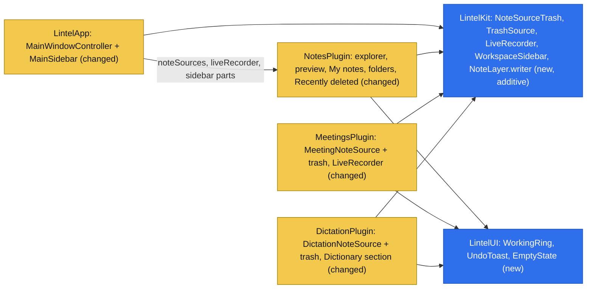
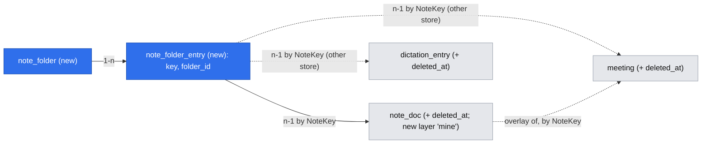

# Notes explorer: the main window as a three-column notes library

> Status: **design**, written 2026-11-24 from `origin/main` @ `232f67c3`. Implements the main-window track of the accepted UX direction (PR #247, revision 2, owner decisions of 2026-11-24). Builds on `.ai/specs/2026-11-04-lintel-main-window.md` (the window, sections, Settings mode) and `.ai/specs/2026-11-04-notes-workspace.md` (`NotesPlugin`, `notes.sqlite`, revisions, delete and kept copies), and replaces their explorer, tab bar and Notes / Dictations switch. UI is delivered through the SwiftUI design gallery of spec PR #248 (`.ai/specs/2026-11-23-swiftui-design-gallery.md`). Prose and identifiers in English, UI strings English + Polish. **Revised 2026-11-25** after the R1 review: the owner decisions on Recently Deleted (2026-11-24 and 2026-11-25) are applied, and this spec owns the trash contract that `.ai/specs/2026-11-24-settings-ia-v2.md` (PR #253) builds on (see "Ownership split with settings-ia-v2").

## 📝 TLDR

Today the main window opens on a Notes section built for power use: a Notes / Dictations switch, a tab per open note, a path bar, an inspector, and a delete that is permanent behind a sheet. The proposed main window is a **three-column notes explorer** for non-technical office workers: a sidebar (All notes · Meetings · Dictations · Folders · Dictionary), a day-grouped list, and a preview with the tabs **Notes · My notes · Transcript**. A meeting is recorded from the **working ring** in the toolbar. Every delete goes to **Recently deleted for 30 days** and shows an **Undo** toast at once. The Dictionary moves out of Settings into the window. The owner accepted the direction on 2026-11-24 (#247); this spec turns it into data, contracts and seven shippable phases.

## Resolved assumptions (autonomous defaults)

The brief was run unattended (`om-auto-write-spec`). Each open question got the most reversible answer; override any of them on the spec PR before implementation. Rows marked **owner** were decided by the owner and are no longer defaults.

| # | Question | Applied default | Why |
|---|---|---|---|
| Q1 | Split the bundle (explorer, recording, deletion, folders, dictionary) into separate specs? | **No.** One spec, one PR per phase, each phase shippable alone (Phasing). | The brief asked for one spec with phases; phases already isolate the capabilities. |
| Q2 | Do automatic retention deletions (Meetings `retentionDays`, meeting audio `keptAudioDays`, Dictation 30 days / 500 entries, Clipboard 30 days / 1000 entries) go to Recently deleted? | **No (owner, 2026-11-25).** Retention by age or count deletes at once, as today, and it also applies to rows that are already in Recently Deleted: a deleted row never outlives its retention limit, and "Deletes in N days" shows the earlier of the two dates. | The retention limit is the user's privacy promise; the trash must never extend it (BC §3). |
| Q3 | Do the bulk deletes (Clear Library, Clear History, settings-ia-v2's "Delete my data…" and "Delete everything") go to Recently deleted? | **Yes (owner, 2026-11-24: Q9 on #253 and decision 8 on #247).** Every manual delete, bulk ones included, moves the rows to Recently Deleted for 30 days (`trashAll()`). The only permanent paths are Delete Now and Empty Recently Deleted in this spec, and Delete everything's Delete Now in settings-ia-v2 (which then runs `eraseData()`). | Every manual delete is reversible, with no exception. |
| Q4 | Keep the confirmation sheet for a single delete? | **No sheet** for a move to Recently deleted: the Undo toast names the object. Permanent deletes (Delete Now, Empty Recently Deleted) still confirm with object, count and a non-default destructive button (C11). | Owner decision 8 (#247) pairs Recently deleted with an immediate Undo; a sheet on a reversible action trains reflex clicking (R8). |
| Q5 | Where does Recently deleted live? | **One view, in the main window**: a sidebar row below Folders, **shown only while it holds something**, with its count, also opened by the `showRecentlyDeleted` route. It lists every store, clipboard items included (without content). Settings → Privacy & data has only a pointer row "Recently deleted · 12 items ›" to it, reading the same counts (settings-ia-v2). **Owner confirmation pending** (question 3 of the R1 review). | Apple Notes / Mail pattern; one view means one count and one Restore; an always-empty row is noise (R1). |
| Q6 | Folder model? | **One level, one folder per note** (a note can also be in no folder). Deleting a folder moves its notes back to All notes (nothing is deleted) and shows Undo. | Smallest model that matches the sketch; nesting and multi-folder can be added without breaking it. |
| Q7 | Keep the tab bar (one tab per open note), the path bar and the Notes / Dictations switch? | **Retired.** One note at a time; Open / double-click shows it in the full window with "‹ All notes" back. Comments, History, Compare and Ask agent stay in the full window's inspector, unchanged. | Mail / Notes users do not expect tabs; keeping the inspector loses no feature or data. |
| Q8 | Does meeting-notes generation read My notes? | **No**, not in this spec (follow-up). My notes are only stored and shown. | Changing `NotesPrompt` is a versioned, user-visible behaviour (BC §5) with its own quality work. |
| Q9 | Can the user edit Lintel's Notes tab? | **As today**: the pen in the full window, with proposals protecting the user's edits. The preview is read-only. | No behaviour change to the revision model; principle 9 is met by My notes being separate. |
| Q10 | Show "Added by you" / "Learned from your corrections" on Dictionary words? | **No source label** in this spec. Auto-learn is accepted (2026-11-20 spec) but not built, so today every word would say "Added by you"; the auto-learn feature decides the label when it lands on the Dictionary page (Phase 7.2). No change to `vocabulary.json`. | No new on-disk field before a feature needs it. |
| Q11 | The first-run checklist row above the list ("Finish setting up · 3 of 5") | **Onboarding spec**, not this one. The list reserves the slot. | It depends on the onboarding steps, which that spec redesigns. |
| Q12 | Settings as a separate window (direction IA) | **Settings rebuild spec** (`settings-ia-v2`). The gear and ⌘, keep today's Settings mode. | Keeps this spec to the workspace. |
| Q13 | Does the panel's ⌃X (Dictation history, Meetings library list modes) also move to Recently deleted? | **Yes**, with the same double-press confirmation as today; no toast in the panel. The clipboard's ⌃X and Clear History go to Recently Deleted too (**owner**, Q9 on #253, no exception, passwords included); the clipboard's trash is built by settings-ia-v2 Phase 5 on this spec's `TrashSource` contract. | Every manual delete must be restorable in one place. |
| Q14 | Are trashed notes searchable or visible elsewhere? | **No.** Hidden from the list, search, counts, the launcher list modes, export, suggestions and any AI provider; Recently deleted is not searchable in v1. | A deleted note must behave as deleted except for Restore. |
| Q15 | Manual notes (⌘N, "+") | **Kept.** They appear under All notes and in folders; no separate collection. | No feature loss; the sketch has no "Notes" collection. |
| Q16 | Default shortcuts in copy (empty state "hold ⌥ Space") | Copy shows the **user's current dictation shortcut**, read at render time; no shortcut default changes here. | The defaults are decided in the onboarding / settings specs (owner decision 7). |
| Q17 | Audio of a deleted meeting | **Kept with the meeting (owner, 2026-11-25).** The encrypted spool and the kept recording stay while the meeting is in Recently Deleted and are purged with it after 30 days, so a restored meeting has its audio. The meeting-audio limit (`keepAudio` / `keptAudioDays`) still removes it by age in the meantime (Q2). | A restore brings the whole meeting back. |

Q2, Q3, Q13 (clipboard part) and Q17 are owner decisions. Q5 keeps its default until the owner answers where Recently Deleted lives; moving the view later changes no data. The other rows weaken no encryption, data scoping or protected contract, and each can be reversed without a data migration.

## 📝 Problem Statement

Evidence: the UX direction (`.ai/specs/research/2026-11-23-lintel-ux-direction.md`, on `main` since #247 merged), the three research reports of 2026-11-24 (`research-competitors-ui.md`, `research-foolproof-ui.md`, `research-settings-ia.md`) and the code on `main`. Lintel has no telemetry; personas are assumptions.

- **The main view is built for experts.** Tabs, a path bar, a Formatted / Raw switch, an inspector and a command palette are the first things a sales manager sees. The research (R2, Jakob's law) and the owner want Mail / Notes' three columns.
- **Dictations are a separate world.** The Notes / Dictations switch (ADR 0008 deviation 14) hides half of the user's words; the direction puts all notes in one list with Meetings and Dictations as filters.
- **"Mine" and "AI" are mixed.** A meeting has two layers (`notes` by the agent, `transcript` by STT); what the user types during a call has no home. Every competitor separates them (Wispr's My thoughts, Granola's black and grey); the owner chose tabs over per-line marks (2026-11-19, #247 decision 6).
- **Recording is hidden.** A meeting starts from a global shortcut or the menu bar; the main window has no Record button and shows no live state.
- **Delete is final.** `NoteDeleter` calls the owner's `NoteSource.delete`, which removes the row; the only safety is a sheet. Owner decision 8: Recently deleted for 30 days plus Undo.
- **The Dictionary lives in a settings form** (`VocabularySection` in the Dictation pane). The research puts personalisation in the main window and keeps Settings systemic.

## 📝 Proposed Solution

1. **Explorer layout** in the Notes section: sidebar · list · preview, in a `NavigationSplitView` hosted by the existing `MainWindowController`. The sidebar is drawn by the shell; sections contribute their part of it (additive contract), so the Dictionary row can come from `DictationPlugin` without Notes importing it.
2. **One list for every note** through the existing `NoteLibrary` / `SourceFanOut`: All notes (meetings, dictations, manual notes), Meetings, Dictations, a Folder. Search scopes to the selected collection.
3. **Note tabs** Notes · My notes · Transcript. My notes is a new `mine` layer document in `notes.sqlite` keyed by the meeting's `NoteKey`, written only by `human`; nothing else may write it (enforced in `RevisionWriter`). The Notes tab footer names who wrote it (this Mac or Claude) from an additive `NoteLayer.writer`.
4. **Working ring**: one `WorkingRing` view in `LintelUI` with the states idle, listening, processing (closing), warning (silence / cannot hear the call) and error, used by the toolbar Record button, the live pill, list rows and both HUDs. Recording is driven through an additive `LiveRecorder` port that `MeetingsPlugin` implements.
5. **Soft delete owned by each store**: one column name, `deleted_at`, on `meeting`, `dictation_entry` and `note_doc` (manual notes and overlays), and on `clip_item` in settings-ia-v2. `NoteSource` gains an optional `NoteSourceTrash` refinement (trash, trash all, restore, list trashed); a store that is not a note source (the clipboard) uses the small `TrashSource` contract with the same shape. Each store's own job purges rows deleted more than 30 days ago; retention by age keeps deleting at once. A minimal Undo toast (and ⌘Z) restores the last delete.
6. **Folders** in `notes.sqlite` (`note_folder`, `note_folder_entry` keyed by `NoteKey`), so meetings and dictations can be filed without touching their stores.
7. **Dictionary section** contributed by `DictationPlugin` (`workspaceSections`) over the existing `VocabularyStore`; Settings → Dictation keeps a pointer row.

**Alternatives considered**

- *A central trash in `notes.sqlite` holding copies of deleted meetings and dictations.* Rejected: it copies transcripts and audio references across encrypted stores and owners (plugins never share data), and the owner's store would no longer be the one truth for "does this meeting exist".
- *Notes section draws the whole sidebar and hosts other sections inside it.* Rejected: Notes would become a host of other plugins' views; the shell already owns section switching.
- *Keep tabs and add the sidebar.* Rejected: four navigation devices on one screen (sidebar, list, tabs, path bar) fails R3/R5 for the target audience.
- *Folders as tags (many per note).* Deferred: more power, more choices; the one-folder model migrates to many-to-many by dropping a unique index, never the reverse.

**Market check** (from `research-competitors-ui.md`): Granola and Wispr keep the user's notes separate and never overwritten — adopted. Granola collapses the sidebar when a note is opened — adopted as the full-window note. Fireflies' adaptive Home and assistant cards collect clutter complaints — no Home, no stats, no upsell. Wispr's "We couldn't process your meeting" end state — adopted as "Notes not written" with Try Again. Apple Notes / Mail Recently Deleted and Undo — adopted. Granola's per-line source lens and Circleback's people pages — not in scope.

## 📝 Architecture

Takeaway: every new cross-plugin need goes through an additive `LintelKit` contract handed out by the shell; no plugin imports another, and each store keeps owning its own rows, including their deleted state.

### Ownership split with settings-ia-v2 (#253)

Recently Deleted is designed once. Both specs use the same column name, contracts, purge and toast.

| Part | Owner | Phase |
|---|---|---|
| `NoteSourceTrash`, `TrashSource`, `LintelPlugin.trashSources`, `PluginContext.trashSources`, `NoteSourceError` | this spec | 1.1 |
| `meetings.sqlite` `v4-trash`, `dictation.sqlite` `v2-trash`, `notes.sqlite` `v2-explorer` (`deleted_at`), read filters, the 30-day purge, the trash sweep | this spec | 1.2–1.4 |
| `UndoToast` (`LintelUI`) | this spec | 1.5 (used from 5.3) |
| The Recently Deleted view (every store, clipboard included) and the `showRecentlyDeleted` route | this spec | 5 |
| `clipboard.sqlite` `v2-trash` (`clip_item.deleted_at`), the clipboard's `TrashSource`, clipboard Clear and ⌃X | settings-ia-v2 | 5 |
| Delete my data (bulk `trashAll()` per store), Delete everything (`app.eraseScheduledAt`, Delete Now, `eraseData()`), the Privacy & data pointer row and counts | settings-ia-v2 | 4–5 |

### Contract additions in `LintelKit` (additive, defaults for all; BC §1)

| Addition | Shape | Default | Who implements / reads |
|---|---|---|---|
| `NoteSourceTrash: NoteSource` | `trash(_ key: NoteKey) async throws`, `trashAll() async throws -> Int` (every live row that is not busy; returns how many moved), `restore(_ key: NoteKey) async throws`, `trashed(after: NoteCursor?, limit: Int) async throws -> NotePage`, `trashedCount() async throws -> Int`, `trashedKeys(_ keys: [NoteKey]) async throws -> Set<NoteKey>` (batch, at most 500 keys) | not conformed → the source has no Recently deleted; Notes falls back to today's confirm + permanent `delete` | Meetings, Dictation; read by `NotesPlugin` and the shell's Privacy & data counts |
| `TrashSource` (for stores that are not note sources) | `id: String`, `title: LocalizedStringResource`, `hidesContent: Bool`, `liveCount()`, `trashedCount()`, `trashed(after: String?, limit: Int) -> TrashPage` of `TrashedItem { id, kindLabel, title: String?, deletedAt, purgeAt }` (`title` is `nil` when `hidesContent`), `restore(_ ids: [String])`, `deleteNow(_ ids: [String])`, `trashAll() -> Int`, `makeChanges() -> AsyncStream<Void>`; all `async throws` | — | Clipboard (settings-ia-v2 Phase 5) through `LintelPlugin.trashSources` (default `[]`) and `PluginContext.trashSources` (default `{ [] }`, active plugins only); read by `RecentlyDeletedView` and the shell |
| `NoteSourceError` (new enum) | `busy`, `notFound`; any other error stays the source's own type | — | thrown by `trash`/`restore`; Notes maps `busy` and `notFound` to their sentences, anything else to the generic failure strip |
| `NoteSummary.deletedAt: Date?`, `purgeAt: Date?` | set only in `trashed(…)` pages; `purgeAt` is the earlier of `deletedAt` + 30 days and the row's retention limit | `nil` | sources, Notes ("Deletes in N days") |
| `NoteSummary.taskCount: Int?`, `wordCount: Int?` | row meta ("3 tasks", "118 words") | `nil` → not shown | Meetings (tasks in the notes), Dictation (words) |
| `NoteLayer.writer: NoteWriter?` | `enum NoteWriter { case thisMac, claude }` (open for later providers, unknown raw value decodes to `nil`) | `nil` → no footer | Meetings, derived from `meeting.notes_provider`: NULL → `thisMac`, the external-providers descriptor id `claude` → `claude`, any other id → `nil` (no footer). The mapping lives in `MeetingNoteSource`, never in the UI |
| `NoteState.recording` / `.processing` (exist) + `NoteSummary.liveSince: Date?` | the "Now" row timer | `nil` | Meetings |
| `LiveRecorder` protocol | `pluginID`, `status() -> AsyncStream<LiveRecordingStatus>`, `start() async throws`, `stop(writeNotes: Bool) async`, `retryNotes(_ key: NoteKey) async throws` | — | Meetings (`LintelPlugin.liveRecorder`, default `nil`) |
| `LiveRecordingStatus` | `idle`, `starting`, `recording(key, since, hearing: .everyone / .microphoneOnly, warning: .silence / .callAudioMissing / .microphoneSilent / nil)`, `processing(key, progress: Double?)`, `failed(key?, reason: LiveRecordingFailure)` | — | Notes toolbar, list, preview |
| `PluginContext.liveRecorder` | `@MainActor () -> (any LiveRecorder)?` — the first active plugin that contributes one | `{ nil }` | shell → Notes |
| `WorkspaceSection.sidebar: WorkspaceSidebar?` | `makeView(_ activate: @escaping @MainActor () -> Void) -> AnyView` (the section's own block) | `nil` → the shell draws one row with `title` and `symbolName` | Notes (collections and folders); Dictionary uses the default row |
| `WorkspaceRoute` kinds `showDictionary`, `showRecentlyDeleted` | route values, no type change | — | `MainWindowRouter` (the Settings → Dictation pointer row) |

`NoteSource.exists` gains a documented meaning, not a new signature: **a trashed note still exists** (only a permanent delete, the purge or retention makes it gone), so `SourceReconciler` never detaches the overlays of a trashed note. `NoteSource.list` and search never return trashed rows. Notes marks the overlays of a trashed key through `trashedKeys` (the trash sweep, Deletion lifecycle), and an overlay marked deleted is never turned into a kept copy. Sources that do not conform to `NoteSourceTrash` behave exactly as today.

### Components

| Component | Target | New / changed | Role |
|---|---|---|---|
| `MainSidebar` | `LintelApp/Window` | new | Stacks each active section's `WorkspaceSidebar` block (or one default row) in `order`; selection switches the section through `MainWindowController`. Add-ons contribute nothing while off (R1). |
| `ExplorerModel` | `NotesPlugin/UI/Explorer` | replaces `NoteCollection` + tab state in `NotesWorkspaceModel` | Selected collection (`all`, `meetings`, `dictations`, `folder(id)`, `recentlyDeleted`), search text, selection, day groups, counts; in memory per window, restored from `plugins.notes.explorer.collection` only for the collection id (Data Model). |
| `NoteListView`, `NoteRowView` | `NotesPlugin/UI/Explorer` | replaces `ExplorerView` | Day groups, the type ring + the word ("Meeting" / "Dictation" / "Note", never shape alone), title wrapping to 3 lines, meta, time, row states (ready, writing notes, notes not written, recording "Now"). |
| `NotePreviewView` | `NotesPlugin/UI/Document` | new, reuses `NoteBlockViews` | Title, meta, "On this Mac" chip, Open, Copy; tabs Notes · My notes · Transcript; the writer footer; failed and live panels. |
| `NoteFullView` | `NotesPlugin/UI/Document` | changed `NoteDocumentView` | Sidebar and list hidden, "‹ All notes" (⌘[), the existing inspector (Details, History, comments, Ask agent) and editor. |
| `MyNotesEditor` | `NotesPlugin/Editor` | new, over `NoteEditorSurface` (`Editor/NoteEditorView.swift`) | Plain editor on the `mine` layer; saving through the layer's `RevisionWriter` (1 s debounce, flush on hide/close/quit). |
| `RecordingPanel` | `NotesPlugin/UI/Recording` | new | Live preview while recording: "Lintel hears you and the other people in the call.", the warning with Fix Call Audio, the consent reminder, My notes pad, Stop and Write Notes. |
| `RecentlyDeletedView` | `NotesPlugin/UI/Trash` | new | The one Recently Deleted view: rows from every active `NoteSourceTrash` and `TrashSource` (a source with `hidesContent` shows "Clipboard item · 2 min ago", never content), "Deletes in N days" from `purgeAt`, Restore, Delete Now…, Empty Recently Deleted…. |
| `NoteTrash` | `NotesPlugin/Document` | changes `NoteDeleter` | Move to trash (owner `trash` first, then overlays' `deleted_at`), restore (owner first, then overlays), permanent delete (today's `NoteDeleter` path), the trash sweep (`trashedKeys`), the in-memory undo stack. |
| `FolderStore` | `NotesPlugin/Storage` | new (`NotesStore+Folders`) | Folder CRUD and membership. |
| `UndoToast` | `LintelUI/Components` | new | One minimal pill at the bottom centre of the window, the `message` variant of `LintelPill` from the minimal-HUD spec (#273) once it lands (until then the same metrics: one line that never wraps, 32 pt high at M, no icon, no ✕, one text button): "Deleted “<title>”" + **Undo**, or "Deleted 3 notes" + **Undo**. The title is shortened in the middle so the line stays within the pill copy budget (40 characters); VoiceOver hears the full title and "It stays in Recently Deleted for 30 days." Registers with the window's `UndoManager` so ⌘Z / Edit → Undo Delete work. |
| `WorkingRing` | `LintelUI/Brand` | new, over `LintelMark` geometry | The five states (UI/UX); static under Reduce Motion. |
| `EmptyStateView` | `LintelUI/Components` | new | Outlined ring, one sentence, one action (C13). |
| `MeetingsLiveRecorder` | `MeetingsPlugin/Recording` | new adapter over `MeetingController` | Maps `MeetingHUDState` (recording, notices `noSystemAudio` / `noMicrophoneAudio` / `systemAudioLost`, processing, problem) to `LiveRecordingStatus`; `start`/`stop` call the same paths as `meetings.record`. |
| `DictionarySection` | `DictationPlugin/Vocabulary` | new, reuses `VocabularyPanelModel` / `VocabularyStore` | The main-window page; the settings pane loses `VocabularySection` for a pointer row. |
| Trash in stores | `MeetingsStore`, `DictationStore`, `NotesStore` | changed | `trash`/`trashAll`/`restore`/`trashed`/`trashedKeys`/`purgeTrashed(olderThan:)`; every list, FTS search, count, export, list mode and suggestion query filters `deleted_at IS NULL`. |

Dependencies on other work: **gallery Phase 1** (renderer, `GalleryScene`, `--qa-gallery-export`) must be merged before Phase 2 here; the onboarding and settings-rebuild specs are independent (Q11, Q12). PR #251 (core on, add-ons off) is assumed merged: the empty-state copy assumes Dictation and Meetings are on.

## 📝 Data Model

All changes are additive GRDB migrations, each with a test that opens the previous released schema with data and migrates it (BC §2). Encryption, keys and the reset policy are unchanged: the new columns and tables live inside the existing SQLCipher databases.

| Store | Migration | Change |
|---|---|---|
| `Plugins/meetings/meetings.sqlite` | `v4-trash` | `ALTER TABLE meeting ADD COLUMN deleted_at REAL` (Unix s, NULL = live); `CREATE INDEX meeting_deleted ON meeting(deleted_at) WHERE deleted_at IS NOT NULL`. The spool, kept recording and FTS rows of a trashed meeting stay until the purge, so a restored meeting has its audio (owner, 2026-11-25); the meeting-audio limit still removes audio by age meanwhile. Every FTS query joins `meeting` and filters `deleted_at IS NULL`. A trashed meeting is never resumed, retried or sent to a notes provider. |
| `Plugins/dictation/dictation.sqlite` | `v2-trash` | `ALTER TABLE dictation_entry ADD COLUMN deleted_at REAL`; partial index as above. Trashed entries do not count toward `maximumEntries`. |
| `Plugins/notes/notes.sqlite` | `v2-explorer` | `ALTER TABLE note_doc ADD COLUMN deleted_at REAL` (set on every layer document of a trashed note: a manual note's `body`, a recorded note's overlays and its `mine` layer); `CREATE TABLE note_folder (id INTEGER PRIMARY KEY, uuid TEXT NOT NULL UNIQUE, name TEXT NOT NULL, created_at REAL NOT NULL, sort REAL NOT NULL)`; `CREATE TABLE note_folder_entry (key TEXT PRIMARY KEY, folder_id INTEGER NOT NULL REFERENCES note_folder(id) ON DELETE CASCADE, added_at REAL NOT NULL)`. Trash leaves the search index: a new trigger `note_fts_trash AFTER UPDATE OF deleted_at ON note_doc` deletes the doc's `note_fts` row when `deleted_at` becomes non-NULL and reinserts it from `note_fts_source` when it becomes NULL (today's triggers fire only on `head_revision_id` / `title_override` and revision changes, so without it a trashed doc stays indexed); `note_fts_source` also filters `deleted_at IS NULL` (the view is recreated, the folding SQL stays frozen) so a rebuild never indexes a trashed doc; every search, list and count query over `note_doc` also filters `d.deleted_at IS NULL`. Folder names: 1–60 characters, no control or bidi characters, unique case-insensitively (validated in Swift). |
| `notes.sqlite` layer ids | none (open set) | New layer id **`mine`** for My notes on a recorded note's key; `RevisionWriter` refuses any author but `human` on it (`NotesError.mineIsHumanOnly`), and `ReviseService` never plans units on it. A manual note keeps its `body` layer (its My notes is the note itself). |
| `UserDefaults` | none new protected | `plugins.notes.explorer.collection` (String: `all`, `meetings`, `dictations`, `folder:<uuid>`; unknown → `all`), owned by Notes because the `folder:<uuid>` ids are Notes' own and the shell never parses them; listed in BC §3 as additive. No other key is added or removed. `plugins.notes.showAuthorBars` stays ignored. |
| Migration ids | — | Ids are unique strings and GRDB applies them in registration order. `dictation.sqlite` also has `v2-cuts` (self-correction-cut spec) and `v2-context` (DICT-1.4 of the context-aware dictation epic, `backlog/2026-11-13-epic-context-aware-dictation.md`; the auto-learn spec registers after it) reserved by accepted plans; `v2-trash` is a different string, and whichever is implemented later is registered after the migrations already on `main`, never between them. `clipboard.sqlite` `v2-trash` belongs to settings-ia-v2. Checked 2026-11-25 against `main` and the open spec PRs: no other use of `v4-trash` (meetings), `v2-trash` (dictation, clipboard) or `v2-explorer` (notes). |
| `vocabulary.json` | none | Unchanged (Q10). |

Cross-store links are `NoteKey` strings, never foreign keys (each plugin owns its database). A `note_folder_entry` has no trash column: it stays unchanged while its key is in Recently Deleted (so Restore puts the note back in its folder) and is removed on a permanent delete (`NoteTrash`) or once the key is gone (the existing `SourceReconciler` sweep, `exists` in batches of 500).

### Deletion lifecycle

| Step | Owner store | `notes.sqlite` | User sees |
|---|---|---|---|
| Delete (explorer ⌘⌫, row menu, preview More menu) | `deleted_at = now` (`trash`) — first | every `note_doc` of the key gets the same `deleted_at` from `NoteTrash` (only if the store exists; never creates it) | row leaves the list, Undo toast; Recently Deleted appears with the count |
| Panel ⌃X twice (not through Notes) | `trash` | the trash sweep marks the key's overlays | the note is in Recently Deleted (no toast in the panel) |
| Bulk manual delete (Clear Library, Clear History, settings-ia-v2's Delete my data) | `trashAll()`: every live row that is not recording or processing | the trash sweep marks the overlays | Recently Deleted with the count; the Undo toast when started from the window |
| Undo / Restore | `deleted_at = NULL` — first | `deleted_at = NULL` | the note returns to its place and folder, audio included |
| Delete Now / Empty (confirmed) | `NoteSource.delete` (today's permanent path) — first | overlays and folder entry deleted (today's `NoteDeleter` path) | gone |
| 30 days after `deleted_at` | the owner's job purges (`purgeTrashed(olderThan: 30 d)`, spool and kept recording included, then the usual `VACUUM` at most daily) | overlays marked deleted are deleted when the sweep sees `exists == false` (never kept as a copy); a manual note (Notes is the owner) is purged by `NotesStore.applyRetention` 30 days after its `deleted_at` | gone |
| Retention by age or count (owner, 2026-11-25) | deletes at once, live and trashed rows alike, as today | live overlays: today's rule (user writing is detached as a kept copy, "Recording removed"); overlays marked deleted are deleted | same as today |

**The trash sweep.** Notes subscribes to each source's `makeChanges()` and also sweeps at activation: for the keys that have overlays it calls `trashedKeys(_:)` in batches of 500, sets `deleted_at` on the overlays of trashed keys (the owner's time) and clears it for restored keys. As a guard between a panel delete and the sweep, overlay search hits are checked with one `trashedKeys` call per result page before they are shown, so a note deleted in the panel never shows up in Notes search, My notes included. A key whose overlays carry `deleted_at` is never detached as a kept copy.

The 30 days count from the delete, in the store's own clock; the purge runs in each store's existing periodic job (Meetings `RetentionJob`, Dictation's hourly retention, Notes' sweep) and on store open, so a Mac that was off for 40 days purges at the next launch. A store whose plugin is off purges when the plugin next activates, as its retention does today. Notes never purges another owner's overlays on its own clock: it follows the owner (`exists == false`), so a restore stays possible while the owner keeps the row.

## 📝 API Contracts

### `NoteSourceTrash` rules (all sources that conform)

- `trash` on a key that is recording or processing throws `NoteSourceError.busy` (Meetings), nothing changes. On an already trashed key: no-op. On a missing key: `NoteSourceError.notFound`.
- `restore` on a key that is not trashed: no-op. After the purge: `notFound` (the UI removes the row and says "This note was deleted permanently.").
- `trashed(after:limit:)` pages newest-deleted first, every `NoteSummary` with `deletedAt`.
- `trashAll` moves every live row except busy ones (recording, processing) and returns the count moved; the caller says how many stayed. It is what Clear Library, Clear History and settings-ia-v2's Delete my data call.
- `trashedKeys` answers for at most 500 keys per call, without loading rows.
- `delete` keeps its meaning (permanent), and is what Delete Now and Empty call.
- `TrashSource` follows the same rules with string ids; with `hidesContent` it never returns a title or any text of an item.
- `makeChanges()` fires after trash, restore and purge.
- Logging: codes, counts and hashed keys only; never titles or text.

### `LiveRecorder` rules

- `start()` throws `LiveRecordingFailure.microphoneDenied`, `.alreadyRecording`, `.libraryUnavailable` (Keychain/library disabled), `.modelMissing`; the UI maps each to one sentence and one fix button (UI/UX).
- `stop(writeNotes: true)` is "Stop and Write Notes"; it honours `plugins.meetings.notesEnabled` exactly as the shortcut does today (when notes are off, the button reads "Stop Recording").
- `status()` replays the current value to a new subscriber and emits on every HUD state change; `recording.warning` is set by the same timers as the HUD notices (system track silent 20 s, microphone digital silence about 10 s, system audio lost) and cleared when sound returns.
- `retryNotes` runs the existing notes pipeline again for a meeting in `failed` / `partial`; refused while another job runs (`busy`).

### Undo

`NoteTrash` keeps an in-memory stack of the last 20 deletes per window (keys and folder ids, never text). The toast's Undo and ⌘Z pop the newest; Redo (⇧⌘Z) re-trashes. The stack is dropped when the window closes; Recently deleted remains the durable path. An undo of a bulk delete restores exactly the ids it moved. Folder deletion and Dictionary removal use the same stack (folder row and memberships, or the removed term with its aliases, held in memory until the toast's stack entry is dropped).

## 📝 UI/UX

Prototype: `.ai/prototypes/lintel-direction/lintel.html` (PR #247, revision 2, sketched on `feat/lintel-ux-direction` @ `07ffdb35`, on `main` since #247 merged). Accepted by the owner on 2026-11-24 (#247 comment "Owner decisions 2026-11-24": direction, warm tone, neutral links with Verdigris only on primary / selection / live, Mine vs AI as tabs, Recently deleted + Undo). Accepted scope: notes explorer, empty notes, full note, recording with the cannot-hear-the-call warning, notes not written, Dictionary. Screenshots: `qa-evidence-pr-247` @ `ef622a54`, folder `pr-247/v2/`. Not sketched, so designed first as gallery scenes in their phase: Recently deleted, the Undo toast, folder states, the Dictionary empty state, permanent-delete confirmations, the processing ring in rows, the error ring.

Per the gallery spec, **the gallery snapshots become the source of truth** once the owner approves a phase's contact sheet; the HTML sketch only seeds them. Window: proposed minimum 900 × 560 pt, default 1000 × 640; below 900 pt the sidebar collapses (toolbar button and ⌃⌘S restore it).

### Layout

- **Toolbar**: sidebar toggle · "Search notes" field (⌘F) · **Record Meeting** (white ring on Verdigris, the window's only filled button) · Settings gear (⌘,). While recording, the button becomes the live pill: turning ring, elapsed time, Stop.
- **Sidebar**: All notes · Meetings · Dictations with counts → Folders (each with count) and "+ New Folder" → Recently Deleted (only while not empty) → Dictionary (Dictation's section row). Add-ons never appear.
- **List**: day groups (Today, Yesterday, weekday, then dates); each row: type ring, the word "Meeting" / "Dictation" / "Note" in the meta line, title up to 3 lines (never truncated to 1), meta ("Meeting · 42 min · 3 tasks", "Dictation · 118 words · pasted into Mail"), time. Row states: ready; writing notes (closing ring, "Writing notes…"); notes not written (warning text "Notes not written"); recording ("Now", live ring, selected).
- **Preview**: title, meta, "On this Mac" chip, Open, Copy, More (Move to Folder, Delete). Tabs **Notes · My notes · Transcript** for a meeting; a dictation shows its text and "pasted into <app>" (no tabs); a manual note shows its text (editable in place).
  - Notes: summary, decisions, tasks with their owner, then the footer: "Lintel wrote these notes from the recording, on this Mac." or "Claude wrote these notes from the transcript. The recording stayed on this Mac." No per-line marks (owner 2026-11-19).
  - My notes: "Only you write here. Lintel never changes these notes." above the editor; empty: "Type your own notes. Lintel keeps them exactly as you write them."
  - Transcript: speakers by name, as today.
- **Full window** (Open, double-click, Return on a row): sidebar and list hidden, "‹ All notes" (⌘[ or Esc), the inspector button for Details / History / comments.

### The working ring

| State | Where | Look | VoiceOver |
|---|---|---|---|
| Idle | Record button, row type mark | static cut ring (meeting: with centre dot; dictation: without) | "Record Meeting" / "Meeting" |
| Listening (recording, dictating) | live pill, "Now" row, recording panel, both HUDs | Verdigris ring turning slowly, centre dot breathing; static under Reduce Motion | "Recording, 12 minutes" |
| Processing | row of a meeting being transcribed or written | ring closing with progress (indeterminate sweep when unknown) | "Writing notes, 60 percent" |
| Warning (silence / cannot hear the call / microphone silent) | live pill gains an amber dot, the panel shows the warning | ring keeps turning, warning colour only on the dot and text | "Recording. Lintel can't hear the other people in this call." |
| Error | row "Notes not written", failed recording | open ring in the error colour, never colour alone (text always beside) | "Notes not written" |

Verdigris only on the primary button, the selection and live states; links neutral (owner decision 4).

### States table (gallery gate: every row is a gallery scene before code)

| Screen | default | empty | loading | error | no permission | long Polish + XL | dark | save failed |
|---|---|---|---|---|---|---|---|---|
| Explorer (All / Meetings / Dictations / Folder) | ✓ | ✓ one per collection | ✓ first page skeleton (no spinner for < 300 ms) | ✓ library locked (Keychain): "Lintel can't open your notes right now. Nothing was deleted." + Try Again | – the list needs none | ✓ | ✓ | – (nothing saved here) |
| Search | results with highlighted snippet | "No notes match “x” in Meetings." + Search All Notes | ✓ | ✓ as explorer | – | ✓ | ✓ | – |
| Preview: meeting (Notes / My notes / Transcript) | ✓ | My notes empty pad; Notes "Notes are off for this meeting" + Write Notes | ✓ | notes not written + Try Again | – | ✓ | ✓ | My notes: strip "Your notes weren't saved. Lintel keeps trying." + Try Now; text stays in the editor |
| Preview: dictation, manual note | ✓ | manual note new | ✓ | ✓ locked | – | ✓ | ✓ | manual note as My notes |
| Recording panel | ✓ hears everyone | – | starting | cannot start (one reason each, below) | microphone denied: "Lintel needs the microphone to record." + Allow Microphone; call audio missing: warning + Fix Call Audio | ✓ | ✓ | – (audio goes to the encrypted spool; disk problems use the existing `lowDisk` / `writeProblem` notices) |
| Silence warning | ✓ | – | – | – | – | ✓ | ✓ | – |
| Full window note | ✓ | – | ✓ | ✓ | – | ✓ | ✓ | as preview |
| Recently Deleted | ✓ | n/a, row hidden when empty; if opened by route while empty: "Nothing here. Deleted notes stay for 30 days." | ✓ | restore failed: "Lintel couldn't restore “x”." + Try Again | – | ✓ | ✓ | – |
| Undo toast (one line, minimal pill) | ✓ one (long title shortened) / ✓ "3 notes" | – | – | undo failed: one line "Couldn't undo. It's in Recently Deleted." + Open | – | ✓ | ✓ | – |
| Delete Now / Empty confirmation | ✓ | – | – | ✓ failure strip | – | ✓ | ✓ | – |
| Folders (new, rename, delete, move) | ✓ | empty folder: "Drag notes here, or move them from a note's menu." + **Move Notes Here…** | – | name taken: inline "A folder with this name already exists." | – | ✓ | ✓ | create failed strip + Try Again |
| Dictionary | ✓ | "Add names you use often, like clients and colleagues." + Add Word | ✓ | file unreadable: "Lintel couldn't read your dictionary. A copy was kept." (existing `.corrupt` rule) | – | ✓ | ✓ | add failed inline + Try Again |
| Dictionary search | ✓ | "No words match “x”." + Add “x” | – | – | – | ✓ | ✓ | – |
| Working ring (5 states) and both HUD indicators | ✓ | – | – | ✓ | – | – | ✓ | – |

Empty states (C13, one sentence + one action; Record Meeting stays the only filled button):

| Collection | English | Polish | Action |
|---|---|---|---|
| All notes | Your notes will appear here. Record a meeting and Lintel writes the notes. Or hold ⟨shortcut⟩ to dictate in any app. | Tu pojawią się Twoje notatki. Nagraj spotkanie, a Lintel napisze notatki. Albo przytrzymaj ⟨skrót⟩, by dyktować w dowolnej aplikacji. | Try Dictation / Wypróbuj dyktowanie |
| Meetings | Meetings you record appear here. | Tu pojawią się nagrane spotkania. | (toolbar Record Meeting) — the sentence points to it |
| Dictations | Hold ⟨shortcut⟩ in any app and speak. Your dictations appear here. | Przytrzymaj ⟨skrót⟩ w dowolnej aplikacji i mów. Tu pojawią się Twoje dyktowania. | Try Dictation |
| Folder | Drag notes here, or move them from a note's menu. | Przeciągnij tu notatki albo przenieś je z menu notatki. | Move Notes Here… / Przenieś tu notatki… |

When Dictation is off, the dictation sentences and Try Dictation are replaced by "Turn on dictation in Settings." + Open Settings; when Meetings is off, the Record button is absent and the meeting sentence is dropped.

### Recording from the ring

1. Record Meeting → `LiveRecorder.start()`. The "Now" row appears at the top of Today, is selected, and the preview shows the recording panel: "Lintel hears you and the other people in the call." (or, with `.microphoneOnly`, the warning "Lintel can't hear the other people in this call. Allow call audio, or check that the call isn't muted." + **Fix Call Audio**, which opens Privacy & data's call-audio row / today's Permissions pane), the consent reminder "Remember to tell people you are recording." (while `plugins.meetings.consentReminder` is on), the My notes pad, and **Stop and Write Notes**.
2. Silence: after the HUD's thresholds the panel shows "Lintel hasn't heard anything for a while. Check your microphone or the call." + **Check Microphone** (opens the input picker); the ring gets the warning dot. It clears itself when sound returns.
3. Stop → the row's ring closes while transcribing and writing ("Writing notes…"); the preview shows progress and the transcript as soon as it exists. The user can leave; the meeting HUD behaves as today when the window is not key.
4. Done → the row becomes ready and the preview shows Notes. Failure → "Lintel couldn't write the notes for this meeting. The recording and transcript are safe. Try again, or read the transcript." + **Try Again** (`retryNotes`).
5. Cannot start: microphone denied → Allow Microphone; library locked → "Lintel can't open your meetings right now. Nothing was deleted." + Try Again; model missing → "Lintel needs to download speech recognition first (about 600 MB)." + Download (opens the existing model route). The ⌃⌥M shortcut and the menu bar keep working and drive the same states.

### Deleting

- Delete (⌘⌫ on the focused row or the preview's More → Delete) moves the note, its My notes and its folder entry to Recently Deleted; the toast "Deleted “Client call: Nordlys…”" + **Undo** stays until the next delete or 10 s (no hard time limit for the data: Recently Deleted keeps it 30 days; the toast is announced with the full title and its Undo is reachable by Tab and ⌘Z). Polish: "Usunięto „…”" + **Cofnij**.
- Multi-select delete: "Deleted 3 notes" / "Usunięto 3 notatki" + Undo.
- Recently Deleted rows: title, type, "Deletes in 12 days" (clipboard items, from settings-ia-v2: "Clipboard item · 2 min ago", never their content; Restore puts them back in the clipboard history, not on the pasteboard); Restore (Return) puts it back in its folder (or All notes if the folder is gone); **Delete Now…** confirms "Delete “x” now? You can't undo this." with **Delete Note** (destructive, not default) and Cancel (default); **Empty Recently Deleted…** "Delete 7 notes now? You can't undo this." with **Delete 7 Notes**.
- A recording or a meeting being processed cannot be deleted: More → Delete is disabled with "You can delete this meeting after it's saved." beside it (C10).

### Dictionary

Sidebar row "Dictionary" (from `DictationPlugin`, shown while Dictation is on). Page: title, "Names and words Lintel always spells your way.", search field, **Add Word** (sheet with the word and optional "Also heard as" aliases, the existing `VocabularyRules` validation and the 2000-term limit with its message), a list with Remove per word; Remove shows the Undo toast "Removed “Nordlys Energy”" + Undo (VoiceOver: "… from the Dictionary"). Settings → Dictation: the vocabulary form is replaced by the row "Dictionary · 12 words · Open ›" (`showDictionary` route).

### Keyboard and accessibility

↑/↓ move in the list, Return opens the full window, ⌘[ / Esc go back, ⌘F search, ⌘⌫ delete, ⌘Z undo, ⌘N new note (unchanged), ⌘P palette (unchanged), ⌘⇧H hide content (unchanged), ⌃⌘S sidebar. Every row reads "Meeting, Client call: Nordlys Energy, today 11:30, 42 minutes, 3 tasks". Targets ≥ 24 pt, text sizes S/M/XL from `TextSize`, no information by colour or shape alone, Reduce Motion stops the ring and the typing effects.

### Strings

New strings go into the owning target's String Catalog with `en` and `pl` (enforced by `StringCatalogTests`); Polish uses "Ty" forms with capitals and never declines "Lintel". The sketch's `COPY.pl` table is the starting point for the explorer strings; new ones (Recently Deleted, toasts, folders, confirmations) are written in the phase's gallery step and approved with its contact sheet. Key terms: All notes / Wszystkie notatki, Meetings / Spotkania, Dictations / Dyktowania, Folders / Foldery, Recently Deleted / Ostatnio usunięte, My notes / Moje notatki, Transcript / Transkrypcja, Record Meeting / Nagraj spotkanie, Stop and Write Notes / Zatrzymaj i napisz notatki, Undo / Cofnij, Restore / Przywróć, Delete Now… / Usuń teraz…, Dictionary / Słownik.

### Foolproof checklist (C1–C19) as acceptance criterion

Every phase that ships UI attaches the C1–C19 table for its screens (PASS / FAIL / n/a with reason, screenshot per row, en + pl, M + XL, light + dark) before `needs-qa`. Expected outcome for this spec's screens:

| Item | Applies to | How it is met / checked |
|---|---|---|
| C1 explorer first | window open | no Home, no welcome card; opens on the last collection (default All notes) |
| C2 add-ons off | fresh `--qa` profile | sidebar shows no add-on; checked with #251 defaults |
| C3 one filled button | every screen | Record Meeting (toolbar) is the only filled button; panels use bordered buttons; confirmations use the system default button rule |
| C4 core first | sidebar | collections, folders, Dictionary; nothing else |
| C5 no jargon | all new strings | the jargon `grep` of the direction's audit (model, LLM, server, index, plugin, Parakeet, Whisper, GGUF, token, diarization…) over new en + pl strings, as a unit test |
| C6 help ≤ 15 words | toast, empty states, warnings | word-count test over the new strings |
| C7 labels as nouns / effects | Move to Folder, Record Meeting | review |
| C8 ≤ 5 basic rows | n/a (no settings page here) beyond the Dictation pointer row | — |
| C9 pick, don't type | Move to Folder (picker), Fix Call Audio (deep link) | review |
| C10 no unexplained disabled control | Delete while recording, Try Again while busy | reason text beside every disabled control |
| C11 delete names object + count | toast, Delete Now, Empty | strings with title / count; destructive button not default |
| C12 error = what + what to do + fix | notes not written, cannot start, locked, restore failed, save failed | states table |
| C13 empty state + one action | every list (4 collections, search, folder, Dictionary, Dictionary search, Recently Deleted by route) | states table |
| C14 permission in 3 states with reason | microphone, call audio in the recording panel | uses the shared permission vocabulary |
| C15 no truncation pl + XL | every screen | gallery matrix at XL pl; titles wrap to 3 lines |
| C16 contrast | ring states, warning dot, toast | token contrast test light/dark; Increase Contrast checked manually |
| C17 keyboard, VoiceOver, Reduce Motion | explorer, recording, Recently Deleted, Dictionary | manual VoiceOver walk recorded in the PR |
| C18 settings search | the Dictionary pointer row ("słownik", "spell", "literuj") | only once settings search exists (settings-ia-v2); n/a until then with that reason |
| C19 Verdigris only primary / selection / live; ring visible | every screen | `NotesUIScanTests` extended: no `LintelBrand.verdigris` outside the allowed roles |

## 📝 Edge Cases & Failure Scenarios

| Case | What happens | What the user sees |
|---|---|---|
| Owner `trash` succeeds, the Notes overlay mark fails (store locked, disk) | the note is hidden (owner says trashed); overlays stay live and attached because `exists` is true | toast as normal; restore later clears both; a reconcile retries the mark on next activation |
| Owner `trash` fails | nothing changes | strip "Lintel couldn't delete “x”. Nothing was changed." + Try Again |
| Restore after the 30-day purge raced it | `notFound` | row removed, "This note was deleted permanently." |
| Meetings, Dictation or Clipboard history switched off with items in Recently Deleted | their items are not listed (source inactive); their purge runs when the plugin next activates (as their retention does today); Notes' marked overlays wait for the owner, so a restore stays possible | Recently Deleted shows only what active sources report; a line "Some deleted items belong to features that are off." |
| Clear Library, Clear History, Delete my data | `trashAll()`; rows recording or processing stay | the named confirmation, then Recently Deleted with the count; "1 meeting is still being recorded and stays." |
| Delete everything (settings-ia-v2) | every store `trashAll()`, then `eraseData()` after 30 days or on Delete Now | as settings-ia-v2 Phase 5 |
| Restore of a meeting whose audio passed the meeting-audio limit while it was deleted | the meeting returns without audio, as any meeting past that limit | the existing "Recording removed" line in the preview |
| Undo after the window closed | stack is gone | Recently Deleted still has the note |
| Delete while the note is open in the full window | goes back to the list, toast | — |
| My notes typed during recording, then the recording is discarded (too short / nothing heard) | the `mine` document is kept as a manual note titled "Notes from <date>" (never silently lost) | the "Now" row turns into that note |
| My notes saving fails (locked store, read-only database, `plugins.notes.readOnly`) | the text stays in the editor; writer retries on the next flush point | strip with Try Now; the pad is read-only with the reason when `readOnly` |
| Meeting deleted from the panel while its preview is open | `makeChanges` reloads the list; the preview closes | the list without it |
| Folder deleted with notes | memberships removed, notes stay in All notes | toast "Deleted folder “Clients”" + Undo (VoiceOver adds "Its 4 notes are in All notes."; the notes stay visible in All notes) |
| Two folders with the same name | refused inline | message beside the field |
| Very large library (10 000 notes) | `NoteLibrary` pages as today; counts from `NotePage.total` | no lag beyond the budgets below |
| A newer database schema (downgrade) | read-only, as today; trash and folders disabled | "Lintel was updated on another Mac…" strip (existing) |
| Claude provider with a trashed meeting queued | the job checks `deleted_at` before sending and is cancelled | nothing sent |
| System audio permission revoked mid-call | `systemAudioLost` → warning state | warning + Fix Call Audio |

## 📝 Risks & Impact Review

- **Protected contracts (BC §1–§3, §5).** All `LintelKit` additions are additive with defaults; the `exists` meaning is documented, not changed for non-conforming sources. Three additive migrations (`meetings v4-trash`, `dictation v2-trash`, `notes v2-explorer`) each need the previous-schema test. Older builds opening a migrated database become read-only (existing rule), so a downgrade cannot purge or corrupt trash. One additive key `plugins.notes.explorer.collection`. BC §5 gets release notes for: delete goes to Recently Deleted with Undo (no sheet), ⌃X in the Dictation / Meetings list modes moves to Recently Deleted, ⌘Z undoes a delete in the main window, the tab bar and the Notes / Dictations switch are gone, the Dictionary moved to the main window.
- **Privacy.** Deleted items stay at most 30 days on disk (meeting audio included, owner 2026-11-25), still encrypted in their stores, hidden from every reader including AI providers. Retention by age or count is never extended by the trash (owner 2026-11-25). Permanent paths: Delete Now, Empty Recently Deleted, and Delete everything's Delete Now (settings-ia-v2). Logs carry codes, counts and hashed keys only.
- **Rollback.** Each phase reverts alone. The risky case is reverting the deletion UI (Phase 5) after users trashed notes: the columns, the list filters and the 30-day purge ship in Phase 1, before any code sets `deleted_at`, so every build from Phase 1 on keeps hiding and purging trashed rows even without the Recently Deleted UI. A build older than Phase 1 opens a migrated `notes.sqlite` read-only (the newer-schema rule exists only in `NotesStore`); `MeetingsStore` and `DictationStore` have no such check, so an older build ignores `deleted_at` and shows trashed meetings and dictations as live again (downgrades are unsupported; the safe direction, as in settings-ia-v2). Reverting Phase 1 itself is only safe before Phase 5 ships.
- **Feature loss perception.** Power users lose tabs and the path bar. The inspector, History, comments, palette and editor stay in the full window; the release note says where.
- **Direction vs evidence.** The layout follows an owner-accepted direction on personas without user testing (#247 evidence limits); the tree and five-second tests remain a later validation plan (owner decision 9).

## 📝 Performance budgets (to measure, none measured yet; added to `docs/perf.md`)

- Switching collection or typing in search: first page on screen < 150 ms at 5 000 notes (fan-out per-source budget unchanged).
- Delete → row gone + toast < 100 ms (UI first, store writes after; a failed write puts the row back with the strip).
- Live pill and ring: no more than one redraw per second for the timer; the turning ring is a Core Animation layer, not a SwiftUI redraw (CPU < 2 % while recording on an M1).

## 📋 Phasing

Each phase is one `feat/` PR based on `main`, starts with its gallery scenes and the owner-approved contact sheet (gallery gate), ships with en + pl strings, tests and the C1–C19 table, and leaves the app working.

| Phase | Ships | Depends on |
|---|---|---|
| 1 | Contracts (`NoteSourceTrash`, `TrashSource`), migrations, store trash, the 30-day purge and the trash sweep (no UI change, nothing calls `trash` yet; trashed rows hidden and purged everywhere), plus the `UndoToast` component, not used yet | — (step 1.5 needs gallery Phase 1) |
| 2 | Working ring + `LiveRecorder` (ring in both HUDs; no window change) | gallery Phase 1, Phase 1 |
| 3a | Explorer layout: sidebar, list, read-only preview with Notes · My notes · Transcript, search, empty states | Phase 2 |
| 3b | My notes editor, full window, retiring the tabs, the path bar and the Notes / Dictations switch | Phase 3a |
| 4 | Recording from the ring in the main window | Phase 3b |
| 5 | Recently Deleted, Undo toast, ⌘Z, panel ⌃X to trash, bulk deletes to trash | Phase 3a |
| 6 | Folders | Phase 5 (folder deletion uses the undo stack) |
| 7 | Dictionary in the main window | Phase 5 (Remove uses the undo stack) |

Phases 4, 5 and 7 are independent of each other once Phase 3b is in (7 needs only the undo stack from 5). settings-ia-v2 Phase 5 (clipboard trash, Delete everything) depends on this spec's Phase 1, and its Recently Deleted pointer row on Phase 5.

## 📋 Implementation Plan

### Phase 1: contracts and data

1. **1.1 Contracts.** Add `NoteSourceTrash` (with `trashAll`, `trashedCount`, `trashedKeys`), `TrashSource` + `TrashPage` + `TrashedItem`, `LintelPlugin.trashSources` (default `[]`), `PluginContext.trashSources` (default `{ [] }`), `NoteSourceError`, `NoteSummary.deletedAt` / `purgeAt` / `taskCount` / `wordCount` / `liveSince`, `NoteLayer.writer` + `NoteWriter`, `LiveRecorder` + `LiveRecordingStatus` + `LiveRecordingFailure`, `LintelPlugin.liveRecorder` (default `nil`), `PluginContext.liveRecorder` (default `{ nil }`), `WorkspaceSection.sidebar` (default `nil`), route kinds. Tests: defaults compile for every plugin, `NoteWriter` decodes an unknown raw value to `nil`. BC §1 entry.
2. **1.2 Meetings `v4-trash`.** Migration + previous-schema test; `trash` / `restore` / `trashed` / `purgeTrashed`; every list, FTS, count, library list mode, export, suggestion, recovery and provider query filters `deleted_at IS NULL`; `RetentionJob` purges trashed rows older than 30 days (audio and spool included, kept until then so a restore brings them back) and keeps deleting by age at once, trashed rows included; `trashAll` skips busy rows; `busy` while recording or processing. `MeetingNoteSource` conforms to `NoteSourceTrash`, fills `taskCount`, `liveSince` and `writer` (from `notes_provider`). Tests per query (a trashed row is invisible to each), purge at 30 days on an injected clock, restore brings the audio back, retention by age removes a trashed row before its 30 days, `trashAll` leaves a recording meeting, `trashedKeys` batches, Erase removes trash.
3. **1.3 Dictation `v2-trash`.** Same for `dictation_entry`, `DictationNoteSource` (+ `wordCount`), the history list mode, `maximumEntries` excluding trash, hourly retention purge. Tests as 1.2.
4. **1.4 Notes `v2-explorer`.** `note_doc.deleted_at`, `note_folder`, `note_folder_entry`, the `note_fts_trash` trigger and the `note_fts_source` filter (test: index a doc, trash it, search finds nothing; restore it, search finds it), the trash sweep over `trashedKeys` with the per-page search guard (tests: a key trashed by its owner hides its overlays from search before and after the sweep; an owner purge of a marked key deletes the overlays and creates no kept copy; owner retention of a live key keeps today's kept-copy rule), the `mine` layer rule in `RevisionWriter` (`mineIsHumanOnly`) and `ReviseService`, `applyRetention` purge of trashed docs at 30 days, reconciler removal of entries for gone keys, `exists` semantics test with a trashed source (no detach). Previous-schema test with fixtures of every `v1-notes` table.
5. **1.5 `UndoToast`** in `LintelUI/Components` with its gallery scenes (one, many, long Polish title at XL, undo failed; light and dark), over #273's `LintelPill` `message` variant when that is merged, otherwise the same metrics; not wired to any screen yet. Needs gallery Phase 1; the rest of Phase 1 does not.
6. **1.6 Docs.** BC §1–§3 entries, `AGENTS.md` rows (Meetings, Dictation, Notes), ADR 0008 addendum "Notes explorer" (deviations: Notes / Dictations switch and tabs retired, Recently Deleted). Validation gate green.

### Phase 2: the working ring and the live recorder

1. **2.1 Gallery scenes** for `WorkingRing` (five states × meeting/dictation marks) and the two HUD indicators; contact sheet approved by the owner.
2. **2.2 `WorkingRing`** in `LintelUI/Brand` over the `LintelMark` geometry; Core Animation rotation, Reduce Motion static, accessibility labels per state. Snapshot tests via the gallery.
3. **2.3 `MeetingsLiveRecorder`** mapping `MeetingHUDState` and the notice timers to `LiveRecordingStatus`; `MeetingsPlugin.liveRecorder`; shell wiring of `PluginContext.liveRecorder` (active plugins only, first wins, a second logged once). Tests with a fake `MeetingController` clock: recording → silence warning at the HUD thresholds → cleared; `.microphoneOnly`; processing progress; failure reasons.
4. **2.4 HUD indicators**: the meeting HUD and the dictation HUD use `WorkingRing` for their live / processing / error marks; no other HUD change. Gallery diff and manual QA screenshots.

### Phase 3a: explorer layout

1. **3.1 Gallery scenes** for every Explorer, Search, Preview and Full window row of the states table (including pl + XL); owner approval.
2. **3.2 `MainSidebar`** in the shell over `WorkspaceSection.sidebar`; Notes' block (collections with counts; Folders header hidden until Phase 6); `plugins.notes.explorer.collection`. Tests: block order, add-on sections absent while off, unknown collection → All.
3. **3.3 `ExplorerModel` + list** replacing `NoteCollection` and the tab state: day groups, rows with ring and meta, row states, keyboard; search scoped to the collection with Search All Notes. Unit tests for grouping, scoping, counts, selection after reload.
4. **3.4 Preview and tabs**: `NotePreviewView` with Notes · My notes (read-only until 3b) · Transcript, writer footer, dictation and manual variants, failed state with Try Again (through `retryNotes` when a `LiveRecorder` exists, hidden otherwise).
5. **3.4b Empty states** for the four collections and search, with the dictation shortcut read live and the off-plugin variants. C1–C19 table, VoiceOver walk, screenshots.
### Phase 3b: My notes and the full window

1. **3.5 My notes**: `MyNotesEditor` on the `mine` layer, lazy store creation on first character, flush on selection change / hide / close / quit, save-failed strip. Tests: AI paths cannot write `mine`; a revise run never touches it; text survives quit.
2. **3.6 Full window**: Open / double-click / Return, "‹ All notes", ⌘[ / Esc, inspector unchanged; retire `NoteTabBar`, path bar and `NoteTabSet` routes (`openNote` route now selects and opens). Update `NotesUIScanTests` and the palette.
3. **3.7 Release** of the retirement: C1–C19 table for the full window, VoiceOver walk, screenshots; release note text.

### Phase 4: recording from the ring

1. **4.1 Gallery scenes**: Record button, live pill, "Now" row, recording panel (everyone / microphone only / silence / consent), processing rows, cannot-start states.
2. **4.2 Toolbar Record button and live pill** over `PluginContext.liveRecorder` (absent when Meetings is off).
3. **4.3 "Now" row and recording panel** with the My notes pad writing the meeting's `mine` layer; Stop and Write Notes / Stop Recording per `notesEnabled`; Fix Call Audio and Check Microphone routes.
4. **4.4 Processing and failure**: closing ring with progress, ready transition, "Notes not written" + Try Again, discarded recording keeps My notes as a manual note. Tests over a fake `LiveRecorder` for every transition; manual QA with a real call and with call audio denied.

### Phase 5: Recently Deleted and Undo

1. **5.1 Gallery scenes**: toast (one, many, undo failed), Recently Deleted (rows, empty by route, restore failed), confirmations.
2. **5.2 `NoteTrash`**: trash / restore / permanent delete ordering (owner first), the undo stack, fallback to today's sheet for sources without `NoteSourceTrash`. Tests with failing owners at each step.
3. **5.3 UI**: ⌘⌫, More → Delete, multi-select, the `UndoToast` from 1.5 + `UndoManager` (⌘Z / ⇧⌘Z), the Recently Deleted row and view over every `NoteSourceTrash` and `TrashSource` (rows of a `hidesContent` source without content), Delete Now and Empty confirmations, "Deletes in N days" from `purgeAt`, the `showRecentlyDeleted` route.
4. **5.4 Panel ⌃X and bulk deletes** in Dictation and Meetings: the history and library list modes call `trash` (prompt text "Move this … to Recently Deleted? Press ⌃X again · Esc cancels"); Clear History (Dictation) and Clear Library (Meetings) call `trashAll` behind their named confirmation, which now says the items stay 30 days in Recently Deleted; `DeleteConfirmationTests` updated. BC §5 release note. (The clipboard's ⌃X and Clear are settings-ia-v2 Phase 5.)

### Phase 6: folders

1. **6.1 Gallery scenes**: sidebar with folders, new / rename inline, empty folder, name taken, Move to Folder picker, delete toast.
2. **6.2 `FolderStore`** and the Notes sidebar block's Folders part; New Folder, rename, delete with undo, drag a row onto a folder, More → Move to Folder…, folder collection in `ExplorerModel`. Tests: one folder per note, cascade on folder delete keeps notes, restore from trash returns to the folder, entries for purged keys removed.

### Phase 7: Dictionary in the main window

1. **7.1 Gallery scenes**: list, empty, search no results, Add Word sheet (with the limit and validation messages), unreadable file, removal toast.
2. **7.2 `DictionarySection`** through `DictationPlugin.workspaceSections` (shown while Dictation is on) over `VocabularyPanelModel`; Remove with the undo stack; `showDictionary` route. This page becomes the home of the accepted auto-learn UI (`2026-11-20-dictation-vocabulary-auto-learn.md`, owner decisions U1–U14) when that feature is built: its "Suggestions" block (U1) sits above the word list here, its switch (U2, "in the Dictionary section") sits on this page under "Use the dictionary", and its count (U9) stays where U9 puts it: in this section's header and next to Dictation in the Settings sidebar, plus the pointer row "Dictionary · 12 words · 3 suggestions ›". Until then none of these exist. Whether a word shows its source (Q10) is decided by that feature.
3. **7.3 Settings pointer row** in the Dictation pane replacing `VocabularySection`; release note. Tests: route opens the section; the pane no longer edits terms.
4. **7.4 Finish for the spec**: `docs/perf.md` measurements for the budgets above, `docs/qa.md` QA keys (`plugins.notes.qaState` gains `trash`, `folders`, `recording`), final C1–C19 table across all screens, VoiceOver walk, `AGENTS.md` and BC updated.

## 📝 Not doing

Chat over notes and post-meeting actions (prototype first, owner decides); the first-run checklist row (onboarding spec); Settings as a separate window, the Privacy & data page, the clipboard's trash, Delete my data and Delete everything (settings-ia-v2, on this spec's contract); learning Dictionary words from corrections (its own accepted spec of 2026-11-20; Phase 7.2 reserves its place); My notes as input to the notes prompt; nested folders or tags; searching Recently Deleted; sharing; calendar "Coming up".
