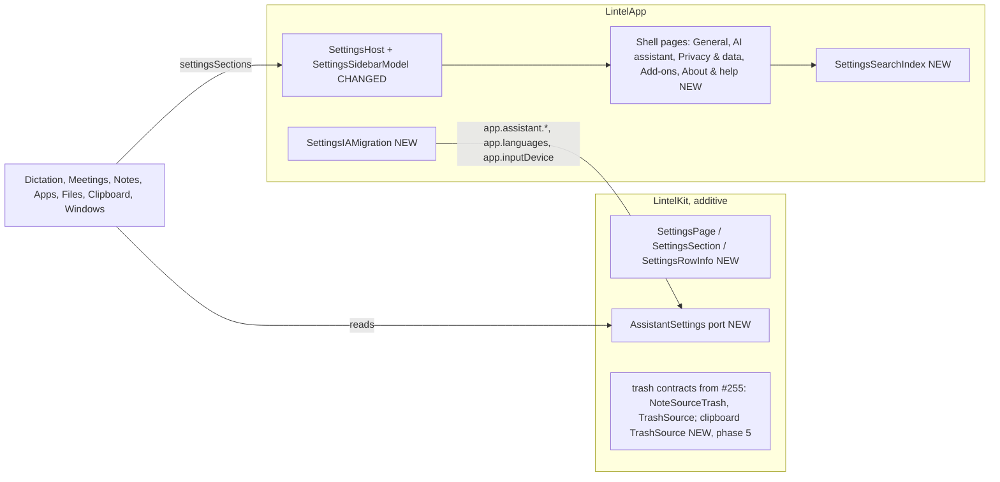

# Settings IA v2: seven pages, one home per setting

> Status: draft spec, 2026-11-24. Design-only. Inputs: the accepted UX direction (PR #247, `.ai/specs/research/2026-11-23-lintel-ux-direction.md` rev. 2, sketch `.ai/prototypes/lintel-direction/lintel.html`, owner decisions of 2026-11-24 on #247), the settings audit (`~/.lintel-agents/2026-11-23/report-settings-ux.md`), the research `research-settings-ia.md`, `research-foolproof-ui.md` and `research-competitors-ui.md` (`~/.lintel-agents/2026-11-24/`), PR #251 (core on, add-ons off) and spec PR #248 (SwiftUI design gallery). **Revised 2026-11-25** after the R1 review: Recently deleted is designed once, in `.ai/specs/2026-11-24-notes-explorer-main-window.md` (#255); this spec builds the clipboard's trash, Delete my data and Delete everything on that contract (owner decisions of 2026-11-24 and 2026-11-25 applied).

## 📝 TLDR

Lintel's settings today are 13 panes grouped Lintel / Search / Voice / Models / Advanced. An add-on sits above the core, the same text model is picked in three places, retention and deletion are spread over five panes, and the basic rows show engine names, server addresses and bundle IDs. This spec proposes a rebuilt Settings: a 7-item sidebar (General, Dictation, Meetings & notes, AI assistant, Privacy & data | Add-ons | About & help), one home per setting with pointer rows elsewhere, search with English and Polish synonyms, one AI assistant choice backed by a shared model, Privacy & data as the only place for permissions, retention and deletion (every manual delete goes to Recently deleted for 30 days, on the trash contract of the notes explorer spec #255), and key migrations for every moved key. Seven PRs, each with gallery states approved before code.

## 📝 Problem Statement

Evidence from the audit and the research, checked against `origin/main` 232f67c3:

1. **The core is buried.** `SettingsSidebarModel` lists Lintel (General, Features, Notes, Windows, Permissions) · Search (Apps, Files, Clipboard) · Voice (Dictation, Meetings) · Models · Advanced. Dictation and Meetings sit in the middle. Windows, an add-on, is in the "Lintel" group.
2. **Three pickers for one text model** (`plugins.dictation.builtInLLMModel`, `plugins.meetings.builtInLLMModel`, `plugins.notes.builtInLLMModel`) and **two for one speech model** (`plugins.{dictation,meetings}.speechModel`), plus a Models pane. Each mismatch costs gigabytes, and the user can't tell which model is "Lintel's".
3. **Jargon in the basic rows.** "Run on: Built-in (Lintel) / My server", `http://127.0.0.1:11434`, model-name footers, Speaker model, Bundle ID (`com.google.Chrome`), Capture diagnostics. That breaks foolproof rules R4 and R6.
4. **No single answer to "what does Lintel keep and how do I delete it".** Retention lives in four panes. Erase Data, Clear Library, Clear History ×2, Erase Notes Data, Reset Ranking and Rebuild use seven verbs. `meetings.retentionDays = 90` also deletes the notes, which are now the product's main view.
5. **Settings with no single home**, such as the dictation language in two panes and Wrap lines in Settings and the inspector. Fireflies (research) shows where this leads: its help centre gives three paths to one option.
6. `.uxproof/conventions.md` still prescribes the Models and Advanced panes, so the design guard enforces the old IA.

Audience: non-technical office workers (personas Anna, Piotr, Kasia in the direction doc). Owner rules: notes and dictation are the core, add-ons are off by default (#251). Every UI goes through the gallery (#248). The 19-item foolproof checklist is an acceptance criterion. All strings are in English and Polish.

## 📝 Proposed Solution

**The shell owns seven fixed pages, and plugins contribute sections to them.** Today each plugin draws a whole pane. Instead, a plugin declares sections, each with a target page, a placement (basic rows or More options) and searchable row metadata. The shell lays out the page: title (with the on/off switch for Dictation and Meetings & notes), status line, up to five basic rows, More options, and one privacy sentence. That gives one home per setting by construction, a search index without hand-written lists, and a jargon gate that a test can check.

**Alternatives considered:**

- *Keep plugin panes and only regroup the sidebar* (audit option 3). It is cheap, but the three model pickers stay, retention stays spread across panes and search has nothing to index. Rejected.
- *The shell imports the plugins' settings models*. This breaks the one-way dependency rule (AGENTS.md: only `PluginRegistry` knows concrete plugins). Rejected.
- *Hand-written search list in the shell*. It drifts from the real rows. Rejected in favour of row metadata declared next to the row.

### Pages and rows

`B` = basic row, `M` = under More options. Polish strings are the `pl` values. Final copy is approved on the gallery contact sheet.

| Page (en / pl) | Row (en / pl) | Control | Owner of the value | Pl. |
|---|---|---|---|---|
| **General / Ogólne** | Languages I speak / Języki, w których mówię | list + Change… | shell `app.languages` (new) | B |
| | Microphone / Mikrofon | popup, Automatic | shell `app.inputDevice` (new) | B |
| | Text size / Wielkość tekstu | M · L · XL | `app.textSize` | B |
| | Open Lintel when I log in / Otwieraj Lintel po zalogowaniu | toggle | Launch at Login | B |
| | Show Lintel in the Dock / Pokazuj Lintel w Docku | toggle | `app.showInDock` | B |
| | Try new features early / Testuj nowości wcześniej | toggle | `app.updates.includeBeta` | M |
| **Dictation / Dyktowanie** (title switch = `plugins.dictation.enabled`) | status "Ready to dictate" / „Gotowe do dyktowania” | status line | Dictation `settingsStatus` | — |
| | Shortcut / Skrót | recorder `dictation.record` | KeyboardShortcuts | B |
| | Tidy up my text / Porządkuj mój tekst | toggle | `plugins.dictation.mode` | B |
| | Dictionary · 12 words / Słownik · 12 słów | pointer › | vocabulary file | B |
| | Dictations are kept for 30 days / Dyktowania są przechowywane 30 dni (built from the effective values, like the Privacy & data sentence: a stored `retentionDays` shows its number, history off shows "Dictation history is off" / „Historia dyktowania jest wyłączona”) | pointer › Privacy & data | — | B |
| | After pasting, put back what I had copied / Po wklejeniu przywróć schowek | toggle | `plugins.dictation.restoreClipboard` | M |
| | Paste my last dictation unedited / Wklej ostatnie dyktowanie bez poprawek | recorder `dictation.pasteLastRaw` | KeyboardShortcuts | M |
| | Open dictation history / Otwórz historię dyktowania | recorder `dictation.history` | KeyboardShortcuts | M |
| **Meetings & notes / Spotkania i notatki** (title switch = `plugins.meetings.enabled`) | status, for example "Hears only you for now · Allow…" | status line | Meetings `settingsStatus` | — |
| | Record a meeting / Nagraj spotkanie | recorder `meetings.record` | KeyboardShortcuts | B |
| | Write notes after each meeting / Pisz notatki po każdym spotkaniu, with the second line "Written on this Mac · Change ›" | toggle + pointer › AI assistant | `plugins.meetings.notesEnabled` | B |
| | Suggest recording when a call starts / Proponuj nagrywanie, gdy zaczyna się rozmowa | toggle | `plugins.meetings.suggestMeetings` | B |
| | Your name in notes / Twoje imię w notatkach | field | `plugins.meetings.selfName` | B |
| | Export all notes… / Eksportuj wszystkie notatki… | button | Notes `NotesExporter` | B |
| | Never suggest recording in… / Nie proponuj nagrywania w… | app picker (no bundle IDs shown) | `suggestMutedBundleIDs`, `suggestExtraBundleIDs` | M |
| | Check call audio / Sprawdź dźwięk rozmowy | button (today's Test System Audio) | Meetings | M |
| | Reduce echo / Ograniczaj echo | toggle | `plugins.meetings.voiceProcessing` | M |
| | Open meeting list / Otwórz listę spotkań | recorder `meetings.library` | KeyboardShortcuts | M |
| **AI assistant / Asystent AI** | Who writes your notes and tidies your text / Kto pisze notatki i porządkuje tekst: **This Mac** (private, works offline) / **Claude** (your account; words are sent to Anthropic) | radio | This Mac = no provider; Claude = `plugins.meetings.notesProvider*` | B |
| | (with Claude) Claude writes your meeting notes. Dictation stays on this Mac. / Claude pisze notatki ze spotkań. Dyktowanie zostaje na tym Macu. | text | — | B |
| | Assistant on this Mac: Recommended for this Mac / Asystent na tym Macu: Zalecany dla tego Maca | popup | shell `app.assistant.textModel` (new) | M |
| | Speech recognition: Recommended / Rozpoznawanie mowy: Zalecane | popup (Whisper inside) | shell `app.assistant.speechModel` (new) | M |
| | Claude model / Model Claude | popup Sonnet · Opus · Fable | `plugins.meetings.notesProviderModel` | M |
| | Claude program location / Lokalizacja programu Claude | Choose… | `plugins.meetings.notesProviderBinary` | M |
| | Use my own AI server for dictation / Użyj własnego serwera AI do dyktowania | toggle + address | `plugins.dictation.llmSource`, `llmEndpoint`, `llmModel` | M |
| | Downloaded files 3.7 GB / Pobrane pliki 3,7 GB | Show in Finder · Remove Unused… | `SharedModelInventory` | M |
| | (only after migration found differing choices) Meeting notes use a different assistant · Use the Same / Notatki ze spotkań używają innego asystenta · Ujednolić | button | plugin override key | M |
| **Privacy & data / Prywatność i dane** | "Recordings, notes and dictations stay on this Mac." / „Nagrania, notatki i dyktowania zostają na tym Macu.” | sentence | — | — |
| *What Lintel can use / Do czego Lintel ma dostęp* | Microphone / Mikrofon · Hear other people in a call / Słysz innych w rozmowie · Type into other apps / Pisz w innych aplikacjach · (Quick search on) Search everywhere on this Mac / Szukaj wszędzie na tym Macu | `PermissionRow` over `PermissionGrantService` (onboarding spec), 3 states | enabled plugins' `requiredPermissions` | B |
| *What Lintel keeps / Co Lintel przechowuje* | Meeting audio / Dźwięk spotkań: Delete when notes are ready · 7 · 30 · 90 days (a stored other value, for example 14, is shown as its own item "14 days" and stays until the user picks another) | popup | `keepAudio` + `keptAudioDays` | B |
| | "Notes and transcripts stay until you delete them. Dictations and clipboard items are kept 30 days." / „Notatki i transkrypcje zostają, dopóki ich nie usuniesz. Dyktowania i schowek są przechowywane 30 dni.” (built from the effective values; the clipboard part only while Clipboard history is on) | read-only sentence | `plugins.meetings.retentionDays`, `plugins.dictation.historyEnabled` + `retentionDays`, `plugins.clipboard.retentionDays` | B |
| | (only on an old install pinned to a limit) Notes and transcripts are deleted after N days (the stored value, 90 when pinned by step 5) · Keep Forever / Notatki i transkrypcje są usuwane po N dniach · Zachowaj na zawsze | button, one way: writes `0` | `plugins.meetings.retentionDays` | B |
| | Remind me to tell people I'm recording / Przypominaj, by uprzedzić o nagrywaniu | toggle | `plugins.meetings.consentReminder` | M |
| *Delete / Usuń* | Delete my data… / Usuń moje dane… → sheet; Recently deleted · 12 items › / Ostatnio usunięte · 12 › (opens the one Recently Deleted view in the main window, #255; hidden while empty) | button + pointer | counts from the #255 trash contracts (`NoteSourceTrash`, `TrashSource`) | B |
| **Add-ons / Dodatki** | "Extra tools. All off until you turn them on." / „Dodatkowe narzędzia. Wyłączone, dopóki ich nie włączysz.” | sentence | — | — |
| | Quick search: open apps and files from the keyboard / Szybkie wyszukiwanie · Clipboard history / Historia schowka · Window layouts / Układy okien | switch each, "Off" next to it | `plugins.{apps,clipboard,windows}.enabled` | B |
| ↳ **Quick search** (only while on) | Shortcut (chosen when turned on) · Also search files (`plugins.files.enabled`) · Folders | | | B |
| | Result order · Show hidden files · Skip these folders · Search everywhere on this Mac · Suggest apps · Start over… | | `app.sectionOrder`, `plugins.files.*`, `plugins.apps.*` | M |
| ↳ **Clipboard history** (only while on) | Shortcut ⌘⇧V · Never save from these apps (app picker, password managers preset) | | `plugins.clipboard.*` | B |
| | Pause | | | M |
| ↳ **Window layouts** (only while on) | Shortcuts · Space between windows | | `plugins.windows.*` | B |
| | today's remaining controls, every command's recorder | | | M |
| **About & help / Pomoc i informacje** | status "Lintel 1.0 beta 2 · Up to date" (Check Now) · Update automatically · What's new · Show welcome again · Send a problem report… (shows what is sent) · Acknowledgements | | Updates, onboarding, About | B |

**Removed:** the Features, Models, Permissions, Advanced and Notes panes as panes. Their rows moved as listed above, the Notes export to Meetings & notes and Erase Notes Data to Delete my data. Also removed: the three text-model and two speech-model pickers (replaced by the shared choice), the Whisper language row (Languages I speak covers it), Speaker model, "Run on", the model-name footer, Bundle ID fields, Capture diagnostics (folded into Send a problem report), Notes → Wrap lines (the inspector stays its home), every per-pane Clear, Reset Ranking and Rebuild (now Start over inside Quick search).

### Rules every page follows

1. **One home.** Every stored value is changed in exactly one row. Other pages show a pointer row (summary + "›") that opens the home page, expands More options when needed and highlights the row. The home-uniqueness test (step 1.6) fails when two rows declare the same `valueKey`.
2. **At most 5 basic rows**, the rest under More options, two levels at most (C8). The exception is Privacy & data, which has three groups and 6–7 basic rows by owner decision 3 (one page, permissions included).
3. **Jargon only under More options** (C5). Basic rows never contain: model, LLM, server, address, endpoint, bundle ID, index, ranking, diagnostics, launcher, plugin, Parakeet, Whisper, GGUF, token, diarization, nor their Polish forms (`JargonGateTests`, step 1.6).
4. **Every command has a recorder** in the page of its plugin (`ShortcutCoverageTests`, step 6.4). Every `PluginCommand` with `hotkey` support is listed.
5. **Changes apply at once.** There are no Save buttons and no filled primary button on settings pages. A destructive action opens a sheet that names the object and the count, gives the button a specific verb ("Delete 42 Meetings") and makes Cancel the default (C11).
6. **Verdigris only** on the selection (14 % tint, 3 pt bar), the "on" state of switches and the live status line. Links stay neutral (owner decision 4).

### Settings search

There is one field at the top of the sidebar (⌘F while Settings is shown). The index holds each row's title and help line in **both** English and Polish, whatever the system language, read from the String Catalog with an explicit locale, plus a synonym table `SettingsSearchSynonyms` (code, not catalog, because it needs both languages at once). Seed entries: hotkey/skrót/shortcut, recording/nagranie/nagrania, delete/usuń/kasuj/erase, spell/literuj/pisownia, disk space/miejsce/storage, headset/słuchawki, bigger/większy, bug/błąd/zgłoś, login/logowanie, claude/anthropic, zoom/teams/meet → Hear other people in a call. Matching goes through `TextNormalizer` + `FuzzyMatcher` (LintelCore), so Polish diacritics fold the same way as everywhere else. A result names its page (and "More options"). Choosing it opens the page, expands More options and highlights the row for 2 s (static under Reduce Motion). With no results the page shows one sentence and "Send a problem report" as its one action (C13).

## 📝 Architecture

Takeaway: plugins stop owning panes and start contributing sections. The shell is the only code that knows the seven pages. Shared values (assistant model, speech model, languages, microphone) move to `app.*` and reach plugins through a read port, so no plugin reads another plugin's keys.

### New contract (additive, ADR 0014 "Settings pages and the shared assistant")

All new contract types are in `Sources/LintelKit/SettingsPages.swift` and every contribution has a default.

- `SettingsPage`: an open set like `SettingsGroup` (`general`, `dictation`, `meetingsAndNotes`, `assistant`, `privacy`, `addOns`, `about`, and `addOn(PluginID)` for an add-on sub-page).
- `SettingsSection { id, page, placement: .basic | .moreOptions, group: LocalizedStringResource?, rows: [SettingsRowInfo], view: @MainActor () -> AnyView }`.
- `SettingsRowInfo { id, title, help, synonyms: [String], valueKey: String?, isPointer }`. `valueKey` is the one-home key (the stored key, or a pseudo-key such as `shortcut:dictation.record`).
- `LintelPlugin.settingsSections: [SettingsSection]` (default `[]`). While it is empty, the plugin's existing `settingsPane()` is shown whole: a core plugin's pane goes on its page under a "More options" fold, an add-on's pane becomes its sub-page. Old panes keep working until each phase moves them, so every step leaves the app working.
- `PluginManifest.isAddOn: Bool` (default `false`; `true` for Apps, Files, Clipboard and Windows). It replaces `settingsGroup` for placement, and `settingsGroup` stays declared and ignored (BC §1 "ignored").
- `PluginContext.assistant: any AssistantSettings` (phase 3), read-only: `textModelID`, `speechModelID`, `speechModelFolder`, `languages: [String]`, `inputDeviceUID`, and `changes: AsyncStream<Void>`. The default for a context without a host returns `nil` for everything, so a plugin falls back to its own key and behaves as today. Writes happen only on the shell's AI assistant and General pages.
- No delete contract of its own. Phase 5 uses the trash contracts of `.ai/specs/2026-11-24-notes-explorer-main-window.md` (#255) Phase 1: `NoteSourceTrash` (Meetings, Dictation, Notes) and `TrashSource` with `LintelPlugin.trashSources` / `PluginContext.trashSources` (the clipboard's, built here with `hidesContent = true`). `DataStoreInfo` is only a shell-side read-only value (`id`, `title`, `liveCount`, `trashedCount`) built from those contracts for the Delete my data sheet and the pointer row; it never deletes. Delete my data calls each source's `trashAll()`; Restore, Delete Now and the purge stay in #255's contracts and view.

The settings `view` closure must not open stores, touch the Keychain or download while the plugin is inactive (the existing `InactiveSettingsPaneTests` rule extends to sections).

### Settings host

Settings stays the main window's Settings mode (ADR 0008; `SettingsHost`, `StatusBanner`, `StatusDerivation`). The direction doc sketches a separate window. That move belongs to the main-window spec, and nothing in this IA depends on the host. `SettingsPanes` / `SettingsShellPane` are replaced by `SettingsPageCatalog` (pure: pages, plugin sections sorted by `manifest.order`, sub-pages of enabled add-ons only). `app.mainWindow.settingsPane` keeps its key. Old ids are mapped on read (`features→addOns`, `permissions→privacy`, `advanced→about`, `models→assistant`, `apps`/`files→addOn(apps)`, `clipboard→addOn(clipboard)`, `windows→addOn(windows)`, `meetings`/`notes→meetingsAndNotes`), and an unknown id still falls back to General.

## 📝 Data Model

### Settings keys

New `app.*` keys are declared in `SettingsKeys.swift` and added to BC §3.

| Key | Type, default | Replaces |
|---|---|---|
| `app.assistant.textModel` | String `LLMModelCatalog` id. Missing = recommended: the largest catalog model whose memory requirement fits this Mac (the filter Meetings uses today, now for every plugin; it picks the recommended model and the popup's offers, while a stored id is used as stored). Missing happens only on new installs, because step 1 writes the old effective id on existing ones | `plugins.{dictation,meetings,notes}.builtInLLMModel` |
| `app.assistant.speechModel` | String `ModelCatalog` id, default `parakeet-ultra` | `plugins.{dictation,meetings}.speechModel` |
| `app.assistant.speechModelFolder` | String path; missing = downloaded model | `plugins.{dictation,meetings}.speechModelFolder` |
| `app.languages` | [String] of `pl`/`en`; missing = system languages ∩ supported, else `["pl"]`. Missing happens only on new installs, because step 3 writes the old effective value on existing ones | `plugins.{dictation,meetings}.speechLanguage` |
| `app.inputDevice` | String UID; missing = Automatic (system input) | `plugins.{dictation,meetings}.inputDevice` |
| `app.settingsMigration.v2` | [String] of finished migration step ids | marker |
| `app.eraseScheduledAt` | Double (Unix s); missing = no deferred Delete everything (phase 5) | new |

**Migration `SettingsIAMigration`** (`Sources/LintelApp/Migration/`) runs once per step id at launch, after `LegacyDataMigration` and `PluginDefaultsMigration`, before the host reads a switch. BC §3 rules apply: the migration keeps its code for at least one minor release, has a test for each case, and never changes behaviour.

1. **Text model** (phase 3). On a new install (the existing-install test of `PluginDefaultsMigration` says no) nothing is written and the recommended model applies. On an existing install, each plugin's **effective id today** is used: its stored `builtInLLMModel` if it is in the catalog (for Meetings also only if `LLMModelCatalog.available(physicalMemory:)` offers it on this Mac, as `MeetingsSettings.builtInLLMModel` checks today), else its old default (Dictation and Meetings: `LLMModelCatalog.defaultModel`, the smallest; Notes: the first installed model, else the default). The winner is the first effective id that is installed, in the order dictation → meetings → notes; with none installed, the dictation effective id. The winner goes to `app.assistant.textModel`. A stored plugin key equal to the winner is deleted. **A plugin whose effective id differs keeps it as an override** (its stored key stays, or the old default is written to it), read by that plugin as effective = own key if valid, else `assistant.textModelID`. Its plugin contributes the M row "… use a different assistant · Use the Same", which deletes the override. So no existing user's notes or cleanup switch models or need a download (a missing key never resolves to "recommended" for them), and new installs never get an override.
2. **Speech model and folder** (phase 3). Same rule over dictation → meetings.
3. **Languages** (phase 3). On a new install nothing is written and the new default applies. On an existing install, each plugin's **effective value today** is used: its stored `speechLanguage`, else `pl` (today's rule `== "en" ? "en" : "pl"`). `app.languages` is their union in the order dictation, meetings, so an existing user who never chose a language gets `["pl"]`, as today, whatever the system language. The old keys are deleted after the copy, except: a meetings effective value that differs from `languages.first` is kept as a meetings override, because it is both the meetings Whisper pin and Parakeet's script hint (#132), by the same rule as 1. The Whisper pin reads the override if present, else `languages.first`.
4. **Microphone** (phase 3). Same rule as 1 (dictation → meetings).
5. **Retention pin** (phase 4). On an install that ran before (same test as `PluginDefaultsMigration`) with no stored `plugins.meetings.retentionDays`, the migration writes `90`, the old effective value. A stored value is kept as it is. New installs read the new default `0` (keep forever). Owner decision 2026-11-24 on #253 (Q7) approves this longer default, as BC §3 requires; the BC §3 entry cites it. The pinned install's only way to change it is the one-way Keep Forever button.

**Keys kept, UI removed, documented in BC as "no UI"**: the retention keys other than meeting audio (`plugins.meetings.retentionDays`, `plugins.dictation.historyEnabled`, `plugins.dictation.retentionDays`, `plugins.clipboard.retentionDays`, `plugins.clipboard.maximumEntries`; owner decision Q7: the only retention choice is how long meeting audio stays on disk), `plugins.dictation.keepWarmMinutes`, `plugins.dictation.maximumEntries`, `plugins.meetings.diarization`, `systemAudio`, `diarizationModelFolder`, `notesChunkTokens`, `notesReduceInputTokens`, `orphanAudioDays`. Still **ignored**: `plugins.notes.showAuthorBars`, `showQuotes` (BC already says so). `app.sectionOrder`, every `plugins.<id>.enabled`, retention keys and KeyboardShortcuts keys keep their names and stored values, so a user who turned dictation history off keeps it off. Only their row moves or goes. `plugins.meetings.notesProvider*` stay in the Meetings namespace (the consent keys of 2026-11-20). The AI assistant page writes them only through the Meetings section, so no consent value moves or appears without the user's choice.

### Recently deleted (phase 5)

The schema, the trash contracts, the 30-day purge, the rule for meeting audio, the Recently Deleted view and the Undo toast are defined once in `.ai/specs/2026-11-24-notes-explorer-main-window.md` (#255): `meetings.sqlite` `v4-trash`, `dictation.sqlite` `v2-trash` and `notes.sqlite` `v2-explorer`, one column name `deleted_at` in every store, `NoteSourceTrash`, `TrashSource`, `UndoToast` (its Phase 1) and the view (its Phase 5). This spec does not restate them. It adds:

- **`clipboard.sqlite` `v2-trash`** (the next id after `v1-clipboard`; no other spec uses it): `ALTER TABLE clip_item ADD COLUMN deleted_at REAL` (Unix s, NULL = live) plus a partial index, the same shape as #255's stores. The FTS5 queries and every list, search, filter, count, paste and duplicate-detection query filter `deleted_at IS NULL`. The clipboard's `TrashSource` (`hidesContent = true`) through `ClipboardPlugin.trashSources`. Previous-schema test per BC §2.
- **Clipboard** (owner decision Q9, no exception, passwords included): Clear history and single deletes (⌃X in the ⌘⇧V panel) move `clip_item` rows to Recently deleted. Deleted items stay in the SQLCipher store and their AES-GCM blob files (> 1 MB) stay encrypted until the purge. They never appear in the ⌘⇧V list, its search or filters, are never pasted, do not count toward the 1000-entry limit, and are skipped by duplicate detection, so copying the same text again makes a new item. The Recently Deleted view shows them as "Clipboard item · 2 min ago" with no content preview; Restore puts them back in the history, not on the pasteboard. The purge runs in the clipboard's `RetentionJob` 30 days after `deleted_at`.
- **Delete my data** (phase 5): the sheet calls `trashAll()` of the chosen stores, so it moves items to Recently deleted like every other manual delete (owner decisions 2026-11-24). Rows being recorded or processed stay, and the sheet says so.
- **Delete everything**: every store's `trashAll()`, and `app.eraseScheduledAt` is set. After 30 days, or on "Delete Now", the plugins' `eraseData()` runs (Keychain items and folders). Until then the data stays encrypted with its key. "Cancel deletion" restores everything and clears the key.

Policy, written the same way in both specs (owner decisions):

| Rule | Decision |
|---|---|
| Manual deletes (single, ⌃X, Clear, Delete my data, Delete everything) | to Recently deleted for 30 days, no exception (2026-11-24, Q9 here and decision 8 on #247) |
| Retention by age or count (clipboard 30 days / 1000, dictation 30 days / 500, pinned notes limit, meeting audio) | deletes at once, as today, trashed rows included: the trash never extends a limit, so "kept 30 days" stays true (2026-11-25) |
| Audio of a deleted meeting | stays with the meeting in Recently deleted and is purged with it after 30 days; a restored meeting has its audio (2026-11-25) |
| Permanent paths | Delete Now and Empty Recently Deleted (#255), Delete everything's Delete Now (here) |
| Where it is shown | one view in the main window (#255); Privacy & data has the pointer row only (default, owner confirmation pending) |

There is no new free-text field. Deleted rows keep their existing encryption. Logs carry counts and ids only.

## 📝 UI/UX

Prototype: `.ai/prototypes/lintel-direction/lintel.html` (accepted direction "Quiet Native with warmth", owner decision 1 of 2026-11-24 on #247; screenshots `qa-evidence-pr-247` @ `ef622a54`, `pr-247/v2/`). Accepted scope: the IA, vocabulary and look of the settings pages. **The source of truth for each page is its gallery scene** (#248), approved by the owner on the contact sheet before the page's code is merged.

**Page anatomy:** title (+ switch for Dictation, Meetings & notes) → one status line (`StatusBanner`, ring tint when live) → up to 5 basic rows → `More options` disclosure (never "Advanced") → one privacy sentence. Help lines are at most 15 words, describe the effect, and appear only where the label is not enough (the C6 reading from #247).

**Sidebar:** 7 items in three groups separated by hairlines. Add-ons shows "3 off" (or "1 on"). An enabled add-on gets an indented sub-page under Add-ons. A sidebar dot appears for attention or error, as today.

**States to put in the gallery (states before code):** each page in light/dark × M/XL × en/pl; Dictation and Meetings & notes off (title switch off: rows dimmed, the status line "Turn on to …" with one Turn On); permission missing (status + Allow…); AI assistant with Claude chosen, Claude not found, assistant model not downloaded (status "Download the assistant · 2.5 GB · Get It"); Privacy & data with every permission state (Allowed ✓ / Needs your OK [Allow…] / Not needed now) (C14); the Delete my data sheet (dictations 128 / meetings and notes 42 / clipboard 300 while Clipboard history is on / everything; the button names the count; Cancel is the default); the What Lintel keeps sentence for a new install and the pinned old install (Keep Forever); the Recently deleted pointer row (hidden while empty, with its count); clipboard items as rows of #255's Recently Deleted view, without content; the Delete my data sheet in its phase 5 wording ("Move 128 Dictations to Recently Deleted"); the deferred Delete everything (scheduled, Cancel deletion, Delete Now); the Undo toast is #255's one-line minimal pill ("Deleted 42 meetings" + Undo, 10 s, announced to VoiceOver, never the only way back) and needs no scene here; Add-ons all off, one on; the Quick search enable sheet (pick a shortcut, prefilled ⌃⌥Space, never ⌘Space; the Search everywhere permission explained); search with results, a More options hit and no results; About & help with an update available.

**Onboarding link:** the Access step's "allow them later in Settings → Privacy & data" points to the one home that this spec builds.

**Accessibility:** every row is a labelled control. VoiceOver reads the title, value and "in More options". Keyboard: ⌘F search, ↑↓ in the sidebar, Space toggles, Esc closes sheets. Targets are at least 24 pt. Nothing is shown only on hover. XL text in Polish fits without truncation at the default size, and pages scroll vertically.

### Acceptance: foolproof checklist

Every UI phase's QA comment carries the C1–C19 table from `research-foolproof-ui.md` §2 for the pages it touches, PASS/FAIL with gallery snapshots and running-app screenshots (light, dark, PL, XL). Not applicable: C1 (main window) and C2 (checked on Add-ons only). Agreed exception: C8 on Privacy & data (owner decision 3). C5 and C18 are automated (`JargonGateTests`, `SettingsSearchTests` with the 18 user words from #247 plus the 20 tree-test phrasings), and C16 is checked by `BrandContrastTests`.

## 📝 Edge Cases & Failure Scenarios

- **A plugin is failed or inactive:** its sections render dimmed with the host's status line ("Dictation stopped working · Try Again"). Search still finds its rows and opens the page.
- **The migration finds a stored model id that is no longer in the catalog:** it is skipped as if unset (the catalog's existing rule). The migration never deletes a model file.
- **The shared model is changed while a meeting's notes are being written:** the running job keeps its lease (`LLMLease` key), and the next job uses the new model. Remove Unused… goes through `ModelManager.delete(_:unless:)`, as the Models pane does today.
- **Claude chosen but the CLI is missing or out of date:** the AI assistant status line shows the existing `ProviderStatusBanner` reasons in plain words with one fix. The notes are never written silently on This Mac (existing rule).
- **Delete while recording:** a meeting being recorded or processed is not moved. The sheet says "1 meeting is still being recorded and stays."
- **Restore after the source plugin was switched off:** the Recently Deleted view (#255) lists only active sources and says "Some deleted items belong to features that are off." The purge of an inactive store runs when it next activates, as its retention does today.
- **Clock moved back:** a purge uses `deleted_at < now − 30 d` on the injected clock, so a row is never purged early, only late.
- **Delete everything, then quit before 30 days:** `app.eraseScheduledAt` survives the quit. "Cancel deletion" restores everything. A Keychain error during the final erase leaves the files in place and logs a code (the `EncryptedDatabaseOpener` policy).
- **Quick search turned off:** the main shortcut is unregistered, so a panel that finds nothing never opens. Turning it on asks for a shortcut. A user who had one keeps it (`app.hotkey.userDefined`).
- **Search in the other language:** a Polish user typing "delete" finds "Usuń moje dane…" (both languages are indexed).
- **A row's `valueKey` collides** (two homes): `SettingsHomeTests` fails in CI and names both rows.

## 📝 Risks & Impact Review

| Surface | Change | Who is affected | Migration / rollback |
|---|---|---|---|
| BC §1 `LintelKit` | additive: `SettingsPage`, `SettingsSection`, `SettingsRowInfo`, `settingsSections`, `isAddOn`, `AssistantSettings`; `settingsGroup` becomes ignored. The trash contracts are #255's | every plugin | defaults keep old panes working; ADR 0014 |
| BC §3 keys | 5 new `app.*` keys; moved model, speech, language and input keys; new notes retention default (owner-approved, Q7); dictation and clipboard retention keys lose their UI | every existing user | `SettingsIAMigration`, one test per case. Rollback: an older build reads the plugin keys. Deleted keys equal the winner, so the older build falls back to its default only where the user never chose one. Known cost: after a rollback a user may see the catalog default instead of the shared choice (documented in the ADR). |
| BC §2 stores | `clipboard.sqlite` `v2-trash` here; the dictation, meetings and notes migrations are #255's | clipboard users | additive column. An older build ignores `deleted_at`, so soft-deleted clipboard items reappear after a rollback (documented, safe direction) |
| BC §5 behaviour | the main shortcut is registered only while Quick search is on. Every delete is reversible for 30 days | launcher users, everyone deleting | BC §5 entry. Users with Quick search on see no change |
| Privacy defaults | notes and transcripts kept forever on new installs; deleted content, clipboard included, kept 30 days encrypted; meeting audio is the only retention choice | new installs; everyone who clears the clipboard | owner decisions Q7 and Q9 of 2026-11-24 on #253 satisfy the BC §3 privacy-default rule. Old installs keep their notes value (90 if none stored). Clipboard items in Recently deleted never show content and are purged after 30 days or on Delete Now. Retention by age or count never passes through the trash (owner 2026-11-25), so no limit is extended |
| `.uxproof/conventions.md`, `guards.json` | rewritten for the 7 pages and the one-home rule | design review | same PR as phase 1 |

Direction calls (not rule violations): the C8 exception and Claude limited to meeting notes. The notes-forever default and the clipboard in Recently deleted were owner direction calls, now decided.

## Resolved assumptions (autonomous defaults)

| # | Question | Applied default | Why | Confirm? |
|---|---|---|---|---|
| Q1 | Split Recently deleted (an independently deployable capability) into its own spec? | **Split with #255** (both R1 reviewers): #255 Phase 1 owns the dictation, meetings and notes migrations, the trash contracts, the 30-day purge and `UndoToast`, and #255 Phase 5 the view. This spec's Phase 5 owns the clipboard migration and `TrashSource`, clipboard Clear, Delete my data, Delete everything and the Privacy & data pointer row | One design, no second migration in the same store | decided in R1 |
| Q2 | Settings in a separate window (sketch) or the main window's Settings mode (ADR 0008)? | Keep the current host. The window move belongs to the main-window spec | Smallest change. The IA does not depend on the host | reversible |
| Q3 | How do plugin settings land on shared pages without the shell importing plugins? | Additive `settingsSections` contributions with row metadata (ADR 0014) | Keeps the dependency rule. Search and the gates come from the same data | reversible until v1.0 ships it |
| Q4 | The three `builtInLLMModel` (and two speech) keys differ: what does the migration do? | Pick the winner (installed, dictation → meetings → notes), and keep differing keys as per-plugin overrides with a "Use the Same" row | Never changes which model a user's notes or cleanup run on (BC §3) | reversible |
| Q5 | Does "Claude" also cover dictation? | No. Claude writes meeting notes only. Dictation stays on This Mac, and the page says so | `LintelProviders` is wired into Meetings only. Dictation via Claude is a new capability | reversible |
| Q6 | A consent sheet before the first Claude meeting? | No sheet. Choosing Claude is the consent, with inline text naming Anthropic and the user's account | Owner decision 2026-11-20 | reversible |
| Q7 | Notes and transcripts default | Keep forever on new installs. Existing installs keep their value (90 if none stored). The only retention choice in Settings is how long meeting audio stays on disk | **Owner decision 2026-11-24 on #253** | decided |
| Q8 | "Write notes after each meeting" default | Unchanged (`false`), but moved to the basic rows so it is visible | #251 left this default to a separate owner decision | reversible |
| Q9 | Does Clear clipboard history go to Recently deleted? | Yes, 30 days encrypted, with the same Restore and Undo as owner decision 8 on #247. No exception | **Owner decision 2026-11-24 on #253** | decided |
| Q10 | "Delete everything" with keys and folders | Soft for 30 days (keys and files kept), then `eraseData()`. "Delete Now" erases at once | Follows owner decision 8 without losing the reset | reversible |
| Q11 | Dictionary's home before the main window's Dictionary page exists | The Dictation pointer opens today's vocabulary panel in a sheet (its only editor). It points to the main-window page once that page lands | One home either way | reversible |
| Q12 | Main shortcut when Quick search is off; default when it is turned on | Unregistered while off. Turning it on asks, prefilled ⌃⌥Space, never ⌘Space. A user's own shortcut is kept | #247 sketch and #251 QA finding (a panel that finds nothing) | reversible |
| Q13 | What does "Languages I speak" control? | The home of the old `speechLanguage` keys: the Whisper pin uses the first language. The language-detection spec (#246) reads it as its candidate set | No new behaviour invented | reversible |
| Q14 | Dictation default shortcut ⌥Space (owner decision 7) | Not changed here. This spec shows whatever default is in effect, and the default change belongs to the onboarding spec | Changing a default shortcut is a BC §5 change with its own collision tests | reversible |
| Q15 | Search languages | Always both English and Polish, whatever the system language | Bilingual users. The tree-test words are in both | reversible |
| Q16 | What do dictation and clipboard retention become without a choice? | Their current values stay in effect (30 days; 500 and 1000 entries), with no UI. A stored value, including dictation history off, is kept. Privacy & data shows them in one read-only sentence. An old install pinned to a notes limit gets a one-way Keep Forever button | Follows Q7 without changing anyone's data. The button is the only way out of the pin | reversible; **owner to confirm** that the dictation-history on/off switch loses its UI (R1 question 4) |
| Q17 | Rows removed by retention by age or count: through Recently deleted? | No. Deleted at once, trashed rows included | **Owner decision 2026-11-25** | decided |
| Q18 | Audio of a deleted meeting | Kept with the meeting in Recently deleted, purged with it after 30 days | **Owner decision 2026-11-25** (#255 Q17) | decided |
| Q19 | Where Recently deleted is shown | One view in the main window (#255 Q5); a pointer row in Privacy & data | One source, one count | reversible; owner confirmation pending (R1 question 3) |

## 📋 Phasing

Each phase is one `feat/` PR from `main`. Each UI phase starts with gallery scenes approved on the contact sheet (#248 must have its Phase 1 merged first; the sheet and toast scenes of phases 4–6 also need #248 Phase 4, the `.sheet` mode). Migration steps 1, 3 and 5 use the existing-install test of `PluginDefaultsMigration`, which arrives with #251, so #251 must be merged before phase 3. Phase 4 needs the onboarding spec's Phase 2 (`PermissionGrantService`). Phase 5 needs #255 Phase 1 (contracts, migrations, purge, `UndoToast`), and its pointer row needs #255 Phase 5 (the view). Each phase passes the validation gate, adds en+pl strings (`StringCatalogTests`) and carries the C1–C19 QA table.

1. **Shell: seven pages, sidebar, search, gates.** Contract part 1, the new sidebar, General (without Languages and Microphone), Add-ons, About & help, old panes hosted inside the new pages, search, pane-id mapping, conventions. Features, Advanced and Permissions disappear as panes.
2. **Dictation and Meetings & notes pages.** Both plugins and Notes contribute sections: basic rows, More options, app picker, Check call audio, every command's recorder, pointer rows. The jargon leaves the basics.
3. **AI assistant and shared values.** `AssistantSettings` port, migration steps 1–4, the AI assistant page, General's Languages and Microphone, Models pane removed (Downloaded files row), the Claude section contributed by Meetings.
4. **Privacy & data.** Permissions in 3 states, the meeting audio choice and the read-only What Lintel keeps sentence, consent reminder, the Delete my data sheet over today's delete paths, retention pin migration (step 5, Q7).
5. **Recently deleted for the clipboard and the bulk deletes.** `clipboard.sqlite` `v2-trash` and its `TrashSource`, clipboard Clear and ⌃X to the trash, Delete my data over `trashAll()`, deferred Delete everything, the Privacy & data pointer row. Everything else is #255's.
6. **Add-on pages and cleanup.** Quick search (Apps + Files), Clipboard history, Window layouts as sub-pages, Start over, shortcut on enable, removal of the leftover pane code, BC "no UI" entries, `ShortcutCoverageTests`.
7. **Validation (later, no code).** Tree test and five-second test per the plan below. The results feed renames or pointer rows only.

## 📋 Implementation Plan

### Phase 1: Shell, sidebar, search, gates

- 1.1 Gallery scenes: sidebar, General, Add-ons, About & help, search (results, More options hit, none), each page in the matrix. Owner approves the contact sheet. Test: gallery snapshot goldens.
- 1.2 `LintelKit/SettingsPages.swift`: `SettingsPage`, `SettingsSection`, `SettingsRowInfo`, `settingsSections` (default `[]`), `PluginManifest.isAddOn` (default `false`; set on Apps, Files, Clipboard, Windows). ADR 0014 part 1 and the BC §1 entry. Test: `LintelKitTests` defaults, `PluginManifest` round trip.
- 1.3 `SettingsPageCatalog` (pure) + new `SettingsSidebarModel`: 7 items, add-on sub-pages only while enabled, fallback hosting of `settingsPane()` per the contract rule, `app.mainWindow.settingsPane` id mapping. Test: catalog for a fresh install (`--qa`) and an old install, the id-mapping table.
- 1.4 Shell pages General (Text size, login, Dock, More: Try new features early), Add-ons (switches with "Off", the sentence), About & help (Updates status and Update automatically from `UpdatesSection`, What's new, Show welcome again, Send a problem report = today's diagnostics with a "This is what is sent" preview, Acknowledgements). Features' switches go to Add-ons and the core page titles. Features' Erase Data rows are hosted temporarily in Privacy & data (moved for good in 4.4). Test: `SettingsHostModel` tests, `InactiveSettingsPaneTests` extended.
- 1.5 `SettingsSearchIndex` + `SettingsSearchSynonyms` + the sidebar field and the highlight/expand behaviour. Test: `SettingsSearchTests` with the 18 #247 words and 20 tree-test phrasings in both languages. Rows not migrated yet are indexed by their page title.
- 1.6 Gates: `JargonGateTests` (basic-row titles and help in en and pl against the list), `SettingsHomeTests` (unique `valueKey`, every pointer targets an existing row). Rewrite `.uxproof/conventions.md` and `guards.json` for the 7 pages, the one-home rule and More options. This step never edits `.uxproof/contract.json` or `tokens.json`, which #248 Phase 2 rewrites, so the two can land in either order. AGENTS.md settings row updated.

### Phase 2: Dictation and Meetings & notes

- 2.1 Gallery scenes for both pages (on, off, missing permission, missing model, More options open). Owner approval.
- 2.2 `DictationPlugin.settingsSections`: Shortcut, Tidy up my text, Dictionary pointer (sheet, Q11), retention pointer, More options (restore clipboard, Paste last unedited, Open history). Model, speech and server rows stay temporarily under More options until phase 3. Test: section row metadata, jargon gate passes, pane-model tests ported.
- 2.3 `MeetingsPlugin.settingsSections`: Record a meeting, Write notes (+ pointer), Suggest recording, Your name, More options (Never suggest in… with an app picker over `WorkspaceClient` running and installed apps, bundle IDs never shown; Check call audio; Reduce echo; Open meeting list). `NotesPlugin.settingsSections`: Export all notes… on the Meetings & notes page. Speaker model and Capture diagnostics rows are removed. Test: app picker model (adds and removes the same keys as before), export action, jargon gate.
- 2.4 Title switches for both pages (`plugins.<id>.enabled` through `PluginHost`), dimmed state, status lines. Test: host toggling, `StatusDerivation` unchanged.

### Phase 3: AI assistant and shared values

- 3.1 Gallery scenes: This Mac, Claude (found, missing), model missing, overrides present, Downloaded files. Owner approval.
- 3.2 `AssistantSettings` port in `LintelKit` (default nil-returning), `AppAssistantSettings` in `LintelApp` over the new `app.*` keys, ADR 0014 part 2, BC §1/§3 entries. Test: port defaults, change stream.
- 3.3 `SettingsIAMigration` steps 1–4 with a test per case: new install with nothing stored (nothing written); existing install with nothing stored (the old effective values are written: `["pl"]` on an English system, `LLMModelCatalog.defaultModel`, Notes' first installed model as an override when it differs); one stored; all equal; differing (overrides kept); a meetings language that differs from `languages.first` (override kept, the Parakeet hint unchanged); stored id not installed; stored id unknown; second launch is a no-op; runs before the host.
- 3.4 Dictation, Meetings and Notes read effective values (own override if valid, else the port). Their model, speech, language and input rows are removed. Override "Use the Same" rows are added. Test: each plugin's effective-value table. `NotesModelUsageParityTests` and the `modelUsage` "used by" tests stay green.
- 3.5 Shell AI assistant page (the #248 pilot "Notes are written by" moves here from Settings → Meetings, and its goldens are re-recorded in this step; radio, inline Claude text, More options with assistant, speech recognition and Downloaded files over `SharedModelInventory`) + the Meetings section (Claude model, program location; writes `notesProvider*` only on the user's choice) + the Dictation section (own AI server). Models pane removed, and `PluginContext.openModels` now opens AI assistant › More options. Test: choosing This Mac or Claude writes exactly the two provider keys, or removes them. Removal refused while in use.
- 3.6 General: Languages I speak, Microphone (Automatic + devices). Test: the Whisper pin follows `languages.first`.

### Phase 4: Privacy & data

- 4.1 Gallery scenes: permission states, the What Lintel keeps sentence (new install, pinned install with Keep Forever, clipboard part present or absent), the Delete my data sheet. Owner approval.
- 4.2 What Lintel can use: `PermissionRow` with 3 states and plain names (the system name only on "Open System Settings"), enabled plugins' permissions only. Granting goes through `PermissionGrantService` (`2026-11-24-first-run-onboarding.md`, step 2.6), the one grant path shared with the onboarding Access step and the plugin banners; this step adds no second one. The 3-state mapping (Allowed ✓ / Needs your OK + Allow… / Not needed now) is one type next to `PermissionGrantService` in `Sources/LintelApp/Permissions/`, added by whichever of the onboarding Access step (its Phase 3) and this step lands first and reused by the other. Test: state mapping table for the 9 current states → 3 (one table, wherever the type lands).
- 4.3 What Lintel keeps: the Meeting audio popup (the only retention choice), the read-only sentence, Keep Forever on pinned installs, consent reminder, contributed by their plugins with placement `privacy`. The Dictation and Meetings pointer rows now land here. Retention pin migration step 5 and the new default (Q7). Dictation and clipboard retention rows and Keep at most are removed. Test: popup ↔ key mapping (`keepAudio` + `keptAudioDays`), the sentence for each stored combination, Keep Forever writes `0`, migration cases.
- 4.4 Delete my data sheet: counts per store, Cancel default, the verb names the count. In this phase it still runs today's Clear and Erase paths behind today's named confirmation (no change from today's behaviour), including Notes' kept-copies box; phase 5 switches it to Recently deleted. Per-pane Clear buttons removed. Test: counts, refusal while recording, kept-copies path unchanged.

### Phase 5: Recently deleted for the clipboard and the bulk deletes

Depends on #255 Phase 1 (trash contracts, the dictation, meetings and notes migrations, the purge, `UndoToast`); step 5.4's pointer row also needs #255 Phase 5 (the view).

- 5.1 Gallery scenes: the Delete my data sheet in its trash wording, clipboard Clear confirmation, deferred Delete everything (scheduled, Cancel deletion, Delete Now), the pointer row, clipboard items in #255's view without content. Owner approval.
- 5.2 `clipboard.sqlite` `v2-trash` + previous-schema test; every read filters `deleted_at`; the clipboard `TrashSource` (`hidesContent`); purge 30 days after `deleted_at` in `RetentionJob`; retention by age or count keeps deleting at once, trashed items included; trashed items do not count toward the 1000 limit. Test: the ⌘⇧V list, search, filters, paste and duplicate detection skip deleted clips; blob files survive until the purge; `TestClock` 30-day purge; age retention removes a trashed item before its 30 days; the `TrashSource` never returns content.
- 5.3 Clipboard Clear and ⌃X call the trash; Delete my data calls `trashAll()` per chosen store ("Move 128 Dictations to Recently Deleted", Cancel default), with #255's `UndoToast` when started from Settings. Test: Clear then Restore round trip, refusal of busy meetings, the toast's undo restores exactly the moved ids.
- 5.4 Deferred Delete everything (`app.eraseScheduledAt`, Cancel deletion, Delete Now → each plugin's `eraseData()`) and the Privacy & data pointer row "Recently deleted · N items ›" opening #255's view (`showRecentlyDeleted`), with counts from the same contracts. Test: erase after 30 days, a Keychain error leaves the files (the `EncryptedDatabaseOpener` policy), Cancel deletion restores everything, the row's count equals the view's.

### Phase 6: Add-on pages and cleanup

- 6.1 Gallery scenes: Quick search, Clipboard history and Window layouts sub-pages, the enable sheet. Owner approval.
- 6.2 Quick search sub-page (Apps + Files sections; Also search files = `plugins.files.enabled`; More options incl. Result order and Start over… = Reset Ranking + Rebuild index, one sheet). The main shortcut is registered only while Quick search is on, and the enable sheet asks for it (Q12). BC §5 entry. Test: hotkey registration follows the switch, the user shortcut is kept.
- 6.3 Clipboard history and Window layouts sections (app picker for ignored apps; Windows' controls under More options).
- 6.4 `ShortcutCoverageTests` (every registered `PluginCommand` id has a recorder row). Delete `FeaturesPane`, `AdvancedPane`, `PermissionsPane`, `Models/ModelsPane*` and the plugins' unused pane code. BC "no UI" and "ignored" entries. `docs/qa.md` `--qa-settings <page>` ids.

### Phase 7: Validation plan (later, no code)

1. **Tree test, 20 tasks** (sidebar and page names as text only, no search), 5–8 people moderated, then 30+ remote. Pass: at least 80 % success per task and at least 70 % correct first clicks. A task below the bar leads to a rename or a pointer row, never a second home. The most uncertain tasks are 2, 4, 10 and 18.

| # | Task | Expected place |
|---|---|---|
| 1 | Change my dictation shortcut | Dictation › Shortcut |
| 2 | Stop saving meeting recordings | Privacy & data › What Lintel keeps › Meeting audio |
| 3 | Turn on clipboard history | Add-ons › Clipboard history |
| 4 | Use my company's Claude for notes | AI assistant › Who writes your notes › Claude |
| 5 | Make Lintel spell a client's name right | Dictionary (pointer in Dictation) |
| 6 | Delete all my meetings | Privacy & data › Delete my data |
| 7 | Lintel doesn't hear the others on Zoom | Privacy & data › Hear other people in a call (also the Meetings & notes status) |
| 8 | Dictate in Polish and English | General › Languages I speak |
| 9 | Stop Lintel changing my words | Dictation › Tidy up my text |
| 10 | Use my headset microphone | General › Microphone |
| 11 | Stop recording suggestions in Slack huddles | Meetings & notes › More options › Never suggest recording in |
| 12 | Get back clipboard items I cleared by mistake | Recently Deleted (main window; pointer in Privacy & data) |
| 13 | Export all notes | Meetings & notes › Export all notes |
| 14 | Turn off the "tell people" reminder | Privacy & data › More options › Remind me… |
| 15 | Make the text bigger | General › Text size |
| 16 | Stop Lintel opening at login | General › Open Lintel when I log in |
| 17 | Open apps with a shortcut | Add-ons › Quick search |
| 18 | Free up disk space | AI assistant › More options › Downloaded files |
| 19 | Fix my name in meeting notes | Meetings & notes › Your name in notes |
| 20 | Report a bug | About & help › Send a problem report |

2. **Five-second test** of the Settings home (General) and Privacy & data with five non-technical office workers, at least two Polish speakers. Pass: 4 of 5 can say where they would delete their meetings.
3. **Search check:** each of the 20 tasks phrased in the participant's own words in the search field. Pass: a correct result in the top 3 for 18 of 20. A miss adds a synonym.

## Self-review (inline)

The brief ruled out starting other agents, so the fresh-context scope-cohesion review was not run. The author's own pass found these points:

- **Medium, scope (resolved in R1).** Recently deleted was designed here and in #255. It is now split: #255 owns the store migrations, contracts, purge, view and toast; Phase 5 here owns the clipboard and the bulk deletes (Q1).
- **Low, sequencing.** Phase 2 keeps the model rows under More options until phase 3, so Dictation briefly has jargon under More options. That is allowed by rule 3.
- **Low, dependency.** Every UI phase waits on the gallery (#248 Phase 1). Phase 1 steps 1.2, 1.3 and 1.6 can start before it.
