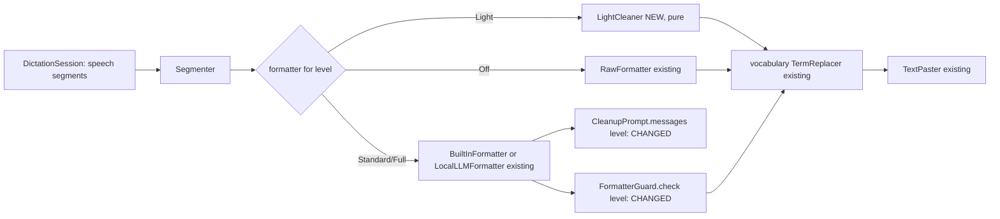

# Dictation cleanup levels (Light, Standard, Full)

> Status: **design only.** Nothing in this file is implemented. Open questions were resolved with autonomous defaults (section "Resolved assumptions"); the owner can override any of them on the PR.
>
> Related: `.ai/specs/2026-11-01-voice-dictation.md` (Phase 2 formatting), `docs/decisions/0004-dictation-formatting.md`, `docs/decisions/0005-builtin-llm.md`, `.ai/specs/2026-11-20-dictation-self-correction-cut.md` (marker cuts with HUD undo), the settings IA v2 spec (PR #253, `.ai/specs/2026-11-24-settings-ia-v2.md`, not merged), the UX direction (PR #247), the benchmark `.ai/specs/research/2026-11-25-dictation-benchmark-wispr-vs-lintel.md` (added in this PR), `BACKWARD_COMPATIBILITY.md` §3 and §5.
>
> Work in flight that this spec builds on and does not repeat: branch `feat/dictation-cleanup-fidelity` (D1 offline measurement tool `scripts/dictation-eval/`, D2 `CleanupPrompt` v2 and the number check in `FormatterGuard`). **This spec assumes CleanupPrompt v2 is the Standard level.**
>
> All example sentences in this file are invented. None comes from a real dictation.

## 📝 TLDR

Today dictation has one switch, "Clean up text" (`plugins.dictation.mode` = `raw` / `cleanup`): either the raw transcript, or one fixed cleanup by a language model. The owner asked (2026-11-25) for selectable strength, as in Wispr Flow. **Proposed:** the switch becomes one choice, **"Tidy up my text: Off · Light · Standard · Full"**. Light runs **without a language model** (filler words out, spacing and capitals fixed, nothing else) at raw speed (≈ 0.13 s); Standard is today's cleanup with prompt v2 (self-corrections and spoken lists); Full adds email layout (greeting, paragraphs, sign-off on their own lines) and light style edits. At every level numbers, names and details stay as dictated, and a guard returns the raw chunk when they do not. A new additive key `plugins.dictation.cleanupLevel` carries the level; `plugins.dictation.mode` keeps its meaning (on/off), so nothing migrates and an older build keeps working. Three code PRs, after the D1+D2 PR.

## 📝 Problem Statement

Facts (benchmark of 2026-11-25, owner's 40-utterance corpus and FLEURS, Parakeet Ultra + Qwen3-30B-A3B, `CleanupPrompt` v1):

- **One size fits nobody.** On read text the raw transcript is already as good as Wispr Flow (FLEURS PL WER 6.5 % raw vs 6.4 % Wispr) and cleanup makes it worse (7.8 %) while adding ≈ 0.75 s. On the corpus, cleanup helps (WER 30.3 → 25.2 %) but still leaves most self-corrections (29 % fixed vs 71 % in Wispr) and never makes lists. A user who wants "just remove the yyy" and a user who dictates emails need different things; today both get the same model pass or nothing.
- **Cleanup changes meaning.** "na szesnastą, sorry, na siedemnastą" came back reversed, "6 cali" became "60 mm", details were cut. D2 fixes the prompt and adds a number check; this spec keeps that guarantee at every level, including the stronger Full level.
- **Owner request (2026-11-25):** "Wispr Flow has several cleanup modes and Lintel should too; you can configure how strongly it cleans." The accepted proposal is the three levels in the TLDR.

Inferred: the Light level is the cheapest win, because the raw transcript already has punctuation, capitals and digits ("na 16, sorry na 17" in the raw output), so what users of raw mode see most is filler words ("yyy", "eee", "um"). Assumed, to be measured in Phase 1: a word-list filter removes most fillers without a model and without touching any other word.

## 📝 Proposed Solution

One setting with four values. Each level is a strict superset of the one below, so the choice reads as "how much", not "which style".

| Level | What it changes | What runs | Latency p50 (key release → text) |
|---|---|---|---|
| **Off** | nothing (vocabulary still applies) | nothing | 0.13 s (today's raw) |
| **Light** | removes filler words and hesitations from a fixed list ("yyy", "eee", "eem", "um", "uh", "erm"), fixes the spaces and the capital letter a removal leaves behind | `LightCleaner`, pure rules, no model | ≈ 0.13 s |
| **Standard** | Light + self-corrections ("we wtorek, a nie, w środę" → "w środę"), a spoken enumeration becomes a list, punctuation fixes, numbers as digits | `CleanupPrompt` level `standard` (= v2 from D2) on the built-in model or the user's server, then `FormatterGuard` | today's cleanup (0.6–0.9 s p50) |
| **Full** | Standard + email layout (a spoken greeting, the paragraphs and a spoken sign-off on their own lines), light style edits (agreement errors, a run-on sentence split in two, a doubled word or phrase removed) | `CleanupPrompt` level `full` on the same model, then `FormatterGuard` with the Full limits | like Standard (to be measured) |

Invariants at **every** level (from the owner's proposal):

1. Numbers, units, dates, times, amounts, names, terms from the user's vocabulary and details (citations, page numbers, adjectives) come back as dictated. The guard rejects a chunk that loses or changes one, and the raw chunk is pasted instead.
2. No level adds content the speaker did not say: no invented greeting, sign-off, subject line, summary or answer. Full lays out a greeting the speaker said; it never writes one.
3. The language stays the language spoken (existing `languageChanged` check).
4. "Paste my last dictation unedited" (`dictation.pasteLastRaw`) and the history's raw text work at every level.

### Alternatives considered

- **Extend `plugins.dictation.mode` with new values** (`light`, `full`). Rejected: `DictationSettings.mode` reads an unknown value as `.raw`, so after a rollback a Light or Full user silently loses cleanup; and BC §3 documents the key as `raw`/`cleanup`. A second key is additive and keeps `mode` as the on/off switch (`cleanup` = on).
- **Styles instead of strength** (Wispr Flow's Formal / Casual / Very casual per app category; Superwhisper's custom modes per app — from their public product pages, not re-checked today). Rejected for now: the owner asked for strength, the audience is non-technical (#247: "show the result, not the machinery"), and per-app styles need the frontmost app's category, which is `FocusContextReader` work in the vocabulary spec. Kept as "Later".
- **Light as a model pass with a "change nothing else" prompt.** Rejected as the default: it costs ≈ 0.5–0.75 s for an edit a word list does, needs a downloaded model, and the benchmark shows the model is what changes words. A later owner decision (A3) may add a model pass to Light only for transcripts the rules cannot fix, and only if Phase 1 data says so.
- **A free-text "custom instructions" field.** Not doing: it removes the guarantees above and breaks the foolproof rules (R4, R6 of #247).

## 📝 Architecture



Takeaway: the level picks the formatter once per session in `DictationPlugin.formatter(settings:…)`; the session, `Segmenter`, the paste and the history stay as they are. Light never loads a model, so `prepare()` does nothing and the keep-warm lease is not taken.

Components (all in `DictationPlugin`; nothing in `LintelKit`, `LintelSpeech` or the shell changes):

- **`DictationSettings.CleanupLevel`** (new): `light`, `standard`, `full`. `DictationSettings.cleanupLevel` reads `plugins.dictation.cleanupLevel`; an unknown or missing value reads as `standard`. `effectiveLevel: CleanupLevel?` = `nil` when `mode == .raw`, else `cleanupLevel`.
- **`LightCleaner: TextFormatter`** (new, pure, no I/O): a fixed filler list per language (PL: `yyy`, `yy`, `eee`, `ee`, `eem`, `yhm` when standalone; EN: `um`, `uh`, `erm`, `uhm`), matched only as whole tokens with optional trailing comma; nothing else is removed (repetitions and false starts are Standard's job); then spacing, the comma left before a removed filler and the capital letter of a sentence whose first word was removed. Always returns `.formatted`; it cannot fail. "no więc" at a sentence start is **not** on the list at Light (it can be content: "no więc tak zrobimy" is ambiguous); Standard removes it as today.
- **`CleanupPrompt`** (changed): `messages(transcript:context:level:)`, `system(for:)`, `examples(for:)`, and `version(for:) -> Int` per level: `standard` = the v2 text from D2 unchanged (2), `full` = v2 + the Full rules and three Full examples (1). The release notes name both ("Standard v2, Full v1"). The Standard text is not edited by this spec. Snapshot fixtures `prompt-standard-v2.txt` (renamed from D2's `prompt-v2.txt` only if D2 has merged; otherwise kept) and `prompt-full-v1.txt`.
- **`FormatterGuard`** (changed): `check(input:output:level:)`. Shared checks at every model level: empty, answered, language changed, and D2's number check. New in Phase 3: **term check** — every token of the input that is a vocabulary term or alias target, or a capitalised word that is not the first word of a sentence, must occur in the output (diacritics-insensitive). Length limits per level: Standard keeps D2's range; Full keeps today's `0.6…1.15` until the eval shows a tighter bound holds (a line break is not a word).
- **`DictationPlugin.formatter(settings:…)`** (changed): `nil` for Off (today's raw path), `LightCleaner()` for Light, else today's server or built-in formatter with the level passed in.
- **`DictationController.recordHistory`** (changed): `formatMode` stays `raw`/`clean` (Light is recorded as `clean`, because the pasted text differs from the raw one); `formatterModel` is `nil` for Light (no model ran; `DictationNoteSource` shows that column as "Cleanup model", so a fake name would leak into the UI).

## 📝 Data Model

No database change. One new settings key (BC §3, additive):

| Key | Type | Values | Default | Read by |
|---|---|---|---|---|
| `plugins.dictation.cleanupLevel` (new) | String | `light`, `standard`, `full` | missing = `standard` | `DictationSettings.cleanupLevel` |
| `plugins.dictation.mode` (unchanged) | String | `raw`, `cleanup` | `raw` | unchanged; `raw` = Off |

**Migration: none is written.** An existing `mode = cleanup` user has no `cleanupLevel` and reads `standard`, which is today's cleanup with prompt v2 (the change from v1 to v2 is D2's, with its own release note). An existing `mode = raw` user stays Off. The picker writes both keys: Off → `mode = raw` (the stored level is kept, so turning back on returns to it); Light/Standard/Full → `mode = cleanup` and `cleanupLevel`. Rollback to a build without levels: it reads `mode`; a Light or Full user gets Standard-era cleanup (v1/v2), an Off user stays raw, so the on/off choice survives. Known cost: a Light user with no model downloaded and no server set gets raw pastes and the "model missing" status on the older build (documented in the release note; no data is touched). The key goes into BC §3 with the release that ships it, and BC §3's sentence on `CleanupPrompt.version` becomes: "`CleanupPrompt.version(for:)` (an Int per level) is a user-visible behaviour: a change to one level's text bumps that level's version and goes into the release notes."

The history (`dictation.sqlite`, `v1-history`) is not changed. The level of an entry is not stored (A5). A Light entry is `format_mode = clean` with `formatter_model` empty.

## 📝 UI/UX

### Direction (shaping)

**Recommendation:** replace the "Clean up text" switch with one popup **"Tidy up my text"** (`MenuPicker`, the component the pane already uses) with Off / Light / Standard / Full, and under it a single help line that shows **what the chosen level does to one invented sentence** (before → after). People choose by the result, not by a description of the machinery (#247 rule "show the result, not the machinery"; R4). The decisive trade-off: a segmented control would show all four at once but does not fit the help-line example and has no room in Polish ("Standardowy"); a popup plus a live example costs one click more and explains itself.

Who: the white-collar, non-technical user of #247 personas, in Settings → Dictation, usually after a dictation came out "too changed" or "not cleaned enough". Outcome: they find the level that keeps their words and they stop using "Paste my last dictation unedited". Signal (offline only, there is no telemetry): owner's corpus scores per level (Validation below). Guard: no level may raise FLEURS WER above raw + 0.3 points or change a number.

### Screen: Settings → Dictation (today's `DictationSettingsPane`; after #253, the Dictation page's basic row)

```
Tidy up my text                         [ Standard ▾ ]
  "yyy spotkanie we wtorek, a nie, w środę" → "Spotkanie w środę."
  Removes filler words and keeps only your corrections.
```

| Value (en / pl) | Help line under the popup (en / pl), ≤ 15 words | Example line (en / pl, invented) |
|---|---|---|
| Off / Wyłączone | Pastes exactly what you said. / Wkleja dokładnie to, co powiesz. | — (no example) |
| Light / Lekkie | Removes "um" and "uh". Never changes your words. / Usuwa „yyy” i „eee”. Nigdy nie zmienia twoich słów. | "um so the meeting is on Tuesday" → "So the meeting is on Tuesday." / „yyy spotkanie jest we wtorek” → „Spotkanie jest we wtorek.” |
| Standard / Standardowe | Also keeps only your corrections and turns spoken lists into lists. / Zostawia tylko twoje poprawki i zamienia wyliczenia na listy. | "the meeting is on Tuesday, no, Wednesday" → "The meeting is on Wednesday." / „spotkanie we wtorek, a nie, w środę” → „Spotkanie w środę.” |
| Full / Pełne | Also lays out emails and smooths the style. Numbers and names stay. / Układa też maile i wygładza styl. Liczby i nazwy zostają. | "hi Anna the report is ready thanks Tom" → "Hi Anna,⏎⏎The report is ready.⏎⏎Thanks,⏎Tom" / „cześć Anno raport jest gotowy dzięki Tomek” → „Cześć Anno,⏎⏎Raport jest gotowy.⏎⏎Dzięki,⏎Tomek” |

(The popup labels use the neuter adjective in Polish to agree with "porządkowanie": "Lekkie / Standardowe / Pełne".) The example is drawn as two lines, the "after" text in the primary colour, the "before" in secondary, with "→" read by VoiceOver as "becomes" / „zmienia się w”.

Rows that follow the popup:

- **Off** and **Light**: no other cleanup rows (today's "Run on", "Model", server address are hidden; Light needs no model). Light works with no model downloaded.
- **Standard** and **Full**: today's cleanup rows unchanged (source, model, server) until #253 moves them to AI assistant → More options.

### States

| State | Trigger | What the user sees | What they can do |
|---|---|---|---|
| Level needs a model that is not downloaded | Standard/Full, built-in source, model missing | today's status row "Download the assistant · 2.5 GB · Get It" and the dictation pastes raw text, as today | Get It, or pick Light (works now) |
| User's server unreachable | Standard/Full, "My server" | as today: the chunk is pasted raw; HUD "Pasted without tidying" | fix the server, or pick Light |
| A chunk was rejected by the guard | any model level | as today: that chunk raw, HUD shows the partial state | "Paste my last dictation unedited" |
| Full chosen on a small built-in model | Full with the smallest catalog model (A6) | help line adds "Works best with the Recommended assistant." / „Działa najlepiej z zalecanym asystentem.” | change the model, or keep it |
| Dictation turned off | plugin disabled | the popup dimmed, as every row | turn Dictation on |

The HUD, the history list and the shortcuts do not change. VoiceOver: the popup is "Tidy up my text, Standard, pop-up button"; the example line is one element ("Example: … becomes …").

**Gallery states** (#248, before code): the row at each of the four values × light/dark × en/pl; the "Works best with…" line; the row dimmed. No HTML mockup is committed: the UI source of truth is the SwiftUI gallery, and the change is one row.

## 📝 Edge Cases & Failure Scenarios

- **A filler word that is a real word.** "Ee" can be a name or an exclamation the user wants. Light removes only standalone list tokens; Polish "no", "więc", "jakby", "tak" are never removed at Light. A user who needs one kept adds it to the vocabulary: `LightCleaner` runs before the vocabulary, and a vocabulary term is never removed (`LightCleaner` gets the term set).
- **Repetition** ("bardzo, bardzo dziękuję", "we we should"): Light keeps every repeated word, so "Never changes your words" holds literally; Standard removes accidental repetitions as today. The corpus `keep-not-correction` category must come back unchanged at Light.
- **Light on text with no fillers:** returned unchanged byte for byte (a property test).
- **Full across chunks.** `Segmenter` cuts at 40–60 words and pauses; a greeting is in the first chunk, a sign-off in the last. Full lays out each chunk; the session already joins chunks with "\n\n" after a pause and " " after a forced cut, so a forced cut inside a paragraph stays one paragraph. The Full prompt receives `<context>` as today and is told to start a new line only for a greeting or sign-off inside the chunk.
- **Full where layout makes no sense** (a chat message, a search query, code): the Full prompt lays out only when the chunk starts with a greeting or ends with a sign-off; otherwise it behaves like Standard plus style. Measured on the corpus `chat` and `code` categories (target: not worse than Standard).
- **Length guard and paragraphs.** Line breaks do not count as words. The length bound alone does not stop a model that adds a short greeting, so the Full prompt forbids it and the eval counts invented greetings (target 0).
- **Server user ("My server").** Levels apply the same way: the request carries the level's prompt. A server model that does Full badly is rejected chunk by chunk by the same guard; Lintel cannot measure the user's model, and the help line does not promise quality for it.
- **Self-correction cut (spec 2026-11-20) ships later.** When it does, marker cuts run before `Segmenter` at Standard and Full only. Light never cuts (it never removes a word that is not a filler).
- **Level changed during a recording:** the formatter is chosen when the session starts, so the change applies to the next dictation (as `mode` today).

## 📝 Risks & Impact Review

| Surface | Change | Who | Mitigation / rollback |
|---|---|---|---|
| BC §3 settings | new key `plugins.dictation.cleanupLevel` | everyone with dictation | additive; missing = `standard`; `mode` unchanged; rollback keeps on/off |
| BC §5 user-visible behaviour | `CleanupPrompt` gets a version per level; Full is new behaviour | users who pick Full | release note "Dictation: choose how much Lintel tidies your text"; Standard is unchanged from D2 |
| Light changes raw-mode users? | no: Off stays raw; Light is opt-in | — | — |
| Settings IA v2 (#253) | its basic row "Tidy up my text" toggle on `mode` becomes this popup on `mode` + `cleanupLevel` | #253 implementer | whichever PR lands second updates the row; the label "Tidy up my text" is the same in both |
| Prompt quality | Full may still rewrite meaning on small models | Full users | guard (numbers, terms, length, language) + raw fallback per chunk; acceptance metrics below before Full is offered |

Product direction calls (not defects): whether Light should ever use a model (A3), and the default level for new installs (A2).

## 📝 Validation (offline, D1 tool)

Every level is measured with `scripts/dictation-eval/` (from `feat/dictation-cleanup-fidelity`) on the owner's corpus (40 utterances) and FLEURS PL/EN (60 each), from the stored raw transcripts, with a `--level light|standard|full` argument added in Phase 1. Scoring stays outside the repo (`score_dictation.py` path from an environment variable). Acceptance, per PR:

| Level | Must hold | Target |
|---|---|---|
| Light | FLEURS PL and EN WER ≤ raw + 0.1 pt; no number, term or non-filler word changed on any item (diff of raw vs Light output shows only list fillers and spacing/capitals); processing time p50 ≤ 5 ms per dictation | corpus "forbidden words left" ≤ 40 % (raw 62 %) — fillers only, corrections stay by design |
| Standard | D2's targets (FLEURS WER ≤ raw + 0.3 pt; self-corrections OK ≥ 60 %; forbidden left ≤ 15 %; lists in `pl-list-01/02`, `en-list-01`; none of the meaning changes from the benchmark) | unchanged from D2 |
| Full | invented greetings or sign-offs: 0; numbers and terms: 100 % kept (guard counters 0 misses after fallback); terms % ≥ Standard; self-corrections ≥ Standard; `chat`/`code`/`keep-not-correction` WER ≤ Standard + 1 pt; on `mail` items with a spoken greeting, the greeting is alone on the first line (new check in the eval script) | mail items: ≥ 2 paragraphs when ≥ 2 pauses were spoken |

FLEURS WER is not a Full metric (layout and style edits are intended); fidelity is carried by the number and term checks. Results go into each PR body (table level × metric), never the transcripts' text.

## 📋 Phasing

Prerequisite (not part of this spec): the D1+D2 PR from `feat/dictation-cleanup-fidelity` is merged (eval tool, `CleanupPrompt` v2, number check).

- **Phase 1 — the setting and Light** (one PR): key, `CleanupLevel`, `LightCleaner`, the popup with Off / Light / Standard, eval `--level`. Full is not offered yet. Standard is exactly today's `mode = cleanup`. **Blocked on the D1+D2 PR** (eval tool, prompt v2, number check): Phase 1 is not started before it merges, so Standard = v2 from the first release that shows levels.
- **Phase 2 — Full** (one PR): `CleanupPrompt` Full text and examples, per-level guard limits, Full in the popup, the "Works best with…" line, measured against the Full targets. Not offered if the targets fail (the PR then reports why and stays open).
- **Phase 3 — term check** (one PR): `FormatterGuard` term check at Standard and Full. First the baseline (today's fallback rate per chunk on corpus and FLEURS), then the check; it ships only if it adds ≤ 2 points of fallback over that baseline and keeps 100 % of terms on the corpus `terms` items.

Outside the phases: the owner's decision on A3 (model assist for Light), taken from Phase 1 data and recorded in ADR 0004.

## 📋 Implementation Plan

### Phase 1 — setting and Light

1. `DictationSettings`: `Key.cleanupLevel`, `CleanupLevel`, `cleanupLevel`, `setCleanupLevel`, `effectiveLevel`. Tests: missing/unknown → `standard`; `mode = raw` → `nil`; rollback reading (only `mode`) unchanged.
2. `LightCleaner` with the PL/EN filler lists, repeat rule, spacing/capital fix, vocabulary-term protection. Tests: table of invented inputs; property test "no filler → identical output"; never removes a digit or a vocabulary term.
3. `DictationPlugin.formatter` picks by `effectiveLevel`; `recordHistory` writes `format_mode = clean`, `formatter_model = nil` for Light. Tests: a Light session never calls the LLM lease or the transport (fakes count zero calls).
4. `FormattingSettingsModel` + `DictationSettingsPane`: the "Tidy up my text" popup (Off / Light / Standard), the help line and example per value, cleanup rows only for Standard; strings en+pl in `Localizable.xcstrings`. Gallery states; QA screenshots (light/dark, each value, en/pl) per `docs/qa.md`.
5. `scripts/dictation-eval/`: `--level` argument (Light runs `LightCleaner` only). Measure Light and Standard; table in the PR body.
6. Docs: BC §3 key; AGENTS.md dictation row (`LightCleaner`, `cleanupLevel`); release note line.

### Phase 2 — Full

1. `CleanupPrompt`: `system(for:)`, `examples(for:)`, `version(for:)`; Full rules (lay out a spoken greeting and sign-off and pause-separated paragraphs; light style edits; never add words; keep every number, name, detail) and three invented Full examples (PL email with greeting and sign-off, EN email, a chat line that must stay one line). Snapshot fixture `prompt-full-v1.txt`.
2. `FormatterGuard.check(…level:)`: Full length range 0.6–1.15 (tighten only with eval data), line breaks not counted. Tests for each reason at Full.
3. `LocalLLMFormatter` and `BuiltInFormatter` pass the level into the prompt and guard (tests with the fake transport/runtime assert the Full system text is sent).
4. Popup gains Full; "Works best with the Recommended assistant." when the built-in model is the smallest catalog entry. Gallery + QA screenshots, including one Full dictation pasted into TextEdit (invented text).
5. Eval: Full targets incl. the greeting-on-first-line check; table in the PR body. BC §5 note on per-level prompt versions; release note.

### Phase 3 — term check

1. `FormatterGuard` term check (vocabulary terms and mid-sentence capitalised words must survive, diacritics-insensitive) for Standard and Full. Tests incl. a Polish inflected name ("Anna" → "Anny" counts as kept by stem of ≥ 4 letters).
2. Baseline first (fallback rate per chunk without the check), then with it; ships when the added fallback is ≤ 2 points and every corpus `terms` item keeps its terms. Table in the PR body.

## Resolved assumptions (autonomous defaults)

| # | Question | Default | Why | Marker |
|---|---|---|---|---|
| A1 | New values in `plugins.dictation.mode`, or a new key? | New key `plugins.dictation.cleanupLevel`; `mode` stays on/off | additive (BC §3); rollback keeps the user's on/off choice | — |
| A2 | Default level for new installs and for today's `cleanup` users? | `mode` default stays `raw` (Off) for new installs; level default `standard`, so `cleanup` users keep today's behaviour | no default change in this spec; changing the default for new installs is an owner decision with onboarding (#254) | ⚠ NEEDS HUMAN CONFIRMATION (owner may want Light or Standard on by default) |
| A3 | Light: model never, or model for "unclean" transcripts? | Never in this spec; the owner decides later from Phase 1 data | fastest, works without a download, the model is what changes words | — |
| A4 | Does "My server" get the levels? | Yes, same prompts and guard; no quality promise for the user's model | one code path; the guard protects the text either way | — |
| A5 | Store the level per history entry? | No schema change; Light is `clean` with no model; Standard/Full are not told apart in history | avoids a migration next to #253's `v2-soft-delete` | — |
| A6 | Offer Full on every built-in model? | Yes, with the "Works best with the Recommended assistant." line on the smallest model | the guard falls back per chunk; hiding a level by model is confusing | — |
| A7 | Per-app levels or a quick switch in the HUD/menu bar? | Not now (Later) | needs app-category context (`FocusContextReader`) and new UI | — |
| A8 | Polish labels | "Wyłączone / Lekkie / Standardowe / Pełne", row "Porządkuj mój tekst" (#253's label) | neuter agrees with "porządkowanie"; same row label as #253 | — |
| A9 | One spec or split per level? | One spec, three PRs: the levels share one key and one control and only make sense together | each phase ships a working subset | — |
