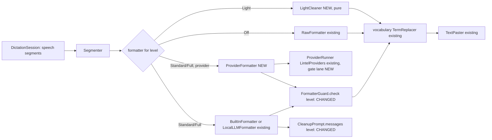

# Dictation cleanup levels (Light, Standard, Full)

> Status: **Phase 1 (setting and Light) is on `main` (#326); Phase 2 (Full) is implemented in its own PR and measured, but it is not offered (`DictationSettings.fullIsOffered` is off): it met every Full target except self-corrections ≥ Standard (see Phase 2 below); the other phases are design only.** Open questions were resolved with autonomous defaults (section "Resolved assumptions"); the owner can override any of them on the PR.
>
> Related: `.ai/specs/2026-11-01-voice-dictation.md` (Phase 2 formatting), `docs/decisions/0004-dictation-formatting.md`, `docs/decisions/0005-builtin-llm.md`, `.ai/specs/2026-11-20-dictation-self-correction-cut.md` (marker cuts with HUD undo), the settings IA v2 spec (PR #253, `.ai/specs/2026-11-24-settings-ia-v2.md`, not merged), the UX direction (PR #247), the benchmark `.ai/specs/research/2026-11-25-dictation-benchmark-wispr-vs-lintel.md` (added in this PR), `BACKWARD_COMPATIBILITY.md` §3 and §5.
>
> Work in flight that this spec builds on and does not repeat: branch `feat/dictation-cleanup-fidelity` (D1 offline measurement tool `scripts/dictation-eval/`, D2 `CleanupPrompt` v2 and the number check in `FormatterGuard`). **This spec assumes CleanupPrompt v2 is the Standard level.**
>
> **Scope addition (owner, 2026-11-25):** dictation tidying can also run on an **external AI provider** (today only meeting notes use Claude Code, `Sources/LintelProviders/`). This spec treats **where it runs** (built-in / my server / AI provider) and **how much it tidies** (level) as two independent dimensions of one setting. It does not repeat the providers spec (`.ai/specs/2026-11-10-external-ai-providers.md`, version of 2026-11-19 on `main`); section "Source: external AI provider" lists only what dictation adds or changes.
>
> All example sentences in this file are invented. None comes from a real dictation.

## 📝 TLDR

Today dictation has one switch, "Clean up text" (`plugins.dictation.mode` = `raw` / `cleanup`): either the raw transcript, or one fixed cleanup by a language model. The owner asked (2026-11-25) for selectable strength, as in Wispr Flow. **Proposed:** the switch becomes one choice, **"Tidy up my text: Off · Light · Standard · Full"**. Light runs **without a language model** (filler words out, spacing and capitals fixed, nothing else) at raw speed (≈ 0.13 s); Standard is today's cleanup with prompt v2 (self-corrections and spoken lists); Full adds the layout of a message (a spoken greeting and sign-off on their own lines), paragraphs for a longer dictation with several thoughts and a smoothed style (agreement, a run-on sentence in two, a doubled word or phrase), without writing or cutting anything (owner decision 2026-11-26). At every level numbers, names and details stay as dictated, and a guard returns the raw chunk when they do not. A new additive key `plugins.dictation.cleanupLevel` carries the level; `plugins.dictation.mode` keeps its meaning (on/off), so nothing migrates and an older build keeps working. A second, independent choice says where Standard and Full run: **This Mac** (built-in model), **My server**, or the **AI provider** (Claude Code, as for meeting notes). The provider is held to a latency limit measured from key release (default 2 s at Standard); past it the raw text is pasted. It is offered only at the levels where offline measurement shows it fits, expected Full only. Five code PRs, after the D1+D2 PR.

## 📝 Problem Statement

Facts (benchmark of 2026-11-25, owner's 40-utterance corpus and FLEURS, Parakeet Ultra + Qwen3-30B-A3B, `CleanupPrompt` v1):

- **One size fits nobody.** On read text the raw transcript is already as good as Wispr Flow (FLEURS PL WER 6.5 % raw vs 6.4 % Wispr) and cleanup makes it worse (7.8 %) while adding ≈ 0.75 s. On the corpus, cleanup helps (WER 30.3 → 25.2 %) but still leaves most self-corrections (29 % fixed vs 71 % in Wispr) and never makes lists. A user who wants "just remove the yyy" and a user who dictates emails need different things; today both get the same model pass or nothing.
- **Cleanup changes meaning.** "na szesnastą, sorry, na siedemnastą" came back reversed, "6 cali" became "60 mm", details were cut. D2 fixes the prompt and adds a number check; this spec keeps that guarantee at every level, including the stronger Full level.
- **Owner request (2026-11-25):** "Wispr Flow has several cleanup modes and Lintel should too; you can configure how strongly it cleans." The accepted proposal is the three levels in the TLDR.

Inferred: the Light level is the cheapest win, because the raw transcript already has punctuation, capitals and digits ("na 16, sorry na 17" in the raw output), so what users of raw mode see most is filler words ("yyy", "eee", "um"). Assumed, to be measured in Phase 1: a word-list filter removes most fillers without a model and without touching any other word.

## 📝 Proposed Solution

One setting with four values. Each level is a strict superset of the one below, so the choice reads as "how much", not "which style".

| Level | What it changes | What runs | Latency p50 (key release → text) |
|---|---|---|---|
| **Off** | nothing (vocabulary still applies) | nothing | 0.13 s (today's raw) |
| **Light** | removes filler words and hesitations from a fixed list ("yyy", "eee", "eem", "um", "uh", "erm"), fixes the spaces and the capital letter a removal leaves behind | `LightCleaner`, pure rules, no model | ≈ 0.13 s |
| **Standard** | Light + self-corrections ("we wtorek, a nie, w środę" → "w środę"), a spoken enumeration becomes a list, punctuation fixes, numbers as digits | `CleanupPrompt` level `standard` (= v2 from D2) on the built-in model or the user's server, then `FormatterGuard` | today's cleanup (0.6–0.9 s p50) |
| **Full** | Standard + the layout of a message (a spoken greeting alone on the first line and a spoken sign-off on its own lines, only when a body of about 25 words or more sits between them), **paragraphs for a longer dictation** (about 40 words or more with several thoughts, not only for an email), and a smoothed style (agreement errors fixed, a run-on sentence split in two, a doubled word or phrase removed). A short message, a chat line, a command, a query or code stays one line, also when it starts with a greeting. Never new content (no greeting, sign-off, subject, summary or answer the speaker did not say), never a cut of content, numbers, names, vocabulary terms and details untouched | `CleanupPrompt` level `full` on the same model, then `FormatterGuard` with the Full checks (invented greeting or sign-off, lost number, the Full length range) | like Standard (measured in the Phase 2 PR) |

Invariants at **every** level (from the owner's proposal):

1. Numbers, units, dates, times, amounts, names, terms from the user's vocabulary and details (citations, page numbers, adjectives) come back as dictated. The guard rejects a chunk that loses or changes one, and the raw chunk is pasted instead.
2. No level adds content the speaker did not say: no invented greeting, sign-off, subject line, summary or answer. Full lays out a greeting the speaker said; it never writes one. No level cuts content either: Full may drop only fillers, a doubled word or phrase, the withdrawn part of a self-correction and the joining word at a sentence split.
3. The language stays the language spoken (existing `languageChanged` check).
4. "Paste my last dictation unedited" (`dictation.pasteLastRaw`) and the history's raw text work at every level.

### Alternatives considered

- **Extend `plugins.dictation.mode` with new values** (`light`, `full`). Rejected: `DictationSettings.mode` reads an unknown value as `.raw`, so after a rollback a Light or Full user silently loses cleanup; and BC §3 documents the key as `raw`/`cleanup`. A second key is additive and keeps `mode` as the on/off switch (`cleanup` = on).
- **Styles instead of strength** (Wispr Flow's Formal / Casual / Very casual per app category; Superwhisper's custom modes per app — from their public product pages, not re-checked today). Rejected for now: the owner asked for strength, the audience is non-technical (#247: "show the result, not the machinery"), and per-app styles need the frontmost app's category, which is `FocusContextReader` work in the vocabulary spec. Kept as "Later".
- **Light as a model pass with a "change nothing else" prompt.** Rejected as the default: it costs ≈ 0.5–0.75 s for an edit a word list does, needs a downloaded model, and the benchmark shows the model is what changes words. A later owner decision (A3) may add a model pass to Light only for transcripts the rules cannot fix, and only if Phase 1 data says so.
- **A free-text "custom instructions" field.** Not doing: it removes the guarantees above and breaks the foolproof rules (R4, R6 of #247).

## 📝 Source × level: two dimensions of one setting

| | Off | Light | Standard | Full |
|---|---|---|---|---|
| **This Mac** (built-in, `llmSource = builtIn`) | raw | rules | built-in model | built-in model |
| **My server** (`llmSource = server`) | raw | rules | user's server | user's server |
| **AI provider** (`llmSource = provider`, new value) | raw | rules | provider **if the Standard gate is open**, else the local fallback below | provider |

- **Two keys, one each:** `plugins.dictation.cleanupLevel` (level) and `plugins.dictation.llmSource` (source). Changing one never changes the other. Off and Light never use a source, so choosing a source has no effect on them and the Light help line says "Runs on this Mac." / „Działa na tym Macu.”.
- **The provider gate per level** (`ProviderLevels.offered`, a compile-time constant set from the measurement in Phase 4, expected `[.full]`). When the source is the provider and the level is not offered, the level runs on the **local fallback**: the built-in model when it is installed, otherwise the user's server when one is set, otherwise raw. The row says so in words (UI below), so nothing is silent.
- **Latency limit from key release** (provider only): Standard 2 s, Full 6 s (Resolved assumptions A10, A11). At key release the session waits for the chunks still out at the provider until the limit. Every chunk not back by then is pasted **raw** and its provider request is cancelled, and the HUD shows one short line, only then: "Claude too slow, pasted as spoken" / „Claude za wolny, wklejono bez porządkowania” (new `FallbackReason.tooSlow`). Chunks that finished during the recording keep their tidied text, which is today's per-chunk `partial` rule. The existing per-chunk timeout (5 s + 0.2 s/word) still applies during the recording. The built-in model and the user's server keep today's timeouts and get no new limit.

## 📝 Source: external AI provider (differences from the providers spec)

The providers spec on `main` (2026-11-19, meeting notes only) stays the authority for the descriptor, the isolation, `ProviderRunner`, `ProviderGate`, status probes and "choosing the provider is the consent" (owner decisions D1–D15 of 2026-11-20). Dictation adds only the following:

1. **Owner decision of 2026-11-25 overrides Q2 of that spec** ("dictation outside v1, separate phase after a separate owner decision"). That decision is now taken. Its point 9 leaves to each future feature whether it inherits the meetings choice. Dictation **does not inherit it**: it has its own provider and model choice, `plugins.dictation.provider` and `plugins.dictation.providerModel`. Choosing them is the consent for dictation only, by the same rule as meetings. A user who sends meetings to Claude does not start sending dictations, and the reverse holds too.
2. **Names and code state on `main`:** the targets are `LintelProviders`, `LintelSpeech` and `LintelKit` (not `Pounce*`). There is **no `TextGenerator` protocol**, because the 2026-11-10 version was replaced. Meetings call `ProviderRunner.run(_:authorization:)` through `ProviderNotesGenerator`. Dictation does the same through a new `ProviderFormatter: TextFormatter`. It builds a `ProviderRequest` (`feature: .dictationCleanup`, a new `ProviderFeatureID` value `dictation.cleanup`, the `CleanupPrompt.messages(…level:)`, the timeout) and checks the answer with the same `FormatterGuard`. The authorization closure answers "`llmSource == provider` and `plugins.dictation.provider` is set, right now", so the `ProviderRunner` check before every process works unchanged. No `LintelKit` change.
3. **What leaves the Mac for dictation:** the recognised text of the chunk and up to 300 characters of the previous chunk of the **same** dictation (`<context>`, as today). Never audio. Never the DICT focus context (app, field, window title), by the DICT epic non-goal. Never vocabulary terms: they are applied after formatting, on this Mac. The fixed sentence beside the choice says this:
   - en: "Text you dictate is sent to **Anthropic** through your Claude Code. Audio stays on this Mac."
   - pl: „Dyktowany tekst jest wysyłany do **Anthropic** przez Twoje Claude Code. Dźwięk zostaje na tym Macu.”
   The company name comes from the descriptor's `recipient`.
4. **`ProviderGate` gets an interactive lane.** Today the gate is FIFO with one slot per provider. Its own comment says "priorities come with the second consumer". A whole-transcript meeting-notes run can hold that slot for minutes, so dictation gets a **separate lane**: the slot key becomes (provider, lane), with lanes `background` (notes) and `interactive` (dictation). Two processes can then run at once, one per lane. Dictation chunks are FIFO among themselves. Notes are never cancelled by dictation. This is simpler than the `LLMLease` cancel-and-retry and costs one extra CLI process at most.
5. **History and HUD:** `formatter_model` = `cli:claude-code/<model>`, the same format as `meeting.notes_model`, read as "Claude · sonnet" in the dictation note's details. The HUD does **not** change while a chunk is at the provider: no cloud mark, no extra label (owner decision 2026-11-25, HUD minimalism: the normal state shows only the recording indicator and one action). The disclosure lives where the choice is made (the fixed sentence beside the source row) and in the history (`cli:` model). The cloud mark of the 2026-11-10 providers version is dropped for dictation.
6. **No fallback chain beyond the local fallback above.** On a provider error (not signed in, limit, no network), the chunk comes back raw with the provider's reason in the HUD, as the providers spec says for dictation. The "fall back to built-in" switch (`app.ai.fallbackToBuiltIn` in the 2026-11-10 version) does not exist on `main` and is not added here.
7. **#253 (settings IA v2) Q5** says "Claude writes meeting notes only. Dictation stays on This Mac". The owner decision of 2026-11-25 replaces this. In #253's layout, the source row is "Tidy up with: This Mac · My server · Claude" under Dictation → More options, and the AI assistant page's sentence "Dictation stays on this Mac" changes to name the actual dictation source. Whichever PR lands second updates the other.

## 📝 Architecture



Takeaway: the level picks the formatter once per session in `DictationPlugin.formatter(settings:…)`; the session, `Segmenter`, the paste and the history stay as they are. Light never loads a model, so `prepare()` does nothing and the keep-warm lease is not taken.

Components (all in `DictationPlugin`; nothing in `LintelKit`, `LintelSpeech` or the shell changes):

- **`DictationSettings.CleanupLevel`** (new): `light`, `standard`, `full`. `DictationSettings.cleanupLevel` reads `plugins.dictation.cleanupLevel`; an unknown or missing value reads as `standard`. `effectiveLevel: CleanupLevel?` = `nil` when `mode == .raw`, else `cleanupLevel`.
- **`LightCleaner: TextFormatter`** (new, pure, no I/O): a fixed filler list per language (PL: `yyy`, `yy`, `eee`, `ee`, `eem`, `yhm` when standalone; EN: `um`, `uh`, `erm`, `uhm`), matched only as whole tokens with optional trailing comma; nothing else is removed (repetitions and false starts are Standard's job); then spacing, the comma left before a removed filler and the capital letter of a sentence whose first word was removed. Always returns `.formatted`; it cannot fail. "no więc" at a sentence start is **not** on the list at Light (it can be content: "no więc tak zrobimy" is ambiguous); Standard removes it as today.
- **`CleanupPrompt`** (changed): `messages(transcript:context:level:)`, `system(for:)`, `examples(for:)`, and `version(for:) -> Int` per level: `standard` = the v2 text from D2 unchanged (2), `full` = v2 + the Full rules and three Full examples (1). The release notes name both ("Standard v2, Full v1"). The Standard text is not edited by this spec. Snapshot fixtures `prompt-standard-v2.txt` (renamed from D2's `prompt-v2.txt` only if D2 has merged; otherwise kept) and `prompt-full-v1.txt`.
- **`FormatterGuard`** (changed): `check(input:output:level:)`. Shared checks at every model level: empty, answered, language changed, and D2's number check. New in Phase 3: **term check** — every token of the input that is a vocabulary term or alias target, or a capitalised word that is not the first word of a sentence, must occur in the output (diacritics-insensitive). Length limits per level: Standard keeps D2's ranges unchanged (on `feat/dictation-cleanup-fidelity` they depend on the chunk: `correctionLengthRange` 0.4…1.15 for a self-correction, `lengthRange` 0.6…1.15 for a minor edit or spoken numbers, `plainLengthRange` 0.85…1.15 otherwise). Full uses the same classification, because it includes Standard's self-corrections: the correction and minor ranges stay as at Standard, and only the plain range is widened to 0.6…1.15 for the style edits, until the eval shows a tighter bound holds. A Full chunk is never rejected for a length Standard accepts (test). A line break is not a word. **Full-only checks (Phase 2):** `inventedLayout` (the first line of the output holds a greeting, or one of its last two lines a sign-off, from a fixed list that the transcript does not hold) and `lostNumber` (a number written in digits, or a whole run of number words, of the transcript is not in the output; a chunk with a self-correction signal is exempt, because the withdrawn number goes on purpose). They are not run at Standard, whose behaviour and measured baseline stay as they were.
- **`DictationPlugin.formatter(settings:…)`** (changed): `nil` for Off (today's raw path), `LightCleaner()` for Light, else the formatter of the **effective source** (the chosen source, or the local fallback when the provider is not offered at this level) with the level passed in.
- **`ProviderFormatter`** (new, Phase 5): `TextFormatter` over `ProviderRunner`; shares the chunk/guard logic with `BuiltInFormatter`; `prepare()` does nothing. `DictationSession` gets the key-release deadline (`releaseDeadline: Duration?`, `nil` for local sources). `DictationPlugin` gains a dependency on `LintelProviders` (allowed: plugins may import it).
- **`LintelProviders`** (changed, Phase 5): `ProviderFeatureID.dictationCleanup`; `ProviderGate` lanes (`ProviderLane.background` default, `.interactive`), additive with the default keeping today's behaviour for meetings.
- **`DictationController.recordHistory`** (changed): `formatMode` stays `raw`/`clean` (Light is recorded as `clean`, because the pasted text differs from the raw one); `formatterModel` is `nil` for Light (no model ran; `DictationNoteSource` shows that column as "Cleanup model", so a fake name would leak into the UI).

## 📝 Data Model

No database change. One new settings key (BC §3, additive):

| Key | Type | Values | Default | Read by |
|---|---|---|---|---|
| `plugins.dictation.cleanupLevel` (new) | String | `light`, `standard`, `full` | missing = `standard` | `DictationSettings.cleanupLevel` |
| `plugins.dictation.mode` (unchanged) | String | `raw`, `cleanup` | `raw` | unchanged; `raw` = Off |
| `plugins.dictation.llmSource` (new value) | String | + `provider` | `server` (unchanged) | an older build reads an unknown value as `.server` (`DictationSettings.swift:101`): no break, the user's server or raw |
| `plugins.dictation.provider` (new) | String `ProviderID` | `claude-code` | missing = no provider chosen (the provider source is then not selectable) | `DictationSettings`, the authorization closure |
| `plugins.dictation.providerModel` (new) | String | descriptor's model aliases | missing = descriptor default | `ProviderFormatter` |

**Migration: none is written.** An existing `mode = cleanup` user has no `cleanupLevel` and reads `standard`, which is today's cleanup with prompt v2 (the change from v1 to v2 is D2's, with its own release note). An existing `mode = raw` user stays Off. The picker writes both keys: Off → `mode = raw` (the stored level is kept, so turning back on returns to it); Light/Standard/Full → `mode = cleanup` and `cleanupLevel`. Rollback to a build without levels: it reads `mode`; a Light or Full user gets Standard-era cleanup (v1/v2), an Off user stays raw, so the on/off choice survives. Known cost: a Light user with no model downloaded and no server set gets raw pastes and the "model missing" status on the older build (documented in the release note; no data is touched). The key goes into BC §3 with the release that ships it, and BC §3's sentence on `CleanupPrompt.version` becomes: "`CleanupPrompt.version(for:)` (an Int per level) is a user-visible behaviour: a change to one level's text bumps that level's version and goes into the release notes."

The history (`dictation.sqlite`, `v1-history`) is not changed. The level of an entry is not stored (A5). A Light entry is `format_mode = clean` with `formatter_model` empty.

## 📝 UI/UX

### Direction (shaping)

**Recommendation:** replace the "Clean up text" switch with one popup **"Tidy up my text"** (`MenuPicker`, the component the pane already uses) with Off / Light / Standard / Full, and under it a single help line that shows **what the chosen level does to one invented sentence** (before → after). People choose by the result, not by a description of the machinery (#247 rule "show the result, not the machinery"; R4). The decisive trade-off: a segmented control would show all four at once but does not fit the help-line example and has no room in Polish ("Standardowy"); a popup plus a live example costs one click more and explains itself.

Who: the white-collar, non-technical user of #247 personas, in Settings → Dictation, usually after a dictation came out "too changed" or "not cleaned enough". Outcome: they find the level that keeps their words and they stop using "Paste my last dictation unedited". Signal (offline only, there is no telemetry): owner's corpus scores per level (Validation below). Guard: no level may raise FLEURS WER above raw + 0.3 points or change a number.

### Screen: Settings → Dictation (today's `DictationSettingsPane`; after #253, the Dictation page's basic row)

```
Tidy up my text                         [ Standard ▾ ]
  "yyy spotkanie we wtorek, a nie, w środę" → "Spotkanie w środę."
  Removes filler words and keeps only your corrections.
```

| Value (en / pl) | Help line under the popup (en / pl), ≤ 15 words | Example line (en / pl, invented) |
|---|---|---|
| Off / Wyłączone | Pastes exactly what you said. / Wkleja dokładnie to, co powiesz. | — (no example) |
| Light / Lekkie | Removes "um" and "uh". Never changes your words. / Usuwa „yyy” i „eee”. Nigdy nie zmienia twoich słów. | "um so the meeting is on Tuesday" → "So the meeting is on Tuesday." / „yyy spotkanie jest we wtorek” → „Spotkanie jest we wtorek.” |
| Standard / Standardowe | Also keeps only your corrections and turns spoken lists into lists. / Zostawia tylko twoje poprawki i zamienia wyliczenia na listy. | "the meeting is on Tuesday, no, Wednesday" → "The meeting is on Wednesday." / „spotkanie we wtorek, a nie, w środę” → „Spotkanie w środę.” |
| Full / Pełne | Also lays out emails and long texts and smooths the style. Numbers and names stay. / Układa też maile i długie teksty oraz wygładza styl. Liczby i nazwy zostają. | "Hi Anna, the report is ready. We still need to talk about the budget. Thanks, Tom" → "Hi Anna,⏎⏎The report is ready.⏎⏎We still need to talk about the budget.⏎⏎Thanks,⏎Tom" / „Cześć Anno, raport jest gotowy. Musimy jeszcze omówić budżet. Dzięki, Tomek” → „Cześć Anno,⏎⏎Raport jest gotowy.⏎⏎Musimy jeszcze omówić budżet.⏎⏎Dzięki,⏎Tomek” (the example shows paragraphs for several thoughts; owner decision 2026-11-26) |

(The popup labels use the neuter adjective in Polish to agree with "porządkowanie": "Lekkie / Standardowe / Pełne".) The example is drawn as two lines, the "after" text in the primary colour, the "before" in secondary, with "→" read by VoiceOver as "becomes" / „zmienia się w”.

Rows that follow the popup:

- **Off** and **Light**: no other cleanup rows (today's "Run on", "Model", server address are hidden; Light needs no model). Light works with no model downloaded.
- **Standard** and **Full**: today's cleanup rows unchanged (source, model, server) until #253 moves them to AI assistant → More options.

### Source row ("Tidy up with")

Shown only for Standard and Full. Until #253 lands it is today's "Run on" popup, renamed; after #253 it is the More options row. Values:
- **This Mac** / **Na tym Macu**
- **My server** / **Mój serwer**
- **Claude** / **Claude**: the provider's display name. It is listed only when the provider is ready, per the providers spec D14. Otherwise the list shows "Add a provider…" / „Dodaj dostawcę…”.

With Claude chosen:
- The fixed sentence from point 3 above sits under the row.
- At a level the provider is not offered for, one more line explains what runs instead: "Claude is used for Full. Standard runs on this Mac." / „Claude porządkuje na poziomie Pełnym. Standardowe działa na tym Macu.” When there is no local fallback: "… Standard pastes your text untidied." / „… Standardowe wkleja tekst bez porządkowania.”

### States

| State | Trigger | What the user sees | What they can do |
|---|---|---|---|
| Level needs a model that is not downloaded | Standard/Full, built-in source, model missing | today's status row "Download the assistant · 2.5 GB · Get It" and the dictation pastes raw text, as today | Get It, or pick Light (works now) |
| User's server unreachable | Standard/Full, "My server" | as today: the chunk is pasted raw; HUD "Pasted without tidying" | fix the server, or pick Light |
| A chunk was rejected by the guard | any model level | as today: that chunk raw, HUD shows the partial state | "Paste my last dictation unedited" |
| Full chosen on a small built-in model | Full with the smallest catalog model (A6) | help line adds "Works best with the Recommended assistant." / „Działa najlepiej z zalecanym asystentem.” | change the model, or keep it |
| Provider too slow | provider source, a chunk not back within the limit after key release | one HUD line "Claude too slow, pasted as spoken" / „Claude za wolny, wklejono bez porządkowania”; finished chunks stay tidied | choose Full or This Mac; "Paste my last dictation unedited" |
| Provider not signed in / limit / no network | provider source | HUD with the provider's reason (providers spec), raw text pasted | fix in Settings, or choose This Mac |
| Dictation turned off | plugin disabled | the popup dimmed, as every row | turn Dictation on |

The HUD, the history list and the shortcuts do not change. VoiceOver: the popup is "Tidy up my text, Standard, pop-up button"; the example line is one element ("Example: … becomes …").

**Gallery states** (#248, before code): the row at each of the four values × light/dark × en/pl; the "Works best with…" line; the row dimmed. No HTML mockup is committed: the UI source of truth is the SwiftUI gallery, and the change is one row.

## 📝 Edge Cases & Failure Scenarios

- **A filler word that is a real word.** "Ee" can be a name or an exclamation the user wants. Light removes only standalone list tokens; Polish "no", "więc", "jakby", "tak" are never removed at Light. A user who needs one kept adds it to the vocabulary: `LightCleaner` runs before the vocabulary, and a vocabulary term is never removed (`LightCleaner` gets the term set).
- **Repetition** ("bardzo, bardzo dziękuję", "we we should"): Light keeps every repeated word, so "Never changes your words" holds literally; Standard removes accidental repetitions as today. The corpus `keep-not-correction` category must come back unchanged at Light.
- **Light on text with no fillers:** returned unchanged byte for byte (a property test).
- **Full across chunks.** `Segmenter` cuts at 40–60 words and pauses; a greeting is in the first chunk, a sign-off in the last. Full lays out each chunk; the session already joins chunks with "\n\n" after a pause and " " after a forced cut, so a forced cut inside a paragraph stays one paragraph. The Full prompt receives `<context>` as today and is told to start a new line only for a greeting or sign-off inside the chunk.
- **Full where layout makes no sense** (a chat message, a search query, code, a command): the Full prompt lays out a greeting and a sign-off only when a body of two or more sentences (about 25 words or more) sits between them, and splits into paragraphs only from about 40 words, and never below about 25; otherwise it behaves like Standard plus style. A greeting alone does not make a message long: "cześć, będę za 5 minut" stays one line. Measured on the corpus `chat` and `code` categories (target: not worse than Standard) and by the eval's "a short item stays one line" check.
- **Full and paragraphs (owner decision 2026-11-26).** The paragraphs are not only for mail: a longer dictation with several thoughts gets one paragraph per thought, separated by a blank line, and a line break is never a word for the guard's length limits. `Segmenter` still cuts a dictation into chunks of 40 to 60 words and the session joins them as before, so a paragraph break the model writes is always inside one chunk; a thought that spans chunks is joined by the session's own rule. Layout never moves, renames or drops a number: the Full guard rejects a chunk that lost a number the transcript held (except a self-correction chunk) and one that opens with a greeting or ends with a sign-off the transcript lacks.
- **Length guard and paragraphs.** Line breaks do not count as words. The length bound alone does not stop a model that adds a short greeting, so the Full prompt forbids it and the eval counts invented greetings (target 0).
- **Server user ("My server").** Levels apply the same way: the request carries the level's prompt. A server model that does Full badly is rejected chunk by chunk by the same guard; Lintel cannot measure the user's model, and the help line does not promise quality for it.
- **Self-correction cut (spec 2026-11-20) ships later.** When it does, marker cuts run before `Segmenter` at Standard and Full only. Light never cuts (it never removes a word that is not a filler).
- **Meeting notes running on Claude while the user dictates:** dictation uses the interactive lane and never waits for the notes job. Two CLI processes run at once, which costs the user's subscription limit; the notes job is not cancelled.
- **Provider chosen, then signed out:** the authorization still passes (the choice is the consent), the process fails to authenticate, and the chunk comes back raw with "Claude is signed out" in the HUD. Settings shows the provider's status as for meetings.
- **Cold start longer than the limit on every dictation** (expected for short Standard dictations): the measurement gate keeps Standard off the provider, so users do not get raw text every time by default.
- **Level changed during a recording:** the formatter is chosen when the session starts, so the change applies to the next dictation (as `mode` today).

## 📝 Risks & Impact Review

| Surface | Change | Who | Mitigation / rollback |
|---|---|---|---|
| BC §3 settings | new key `plugins.dictation.cleanupLevel` | everyone with dictation | additive; missing = `standard`; `mode` unchanged; rollback keeps on/off |
| BC §5 user-visible behaviour | `CleanupPrompt` gets a version per level; Full is new behaviour | users who pick Full | release note "Dictation: choose how much Lintel tidies your text"; Standard is unchanged from D2 |
| Light changes raw-mode users? | no: Off stays raw; Light is opt-in | — | — |
| Settings IA v2 (#253) | its basic row "Tidy up my text" toggle on `mode` becomes this popup on `mode` + `cleanupLevel` | #253 implementer | whichever PR lands second updates the row; the label "Tidy up my text" is the same in both |
| Privacy promise | the dictated text leaves the Mac when the provider source is chosen | users who choose it | own choice per feature (not inherited from meetings), fixed sentence beside the choice, `cli:` marker in history (no HUD mark, HUD minimalism); Off and Light never send anything |
| `LintelProviders` | `ProviderGate` lanes, new `ProviderFeatureID` | meetings (unchanged behaviour by default lane) | additive; TSan tests for two lanes |
| Prompt quality | Full may still rewrite meaning on small models | Full users | guard (numbers, terms, length, language) + raw fallback per chunk; acceptance metrics below before Full is offered |

Product direction calls (not defects): whether Light should ever use a model (A3), and the default level for new installs (A2).

## 📝 Validation (offline, D1 tool)

Every level is measured with `scripts/dictation-eval/` (from `feat/dictation-cleanup-fidelity`) on the owner's corpus (40 utterances) and FLEURS PL/EN (60 each), from the stored raw transcripts, with a `--level light|standard|full` argument added in Phase 1. Scoring stays outside the repo (`score_dictation.py` path from an environment variable). Acceptance, per PR:

| Level | Must hold | Target |
|---|---|---|
| Light | FLEURS PL and EN WER ≤ raw + 0.1 pt; no number, term or non-filler word changed on any item (diff of raw vs Light output shows only list fillers and spacing/capitals); processing time p50 ≤ 5 ms per dictation | none. Corpus "forbidden words left" is informational only (raw 62 %, Light 58 % measured in Phase 1): Light removes fillers only by design, the rest of those words are self-corrections and list lead-ins, which are Standard's job. The earlier target "≤ 40 %" was wrong for a filler list and is dropped (owner decision 2026-11-26); Light stays without a model (A3 not taken) |
| Standard | D2's targets (FLEURS WER ≤ raw + 0.3 pt; self-corrections OK ≥ 60 %; forbidden left ≤ 15 %; lists in `pl-list-01/02`, `en-list-01`; none of the meaning changes from the benchmark) | unchanged from D2 |
| Full | invented greetings or sign-offs: 0; numbers and terms: 100 % kept (guard counters 0 misses after fallback; no number lost outside self-correction items); terms % ≥ Standard; self-corrections ≥ Standard; `chat`/`code`/`keep-not-correction` WER ≤ Standard + 1 pt; no content word lost beyond Standard (stems of 5 letters, fillers and correction signals excluded, self-correction items apart); an item under 25 words stays one line; on `mail` items with a spoken greeting, the greeting is alone on the first line (new check `scripts/dictation-eval/check_full.py`) | mail and long items: ≥ 2 paragraphs when ≥ 2 pauses were spoken (the stored raw transcripts carry no pauses, so the eval reports ≥ 2 paragraphs in `mail` and `long` items as a proxy) |

**Provider (Phase 4 gate, before any product code):**
- The eval tool gets `--source provider` and runs each chunk through `ProviderRunner` with the real Claude Code CLI. It is off by default and turned on by `LINTEL_DICTATION_EVAL_PROVIDER=claude-code` and `LINTEL_DICTATION_EVAL_PROVIDER_MODEL`.
- It replays the chunking of a real session: chunks complete at the times the speech segments would, and it records **latency from key release** = the time from the last segment to the last chunk back, cold start included.
- It reports p50 and p90 per level, plus the quality metrics of that level.
- A level is **offered** for the provider when its p90 is at or under the limit (Standard 2 s, Full 6 s) **and** it meets that level's quality targets.
- The result is set in `ProviderLevels.offered` and recorded in `docs/perf.md`.
- Input:
  - FLEURS PL/EN (public text) by default.
  - The owner's corpus only with the owner's explicit OK for sending it to Anthropic (A14).

FLEURS WER is not a Full metric (layout and style edits are intended); fidelity is carried by the number and term checks. Results go into each PR body (table level × metric), never the transcripts' text.

## 📋 Phasing

Prerequisite (not part of this spec): the D1+D2 PR from `feat/dictation-cleanup-fidelity` is merged (eval tool, `CleanupPrompt` v2, number check).

- **Phase 1 — the setting and Light** (one PR): key, `CleanupLevel`, `LightCleaner`, the popup with Off / Light / Standard, eval `--level`. Full is not offered yet. Standard is exactly today's `mode = cleanup`. **Blocked on the D1+D2 PR** (eval tool, prompt v2, number check): Phase 1 is not started before it merges, so Standard = v2 from the first release that shows levels.
- **Phase 2 — Full** (one PR): `CleanupPrompt` Full text and examples, per-level guard limits and checks, Full in the popup, the "Works best with…" line, measured against the Full targets, with the widened definition of 2026-11-26 (layout, paragraphs for a longer dictation, smoothed style, no new content, no cut). Not offered if the targets fail (`DictationSettings.fullIsOffered` off; the PR then reports why and stays open).
- **Phase 3 — term check** (one PR): `FormatterGuard` term check at Standard and Full. First the baseline (today's fallback rate per chunk on corpus and FLEURS), then the check; it ships only if it adds ≤ 2 points of fallback over that baseline and keeps 100 % of terms on the corpus `terms` items.

- **Phase 4: provider measurement** (one PR, scripts and tests only, no product change): `--source provider` in `scripts/dictation-eval/` and the latency-from-release replay. The tables (Standard and Full × p50/p90 × quality) go in `docs/perf.md`, with the proposed `ProviderLevels.offered`.
- **Phase 5: provider source** (one PR, `risk-high`, as PR 11 of the providers spec: dictated text leaves the Mac): `ProviderFeatureID.dictationCleanup`, `ProviderGate` lanes, `ProviderFormatter`, `llmSource = provider`, `plugins.dictation.provider`/`providerModel`, the source row with the fixed sentence, the local-fallback line, the release deadline and the one-line HUD problem states (too slow, provider reasons). QA with the real Claude Code CLI.

Outside the phases: the owner's decision on A3 (model assist for Light), taken from Phase 1 data and recorded in ADR 0004.

## 📋 Implementation Plan

### Phase 1 — setting and Light

1. `DictationSettings`: `Key.cleanupLevel`, `CleanupLevel`, `cleanupLevel`, `setCleanupLevel`, `effectiveLevel`. Tests: missing/unknown → `standard`; `mode = raw` → `nil`; rollback reading (only `mode`) unchanged.
2. `LightCleaner` with the PL/EN filler lists, repeat rule, spacing/capital fix, vocabulary-term protection. Tests: table of invented inputs; property test "no filler → identical output"; never removes a digit or a vocabulary term.
3. `DictationPlugin.formatter` picks by `effectiveLevel`; `recordHistory` writes `format_mode = clean`, `formatter_model = nil` for Light. Tests: a Light session never calls the LLM lease or the transport (fakes count zero calls).
4. `FormattingSettingsModel` + `DictationSettingsPane`: the "Tidy up my text" popup (Off / Light / Standard), the help line and example per value, cleanup rows only for Standard; strings en+pl in `Localizable.xcstrings`. Gallery states; QA screenshots (light/dark, each value, en/pl) per `docs/qa.md`.
5. `scripts/dictation-eval/`: `--level` argument (Light runs `LightCleaner` only). Measure Light and Standard; table in the PR body.
6. Docs: BC §3 key; AGENTS.md dictation row (`LightCleaner`, `cleanupLevel`); release note line.

### Phase 2 — Full

1. `CleanupPrompt`: `system(for:)`, `examples(for:)`, `version(for:)`; Full rules (lay out a spoken greeting and sign-off when a body of about 25 words or more sits between them, paragraphs for a longer dictation with several thoughts, a smoothed style; never add words; keep every number, name, detail) and invented Full examples (PL email with greeting and sign-off, EN email, a long statement without a greeting split into paragraphs, a style edit each in PL and EN, and two short chats, one starting with a greeting, that stay one line). Snapshot fixture `prompt-full-v1.txt`. Standard's text, version and snapshot are untouched.
2. `FormatterGuard.check(…level:)`: at Full, D2's correction and minor ranges unchanged and the plain range widened to 0.7–1.15 (the spec's first 0.6 was tightened from the eval: no accepted plain chunk went below 0.77), line breaks not counted; two Full-only checks, `inventedLayout` (a greeting at the top or a sign-off at the bottom of the output that the transcript lacks) and `lostNumber` (a number the transcript held is gone, self-correction chunks excepted). Tests for each reason at Full, and a chunk accepted at Standard for its length is accepted at Full.
3. `LocalLLMFormatter` and `BuiltInFormatter` pass the level into the prompt and guard (tests with the fake transport/runtime assert the Full system text is sent).
4. Popup gains Full; "Works best with the Recommended assistant." when the built-in model is the smallest catalog entry. Gallery + QA screenshots, including one Full dictation pasted into TextEdit (invented text).
5. Eval: Full targets incl. the greeting-on-first-line check, the lost-word, lost-number, invented-layout and short-item checks (`check_full.py`) and the accepted chunks' length ratios; table in the PR body. BC §5 note on per-level prompt versions; release note.

   **Result (2026-11-26, Full prompt v1, built-in 4B model, stored raw transcripts; the table with every number is in the Phase 2 PR):** Full equals or beats Standard on FLEURS-independent fidelity (WER on `chat`, `code` and `keep-not-correction` within 1 pt, terms hit 73 % against 72 %), has 0 invented greetings or sign-offs, 0 lost numbers outside self-correction items, 4 of 4 mail greetings alone on the first line, 7 of 8 `mail`/`long` items with ≥ 2 paragraphs, and 1 short item with a line break (Standard 0). **One target is missed: self-corrections OK 57 % against Standard's 71 %** (4 of 7 items against 5 of 7, one item, `pl-fix-01`, where the new `lostNumber` check sends the chunk back raw). Lost content stems are 16 against 23 for Standard (11 items against 12). Latency is like Standard (p50 about 0.3 s, p90 about 0.7 s on the corpus, 0.3–0.6 s on FLEURS chunks). FLEURS WER is 0.9–1.0 pt above Standard and 0.7–1.4 pt above raw, informational only.
   **Decision per this spec: Full is not offered.** `DictationSettings.fullIsOffered` is `false`, the popup has no Full and a stored `full` runs as Standard. The targets are not lowered by the implementer. The owner decides whether to accept 57 % on a 7-item category (a flag flip, nothing else changes) or to ask for another prompt round. A DEBUG build turns Full on for QA with `plugins.dictation.qaOfferFull=true`.

### Phase 3 — term check

1. `FormatterGuard` term check (vocabulary terms and mid-sentence capitalised words must survive, diacritics-insensitive) for Standard and Full. Tests incl. a Polish inflected name ("Anna" → "Anny" counts as kept by stem of ≥ 4 letters).
2. Baseline first (fallback rate per chunk without the check), then with it; ships when the added fallback is ≤ 2 points and every corpus `terms` item keeps its terms. Table in the PR body.

### Phase 4 — provider measurement

1. `scripts/dictation-eval/`: `--source provider`, the replay of chunk completion times, and the latency-from-release metric. Real CLI behind environment variables, off by default.
2. Measure Standard and Full on FLEURS PL/EN (and on the corpus if A14 is approved): p50 and p90 from release, the level's quality targets, the provider's failures. Table in `docs/perf.md` and the PR body.
3. Propose `ProviderLevels.offered`. The owner confirms it on the PR.

### Phase 5 — provider source

1. `LintelProviders`: `ProviderFeatureID.dictationCleanup`; `ProviderGate` lanes (`background` by default, `interactive`). Tests:
   - meetings unchanged;
   - two lanes run at once and one lane stays FIFO;
   - a cancelled waiter leaves its lane (TSan).
2. `DictationSettings`: `LLMSource.provider`, `provider`, `providerModel`, `effectiveSource(for:)` with the local fallback. Tests: every row of the source × level table; an unknown source reads `.server`.
3. `ProviderFormatter` (shared chunk/guard logic with `BuiltInFormatter`), the authorization closure, and `FallbackReason.tooSlow` plus the provider reasons. Tests with a fake `ProviderSystem`:
   - success;
   - not authorized → 0 processes;
   - timeout;
   - guard rejection;
   - `formatter_model = cli:claude-code/<model>`;
   - the messages sent to the provider equal `CleanupPrompt.messages(…level:)` with no focus-context, vocabulary, clipboard, selection or window-title field, also with DICT context and vocabulary on (the providers spec's step 4.x test).
4. `DictationSession.releaseDeadline`. At the limit the session cancels the provider requests still out (their processes end through `ProviderRunner` cancellation, so the interactive lane is free for the next dictation and no late answer is used). Test with a fake clock: chunks that finished stay tidied; the chunk that is late at the limit is raw and its request is cancelled; the summary is `partial`.
5. Settings: the source row, the fixed sentence (en+pl), the local-fallback line. HUD: the one-line too-slow and provider-reason messages only (no new element in the normal state), VoiceOver labels. Gallery states and QA screenshots (light/dark, en/pl), plus one real dictation through Claude Code (invented text).
6. Docs:
   - BC §3: the new keys and the `provider` value;
   - BC §1: the `LintelProviders` additions;
   - AGENTS.md: the dictation row and the providers row;
   - the providers spec: a line at Q2 pointing to this spec;
   - the release note.

## Resolved assumptions (autonomous defaults)

| # | Question | Default | Why | Marker |
|---|---|---|---|---|
| A1 | New values in `plugins.dictation.mode`, or a new key? | New key `plugins.dictation.cleanupLevel`; `mode` stays on/off | additive (BC §3); rollback keeps the user's on/off choice | — |
| A2 | Default level for new installs and for today's `cleanup` users? | `mode` default stays `raw` (Off) for new installs; level default `standard`, so `cleanup` users keep today's behaviour | no default change in this spec; changing the default for new installs is an owner decision with onboarding (#254) | ⚠ NEEDS HUMAN CONFIRMATION (owner may want Light or Standard on by default) |
| A3 | Light: model never, or model for "unclean" transcripts? | Never in this spec; the owner decides later from Phase 1 data | fastest, works without a download, the model is what changes words | — |
| A4 | Does "My server" get the levels? | Yes, same prompts and guard; no quality promise for the user's model | one code path; the guard protects the text either way | — |
| A5 | Store the level per history entry? | No schema change; Light is `clean` with no model; Standard/Full are not told apart in history | avoids a migration next to #253's `v2-soft-delete` | — |
| A6 | Offer Full on every built-in model? | Yes, with the "Works best with the Recommended assistant." line on the smallest model | the guard falls back per chunk; hiding a level by model is confusing | — |
| A7 | Per-app levels or a quick switch in the HUD/menu bar? | Not now (Later) | needs app-category context (`FocusContextReader`) and new UI | — |
| A8 | Polish labels | "Wyłączone / Lekkie / Standardowe / Pełne", row "Porządkuj mój tekst" (#253's label) | neuter agrees with "porządkowanie"; same row label as #253 | — |
| A9 | One spec or split per level? | One spec, five PRs. The levels and the source share one setting and one control | each phase ships a working subset | — |
| A10 | Provider latency limit from key release at Standard | **2 s** (the owner's proposed default); past it the late chunks are pasted raw | Standard is for everyday short messages; built-in p90 today is ≈ 1 s | ⚠ NEEDS HUMAN CONFIRMATION |
| A11 | The same limit at Full | **6 s** | Full is for emails, where a wait is acceptable. It stays under the providers spec's 8 s p95 gate for chunks | ⚠ NEEDS HUMAN CONFIRMATION |
| A12 | Which levels the provider serves | Only the levels that pass the Phase 4 gate (`ProviderLevels.offered`); **expected Full only**. Other levels use the local fallback, and the UI says so | follows the owner's "consider the provider by default only for Full" with data instead of a guess | — |
| A13 | Does dictation inherit the meetings provider choice? | No: its own `plugins.dictation.provider` and its own consent-by-choice | the providers spec, point 9, leaves this to the feature; separate consent is the safer reading of "the choice is the consent" | — |
| A14 | May the owner's voice corpus go to Anthropic during the Phase 4 measurement? | Not by default; FLEURS only, until the owner says yes on the PR | the corpus is the owner's private speech, and the benchmark data never enters the repo | ⚠ NEEDS HUMAN CONFIRMATION |
| A15 | Dictation's place in `ProviderGate` | A separate `interactive` lane (two processes at most); notes are never cancelled | simplest; avoids minutes of waiting behind a whole-transcript notes run | — |
| A16 | What does Full include? | **Owner decision 2026-11-26, wider than the first proposal:** Standard + the layout of a message (a spoken greeting and sign-off on their own lines) + paragraphs for a longer dictation with several thoughts (not only a mail) + a smoothed style (agreement, a run-on sentence in two, a doubled word or phrase removed). No new content, no cut of content, numbers, names, vocabulary terms and details untouched, the guard on every level. A short message, chat, code or query stays one line. The name "Full / Pełne" stays | the owner wants a readable text from a long dictation, not an email template; the guard and the eval checks keep "no invented words, no lost words" measurable | — |
| A17 | Is Full offered after the Phase 2 measurement? | **No, not yet (2026-11-26).** `DictationSettings.fullIsOffered = false`; the plain range was tightened to 0.7–1.15 from the data | every Full target held except self-corrections ≥ Standard (57 % against 71 %, one item of seven); the targets are the owner's to change, so the PR stays open with the table | ⚠ NEEDS HUMAN CONFIRMATION |
