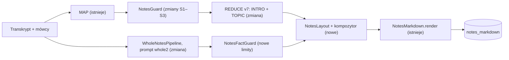

# Notatki ze spotkań w układzie liderów rynku i więcej punktów, które przechodzą strażnika

> Status: **projekt**, napisany 2026-11-25 z `origin/main` @ `232f67c3`. Pomiar odniesienia: `bf02f7ef` (Parakeet + diaryzacja + Qwen3-30B-A3B), benchmark poza repozytorium. Opiera się na `.ai/specs/2026-11-03-meeting-notes.md` (tor cytatów, `NotesGuard`), `.ai/specs/2026-11-10-external-ai-providers.md` i ADR 0011 (tor jednej generacji, `NotesFactGuard`), `.ai/specs/2026-11-06-meeting-notes-semantic-verifier.md` (weryfikator, wyłączony) i protokole `scripts/meeting-eval/fable-judge.md`. Kierunek UX i okno notatek: PR #247 i #255 (zakładki Notes / My notes / Transcript). Treść spotkań jest prywatna: ten dokument podaje wyłącznie strukturę (nagłówki, liczby punktów, sposób oznaczania) i liczniki.

## 📝 TLDR

Dla osoby, która czyta notatki ze spotkania, na którym jej nie było. Dziś notatka Lintela ma 2–4 sekcje i 5–18 punktów (827–1843 znaki), bo strażnik toru wbudowanego odrzuca 77% punktów zaproponowanych przez model (309 z 401 na sześciu nagraniach), a sekcja „Omówione tematy” pokazuje najwyżej 10 punktów bez podziału na tematy. Proponowane przyszłe zachowanie: obie ścieżki notatek (wbudowany model i dostawca Claude) piszą ten sam układ co Wispr Flow i Granola: krótki wstęp bez nagłówka, 4–10 tematów po 2–6 punktów, „Podjęte decyzje”, „Następne kroki” (z osobą, gdy padła), bez czasów i bez oznaczeń AI, w języku spotkania. Strażnik toru wbudowanego dostaje trzy zmiany, każda mierzona osobno: kotwiczenie lekko przekręconego cytatu do najkrótszego pasującego fragmentu, koniec fałszywych odrzuceń zwykłego słowa z wielkiej litery na początku punktu i dryf mierzony względem całego dosłownego cytatu modelu (dziś obcinanego do pierwszego zdania). Twarde reguły (liczby, daty, osoby, negacja, pytania) zostają, a każda faza, która doda choć jedno potwierdzone zmyślenie major, nie wchodzi.

## 📝 Problem Statement

### Co pokazują liderzy (struktura, bez treści)

Porównanie na prawdziwych spotkaniach właściciela z 2026-11-24/25 (`lintel-market-benchmark/data/owner/2026-11-25-meetings-findings.md`, sekcje Wispr Flow i Granola):

| | Wispr Flow (5 spotkań) | Granola (4 notatki) | Lintel, tor wbudowany (6 nagrań benchmarku) |
|---|---|---|---|
| Wstęp | jedna linia tekstu, bez nagłówka | brak osobnego wstępu (w 1 z 4 pierwszy temat to przegląd) | sekcja „Podsumowanie”, akapit do 120 słów |
| Tematy | 5–10 nagłówków tematycznych, nazwa z treści | 4–6 nagłówków, jeden szablon | brak; płaska lista „Omówione tematy”, najwyżej 10 punktów |
| Punkty | 2–6 na temat, razem 18–39 | 2–5 na sekcję, razem 12–40 (137–522 słów) | razem 5–18 |
| Decyzje | „Podjęte decyzje”, zwykle | brak sekcji | „Decyzje”, gdy są |
| Następne kroki | zawsze, sekcja końcowa | zawsze, sekcja końcowa „Next Steps” | „Zadania” z polem osoby i terminu (checklista) |
| Osoby | oznaczone w punktach (wzmianki o osobach) | tylko w nazwie tematu (1 z 4 notatek) | tylko przy zadaniu, gdy imię padło w cytacie |
| Czasy w notatce | brak | brak | brak |
| Język nagłówków | język spotkania | angielski w 3 z 4 polskich spotkań | język spotkania (etykiety kodu) |
| Długość | 2250–5064 znaków | 137–522 słów | 827–1843 znaków |

Opinia właściciela (2026-11-25): notatki Wispr Flow są „mega czytelne, bardzo dobrze oznaczają rozmówców, można samemu dopisywać, UI fajnie działa”; plusy Granoli to zrzuty ekranu w trakcie spotkania i szablony. Rozmówcy, zrzuty, szablony i własne notatki to osobne specy (sekcja „Poza zakresem”). Ten spec bierze z liderów układ i gęstość punktów.

### Dlaczego tor wbudowany ma tak mało punktów (ślad `*.notes-trace.json`, `bf02f7ef`)

| Nagranie | Długość | Zaproponowane | Zweryfikowane | Odrzucone | Przechodzi | Pokazane | Zweryfikowane, niepokazane |
|---|---|---|---|---|---|---|---|
| AMI ES2014c (EN) | 38 min | 76 | 8 | 68 | 11% | 8 | 0 |
| AMI IS1009c (EN) | 30 min | 29 | 6 | 23 | 21% | 5 | 1 (częściowe: 1 kawałek nie wrócił) |
| AMI TS3007c (EN) | 40 min | 81 | 8 | 73 | 10% | 5 | 3 |
| Sejm ASW-140 (PL) | 45 min | 64 | 25 | 39 | 39% | 14 | 11 |
| Sejm CNT-53 (PL) | 43 min | 63 | 29 | 34 | 46% | 18 | 11 |
| Spotkanie właściciela O1 (PL) | 55 min | 88 | 16 | 71 (+1 poza powodami) | 18% | 15 | 1 |
| **Razem** | | **401** | **92** | **309** | **23%** | **65** | **27** |

Powody odrzucenia (suma 308 z sześciu śladów; ślad podaje tylko liczby, nie rozbija ich na rodzaj punktu):

| Powód (`NotesGuard.DropReason`) | Liczba | Udział | Co sprawdza dziś | Wniosek |
|---|---|---|---|---|
| `driftedFromQuote` | 98 | 32% | punkt `SUM` musi mieć ≥ 3/5 słów treści z **dopasowanego fragmentu cytatu**; dosłowny cytat, który biegnie przez koniec zdania, jest dziś obcinany do pierwszego zdania (limit 25 słów to tylko polecenie w prompcie) | Notatka to podsumowanie, nie cytat: punkt, który oddaje cały dwuzdaniowy cytat, odpada, bo liczy się tylko pierwsze zdanie. Próg dobrano na czterech odwróconych punktach z prawdziwego spotkania (`NotesDriftTests`), więc nie wolno go po prostu obniżyć. |
| `unsupportedDetail` | 80 | 26% | liczba, data, dzień, miesiąc, wielka litera lub „początek zdania” w tekście, których nie ma w wypowiedzi cytatu i nazwie mówcy | Hipoteza do potwierdzenia w F0: duża część to `unsupportedSentenceStart` (pierwsze słowo punktu pisane wielką literą, np. rzeczownik pospolity, którego nie ma na liście `sentenceStarters`), a nie zmyślone imię czy liczba. Ślad nie rozbija tego powodu na podpowody. |
| `quoteNotInTranscript` | 74 | 24% | cytat dosłownie w słowach jednego mówcy (polskie końcówki tolerowane przez `NotesText.wordsMatch`); z pominięciami (do 2 słów) tylko w jednym zdaniu; dosłowny cytat przez koniec zdania przyjęty i obcięty do pierwszego zdania | Hipoteza: model przekręca słowo albo pomija więcej niż 2 słowa. F0 rozbija ten powód na podpowody (zmienione słowo, > 2 pominięte, zmiana mówcy, brak w transkrypcie). Zakaz sklejania przez granicę mówcy ma powód (`NotesGuardSentenceCrossingTests`) i zostaje. |
| `negationChanged` | 27 | 9% | negacja w tekście bez negacji w cytacie lub odwrotnie | Zostaje bez zmian: chroni przed odwróceniem sensu. |
| `questionNotAFinding` | 22 | 7% | punkt z pytania, który nie jest pytaniem | Zostaje bez zmian. |
| `verifierRejected` | 6 | 2% | weryfikator semantyczny (w harnessie; w aplikacji wyłączony) | Bez zmian. |
| `reportWithoutVerdict` | 1 | 0% | problem bez przyczyny lub dalszego kroku | Bez zmian. |

Do tego dwie straty poza strażnikiem: (1) limit `NotesGuard.maxKeyPoints = 10` ukrywa zweryfikowane punkty (27 z 92, w Sejmie 11 na nagranie); (2) MAP proponuje 13–31 punktów `SUM` na kawałek 3000 tokenów, choć prompt mówi „2 to 5”, więc jedna odpowiedź raz przekroczyła 1000 tokenów i była powtórzona z limitem 2000.

Wcześniejsza próba (spec `2026-11-06-meeting-notes-semantic-verifier`, Qwen3-4B) zastąpienia reguł tekstowych weryfikatorem podniosła udział tekstu modelu z ok. 9–19% do 45–53%, ale sędziowie obniżyli wierność na polskim nagraniu (3 → 1); dlatego `notesVerifierEnabled = false`. Ten spec nie powtarza tej drogi: luzuje tylko reguły, których fałszywe odrzucenia da się pokazać na danych, i każdą zmianę mierzy sędzią Fable.

### Tor dostawcy

Właściciel na co dzień używa dostawcy Claude (`notesProvider = claude-code`, model `sonnet`), czyli toru jednej generacji (`WholeNotesPipeline`, prompt `whole1`, `NotesFactGuard`). Ten tor ma tematy (`TOPIC:`/`POINT |`), ale z limitami 5 tematów × 4 punkty, 7 decyzji, 10 zadań, a `NotesDraftComposer` stawia tematy pod jednym nagłówkiem „Omówione tematy” po decyzjach i zadaniach. Struktury notatek z 25 listopada nie sprawdzono (zaszyfrowana baza); pomiar F0 to uzupełnia.

### Brak liczby odniesienia od sędziego

Benchmark ma dziś tylko liczniki śladu i długości notatek. Ocen sędziego Fable (`coverage`, `faithfulness`, `tasks`, `formatting`, `overall`) dla Lintela jeszcze nie ma, więc cele w sekcji „Plan pomiaru” są względne i F0 najpierw mierzy stan wyjściowy.

## 📝 Proposed Solution

1. **Jeden układ notatki dla obu torów** (`NotesLayout`, czysty typ + kompozytor), w kolejności:
   - tytuł (tylko tor dostawcy, jak dziś);
   - **wstęp**: akapit 1–3 zdań, najwyżej 70 słów, bez nagłówka: po co było spotkanie i na czym stanęło;
   - **tematy**: każdy temat to nagłówek z nazwą napisaną przez model w języku spotkania i 2–6 punktów; tematy są rodzeństwem sekcji (bez nadrzędnego „Omówione tematy”), w kolejności rozmowy;
   - **Podjęte decyzje** (EN „Decisions”), tylko gdy są;
   - **Następne kroki** (EN „Next steps”): checklista `- [ ]`, przy punkcie „— osoba: X, termin: Y” tylko to, co padło; bez etykiety „Do przypisania”;
   - **Otwarte kwestie** (EN „Open questions”), tylko gdy są, najwyżej 5;
   - **Uczestnicy**, tylko prawdziwe imiona (jak dziś).
   Bez czasów, bez oznaczeń autora (decyzja właściciela 2026-11-19). Etykiety sekcji należą do kodu (`NotesComposer.Labels`, PL/EN według dominującego języka transkryptu), nazwy tematów i treść pisze model w języku spotkania.
2. **Reguły długości zależne od spotkania**, liczone w kodzie: `maxTopics = min(10, max(2, minuty / 6))` (24 min → 4, 38 min → 6, 55 min → 9, ≥ 60 min → 10). Cel 4–10 tematów dotyczy spotkań od ok. 20 minut. Kod pilnuje tylko górnej granicy; dolnej nie wymusza, nie dopycha tematów ani punktów. **Krótkie spotkanie** (< 10 min albo < 6 punktów do pokazania): wstęp + jedna lista punktów bez nagłówków tematów + decyzje i następne kroki, gdy są. Temat z jednym punktem łączy się w końcowy temat „Inne” (EN „Other”), który też ma najwyżej 6 punktów.
3. **Tor dostawcy:** prompt `whole2` w nowym formacie (`INTRO:`, `TOPIC:`, `POINT |`, `DECISION |`, `TASK |`, `OPEN |`) z liczbą tematów podaną przez kod; nowe limity w `NotesFactGuard`; `NotesDraftComposer` przechodzi na `NotesLayout`. Sprawdzanie faktów bez zmian.
4. **Tor wbudowany, układ:** REDUCE w wersji 7 zwraca `INTRO:` i linie `TOPIC: nazwa | id, id, …` zamiast jednej listy `FINDINGS`; limit 10 punktów znika (zostaje `maxTopics` × 6); nazwa tematu przechodzi kontrolę faktów jak zdanie wstępu (bez obcych imion, liczb, dat, w języku spotkania, do 8 słów), a odrzucona nazwa przenosi punkty do tematu „Inne”.
5. **Tor wbudowany, strażnik**, trzy zmiany, każda w osobnej fazie i z pomiarem:
   - **(S1) kotwiczenie cytatu:** gdy dopasowanie dosłowne i z przerwami zawiodą, strażnik szuka **najkrótszego fragmentu jednego zdania tego samego mówcy**, który zawiera w tej samej kolejności co najmniej 80% słów treści cytatu (zaokrąglone w górę, co najmniej 3 słowa; słowa funkcyjne z `notContentWords` się nie liczą), nie dłuższego niż cytat + 3 słowa, w odległości ≤ 60 s od czasu podanego przez model. Ten fragment (nie całe zdanie ASR) staje się cytatem punktu i wszystkie dalsze sprawdzenia (szczegóły, negacja, dryf, osoba, termin) działają na nim. Nigdy przez granicę mówcy, nigdy z dwóch zdań (`NotesGuardSentenceCrossingTests` bez zmian).
   - **(S2) zwykłe słowo z wielkiej litery na początku punktu:** pierwsze słowo tekstu punktu `SUM` nie daje `unsupportedSentenceStart`, gdy w transkrypcie występuje pisane małą literą poza początkiem zdania **i** nigdy nie stoi z wielkiej litery w środku zdania, nie jest częścią etykiety mówcy ani kandydatem na imię (`nameCandidates`). Decyzje i zadania bez zmian (nie mają za sobą sprawdzenia dryfu). Liczby, daty, dni, miesiące i nazwy własne nadal muszą być w wypowiedzi cytatu albo w nazwie mówcy. Jeśli F0 pokaże, że podpowód `unsupportedSentenceStart` jest mały, S2 wypada z F2 (cel się nie zmienia).
   - **(S3) dryf względem całego dosłownego cytatu:** pokrycie słów treści punktu `SUM` liczone względem całego cytatu, który model podał, także części za końcem pierwszego zdania, którą `find` dziś obcina, ale tylko słów tego samego mówcy, które naprawdę stoją w transkrypcie w ciągu. Żadnych niecytowanych sąsiednich zdań. Próg 3/5 bez zmian. Wcześniejsza wersja tej propozycji (dokładanie sąsiednich zdań wypowiedzi) przepuszczała odwrócony punkt nr 3 z `NotesDriftTests` (2/4 → 3/4) i została odrzucona w przeglądzie; cztery odwrócone punkty muszą nadal odpaść.
   - **Wersja reguł:** każda zmiana strażnika zmienia to, co użytkownik widzi, bez zmiany promptu, więc dostaje wersję `NotesGuard.rulesVersion` (`g1` po F2, `g2` po F3), zapisaną w zdarzeniu `started` śladu i w `notes_prompt_version` (kolumna tekstowa) jako `6+g1`, jak `whole2+cli1`; wpis w release notes.
   Bez zmian: `negationChanged`, `questionNotAFinding`, `quoteTooShort`, `languageChanged`, sprawdzanie osoby i terminu zadania, weryfikator wyłączony.
6. **MAP bez zmian w liczbie punktów** w tej wersji: prompt v7 zmienia tylko REDUCE. Nadmiar `SUM` jest dziś tani (strażnik go tnie), a ograniczanie go przed pomiarem S1–S3 zaciemniłoby wynik.

Alternatywy odrzucone:
- **Tor wbudowany przechodzi na tor jednej generacji** (model pisze notatkę sam, `NotesFactGuard` sprawdza fakty). Odrzucone teraz, bo właściciel 2026-11-19 postanowił, że model wbudowany zostaje na torze cytatów (ADR 0011, decyzja 5), a kontekst 8192 tokenów wymaga dzielenia długich spotkań na części. F0 mierzy ten wariant w harnessie (wariant W) wyłącznie jako dane do ewentualnej nowej decyzji właściciela.
- **Obniżenie progów bez dowodu** (np. dryf 2/5): wraca problem odwróconych punktów, który próg rozwiązał.
- **Włączenie weryfikatora:** już raz obniżył wierność; zostaje wyłączony (Q8).
- **Szablony notatek** (jak Granola): osobny spec; ten układ jest jedynym „szablonem” domyślnym.

## 📝 Architecture

Moduł: `Sources/MeetingsPlugin/Notes/`. Bez zmian w `LintelKit`, `LintelCore`, `LintelPersistence`, ustawieniach i schemacie bazy.



Wniosek z diagramu: oba tory kończą się w jednym nowym typie `NotesLayout`, więc układ, etykiety, reguły krótkich spotkań i usuwanie czasów są w jednym miejscu, a tory różnią się tylko tym, skąd biorą treść i jak ją sprawdzają.

| Komponent | Stan | Zmiana |
|---|---|---|
| `NotesLayout` (nowy, czysty) | nowy | `intro: String?`, `topics: [Topic(name: String?, points: [String])]`, `decisions: [String]`, `nextSteps: [NextStep(text, person?, due?)]`, `openQuestions: [String]`, `participants: [String]`; `NotesLayout.maxTopics(durationMs:)`, `isShortMeeting`, łączenie tematów z jednym punktem w „Inne”, limity. |
| `NotesLayoutComposer` (nowy) | nowy | `markdown(layout:title:labels:)`; renderuje przez `NotesMarkdown.render` (lista dozwolonych elementów, bez linków, obrazów, HTML), usuwa czasy (`NotesDraftComposer.withoutTimes`) i znaczniki checklisty z tekstu modelu. |
| `NotesComposer.Labels` | istnieje | nowe etykiety `decisionsMade` („Podjęte decyzje” / „Decisions”), `nextSteps` („Następne kroki” / „Next steps”), `otherTopic` („Inne” / „Other”); `summary`, `keyPoints`, `tasks` przestają być używane w nowych notatkach. |
| `NotesComposer`, `NotesDraftComposer` | istnieją | mapują `ReduceVerdict` / `NotesDraft` na `NotesLayout`; własne składanie Markdownu znika. |
| `WholeNotesPrompt` | `whole1` | `whole2`: format z `INTRO:`, liczba tematów i punktów w prompcie, nowy syntetyczny przykład. Nowe pliki golden `whole-notes-prompt-v2.txt` i `provider-prompt-cli1-whole2.txt` (stare zostają). |
| `NotesFactGuard` | istnieje | `maxTopics` z `NotesLayout`, `maxPointsPerTopic = 6`, `maxDecisions = 10`, `maxTasks = 15`, `maxSummarySentences = 3`; nazwa tematu sprawdzana ściśle jak dziś (nie łagodnym trybem tytułu `lenientNames`), wstęp jak dziś podsumowanie; odrzucona nazwa tematu przenosi punkty do „Inne” i nie liczy się do `notes_dropped_count` (licznik `topicNameRefused`). |
| `NotesPrompt` | v6 | v7: REDUCE zwraca `INTRO:`, `TOPIC: nazwa | ids`, `DECISIONS:`, `TASKS:`, `QUESTIONS:`. MAP bez zmian treści (wersja rośnie razem z REDUCE). Nowy plik golden. |
| `NotesParser` / `NotesReduceOutput` | istnieją | `topics: [(name: String, ids: [String])]` zamiast `keyPoints`; stara forma `FINDINGS:` nadal parsowana (odporność na model), mapowana na jeden temat bez nazwy. |
| `NotesGuard` | istnieje | S1 (`find` z kotwiczeniem do najkrótszego fragmentu), S2 (słowa pisane w transkrypcie tylko małą literą), S3 (`driftsFromQuote` na całym dosłownym cytacie), `rulesVersion`; `verifyReduce` sprawdza nazwę tematu względem słownika punktów **tego** tematu; `maxKeyPoints` zastępuje limit z `NotesLayout`; `maxSummaryWords` 160 → 70 i najwyżej 3 zdania (dłuższy wstęp: zostają zdania, które przechodzą, do limitu, jak dziś przy ocalaniu). |
| `NotesTrace` | `schemaVersion` 5 | 6 (cały zestaw zarezerwowany w F0, pola zerowe do czasu swojej fazy, bo dekoder odrzuca nieznane klucze): podpowody `unsupportedDetail` (`unsupportedNumber`, `unsupportedCalendarWord`, `unsupportedCapitalised`, `unsupportedSentenceStart`) i `quoteNotInTranscript`, `reanchored`, `rulesVersion`, `topicNameRefused`, liczba tematów i punktów na temat, punkty `SUM` bez tematu (`notChosen`) i ucięte limitem. Tylko liczby. |
| `scripts/meeting-eval/` | istnieje | `notes_structure.py` (zgodność z układem, liczona kodem) i `notes_md_to_points.py` (notatka Markdown → `notes.json` dla `score_notes.py`), oba z testami, tylko biblioteka standardowa, nigdy nie wypisują treści. |

REDUCE dziś (`NotesPipeline.reduceBatches`): punkty dzielone na partie w budżecie `notesReduceInputTokens` (4 500), jedna prośba na partię, sekcje sklejane, `keyPoints` przeplatane między partiami, podsumowania łączone osobną prośbą; gdy prośba zawiedzie, `codeOrder` układa sekcje bez modelu. Tematy: przy jednej partii linie `TOPIC:` przychodzą w tej samej odpowiedzi REDUCE. Przy wielu partiach każda zwraca swoje tematy, a nowa prośba `topics` (etap śladu `.topics`) dostaje tylko nazwy tematów z identyfikatorami i zwraca scalone tematy (najwyżej `maxTopics`); budżet wejścia i czas jak REDUCE, jedna powtórka. Porażka tej prośby albo `codeOrder`: punkty `SUM` w kolejności czasu jako jeden temat bez nazwy (lista bez nagłówka), licznik w śladzie. Punkty `SUM`, których REDUCE nie przypisał do żadnego tematu, nie są pokazywane (jak dziś niewybrane), ale są liczone.

## 📝 Data Model

Bez zmian schematu. `meeting.notes_markdown` przechowuje nowy układ dla notatek napisanych po wdrożeniu; `notes_prompt_version` (kolumna tekstowa) zapisuje wersję promptu i reguł strażnika, np. `6+g1`, `7+g2` albo `whole2+cli1`. Notatki już zapisane nigdy nie są przepisywane (BACKWARD_COMPATIBILITY §5); „Regenerate Notes” daje nowy układ i przechodzi przez istniejący mechanizm propozycji, gdy użytkownik edytował notatkę. Ślad (`NotesTrace`) i pliki benchmarku zawierają tylko liczby; pliki z treścią punktów (audyt F0) powstają tylko w harnessie testowym, w folderze benchmarku poza repozytorium, i nie trafiają do logów.

## 📝 UI/UX

Notatka jest Markdownem pokazywanym w zakładce Notes (dziś widok notatki, po #255 eksplorator); nie ma nowych widoków ani ustawień. Przykład kształtu (dane wymyślone, polskie spotkanie 30 min, `maxTopics = 5`):

```markdown
Zespół omówił przejście na nowego kuriera i ustalił plan na najbliższy tydzień.

### Opóźnienia dostaw
- Od października paczki docierają nawet po pięciu dniach.
- Nowy kurier jest droższy o około dwa złote za paczkę, co zespół akceptuje.

### Paczki zagraniczne
- Obecny kurier obsługuje je bez opóźnień.
- Koszt wysyłki za granicę nie był omawiany.

### Podjęte decyzje
- Zwykłe paczki idą przez nowego kuriera, duże zostają u dotychczasowego.

### Następne kroki
- [ ] Ustawić nowego kuriera jako domyślnego w sklepie — osoba: Julia, termin: piątek
- [ ] Poprosić dotychczasowego kuriera o zwrot za październik — osoba: Bartek

### Uczestnicy
Hanna, Bartek, Julia
```

Poziom nagłówka nadaje `NotesMarkdown` (`firstHeadingLevel = 3`), jak dziś. Dostępność: nagłówki tematów są prawdziwymi nagłówkami Markdown, więc VoiceOver nawiguje po tematach (rotor nagłówków) bez zmian w widoku. Stany: notatka pusta (`labels.nothing`, bez zmian), częściowa (`partial`, ten sam układ z pozostałych kawałków), krótkie spotkanie (lista bez nagłówków tematów). Brak makiet HTML: zmiana dotyczy treści Markdown, nie widoku; QA w fazach F1 i F4 to zrzuty działającej aplikacji (jasny i ciemny motyw) z notatką długą, krótką, polską i angielską (`docs/qa.md`).

## 📝 Plan pomiaru

**Zbiór A (regresja i cel, ten sam co w `score-baseline.json`):** AMI ES2014c, IS1009c, TS3007c (EN, adnotacje), Sejm ASW-140 i CNT-53 (PL, stenogram + punkty wypisane przez agenta), spotkanie właściciela O1 (PL, 55 min, bez ręcznej prawdy; tylko sędzia Fable, decyzja właściciela 2026-11-19). Uruchomienie: `tools/run_lintel_meeting.sh` w benchmarku (harness `MeetingEvalTests`, ten sam kod co aplikacja).

**Zbiór B (ślepe porównanie z liderami, „tam, gdzie są”):** spotkania właściciela z 2026-11-25, dla których są nagrania ekranu z dźwiękiem: O2 (24 min) i O3 (3,5 min, sprawdza regułę krótkiego spotkania); mapowanie O1–O5 na pliki jest tylko w folderze benchmarku. Notatki Wispr Flow z lokalnej bazy (`flow.sqlite`) i Granoli (udostępnione linki) dla tych samych spotkań; Lintel przepuszczony przez harness z tym samym dźwiękiem (oba tory). Notatki anonimizuje `tools/blind_notes.py`; odniesieniem jest jeden wspólny transkrypt (najlepszy silnik, oznaczony jako przybliżony, jak w README benchmarku). Opcjonalnie spotkania O4 i O5 (bez nagrań; zapisane notatki Lintela tylko z eksportu `meeting-export` wykonanego przez właściciela).

**Warianty:** `B0` tor wbudowany na `main` (punkt odniesienia), `P0` tor dostawcy `whole1` (Claude `sonnet`), `W` Qwen3-30B na torze jednej generacji (tylko harness, tylko dane do Q2), potem `B2`, `B3`, `B4` i `P1` po kolejnych fazach. Tor wbudowany jest deterministyczny (dekodowanie zachłanne), więc jedna generacja na nagranie; tor dostawcy dwie generacje na nagranie.

**Metryki:**
1. Sędzia Fable według `scripts/meeting-eval/fable-judge.md` (`judge_protocol_version` 1, 3 przebiegi, mediana): `coverage`, `faithfulness`, `tasks`, `formatting`, `overall`, liczba potwierdzonych zmyśleń major i minor według kategorii.
2. `score_notes.py` na AMI i Sejmie (notatka sprowadzona do punktów przez `notes_md_to_points.py`): `coverage`, `taskF1` (task / owner / due); `quoteConfirmedShare` tylko dla toru wbudowanego.
3. Kod: odsetek punktów, które przechodzą strażnika (zweryfikowane / zaproponowane), powody i podpowody, punkty zweryfikowane a niepokazane; zgodność z układem (`notes_structure.py`): liczba tematów w granicach `maxTopics`, 2–6 punktów na temat (poza krótkim spotkaniem i „Inne”), sekcje decyzji i następnych kroków obecne wtedy, gdy są pozycje, zero czasów, zero oznaczeń autora, etykiety w języku dominującym, wstęp ≤ 3 zdania.
4. Czas do notatki i szczytowa pamięć toru wbudowanego (z wyniku harnessu).

**Cele (wartości robocze; po F0 kalibrowane raz, zapisane w PR F0, potem stałe):**

| Cel | Tor wbudowany (zbiór A) | Tor dostawcy (zbiór A) |
|---|---|---|
| Wierność (twardy warunek każdej fazy) | 0 potwierdzonych zmyśleń major na 6 nagraniach; mediana `faithfulness` ≥ 3 i nie niższa niż w `B0` | jak obok, względem `P0` |
| Pokrycie | mediana `coverage` ≥ `B0` + 1 stopień i ≥ 3 na co najmniej 4 z 6 nagrań; `score_notes` `coverage` (średnia AMI + Sejm) ≥ `B0` + 0,15 | mediana `coverage` ≥ `P0`, ≥ 3 na co najmniej 5 z 6 |
| Strażnik | przechodzi ≥ 50% zaproponowanych punktów (dziś 23%) | nie dotyczy (liczba odrzuconych linii nie rośnie o więcej niż 20%) |
| Układ | `formatting` mediana ≥ 3; `notes_structure.py` 100% zgodności | jak obok |
| Całość | mediana `overall` ≥ `B0` + 10 | mediana `overall` ≥ `P0` |
| Koszt | czas do notatki i pamięć nie gorsze niż `B0` o więcej niż 20% | czas nie gorszy niż `P0` o więcej niż 20% |

Zbiór B jest informacyjny (2 spotkania to za mało na bramkę): cel to `overall` Lintela (dostawca) nie niższy niż Wispr Flow o więcej niż 5 punktów i wierność nie niższa niż u Wispr i Granoli. Wynik trafia do PR F5 jako liczby.

**Pełny przegląd nowych punktów (F2, F3):** dopóki F4 nie podniesie limitu, sędzia widzi tylko 10 punktów, więc ocena samej notatki nie wystarcza. Harness uruchamia warianty z wyłączonym limitem i wypisuje (lokalnie, poza repozytorium) **każdy** punkt zweryfikowany w `B2`/`B3`, a niezweryfikowany w `B0`, razem z cytatem i kontekstem ±2 wypowiedzi; wszystkie idą do sędziego Fable jako osobna lista do sprawdzenia wierności (nie próbka). Jedno potwierdzone zmyślenie major w tej liście zatrzymuje fazę.

**Reguła zatrzymania:** faza, po której pojawi się choć jedno potwierdzone zmyślenie major, którego nie było w poprzednim wariancie, nie jest scalana; zmiana strażnika, która nie podnosi odsetka przechodzących punktów o co najmniej 5 punktów procentowych, też nie (nie dokładamy złożoności bez zysku). Wyniki z różnych wersji protokołu sędziego nie są porównywane.

**Audyt odrzuceń (F0):** harness (tylko target testowy, zmienna środowiskowa, zapis do podanego folderu poza repozytorium) zapisuje dla odrzuconych punktów tekst, cytat, powód i podpowód. Losowa próba 60 odrzuconych punktów (po 20 z `driftedFromQuote`, `unsupportedDetail`, `quoteNotInTranscript`, z AMI i Sejmu; punkty ze spotkania właściciela tylko do sędziego Fable) dostaje ocenę „słusznie / fałszywie odrzucony”. To ustala zakres S1–S3 i jest jedynym miejscem, gdzie przy pomiarze widać treść punktów.

## 📝 Edge Cases & Failure Scenarios

- **Spotkanie bez decyzji lub bez zadań:** sekcja znika (bez zdania „brak decyzji”). Nic nie znaleziono: istniejący tekst `labels.nothing`.
- **Spotkanie krótsze niż 10 min albo < 6 punktów:** jedna lista bez nagłówków tematów; nigdy nie dopychamy tematów.
- **Bardzo długie spotkanie (3 h):** najwyżej 10 tematów × 6 punktów + „Inne”; tematy powstają w ostatnim REDUCE nad wybranymi identyfikatorami, więc budżet wejścia się mieści.
- **Model zwraca stary format `FINDINGS:`:** jeden temat bez nazwy (lista bez nagłówka). Model zwraca identyfikator w dwóch tematach: zostaje w pierwszym. Identyfikator nie-`SUM` w temacie: odrzucony jak dziś (`rejectedWrongSection`).
- **Nazwa tematu z obcym imieniem, liczbą, datą albo w innym języku:** nazwa odrzucona, punkty idą do „Inne”; licznik `topicNameRefused` w śladzie.
- **Spotkanie mieszane PL/EN:** etykiety w języku dominującym; angielskie terminy w punktach zostają (dozwolone przez rubrykę).
- **Kotwiczenie (S1) trafia na zły fragment:** wymagane ≥ 80% słów treści cytatu w kolejności, ten sam mówca, ≤ 60 s od czasu modelu i fragment nie dłuższy niż cytat + 3 słowa; wszystkie sprawdzenia faktów działają na zakotwiczonym fragmencie, więc szczegół spoza niego nadal odrzuca punkt.
- **Częściowe notatki (kawałek nie wrócił):** status `partial`, ten sam układ z pozostałych kawałków, jak dziś.
- **Tor dostawcy przekracza limity:** linie ponad limit cięte (`cutToLimit`, nie liczone jako odrzucone), jak dziś.
- **Użytkownik edytował notatkę i klika Regenerate:** istniejący mechanizm propozycji; nowy układ nie nadpisuje edycji.
- **Polecenie wypowiedziane na spotkaniu („dodaj zadanie…”):** ryzyko rezydualne bez zmian (`NotesGuard`, `NotesFactGuard` docs); notatka jest tylko wyświetlana.
- **Brak sieci, odmowa dostawcy, błąd modelu:** bez zmian względem dzisiejszych ścieżek błędów obu torów.

## 📝 Risks & Impact Review

- **Wierność (najważniejsze ryzyko):** S1–S3 przepuszczają więcej tekstu modelu. Ograniczenia: każda zmiana w osobnej fazie, istniejące testy regresji (`NotesDriftTests`, `NotesGuardSentenceCrossingTests`, `NotesGuardHardeningTests`, `NotesRegressionTests`) zostają bez osłabiania oczekiwań, reguła zatrzymania, audyt F0. Zmiana oczekiwania w tych testach wraca do właściciela (zasada z pamięci projektu o testach osłabionych).
- **Zachowanie widoczne dla użytkownika (BACKWARD_COMPATIBILITY §5):** `NotesPrompt.version` 6 → 7 i `WholeNotesPrompt.version` `whole1` → `whole2`, nowe pliki golden, wpis w release notes: *Meeting notes now follow a topic layout: a short intro, topics, decisions made and next steps.* Stare notatki bez zmian. Wycofanie: przywrócenie poprzedniej wersji promptu i kompozytora (kod), bez migracji danych.
- **Zgodność narzędzi:** `NotesTrace.schemaVersion` 5 → 6, wszystkie nowe pola zarezerwowane w F0 (dekoder odrzuca nieznane klucze); narzędzia benchmarku muszą znać 6 (zmiana w F0).
- **Zmiany strażnika bez zmiany promptu** też zmieniają notatki: wersja reguł `g1`/`g2` w `notes_prompt_version` i wpis w release notes, jak przy wersji promptu.
- **Kontrakty:** brak zmian w `LintelKit`, ustawieniach, bazie. Etykiety sekcji to tekst UI w kodzie pluginu (jak dziś), nie klucze `Localizable.xcstrings`.
- **Bramka G (ADR 0011):** prompt `whole2` to nowa wersja promptu dostawcy; ta sama jedna pomiarowa bramka G (korpus syntetyczny, harness) jest warunkiem scalenia F1.
- **Prywatność:** treść spotkań właściciela idzie do sędziego Fable i, w harnessie, do dostawcy Claude tylko w ramach decyzji właściciela (Q10); nic z treści nie trafia do repozytorium, logów, PR ani tego speca.
- **Kierunek produktu vs. dowód:** wybór układu (tematy przed decyzjami, wstęp bez nagłówka) to decyzja kierunkowa oparta na liderach i opinii właściciela, nie naprawa błędu; zmiany strażnika są naprawą fałszywych odrzuceń i muszą mieć dowód z F0.

## Decyzje właściciela, na których spec stoi (nie do zmiany w tym specu)

| # | Decyzja | Źródło |
|---|---|---|
| OD1 | Bez czasów i bez oznaczeń AI/autora w notatce | właściciel 2026-11-19 (decyzje 3 i 4, `fable-judge.md`) |
| OD2 | Sędzia Fable ocenia wszystkie notatki, także ze spotkań właściciela | właściciel 2026-11-19 (decyzja 2) |
| OD3 | Model wbudowany zostaje na torze cytatów; dostawca na torze jednej generacji | właściciel 2026-11-19, ADR 0011 decyzja 5 |
| OD4 | Dostawca Claude włączony | właściciel 2026-11-19 |
| OD5 | Wzorzec czytelności: Wispr Flow; zrzuty ekranu i szablony (Granola) to osobne specy | właściciel 2026-11-25 (brief S2) |
| OD6 | Wierność ponad pokrycie: zero zmyśleń | brief S2 |

## Resolved assumptions (autonomous defaults)

Pytania otwarte rozstrzygnięte domyślnie (najmniejszy zakres, odwracalne); każde można nadpisać przed scaleniem.

| # | Pytanie | Przyjęta odpowiedź | Dlaczego | Potwierdzić? |
|---|---|---|---|---|
| Q1 | Rozdzielić na dwa specy (układ notatki oraz strażnik), skoro działają niezależnie i mają inne ryzyko? | Nie: jeden spec, ale dwie niezależne ścieżki faz: układ (F1 → F4) i strażnik (F2, F3, każda warunkowa od danych F0); F4 nie czeka na F2–F3 | Oba cele mierzy ten sam plan i ta sama metryka; brief prosi o jeden dokument. Niezależny przegląd zalecał podział; jeśli właściciel woli, część „strażnik” przechodzi do osobnego speca po F0 bez zmian w reszcie | odwracalne |
| Q2 | Przenieść tor wbudowany na tor jednej generacji? | Nie (OD3); F0 mierzy wariant `W` jako dane dla właściciela | Decyzja właściciela; bez danych to byłaby duża przebudowa | odwracalne |
| Q3 | Kolejność sekcji | Wstęp, tematy, Podjęte decyzje, Następne kroki, Otwarte kwestie, Uczestnicy | Układ Wispr Flow i Granoli; brief | odwracalne |
| Q4 | Zostawić „Otwarte kwestie”? | Tak, po „Następnych krokach”, tylko gdy są, najwyżej 5 | Istniejąca treść, rubryka ich nie karze; liderzy jej nie mają, ale nic nie ginie | odwracalne |
| Q5 | Format następnych kroków | Checklista `- [ ]`, „— osoba: X, termin: Y” tylko gdy padło; bez „Do przypisania” | Checklista działa dziś w widoku notatki (`NotesChecklistTests`); brief: osoba „jeśli wiadomo” | odwracalne |
| Q6 | Zostawić „Uczestnicy”? | Tak, na końcu, tylko prawdziwe imiona | Bez zmian względem dziś; imiona rozmówców to osobny spec | odwracalne |
| Q7 | Wstęp | Akapit bez nagłówka, 1–3 zdania, ≤ 70 słów; ta sama kontrola faktów co dziś | Wispr: jedna linia wstępu; krótszy tekst modelu to mniej ryzyka | odwracalne |
| Q8 | Włączyć weryfikator semantyczny, żeby przepuścić więcej punktów? | Nie; wraca tylko, gdy S1–S3 nie osiągną celu i weryfikator przejdzie ostrzejszą bramkę (osobna decyzja) | Poprzedni pomiar obniżył wierność | odwracalne |
| Q9 | Progi krótkiego spotkania i `maxTopics` | < 10 min albo < 6 punktów = lista bez tematów; `maxTopics = min(10, max(2, minuty / 6))` | Wispr ma 5–10 tematów nawet na spotkaniu 4-minutowym, Granola 4–6; brief żąda osobnych reguł dla krótkich spotkań, więc Lintel celowo nie dzieli krótkiego spotkania na tematy; prosta reguła, łatwa do zmiany po F0 | odwracalne |
| Q10 | Czy spotkania właściciela mogą iść w harnessie do dostawcy Claude? | Tak, w tym samym zakresie co sędzia Fable (OD2) i jak w codziennym użyciu (OD4); wyniki tylko w folderze benchmarku | Bez tego nie da się zmierzyć toru, którego właściciel używa | odwracalne |
| Q11 | Cele liczbowe | Wartości z tabeli „Plan pomiaru”, kalibrowane raz po F0 | Brak dziś ocen sędziego dla Lintela | odwracalne |
| Q12 | Ograniczyć liczbę punktów `SUM` w MAP? | Nie w tej wersji | Mierzymy najpierw S1–S3; zmiana MAP zaciemniłaby wynik | odwracalne |

## 📝 Poza zakresem (osobne specy)

- **Imiona rozmówców i oznaczanie osób w punktach** (jak wzmianki w Wispr Flow): `.ai/specs/2026-11-06-meeting-speaker-names.md` (szkic, poza repozytorium); ten spec pokazuje osobę tylko przy następnym kroku, gdy padła.
- **Zrzuty ekranu w trakcie spotkania** (Granola).
- **Szablony notatek** (Granola) i wybór układu przez użytkownika.
- **Własne notatki użytkownika obok notatek AI** („My notes”, PR #255).
- **Ostrzeżenie o słabej jakości transkrypcji w notatce** (Granola to robi): pomysł do backlogu.
- **Niezawodność mikrofonu w nagraniu** (spotkania 25.11 bez mikrofonu właściciela): osobny brief S1.
- Zmiany widoku notatki, eksportu i wyszukiwania (Markdown się zmienia, kod widoku nie).

## 📋 Phasing

Każda faza to jeden PR z `main`, scalany osobno; aplikacja działa po każdej.

| Faza | Co | Ryzyko | QA |
|---|---|---|---|
| F0 | Narzędzia pomiaru, podpowody w śladzie, pomiar `B0`/`P0`/`W`, audyt odrzuceń, kalibracja celów | niskie | bez UI (`needs-qa` nie dotyczy); wyniki w PR |
| F1 | `NotesLayout` + tor dostawcy `whole2` (krótkie spotkania, limity) | średnie | ręczne QA ze zrzutami |
| F2 | Strażnik S1 (kotwiczenie) i S2 (początek zdania) | średnie | pomiar `B2`; brak zmian UI |
| F3 | Strażnik S3 (dryf względem całego dosłownego cytatu) | średnie | pomiar `B3`; brak zmian UI |
| F4 | Tor wbudowany: REDUCE v7 z tematami, nowe limity, wstęp, krótkie spotkania | średnie | ręczne QA ze zrzutami, pomiar `B4` |
| F5 | Pomiar końcowy, ślepe porównanie (zbiór B), release notes, `AGENTS.md`, `docs/perf.md` | niskie | docs-only |

Dwie niezależne ścieżki: układ (F1 → F4; F4 zależy tylko od F1, czyli od `NotesLayout`) i strażnik (F2, F3; każda tylko wtedy, gdy F0 pokaże fałszywe odrzucenia, w które celuje). Kolejność scalania ścieżek dowolna; po F4 limit 10 punktów znika, więc F2–F3 scalone później od razu pokazują więcej punktów i ich pomiar idzie na układzie F4.

## 📋 Implementation Plan

### F0 — pomiar bazowy

1. **Podpowody w śladzie.** `NotesTrace.schemaVersion` 6: `verified.reasons` dostaje `unsupportedDetail` rozbity na `unsupportedNumber`, `unsupportedCalendarWord`, `unsupportedCapitalised`, `unsupportedSentenceStart` (enum `SummaryRefusal` już istnieje) i `quoteNotInTranscript` rozbity na zmienione słowo, > 2 pominięte, zmianę mówcy i brak; od razu zarezerwowane (zerowe) pola późniejszych faz: `reanchored`, `rulesVersion`, `topicNameRefused`, tematy, punkty na temat, `notChosen`, ucięte limitem. Narzędzia benchmarku czytają schemat 6. Test: `NotesTraceTests` (nowe pola, tylko liczby, brak tekstu w pliku).
2. **Zrzut odrzuceń w harnessie.** `Tests/MeetingsPluginTests/Eval/`: przy ustawionej zmiennej (np. `LINTEL_NOTES_DROP_AUDIT_OUT`) harness zapisuje odrzucone punkty (tekst, cytat, powód, podpowód) do wskazanego folderu z uprawnieniami 0600. Bez zmiennej nic. Test: bez zmiennej nie powstaje plik; z nią plik w folderze tymczasowym; `NoRealSystemTests` bez zmian.
3. **`notes_structure.py`** (+ `test_notes_structure.py`): czyta notatkę Markdown i `--duration-min`, `--lang`, sprawdza reguły z sekcji „Plan pomiaru” i wypisuje tylko liczby i nazwy reguł. Rozpoznaje etykiety PL/EN obu wersji układu.
4. **`notes_md_to_points.py`** (+ test): Markdown → `notes.json` (schema 1 `score_notes.py`): wstęp → `summary`, punkty tematów i stara lista tematów → `key_point`, decyzje → `decision`, następne kroki i stare zadania → `task` (osoba i termin z sufiksu), otwarte kwestie → `question`; nagłówki nieznane (Wispr, Granola) → `key_point`, „Next steps”/„Następne kroki” → `task`, „Decisions”/„Podjęte decyzje” → `decision`.
5. **Pomiar** `B0`, `P0`, `W` na zbiorze A, audyt 60 odrzuceń, kalibracja celów. Wynik (tylko liczby) w treści PR. Test: `python3 -m unittest discover scripts/meeting-eval` zielone; bramka Swift.

### F1 — układ wspólny i tor dostawcy

1. **`NotesLayout` + `NotesLayoutComposer`** (czyste): `maxTopics`, krótkie spotkanie, łączenie tematów z jednym punktem w „Inne”, kolejność sekcji, usuwanie czasów i znaczników checklisty, etykiety PL/EN. Testy: tabela długości → `maxTopics`; krótkie spotkanie bez nagłówków; pusta sekcja znika; brak „Do przypisania”; żaden czas `[mm:ss]`, `~mm:ss`, `(mm:ss)` nie przechodzi; Markdown przez `NotesMarkdown.render` bez linków i obrazów.
2. **`NotesDraftComposer` → `NotesLayout`.** Testy: istniejące testy dostawcy zaktualizowane do nowej kolejności; oczekiwania co do usuwanych treści (linki, HTML, czasy, osoby bez pokrycia) bez osłabienia.
3. **`WholeNotesPrompt` `whole2`** (format z `INTRO:`, liczba tematów i punktów od kodu, nowy syntetyczny przykład) i limity `NotesFactGuard`. Testy: nowy golden `whole-notes-prompt-v2.txt`, `provider-prompt-cli1.txt` dla nowej treści; parser przyjmuje `INTRO:` i stary `SUMMARY:`; nazwa tematu z obcym imieniem odrzucona.
4. **Pomiar `P1`** + bramka G (ADR 0011) + ręczne QA: zrzuty notatki długiej, krótkiej, PL i EN w jasnym i ciemnym motywie (`--qa` i nagranie z korpusu syntetycznego). Release note tylko dla notatek dostawcy (tor wbudowany zmienia układ w F4).

### F2 — strażnik: kotwiczenie i początek zdania

1. **S1 kotwiczenie** w `NotesGuard.find`: po nieudanym dopasowaniu dosłownym i z przerwami szukanie najkrótszego fragmentu jednego zdania tego samego mówcy z ≥ 80% słów treści cytatu w tej samej kolejności (zaokrąglone w górę, co najmniej 3), nie dłuższego niż cytat + 3 słowa, w oknie ± 60 s; licznik `reanchored`. Testy: cytat z jednym przekręconym słowem zakotwiczony do fragmentu, nie do całego zdania; szczegół z reszty długiego zdania ASR nie przechodzi; punkt potrzebujący drugiego zdania nadal odpada; cytat przez granicę mówcy nie zakotwiczony; zdanie innego mówcy z tymi samymi słowami nie wybrane; `NotesGuardSentenceCrossingTests` bez zmian.
2. **S2** w `faithfulnessRefusal` (tylko punkty `SUM`): pierwsze słowo, które w transkrypcie stoi małą literą poza początkiem zdania, nigdy z wielkiej litery w środku zdania i nie jest etykietą mówcy ani `nameCandidates`, nie jest nazwą. Testy: rzeczownik pospolity na początku przechodzi; zmyślone imię na początku nadal odpada; imię, które jest też zwykłym słowem i padło z wielkiej litery w środku zdania (np. „Róża”/„róża”, „Grace”/„grace”), nadal odpada; decyzja i zadanie bez zmian; liczba i dzień tygodnia spoza wypowiedzi nadal odpadają. Pominięty, jeśli F0 pokaże mały udział `unsupportedSentenceStart`.
3. **`rulesVersion` = `g1`** w śladzie i `notes_prompt_version` (`6+g1`); release note. **Pomiar `B2`** z pełnym przeglądem nowych punktów (reguła zatrzymania). Test: bramka Swift, `NotesGuardHardeningTests`, `NotesRegressionTests` zielone bez zmian oczekiwań.

### F3 — strażnik: dryf względem całego dosłownego cytatu

1. **S3** w `driftsFromQuote`: pokrycie liczone na całym dosłownym cytacie modelu (także części za pierwszym zdaniem, którą `find` obcina), tylko słowa tego samego mówcy stojące w transkrypcie w ciągu; próg 3/5 bez zmian. Testy: `NotesDriftTests` — cztery odwrócone punkty nadal odpadają (w tym nr 3, którego wypowiedź ma niecytowane zdanie ze słowem z tekstu), parafrazy nadal przechodzą; nowy przypadek: punkt oddający cały dwuzdaniowy cytat jednego mówcy przechodzi; punkt ze słowami z niecytowanego zdania albo innego mówcy nie przechodzi.
2. **`rulesVersion` = `g2`**, release note. **Pomiar `B3`** z pełnym przeglądem nowych punktów (reguła zatrzymania).

### F4 — układ toru wbudowanego

1. **`NotesPrompt` v7:** REDUCE z `INTRO:` i `TOPIC: nazwa | ids` (liczba tematów od kodu); MAP bez zmian treści. Testy: nowe golden `notes-prompt-v7-{en,pl,unknown}.txt` (jak dziś `v6`); `NotesPromptTests`.
2. **Parser i `verifyReduce`:** tematy, identyfikator tylko w jednym temacie, tylko `SUM`, nazwa tematu przez kontrolę faktów i języka, odrzucona nazwa → „Inne”, stary `FINDINGS:` → jeden temat bez nazwy; limit `maxTopics × 6` zamiast `maxKeyPoints`. Testy: `NotesGuardTests`, `NotesParserTests`, `NotesSummaryRefusalTests` z nowymi przypadkami.
3. **`NotesComposer` → `NotesLayout`**; ślad: liczba tematów, punktów na temat, `topicNameRefused`. Testy: `NotesPresentationTests`, `NotesTraceTests`, `NotesChecklistTests` (następne kroki nadal przełączalne).
4. **Pomiar `B4`** + ręczne QA ze zrzutami (jak F1). Release note.

### F5 — pomiar końcowy

1. Zbiór A dla `B4` i `P1` (powtórzenie, żeby wykluczyć dryf środowiska), zbiór B: ślepe porównanie z Wispr Flow i Granolą.
2. `docs/perf.md`: czas do notatki i pamięć po zmianach; `AGENTS.md` (wiersz „Meetings plugin”: układ notatki, `NotesLayout`, wersje promptów); `CHANGELOG`. Docs-only: „validation gate not applicable: docs-only”.
