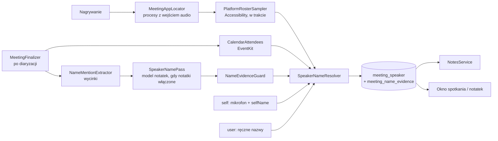

# Prawdziwe imiona rozmówców w notatkach i transkrypcji

Zastępuje szkic `2026-11-06-meeting-speaker-names.md` (jego Faza 1, „Twoje imię”, jest już w kodzie: `plugins.meetings.selfName`, `NotesUtterance.make(from:selfName:)`, operacja zbiorcza `stale` w `MeetingsStore`). Powiązane: `2026-11-06-meeting-speaker-quality.md` (jakość klastrów; pomiar zrobiony 2026-11-06), `2026-11-06-meeting-segment-split.md` (ziarnistość segmentów), `2026-11-25-meeting-notes-structure.md` (#257, sekcja „Uczestnicy” i osoba przy następnym kroku), kierunek UX #247, okno notatek #255. Nazwy w kodzie: produkt to Lintel (`LintelKit`, klucze `plugins.meetings.*`), repozytorium nadal nazywa się Pounce.

## 📝 TLDR
Osoba, która nagrywa spotkanie, widzi dziś w transkrypcji i notatkach „Rozmówca 1, 2…”; tylko ona sama ma imię (`selfName`). Proponowane zachowanie: Lintel nadaje rozmówcom prawdziwe imiona z czterech źródeł ułożonych warstwowo, jak Wispr Flow: (1) mikrofon = właściciel, (2) lista uczestników i wskaźnik „mówi teraz” z okna aplikacji spotkania (Google Meet w Chrome, Teams, Zoom: te, które przejdą zwiad 0.2; Accessibility, domyślnie włączone, wyłączalne w Ustawieniach), (3) uczestnicy wydarzenia z kalendarza (EventKit, tylko po włączeniu przez użytkownika), (4) imiona wypowiedziane w rozmowie, wyłuskane z dowodem i oznaczeniem pewności przez ten sam model, który pisze notatki (tylko przy włączonych notatkach). Imię pewne trafia od razu do transkrypcji i notatek, bez kliknięcia (decyzja właściciela Q1); niepewne jest pokazane jako „Marek?” i czeka na jedno kliknięcie. Każde imię da się zmienić jednym kliknięciem; zmiana działa w całym spotkaniu i nigdy nie jest nadpisywana. Powód: właściciel ocenia, że Wispr „bardzo dobrze oznacza rozmówców”, a bez imion notatki nie mówią, kto co ma zrobić.

## 📝 Problem Statement
- **Stan dziś:** diaryzacja `diarization-community-1` (FluidAudio) daje klastry; `MeetingFinalizer` nazywa je „Rozmówca N”, mówcę z kanału mikrofonu „Ja”, a po ustawieniu `selfName` jego imieniem. Użytkownik może zmienić nazwę klastra (`MeetingWindowModel.renameSpeaker`, `NoteSourceEditing.renameSpeaker`) i oznaczyć „To ja” (`markSelf`); po zmianie notatki są `stale`.
- **Skutek zmierzony:** na ovn 0 z 12–18 zadań miało osobę (archiwum `Pounce-eval-archive/PLAN-meeting-notes-quality.md`), bo `NotesGuard.checkedPerson` nie przyjmuje „Rozmówca N” (`isGenericLabel`). Spec #257 pokazuje osobę przy następnym kroku tylko wtedy, gdy etykieta jest prawdziwym imieniem; sekcja „Uczestnicy” zawiera tylko prawdziwe imiona, więc dziś zwykle jest pusta albo ma samego właściciela.
- **Porównanie (2026-11-25, te same spotkania właściciela, tylko struktura danych Wispr Flow z `flow.sqlite`):** Wispr dla każdego głosu trzyma rekord warstwowy `{room, user, dom, mic, llm}` (pierwszy niepusty wygrywa) i mapę osób z pochodzeniem `platform` (11 osób), `user` (8, kontakty właściciela) i `llm` (3). `dom` to obserwacje strony Google Meet w Chrome: kto „świeci” jako mówiący, z czasem, korelowane z głosami. `mic` to właściciel. W transkrypcji Wispr nie ma ani jednego „Speaker N”. Lintel na tych spotkaniach znalazł 3–4 klastry i żadnego imienia poza właścicielem.
- **Czego nie wiemy:** czy okna Meet (Chrome), Teams i Zoom udostępniają przez Accessibility listę uczestników i wskaźnik mówienia w czytelnej formie (krok 0.2); jak często imię pada w rozmowie (Sejm: przewodniczący zapowiada mówców; AMI: rzadko).

## 📝 Proposed Solution
Jeden rozwiązywacz nazw, kilka niezależnych dostawców dowodów. Każdy dostawca działa sam; brak jednego nie psuje pozostałych.

1. **Dowody (`NameEvidence`)** zbierane w trakcie i po nagraniu, każdy z źródłem, imieniem, opcjonalnym czasem lub mówcą i siłą:
   - `self` — kanał mikrofonu i `selfName` (istnieje; bez zmian zachowania).
   - `platform` — z okna aplikacji spotkania: lista uczestników (imiona) i przedziały czasu, w których dana osoba jest oznaczona jako mówiąca. Domyślnie włączone („Imiona z okna spotkania”, decyzja Q2), działa tylko z nadanym Accessibility i tylko podczas nagrywania. Aplikację spotkania wskazuje `MeetingAppLocator` przy starcie nagrania (Architecture), niezależnie od podpowiedzi nagrywania (`suggestMeetings`, domyślnie wyłączone) i od listy `KnownMeetingApp`, która celowo pomija przeglądarki.
   - `calendar` — uczestnicy wydarzenia kalendarza, które pokrywa się z nagraniem (bez właściciela: `EKParticipant.isCurrentUser`). Tylko lista kandydatów, bez czasu. Tylko gdy użytkownik sam włączy „Imiona z kalendarza” (decyzja Q3).
   - `transcript` — imiona wypowiedziane w rozmowie: samoprezentacja („tu Marek”, „I'm Anna”), zapowiedź („głos ma pan poseł Kowalski”), zwrot („Marku, zrobisz to?”, wskazuje następną wypowiedź). Działa tylko przy włączonych notatkach (`plugins.meetings.notesEnabled`, domyślnie wyłączone) i tym samym generatorem co notatki: wybór dostawcy notatek jest zgodą na wysłanie transkrypcji tylko wtedy, gdy notatki działają (`BACKWARD_COMPATIBILITY.md` §3), a przy wyłączonych notatkach Lintel nie ładuje modelu tylko dla imion. Model dostaje tylko wycinki wokół kandydatów na imiona (patrz Architecture), bez listy uczestników z okna lub kalendarza; zwraca imię, rodzaj dowodu, cytat i pewność; strażnik sprawdza cytat w transkrypcji.
2. **Rozwiązanie (`SpeakerNameResolver`, czysta logika):** dla każdego klastra wybiera co najwyżej jedno imię i każde imię daje co najwyżej jednemu klastrowi (przypisanie jeden do jednego; konflikt = brak imienia, nie zgadywanie). Pierwszeństwo: `user` > `self` > `platform` > `transcript` > `calendar`. Kalendarz sam nie przypisuje imienia klastrowi, z jednym wyjątkiem: spotkanie z właścicielem i dokładnie jednym innym uczestnikiem, w którym poza właścicielem jest dokładnie jeden klaster. Lista z platformy i kalendarza zawęża też imiona z transkrypcji (imię spoza listy dostaje niższą pewność); to porównanie odbywa się lokalnie w rozwiązywaczu, lista nie trafia do modelu.
3. **Pewność i potwierdzenie:** wynik ma stan `confirmed` (użytkownik), `applied` (pewny dowód: `self`, `platform` z wyraźnym pokryciem, samoprezentacja tego samego mówcy, zapowiedź potwierdzona listą) albo `suggested` (reszta: zwrot po imieniu, imię spoza listy, słabe pokrycie). `applied` i `confirmed` są używane w transkrypcji i notatkach od razu, bez kliknięcia (decyzja właściciela Q1 z 2026-11-25; zmienia decyzję Q3 z 2026-11-06 „dopiero po potwierdzeniu” dla pewnych dowodów). `suggested` jest pokazane jako „Marek?” i do potwierdzenia notatki używają etykiety „Rozmówca N” (decyzja Q3 z 2026-11-06 utrzymana dla słabych dowodów).
4. **Ręczna poprawka (jedno kliknięcie, także dla imion `applied`):** kliknięcie imienia na liście „Mówcy” lub w transkrypcji zamienia je w pole edycji; Return zapisuje, Esc anuluje, bez okna potwierdzenia. Zmiana nazwy klastra działa w całym spotkaniu (istnieje), dostaje źródło `user` i nigdy nie jest nadpisana automatycznie, także przy ponownym przetworzeniu. Nowe: nadanie klastrowi imienia, które ma już inny klaster tego spotkania, proponuje połączenie obu („Połączyć z Marek?”), bo diaryzacja często dzieli jedną osobę na dwa klastry; „Zostaw osobno” zapisuje to samo imię przy obu klastrach (dwie osoby o tym samym imieniu; zasada jeden do jednego dotyczy tylko źródeł automatycznych, nie użytkownika); odrzucenie podpowiedzi („To nie Marek”) zapamiętuje odrzucenie dla tego klastra.
5. **Notatki:** rozwiązywanie nazw biegnie po diaryzacji, a przed notatkami, więc pierwsze notatki mają już imiona i nie trzeba ich regenerować. Potwierdzenie podpowiedzi lub ręczna zmiana później oznacza notatki `stale` (istnieje); regeneracja jak dziś.

Rozważone i odrzucone:
- *Profile głosowe między spotkaniami* — dane biometryczne (ryzyko BIPA opisane w szkicu 2026-11-06), poza zakresem.
- *Rozszerzenie przeglądarki dla Meet* (droga Wispr `dom`, `client: chrome`) — nowy komponent do dystrybucji i przeglądu w Chrome Web Store; najpierw sprawdzamy Accessibility, które Lintel już ma (wklejanie, zarządzanie oknami). Wraca, jeśli krok 0.2 wykaże, że Chrome nie daje drzewa dostępności strony.
- *Model językowy nad całą transkrypcją dla imion* — przy długim spotkaniu kosztowny na modelu lokalnym i wysyła więcej tekstu do dostawcy chmurowego niż trzeba; wycinki wystarczają, bo imię musi paść w tekście.
- *Wyłącznie reguły bez modelu* (szkic 2026-11-06, `SpeakerNameSuggester`) — wzorce zostają jako tani wstępny filtr kandydatów, ale polska fleksja i zapowiedzi typu „pan poseł” są poza zasięgiem prostych wzorców; ostateczną interpretację robi model, a strażnik ją sprawdza.

## 📝 Research (rynek)
- **Wispr Flow** (dane lokalne właściciela, tylko struktura): warstwy `room`, `user`, `dom`, `mic`, `llm`, pierwsza niepusta wygrywa; pochodzenie osoby `platform` / `user` / `llm`; obserwacje „mówi / wyciszony” ze strony Meet z czasem; imiona w transkrypcji rozwiązywane z mapy, nie zapisywane w segmentach (zmiana imienia nie przepisuje transkrypcji). Ten spec przejmuje warstwy, pochodzenie i oddzielenie imienia od segmentu.
- **Granola, Fathom, Otter, Fireflies, Read.ai, Zoom, Teams** (szkic 2026-11-06, `Pounce-eval-archive/research-speaker-names.md`): źródła to lista uczestników platformy lub kalendarz, voiceprint albo ręczne wpisanie; jeden mikrofon w sali zawodzi u wszystkich; po zmianie imienia notatki trzeba wygenerować ponownie. Żaden nie dokumentuje wnioskowania z samoprezentacji; Wispr (`llm`) pokazuje, że w praktyce się to robi.
- **Luka:** brak publicznych liczb trafności przypisania imion u konkurentów; brak opisu, jak Wispr łączy obserwacje `dom` z głosami (przyjmujemy pokrycie czasu, krok 2.3 to mierzy).

## 📝 Architecture

- **`LintelKit` (chronione, tylko dodatki z domyślnymi wartościami):**
  - Port `MeetingWindowReader` (nowy, w `PluginContext`, parametr init z domyślnym `NoMeetingWindowReader()` jak `windows: NoWindowClient()`; domyślnie „niedostępny”, pusta lista aplikacji, pusty strumień): `supportedBundleIDs: Set<String>` (aplikacje, dla których ta wersja ma czytnik, czyli te, które przeszły bramkę 0.2), `participants(of pid: Int32) async -> MeetingRoster?` i `observe(pid:) -> AsyncStream<SpeakingObservation>` (`at: ContinuousClock.Instant`, imię, `speaking`). Czytnik sam próbkuje drzewo AX co 1 s (wskaźnik mówienia nie ma niezawodnego powiadomienia AX) i wysyła obserwację tylko przy zmianie; próbnik przelicza `at` na oś czasu nagrania (ms od startu sesji). Implementacja w `LintelApp` obok `AXWindowClient` (`Ports/AXWindowClient.swift`) i `AXObservationHub` (`Ports/AXObservationHub.swift`), bo tylko powłoka używa Accessibility; wtyczki nie importują `LintelApp`. Zwraca wyłącznie imiona i flagi mówienia, nigdy innego tekstu okna. W Chrome czytnik szuka karty Meet tylko po adresie obszaru strony (`AXWebArea` → `AXURL` z hostem `meet.google.com`); tytułów ani treści innych kart nie czyta, nie zapisuje i nie loguje.
  - `Permission.calendars` (nowy przypadek, `isReadable = true`) — dodanie przypadku do enumu jest dozwolone jak przy `systemAudioRecording`; konsumenci obsługują je w Settings → Permissions. Aplikacja jest podpisywana z hardened runtime (`scripts/make-app.sh`, `--options runtime`), więc dochodzi uprawnienie `com.apple.security.personal-information.calendars` w `Resources/Lintel.entitlements` i `Resources/Lintel-adhoc.entitlements` (dodanie uprawnienia nie zmienia identyfikatora pakietu ani certyfikatu; sprawdzenie wymagania podpisu w PR, `BACKWARD_COMPATIBILITY.md` §4).
  - `NoteSpeaker.nameStatus` (`confirmed` / `applied` / `suggested`, init domyślnie `.confirmed`) i `NoteSpeaker.suggestion: String?` (domyślnie `nil`), żeby okno notatek (#255) pokazało „Marek?”; `NoteSourceEditing` dostaje `confirmSpeakerName`, `rejectSpeakerName` i `mergeSpeakers` z domyślnymi implementacjami w rozszerzeniu protokołu, rzucającymi nowy błąd `NoteEditingError.unsupported` (nowy typ w `LintelKit`; kontrakt notatek nie ma dziś typu błędu).
- **`MeetingsPlugin` (nowe, w `Sources/MeetingsPlugin/Names/`):**
  - `MeetingAppLocator` (czysta logika + istniejący port `ProcessAudioObserver`) — wskazuje aplikację spotkania nagrania: (1) `sourceBundleID`, gdy nagranie wystartowało z podpowiedzi; (2) inaczej procesy, które przy starcie nagrania używają wejścia audio (ten sam sygnał „uses an input”, z którego korzysta `MeetingDetector`, odczytany bez włączania podpowiedzi), z identyfikatorem pakietu z `MeetingWindowReader.supportedBundleIDs` (proces pomocniczy należy do aplikacji, jak w `SuggestionConfig.listedApp(for:)`); przeglądarka liczy się tu bez dodawania jej przez użytkownika, bo użytkownik już nagrywa, więc powód wykluczenia przeglądarek z podpowiedzi (fałszywe alarmy) nie zachodzi. Gdy pasuje kilka aplikacji, wygrywa pierwsza, której `participants(of:)` zwraca niepustą listę; gdy żadna, lokalizator ponawia co 30 s przez pierwsze 5 min nagrania, potem źródło milczy do końca spotkania.
  - `PlatformRosterSampler` — podczas nagrywania, gdy przełącznik jest włączony (domyślnie jest), Accessibility jest nadane i `MeetingAppLocator` wskazał aplikację: słucha `observe(pid:)`, trzyma w pamięci przedziały „mówi” per imię (maks. 4 h, potem najstarsze odpadają); przy `MeetingFinalizer` oddaje je rozwiązywaczowi. Nic nie trafia do spoolu ani logów; po awarii przedziały przepadają (spotkanie dostaje tylko pozostałe źródła). Czyta wyłącznie okno (w Chrome: kartę Meet) wskazanej aplikacji, nigdy innych okien, imiona i flagę „mówi”, nic więcej. Bez Accessibility źródło milczy i nie wyświetla żadnego systemowego pytania w trakcie nagrania (patrz „Brak Accessibility” w UI/UX).
  - **Accessibility jako uprawnienie opcjonalne (istniejące mechanizmy, bez zmian w kontrakcie):** `MeetingsPlugin.requiredPermissions` zawiera `.accessibility` tylko przy włączonym `namesFromMeetingWindow`, a każdy status zwracany przez `settingsStatus` (wszystkie gałęzie: wstrzymana biblioteka, model, mikrofon, „Gotowe” i baner dostawcy notatek; test na każdą gałąź) niesie `acknowledgedPermissions: [.accessibility]` (wzór: Pliki bez Full Disk Access), więc `StatusDerivation` nie pokazuje banera „odmowa”, a `ThingsToDo.deniedPermissions` dostaje `.accessibility` w `countedByPlugin`, więc nie liczy go w tytule. Wiersz Accessibility w Settings → Permissions wymienia wtyczki, które go używają (dziś Schowek, Dyktowanie, Okna), więc doda „Spotkania”; `permissionAccessory(for: .accessibility)` dodaje pod nim jedną linię „Spotkania: imiona z okna spotkania (opcjonalne)”. Nagrywanie i onboarding (#254) nie czekają na Accessibility.
  - `CalendarAttendees` — przy finalizacji: `EKEventStore.events(matching:)` w oknie [start − 15 min, koniec + 15 min], wydarzenie o największym pokryciu z co najmniej 2 uczestnikami; czyta tylko `EKParticipant.name` i `isCurrentUser`, nie czyta tytułu, opisu, miejsca ani adresów e-mail. Odczyt wymaga `requestFullAccessToEvents()` (EventKit nie ma dostępu tylko do odczytu; dostęp „write-only” nie pozwala czytać), więc prośba o zgodę padnie tylko po włączeniu przełącznika, z tekstem `NSCalendarsFullAccessUsageDescription` mówiącym, że Lintel tylko czyta imiona uczestników.
  - `NameMentionExtractor` (czysty) — kandydaci: słowa z wielkiej litery spoza początku zdania, imiona z listy platformy/kalendarza (dopasowanie po rdzeniu, polskie końcówki przez `NotesText.wordsMatch`), wzorce samoprezentacji i zapowiedzi PL/EN ze szkicu. Wycinek = segment z kandydatem, segment przed i po, z etykietą klastra i czasem; maks. 40 wycinków, reszta odcięta (licznik w śladzie).
  - `SpeakerNamePass` — tylko przy włączonych notatkach (`notesEnabled`); jedno wywołanie tego samego generatora, którym idą notatki (`NotesGenerating`: wbudowany Qwen lokalnie albo wybrany dostawca); wejście to wyłącznie wycinki z `NameMentionExtractor`, bez listy uczestników; prompt `SpeakerNamePrompt` (wersjonowany, test migawkowy, wejście przez to samo `sanitized` co etykiety). Wyjście JSON: `[{speaker, name, kind: introduction|announced|addressed|referred, quote, confidence: high|low}]`. Limit czasu 60 s; błąd lub limit = brak dowodów `transcript`, notatki idą dalej.
  - `NameEvidenceGuard` (czysty) — odrzuca dowód, gdy cytat nie stoi w transkrypcji u wskazanego mówcy (wyszukiwanie cytatu z `NotesGuard`, dziś prywatna metoda `find(_:near:)`: wydzielona do wspólnej funkcji wewnętrznej, bez zmiany zachowania strażnika notatek), imienia nie ma w cytacie, imię jest generyczne (`isGenericLabel`), `kind = referred` (mowa o osobie trzeciej) albo `addressed` wskazuje mówcę innego niż następna wypowiedź po cytacie.
  - `SpeakerNameResolver` (czysty) — pokrycie platformy: dla klastra z kanału systemowego udział jego czasu mowy, w którym dokładnie jedna osoba z platformy jest „mówiąca”; `applied` przy udziale ≥ 0,6 i przewadze ≥ 0,2 nad drugą osobą, `suggested` przy ≥ 0,3. Samoprezentacja `high` tego samego klastra = `applied`; zapowiedź `high` = `applied`, gdy imię jest na liście platformy lub kalendarza, inaczej `suggested`; reszta `suggested`. Przypisanie jeden do jednego zachłannie po sile dowodu; remis = brak imienia. Progi są stałymi w kodzie, strojonymi tylko na zbiorach rozwojowych (rozmowa: krok 1.5; platforma: krok 2.3), nigdy na testowych.
- **Kolejność w finalizacji:** diaryzacja → `self` → kalendarz i platforma → `SpeakerNamePass` (tylko przy włączonych notatkach) → rozwiązanie → zapis → `NotesService`. Gdy notatki idą do dostawcy chmurowego, ten sam dostawca dostaje wycinki transkrypcji (fragmenty tego, co i tak dostaje w transkrypcji; decyzja Q4), a potem transkrypcję do notatek z imionami `applied`/`confirmed` jako etykietami mówców. Lista uczestników z okna i kalendarza nie jest wysyłana: imiona osób, które nie mówiły i nie padły w rozmowie, nie opuszczają Maca. Żaden inny odbiorca nie dostaje imion, a z wbudowanym modelem na Macu nic nie opuszcza komputera.
- **Granice:** bez nowych zależności SwiftPM (EventKit i ApplicationServices są systemowe). `MeetingsPlugin` nie importuje `LintelApp` ani innej wtyczki. Kod wtyczki nie przerywa procesu (R7).

## 📝 Data Model
Migracja addytywna `v4-speaker-names` w `meetings.sqlite` (SQLCipher):
- `meeting_speaker` dostaje kolumny `name_source TEXT NOT NULL DEFAULT 'default'` (`default`, `self`, `user`, `platform`, `calendar`, `transcript`), `name_status TEXT NOT NULL DEFAULT 'confirmed'` (`confirmed`, `applied`, `suggested`), `suggested_name TEXT` (imię podpowiedzi, `label` zostaje „Rozmówca N” do potwierdzenia) i `rejected_names TEXT` (JSON, imiona odrzucone dla tego klastra). Istniejące wiersze (migracja zapisuje tylko nowe kolumny, `label` i `is_self` zostają bez zmian): `is_self = 1` dostaje `self`; spotkania w trybie `channels` (ścieżki „Ja” / „Inni” / „Mówca 1”, nie osoby) i etykiety, które są generyczne według reguły zamrożonej w migracji (wzorce „Rozmówca N”, „Speaker N”, „Mówca N”, „Ja”, „Inni” wypisane wprost w SQL, jak zamrożone zawijanie FTS w `v1-meetings`, a nie czytane z `NotesGuard.isGenericLabel`), dostają `default`; reszta, czyli nazwy nadane ręcznie, dostaje `user`.
- Nowa tabela `meeting_name_evidence (id, meeting_id → meeting ON DELETE CASCADE, speaker_id → meeting_speaker ON DELETE SET NULL, source, name, kind, segment_id → meeting_segment ON DELETE SET NULL, start_ms, end_ms, strength REAL)` — tylko dowody użyte do wyniku, żeby okno pokazało „usłyszane w 12:03” i przewinęło do cytatu. Cytat nie jest kopiowany: wskazuje segment.
- Nic nie trafia do `ranking.sqlite`, `NotesTrace` (tylko liczniki: ile dowodów z każdego źródła, ile odrzuconych i dlaczego) ani logów. Erase Data i retencja usuwają dowody razem ze spotkaniem (kaskada). Brak nowych plików poza bazą.
- Nowe ustawienia (chroniony kontrakt kluczy; nazwy ostateczne przed implementacją): `plugins.meetings.namesFromMeetingWindow` (Bool, domyślnie `true` wg decyzji Q2; działa dopiero z Accessibility, więc bez nadania uprawnienia nic nie jest czytane), `plugins.meetings.namesFromCalendar` (Bool, domyślnie `false`, Q3), `plugins.meetings.namesFromConversation` (Bool, domyślnie `true`, bo nie wymaga zgody systemowej i nie wysyła niczego poza wybranego dostawcę notatek). Domyślne wartości są częścią chronionego kontraktu: po wydaniu `namesFromMeetingWindow = true` nie da się cicho zmienić na `false` u użytkowników, którzy go nie dotykali. `namesFromConversation` działa tylko razem z `notesEnabled` (domyślnie `false`): przełącznik nie zmienia zgody na wysyłanie transkrypcji.
- Klucze ukryte, zapisywane przez wtyczkę (też chronione, deklarowane raz w `MeetingsSettings`, wzór `plugins.files.accessNoticeDismissed`): `plugins.meetings.meetingWindowNoticeShown` (Bool, domyślnie `false`: jednorazowa linia o pierwszym użyciu źródła została pokazana), `plugins.meetings.meetingWindowAccessNoticeDismissed` (Bool, domyślnie `false`: użytkownik zamknął linię o braku Accessibility w liście „Mówcy”) i `plugins.meetings.chromeAXRestore` (String JSON `{"pid": Int, "previous": Bool}`; zapisany przed ustawieniem `AXManualAccessibility` w Chrome, usuwany po przywróceniu; przy starcie Lintela, gdy proces o tym `pid` nadal jest Chrome, przywraca poprzednią wartość, w przeciwnym razie tylko usuwa klucz, bo atrybut żyje tylko w procesie Chrome).

## 📝 UI/UX
Zasada minimalizmu (`_common.md`, decyzja 2026-11-25): **żadnych zmian w HUD nagrywania** i żadnych nowych okienek. Imiona pojawiają się tam, gdzie dziś są etykiety.
- **Transkrypcja i lista „Mówcy” w oknie spotkania / notatki (#255):** imię zamiast „Rozmówca N”; kliknięcie dowolnego imienia (także `applied`) otwiera edycję w miejscu, Return zapisuje, Esc anuluje; zmiana obejmuje całe spotkanie. Podpowiedź to jedna linia pod nazwą: „Marek?” z dwoma przyciskami „Tak” / „Nie” i czasem dowodu jako łączem (przewija do cytatu). Imię `applied` nie ma znaczka (jak w Wispr); jego pochodzenie widać w podpowiedzi narzędzia („z okna Google Meet”, „przedstawił się w 03:12”). Dostępność: etykiety VoiceOver „Podpowiedź imienia: Marek. Potwierdź / Odrzuć”, fokus klawiaturą, Return potwierdza.
- **Zmiana nazwy na imię innego mówcy:** zamiast zapisu jedna linia „Marek już jest w tym spotkaniu. Połączyć?” z „Połącz” / „Zostaw osobno” / „Anuluj”; połączenie przenosi segmenty i oznacza notatki `stale`; „Zostaw osobno” zapisuje imię przy obu (dwie osoby o tym samym imieniu).
- **Settings → Spotkania, grupa „Imiona rozmówców” (#247 IA: strona Spotkań):** pole „Twoje imię” (istnieje) i trzy przełączniki: „Z rozmowy” (włączony; przy wyłączonych notatkach nieaktywny z jedną linią „Działa, gdy notatki są włączone”), „Z okna spotkania (…)” (**włączony domyślnie**, decyzja Q2; w nawiasie nazwy aplikacji z `MeetingWindowReader.supportedBundleIDs`, np. „Meet, Teams, Zoom”, jeśli wszystkie przejdą bramkę 0.2) i „Z kalendarza” (wyłączony, Q3). Pod przełącznikiem okna jedna linia wyjaśnienia: „Lintel czyta w oknie spotkania tylko imiona uczestników i kto mówi, tylko podczas nagrywania”. Włączenie kalendarza prosi o zgodę systemową dopiero w tej chwili; odmowa wyłącza przełącznik z jedną linią „Brak dostępu do kalendarza — Otwórz Ustawienia systemowe”. Bez nowego kroku w onboardingu (#254): zgoda w chwili, gdy jest potrzebna.
- **Brak Accessibility (przełącznik okna włączony, uprawnienia nie ma):** Accessibility jest dziś nadawane dla wklejania (wtyczki Schowek i Dyktowanie) i zarządzania oknami (wtyczka Okna), więc u części użytkowników już jest i źródło działa od razu, bez nowego pytania. Gdy go nie ma: (1) nagranie nie pokazuje nic i nie przerywa pytaniem systemowym; (2) pod przełącznikiem w Ustawieniach jedna linia „Brak Accessibility — imiona z okna spotkania nie działają. Nadaj dostęp” z przyciskiem, który otwiera panel Accessibility w Ustawieniach systemowych (`x-apple.systempreferences:…?Privacy_Accessibility` przez `context.workspace.open`, jak w Schowku; wtyczka nie ma dostępu do `PermissionsModel` powłoki); (3) w liście „Mówcy” spotkania, w którym `MeetingAppLocator` wskazał aplikację, a źródło milczało z tego powodu, jedna zamykalna linia „Bez Accessibility Lintel nie zna imion z okna spotkania. Nadaj dostęp”; po pierwszym zamknięciu nie wraca w żadnym spotkaniu (`meetingWindowAccessNoticeDismissed`), zostaje tylko linia w Ustawieniach; (4) Settings → Permissions: wiersz Accessibility wymienia też „Spotkania” z linią „imiona z okna spotkania (opcjonalne)”, bez banera i bez licznika „rzeczy do zrobienia” (mechanizm w Architecture: `acknowledgedPermissions`, `countedByPlugin`, `permissionAccessory`); nie blokuje nagrywania ani onboardingu #254.
- **Jawność nowego użycia uprawnienia:** użytkownik, który nadał Accessibility dla wklejania lub okien, nie zgodził się jawnie na czytanie okien spotkań, więc przy pierwszym użyciu źródła lista „Mówcy” pokazuje jedną zamykalną linię „Imiona z okna Google Meet. Wyłącz w Ustawieniach” (nazwa aplikacji, z której je odczytano; raz, potem nie wraca: `meetingWindowNoticeShown`), a notatka wydania i opis przełącznika mówią to samo.
- **Notatki (#257):** „Uczestnicy” i „osoba:” przy następnym kroku używają imion `applied`/`confirmed`, nigdy `suggested`.
- **Stany:** brak imion (dziś); imiona wszystkie pewne; mieszane z podpowiedziami; konflikt (dwa klastry, jedno imię — oba bez imienia, podpowiedź przy obu); przetwarzanie (lista pokazuje „Rozmówca N” do końca finalizacji, bez osobnego wskaźnika).
- **Makiety:** HTML z przykładowymi danymi w `.ai/specs/assets/meeting-speaker-names/` (zrzuty w PR); źródłem prawdy UI jest galeria SwiftUI (#248), więc implementacja dodaje stany listy „Mówcy” do galerii i testów migawkowych.

## 📝 Plan pomiaru
- **Metryki (per nagranie, na słowach transkrypcji, po dopasowaniu klastrów do mówców odniesienia przez największe pokrycie czasu):** *pokrycie* = udział słów z wyświetlanym prawdziwym imieniem; *trafność* = udział słów z imieniem, w których imię jest imieniem mówcy odniesienia; *fałszywe imię* = 1 − trafność (główny strażnik: zła osoba przy zadaniu jest gorsza niż „Rozmówca N”); osobno dla `applied` i dla `suggested`.
- **Zbiory:** Sejm ASW-140 i CNT-53 (`data/sejm/*/entry.json`, prawdziwe imiona i nazwiska 13 i 9 mówców; zapowiedzi przewodniczącego testują źródło `transcript`); AMI ES2014c, IS1009c, TS3007c (role zamiast imion, imiona prawie nie padają: test powściągliwości, oczekiwane pokrycie bliskie 0 przy fałszywym imieniu 0); kalendarz symulowany z listy `speakers` w `entry.json` (wariant „z listą” i „bez listy”). Źródła `platform` nie da się zmierzyć na tych nagraniach (brak obserwacji okna), a spotkania właściciela z 2026-11-25 nie mają obserwacji Lintela (Lintel nie czytał wtedy okna, a mikrofon spotkań był źle ustawiony). Pomiar platformy jest więc prospektywny: co najmniej 3 nowe spotkania Meet/Teams/Zoom nagrane kompilacją z kroku 2.2 (QA, `--qa…`), z co najmniej 3 osobami poza właścicielem; próbnik zapisuje obserwacje tylko do folderu benchmarku (`~/DeveloperTools/lintel-market-benchmark/`, poza repozytorium; zapis tylko w kompilacji DEBUG z opcją `--qa…`, nigdy w wydanej aplikacji). Odniesieniem są imiona przypisane głosom ręcznie przez właściciela (nie wynik Wispr Flow ani samego okna, żeby pomiar nie był kołowy). Pierwsze spotkanie jest rozwojowe (opóźnienie i progi pokrycia, krok 2.3), pozostałe testowe. Wejście uzupełniające (tylko rozwój, za zgodą właściciela): obserwacje Wispr `speakers.observations.ndjson` z tych samych spotkań, przełożone skryptem w benchmarku na `SpeakingObservation` i podane czytnikowi w pamięci; sprawdza rozwiązywacz, nie czytnik AX.
- **Podział:** CNT-53 i ES2014c są zbiorem rozwojowym (strojenie progów i promptu), ASW-140, IS1009c, TS3007c testowym; wynik testowy raportowany raz po strojeniu. Platforma: jak wyżej (pierwsze nowe spotkanie rozwojowe, reszta testowa).
- **Progi przyjęcia (ustalone przed pomiarem):** fałszywe imię `applied` ≤ 3% słów z imieniem na każdym nagraniu; AMI: fałszywe imię ≤ 1% (nagranie bez żadnego słowa z imieniem spełnia próg: 0 fałszywych imion); Sejm z listą: pokrycie `applied` ≥ 50%; bez listy ≥ 30%. Nieosiągnięte pokrycie przy dotrzymanym progu fałszywych imion nie blokuje wydania (mniej imion, ale prawdziwe); przekroczony próg fałszywych imion blokuje stan `applied` dla danego źródła (spada do `suggested`).
- **Uruchomienie:** harness `MeetingEvalTests` (ten sam kod co aplikacja) przez `tools/run_lintel_meeting.sh` w benchmarku; liczenie w `scripts/meeting-eval/score.py` (nowa funkcja `speaker_names` z testem na sztucznym przykładzie w `test_score.py`). Dane benchmarku nie trafiają do repozytorium; wyniki (same liczby) w PR.

## 📝 Edge Cases & Failure Scenarios
- **Jedna sala, jeden mikrofon:** kilka osób w kanale mikrofonu; `self` dotyczy tylko klastra oznaczonego „To ja”, nie całego mikrofonu, gdy diaryzacja znalazła w nim kilka klastrów (dziś `markSelf` zablokowany w `channels`; tam imiona z platformy i rozmowy też są wyłączone).
- **Platforma pokazuje „mówi” dla wielu naraz / z opóźnieniem:** przedziały z więcej niż jedną mówiącą osobą nie liczą się do pokrycia; korekta opóźnienia (w granicach ±500 ms) wybrana w kroku 2.3 na rozwojowym nagraniu platformy.
- **Użytkownik sam mówi przez głośnik innego urządzenia lub ma echo:** klastry z kanału mikrofonu nie dostają imion z platformy (tylko kanał systemowy), echo tłumi `EchoSuppressor`.
- **Uczestnik dołącza z telefonu / pokój konferencyjny („Sala 3.14”):** nazwa z platformy nie wygląda na osobę → `isGenericLabel` lub lista słów sal; pokazywana jako jest tylko po potwierdzeniu (`suggested`).
- **Dwie osoby o tym samym imieniu:** imię i nazwisko z platformy/kalendarza rozróżnia; z samej rozmowy konflikt → brak imienia.
- **Imię o osobie trzeciej („Marek mówił, że…”):** `referred` odrzucony przez strażnika.
- **Polska fleksja:** imię zapisywane w mianowniku z listy, jeśli pasuje rdzeniem; bez listy model zwraca mianownik, a strażnik wymaga, by rdzeń stał w cytacie (`NotesText.wordsMatch`).
- **Model zmyśla imię lub cytat:** strażnik odrzuca; licznik odrzuceń w śladzie.
- **Prompt injection przez nazwę z okna lub kalendarza:** nazwy przechodzą przez `sanitized` i limit 60 znaków jak `selfName`; nazwa z `|` lub znacznikiem promptu jest czyszczona.
- **Brak zgody / zgoda cofnięta w trakcie:** źródło milknie, nagrywanie trwa; jedna linia w Ustawieniach, nic w HUD.
- **Chrome bez drzewa dostępności strony:** wymaga ustawienia `AXEnhancedUserInterface`/`AXManualAccessibility` na aplikacji, co znane jest ze skutków ubocznych (wolniejsze okna, menedżery okien). Skoro źródło jest domyślnie włączone, ustawienie `AXManualAccessibility` w Chrome dotknęłoby każdego użytkownika Meet, więc włączamy je tylko na czas nagrania, gdy `MeetingAppLocator` wskazał Chrome, i przywracamy poprzednią wartość po zakończeniu nagrania (po awarii przy następnym starcie, klucz `chromeAXRestore`). Atrybut włącza drzewo dla wszystkich kart, ale czytnik schodzi tylko do karty Meet (Architecture). Krok 0.2 mierzy skutki według progów bramki; jeśli je przekracza, Meet przez Chrome odpada z F2 (zostają Zoom/Teams, które przeszły bramkę, a rozszerzenie przeglądarki wraca jako osobny spec, Q7).
- **Ponowna finalizacja / odzysk po awarii:** `user` i `confirmed` zachowane, odrzucenia zachowane; reszta liczona od nowa.

## 📝 Risks & Impact Review
- **Zła osoba przy zadaniu** (najpoważniejsze): progi fałszywych imion z pomiaru, przypisanie jeden do jednego, `suggested` dla słabych dowodów, ręczna poprawka zawsze wygrywa.
- **Prywatność:** imiona uczestników i zapisy z kalendarza to dane osobowe osób, które nie zgodziły się na nic. Zostają wyłącznie w zaszyfrowanym `meetings.sqlite`; do dostawcy notatek trafiają tylko wtedy, gdy użytkownik włączył notatki i wybrał dostawcę chmurowego (ten sam, który i tak dostaje transkrypcję), i tylko wycinki transkrypcji oraz etykiety mówców; lista uczestników z okna i kalendarza nie jest wysyłana; z wbudowanym modelem nic nie opuszcza Maca. Odczyt okna spotkania to nowy sposób użycia uprawnienia Accessibility, które użytkownik mógł dać tylko do wklejania lub zarządzania oknami. Decyzja właściciela (Q2, 2026-11-25): źródło jest **domyślnie włączone**, wyłączalne w Ustawieniach. Ryzyko (zgoda domyślna zamiast jawnej) łagodzą: czytanie tylko okna aplikacji spotkania wskazanej przez `MeetingAppLocator` (w Chrome tylko karty Meet, znalezionej po adresie, bez czytania innych kart), tylko imion i flagi „mówi”, tylko podczas nagrywania, zaszyfrowany zapis, jednorazowa jawna linia przy pierwszym użyciu, opis przy przełączniku i w notatce wydania, wpis przy Accessibility w Settings → Permissions. Kalendarz (Q3) zostaje jawnym wyborem użytkownika.
- **Kontrakty:** nowe klucze ustawień (także ukryte), migracja `v4-speaker-names`, `Permission.calendars` i uprawnienie kalendarza w entitlements, port `MeetingWindowReader`, pola `NoteSpeaker`, metody `NoteSourceEditing` i `NoteEditingError` są nieodwracalne po wydaniu (`BACKWARD_COMPATIBILITY.md` §1–§4); każdy PR, który je wprowadza, ma `risk-high` i dopisuje swoje powierzchnie do `BACKWARD_COMPATIBILITY.md` (F1: migracja, `namesFromConversation`, `NoteSpeaker`, `NoteSourceEditing`; F2: port, `namesFromMeetingWindow` i klucze ukryte; F3: `Permission.calendars`, `namesFromCalendar`, entitlement). Notatka wydania F2 (z nazwami aplikacji, które przeszły bramkę 0.2): „Lintel odczytuje teraz w oknie Meet, Teams lub Zoom imiona uczestników i to, kto mówi, tylko podczas nagrywania. Wyłączysz to w Ustawieniach → Spotkania”; notatka F3: „Imiona z kalendarza: tylko po włączeniu w Ustawieniach → Spotkania”.
- **Kruchość Accessibility:** układ okien Meet/Teams/Zoom zmienia się bez zapowiedzi; czytnik ma testy na nagranych drzewach AX (fikstury bez prawdziwych imion) i cicho przestaje działać (źródło puste, licznik w śladzie), nigdy nie blokuje nagrania.
- **Wydajność:** próbkowanie 1 Hz tylko podczas nagrania, z włączonym przełącznikiem i nadanym Accessibility; budżet ≤ 2% CPU (pomiar w kroku 2.5, wpis w `docs/perf.md`). `SpeakerNamePass` dodaje do finalizacji maks. 60 s (lokalnie zwykle mniej przy 40 wycinkach); pomiar w kroku 1.5.

## 📋 Phasing
- **F0 — pomiar i zwiad (bez zmian w produkcie):** metryki imion w harnessie, punkt odniesienia (dziś: tylko `self`), zwiad Accessibility dla Meet/Teams/Zoom (bramka dla F2).
- **F1 — imiona z rozmowy i rdzeń:** dane, rozwiązywacz, ekstraktor, przebieg modelu, strażnik, UI podpowiedzi, edycji jednym kliknięciem i połączenia. Bez nowych zgód. Samodzielnie wdrażalna.
- **F2 — okno spotkania (przesunięte przed kalendarz):** port `MeetingWindowReader`, czytniki per aplikacja, które przeszły bramkę F0, próbnik, pokrycie, obsługa braku Accessibility. Domyślnie włączone (Q2), więc dotyczy każdego użytkownika. Zależy od rdzenia z F1, nie od strojenia 1.5: kroki 2.1–2.3 mogą ruszyć po kroku 1.4 (migracja i rozwiązywacz), równolegle z 1.5–1.6; krok 2.4 (linie w liście „Mówcy”) czeka na UI z kroku 1.6. F2 wychodzi do użytkowników dopiero po F1.
- **F3 — kalendarz:** `Permission.calendars`, `CalendarAttendees`, przełącznik (wyłączony domyślnie, Q3).

**Dlaczego okno przed kalendarzem (zmiana Q6 po decyzji Q2).** (1) Okno daje najlepsze imiona: Wispr ma 11 osób z `platform` wobec 3 z `llm` na tych samych spotkaniach, a okno jako jedyne źródło daje powiązanie imię ↔ czas mówienia, więc przypisuje klastrom imiona z wysoką pewnością; kalendarz daje tylko listę bez czasu i sam przypisuje klaster tylko w jednym przypadku (dwie osoby). (2) Okno jest domyślnie włączone, kalendarz wymaga świadomego włączenia i pełnego dostępu do kalendarza, więc okno dotyka wszystkich użytkowników, a kalendarz garstki. (3) Okno nie może wyprzedzić F1, bo korzysta z migracji, rozwiązywacza i UI podpowiedzi. (4) Ryzyko okna (Accessibility w Chrome/Teams/Zoom) rozstrzyga F0 przed jakimkolwiek kodem F2, więc przesunięcie nie wiąże się z niewiadomą: jeśli bramka 0.2 odrzuci wszystkie aplikacje, F2 odpada, a kolejność wraca do F1 → kalendarz.

## 📋 Implementation Plan

### F0 — pomiar i zwiad
- **0.1** `speaker_names` w `scripts/meeting-eval/score.py` (pokrycie, trafność, fałszywe imię, osobno `applied`/`suggested`) z testem na sztucznym przykładzie; `EvalResult` dostaje imię, źródło i stan per mówca. Wynik punktu odniesienia na zbiorze z sekcji Plan pomiaru.
- **0.2** Zwiad (skrypt poza aplikacją, wynik w PR, bez prawdziwych imion w zrzutach; spotkanie testowe z fikcyjnymi imionami): czy drzewo AX Google Meet w Chrome, nowego Teams i Zoom podaje listę uczestników i wskaźnik mówienia; koszt i skutki włączenia drzewa w Chrome. **Bramka** (każdy punkt na każdą aplikację, wyniki liczbowe w PR; skoro źródło jest domyślnie włączone, bramka dotyczy każdego użytkownika danej aplikacji); aplikacja wchodzi do F2 tylko, gdy:
  - (a) lista uczestników daje imiona wszystkich osób spotkania z co najmniej 4 uczestnikami w widoku galerii, widoku mówcy i podczas udostępniania ekranu, bez otwierania paneli (np. listy uczestników) i bez klikania w oknie;
  - (b) wskaźnik mówienia jest czytelny w tych trzech widokach z opóźnieniem ≤ 1 s względem dźwięku (mediana na nagraniu 10 min);
  - (c) próbkowanie 1 Hz kosztuje Lintela ≤ 2% CPU, a aplikację spotkania ≤ 2 punkty procentowe CPU więcej niż bez próbkowania (Monitor aktywności, średnia z 10 min);
  - (d) tylko Chrome: kartę Meet da się znaleźć po adresie obszaru strony (`AXURL`) bez czytania tytułów ani treści innych kart; włączenie `AXManualAccessibility` nie zwiększa CPU Chrome o więcej niż 5 punktów procentowych przy 10 otwartych kartach i nie spowalnia przesuwania okien Chrome przez wtyczkę Okna Lintela (budżet „Switch workspaces with 20 windows” < 100 ms z `docs/perf.md` dotrzymany także, gdy wśród okien są okna Chrome z włączonym atrybutem); przywrócenie poprzedniej wartości działa po zwykłym końcu nagrania i po `kill -9` Lintela (przy następnym starcie).
  Aplikacja, która nie spełnia któregoś punktu, nie dostaje czytnika w F2.

### F1 — imiona z rozmowy
- **1.1** Migracja `v4-speaker-names`, typy `NameEvidence`, `SpeakerNameStatus`, zapis i odczyt w `MeetingsStore`; test migracji na bazie z v3 (etykiety użytkownika dostają `user`, `is_self` dostaje `self`, etykiety generyczne i spotkania `channels` dostają `default`, `label` bez zmian); wpis w `BACKWARD_COMPATIBILITY.md` §2, PR `risk-high`.
- **1.2** `NameMentionExtractor` i `NameEvidenceGuard` (czyste) z testami: wołacz, imię osoby trzeciej, nazwy produktów z wielkiej litery, zapowiedź „głos ma”, limit 40 wycinków.
- **1.3** `SpeakerNamePrompt` (wersjonowany, migawka) i `SpeakerNamePass` przez `NotesGenerating`; limit 60 s; test z generatorem w pamięci (błąd, limit, zły JSON = brak dowodów; wyłączone notatki = brak wywołania; wejście nie zawiera listy uczestników).
- **1.4** `SpeakerNameResolver` (czysty) i wpięcie w `MeetingFinalizer` przed `NotesService`; `user`/`confirmed` nienaruszalne przy ponownej finalizacji; testy pierwszeństwa, konfliktu, jeden do jednego.
- **1.5** Strojenie na zbiorze rozwojowym, jeden przebieg testowy, liczby w PR; czas finalizacji przed/po.
- **1.6** UI: podpowiedź „Marek?” z Tak/Nie, połączenie mówców („Połącz” / „Zostaw osobno” / „Anuluj”), przełącznik „Z rozmowy” (nieaktywny przy wyłączonych notatkach); `NoteSpeaker.nameStatus`/`suggestion`, nowe metody `NoteSourceEditing` z domyślnymi i `NoteEditingError`; wpis w `BACKWARD_COMPATIBILITY.md` §1 i §3 (`namesFromConversation`); stany w galerii SwiftUI i migawki; `Localizable.xcstrings` en/pl.
- **1.7** Prywatność: test, że `NotesTrace` i logi nie zawierają imion ani cytatów; Erase Data usuwa dowody.
- **1.8** QA natywnego UI ze zrzutami (jasny i ciemny motyw, `docs/qa.md`), fikstura spotkania z fikcyjnymi imionami.

### F2 — okno spotkania (tylko aplikacje, które przeszły bramkę 0.2)
- **2.1** Port `MeetingWindowReader` w `LintelKit` (domyślnie niedostępny, `supportedBundleIDs` puste) i implementacja w `LintelApp` obok `AXWindowClient` i `AXObservationHub`, tylko dla aplikacji, które przeszły bramkę 0.2; fikstury drzew AX per aplikacja (bez prawdziwych imion); w Chrome wyszukiwanie karty Meet po `AXURL` i `AXManualAccessibility` tylko na czas nagrania, z przywróceniem wartości (także po awarii, klucz `chromeAXRestore`); test, że czytnik nie zwraca tekstu innego niż imiona i flagi.
- **2.2** `MeetingAppLocator` (czysty: `sourceBundleID`, procesy z wejściem audio, `supportedBundleIDs`, procesy pomocnicze, kilka kandydatów, ponawianie przez 5 min) i `PlatformRosterSampler` (tylko podczas nagrania, z włączonym przełącznikiem i Accessibility, pamięć, limit 4 h, przeliczenie `at` na oś nagrania); testy z czytnikiem i obserwatorem procesów w pamięci; brak Accessibility = źródło milczy bez pytania w trakcie nagrania.
- **2.3** Pokrycie w `SpeakerNameResolver`, korekta opóźnienia i progi pokrycia na rozwojowym nagraniu platformy; pomiar na testowych nagraniach platformy (Plan pomiaru; odniesienie przypisane przez właściciela).
- **2.4** Brak Accessibility i jawność użycia: linia w Ustawieniach z przyciskiem, zamykalne linie w liście „Mówcy” (klucze `meetingWindowNoticeShown`, `meetingWindowAccessNoticeDismissed`), Accessibility jako uprawnienie opcjonalne (`requiredPermissions` tylko przy włączonym przełączniku, `acknowledgedPermissions`, `countedByPlugin`, `permissionAccessory`), klucz `namesFromMeetingWindow` domyślnie `true`, notatka wydania i wpis w `BACKWARD_COMPATIBILITY.md` §1 i §3 z jawną zgodą właściciela na domyślne `true` w tym PR (wymóg §3 dla domyślnej wartości osłabiającej prywatność; decyzja zapisana w tabeli decyzji niżej i w [komentarzu w PR #274](https://github.com/mjozefiak/lintel/pull/274#issuecomment-7174202322)); en/pl.
- **2.5** Budżet CPU w `docs/perf.md`; QA ze zrzutami z prawdziwym spotkaniem testowym (fikcyjne imiona uczestników), z Accessibility i bez.

### F3 — kalendarz
- **3.1** `Permission.calendars` w `LintelKit`, `PermissionsReader`, Settings → Permissions, `NSCalendarsFullAccessUsageDescription` (en/pl, `Resources/InfoPlist.xcstrings`), entitlement `com.apple.security.personal-information.calendars` w obu plikach `Resources/*.entitlements` (sprawdzenie, że wymaganie podpisu zgadza się z `Resources/designated-requirement.txt`); wpis w `BACKWARD_COMPATIBILITY.md` §1, §3 i §4.
- **3.2** `CalendarAttendees` za portem (test z magazynem w pamięci: wybór wydarzenia, pominięcie właściciela, brak zgody); przełącznik (wyłączony domyślnie) i prośba o zgodę w chwili włączenia.
- **3.3** Pomiar z symulowaną listą (wariant „z listą”), QA ze zrzutami.

## 📝 Open Questions
Brak otwartych pytań. Q1–Q4 rozstrzygnął właściciel 2026-11-25 (niżej); Q5–Q10 zostają jak w domyślnych odpowiedziach, z jedną zmianą w Q6.

## Decyzje właściciela (2026-11-25)

| # | Pytanie | Decyzja | Skutek w specu |
|---|---|---|---|
| Q1 | Czy pewne imiona mogą trafiać do notatek bez kliknięcia? | **Tak.** Pewne imiona (ja z mikrofonu, wyraźne dopasowanie z listy uczestników, samoprezentacja) wchodzą od razu. Słabe przesłanki = podpowiedź „Marek?”. Zmiana imienia jednym kliknięciem w całym spotkaniu. | Stan `applied` używany bez potwierdzenia; edycja w miejscu także dla `applied`; progi fałszywych imion z Q10 pilnują jakości. |
| Q2 | Czy Lintel może czytać okno Meet/Teams/Zoom przez Accessibility? | **Tak, domyślnie włączone** (zmiana względem propozycji „domyślnie wyłączone”). Tylko imiona i flaga mówienia, tylko podczas nagrywania, wyłączalne w Ustawieniach. | `namesFromMeetingWindow = true` (domyślna wartość osłabiająca prywatność: `BACKWARD_COMPATIBILITY.md` §3 wymaga jawnej zgody właściciela w PR; decyzja jest zapisana w tej tabeli i w [komentarzu w PR #274](https://github.com/mjozefiak/lintel/pull/274#issuecomment-7174202322), a PR kroku 2.4 zawiera jawną zgodę właściciela na `true`); obsługa braku Accessibility bez pytania w trakcie nagrania; jednorazowa jawność przy pierwszym użyciu; bramka 0.2 dotyczy wszystkich; kolejność faz zmieniona (okno F2, kalendarz F3). |
| Q3 | Pełny dostęp do kalendarza? | **Tylko po włączeniu przez użytkownika**, tylko imiona uczestników. | `namesFromCalendar = false`; prośba o zgodę w chwili włączenia. |
| Q4 | Czy wycinki z imionami mogą iść do dostawcy chmurowego? | **Tylko do dostawcy notatek wybranego przez użytkownika**; z modelem na Macu nic nie wychodzi. | Bez zmian względem proponowanego; zapisane wprost w Architecture i Risks. Dostawca dostaje wycinki transkrypcji, nie listę uczestników z okna i kalendarza. |
| Q5 | Imiona z rozmowy domyślnie? | Tak (`namesFromConversation = true`). | Działa tylko przy włączonych notatkach, tym samym modelem co notatki (z przeglądu specyfikacji). |
| Q6 | Kolejność faz | **F0 → F1 → F2 okno → F3 kalendarz** (było: kalendarz przed oknem); uzasadnienie w Phasing. | Kroki 2.x i 3.x zamienione miejscami. |
| Q7 | Rozszerzenie przeglądarki dla Meet | Poza zakresem; osobny spec, jeśli bramka 0.2 odrzuci Chrome. | — |
| Q8 | Profile głosowe | Poza zakresem. | — |
| Q9 | Podpowiedź w HUD lub powiadomieniu? | Nie, tylko w oknie spotkania/notatki. | — |
| Q10 | Progi pomiaru | Fałszywe imię `applied` ≤ 3% (AMI ≤ 1%), pokrycie Sejm ≥ 50% z listą, ≥ 30% bez. | — |

## Poza zakresem
Profile głosowe; rozszerzenie przeglądarki; podział segmentów na zmianie mówcy (`2026-11-06-meeting-segment-split.md`; imię trafia do klastra, więc segment mieszający dwie osoby dostaje jedno imię — dowód w podpowiedzi wskazuje konkretną wypowiedź); oznaczanie osób w punktach notatek wzmiankami (`<@…>` jak w Wispr); uczenie imion między spotkaniami.
