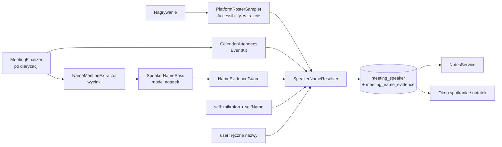

# Prawdziwe imiona rozmówców w notatkach i transkrypcji

Zastępuje szkic `2026-11-06-meeting-speaker-names.md` (jego Faza 1, „Twoje imię”, jest już w kodzie: `plugins.meetings.selfName`, `NotesUtterance.make(from:selfName:)`, operacja zbiorcza `stale` w `MeetingsStore`). Powiązane: `2026-11-06-meeting-speaker-quality.md` (jakość klastrów; pomiar zrobiony 2026-11-06), `2026-11-06-meeting-segment-split.md` (ziarnistość segmentów), `2026-11-25-meeting-notes-structure.md` (#257, sekcja „Uczestnicy” i osoba przy następnym kroku), kierunek UX #247, okno notatek #255. Nazwy w kodzie: produkt to Lintel (`LintelKit`, klucze `plugins.meetings.*`), repozytorium nadal nazywa się Pounce.

## 📝 TLDR
Osoba, która nagrywa spotkanie, widzi dziś w transkrypcji i notatkach „Rozmówca 1, 2…”; tylko ona sama ma imię (`selfName`). Proponowane zachowanie: Lintel nadaje rozmówcom prawdziwe imiona z czterech źródeł ułożonych warstwowo, jak Wispr Flow: (1) mikrofon = właściciel, (2) lista uczestników i wskaźnik „mówi teraz” z okna Google Meet / Teams / Zoom (Accessibility, domyślnie włączone, wyłączalne w Ustawieniach), (3) uczestnicy wydarzenia z kalendarza (EventKit, tylko po włączeniu przez użytkownika), (4) imiona wypowiedziane w rozmowie, wyłuskane przez model językowy z dowodem i oznaczeniem pewności. Imię pewne trafia od razu do transkrypcji i notatek, bez kliknięcia (decyzja właściciela Q1); niepewne jest pokazane jako „Marek?” i czeka na jedno kliknięcie. Każde imię da się zmienić jednym kliknięciem; zmiana działa w całym spotkaniu i nigdy nie jest nadpisywana. Powód: właściciel ocenia, że Wispr „bardzo dobrze oznacza rozmówców”, a bez imion notatki nie mówią, kto co ma zrobić.

## 📝 Problem Statement
- **Stan dziś:** diaryzacja `diarization-community-1` (FluidAudio) daje klastry; `MeetingFinalizer` nazywa je „Rozmówca N”, mówcę z kanału mikrofonu „Ja”, a po ustawieniu `selfName` jego imieniem. Użytkownik może zmienić nazwę klastra (`MeetingWindowModel.renameSpeaker`, `NoteSourceEditing.renameSpeaker`) i oznaczyć „To ja” (`markSelf`); po zmianie notatki są `stale`.
- **Skutek zmierzony:** na ovn 0 z 12–18 zadań miało osobę (archiwum `Pounce-eval-archive/PLAN-meeting-notes-quality.md`), bo `NotesGuard.checkedPerson` nie przyjmuje „Rozmówca N” (`isGenericLabel`). Spec #257 pokazuje osobę przy następnym kroku tylko wtedy, gdy etykieta jest prawdziwym imieniem; sekcja „Uczestnicy” zawiera tylko prawdziwe imiona, więc dziś zwykle jest pusta albo ma samego właściciela.
- **Porównanie (2026-11-25, te same spotkania właściciela, tylko struktura danych Wispr Flow z `flow.sqlite`):** Wispr dla każdego głosu trzyma rekord warstwowy `{room, user, dom, mic, llm}` (pierwszy niepusty wygrywa) i mapę osób z pochodzeniem `platform` (11 osób), `user` (8, kontakty właściciela) i `llm` (3). `dom` to obserwacje strony Google Meet w Chrome: kto „świeci” jako mówiący, z czasem, korelowane z głosami. `mic` to właściciel. W transkrypcji Wispr nie ma ani jednego „Speaker N”. Lintel na tych spotkaniach znalazł 3–4 klastry i żadnego imienia poza właścicielem.
- **Czego nie wiemy:** czy okna Meet (Chrome), Teams i Zoom udostępniają przez Accessibility listę uczestników i wskaźnik mówienia w czytelnej formie (krok 0.2); jak często imię pada w rozmowie (Sejm: przewodniczący zapowiada mówców; AMI: rzadko).

## 📝 Proposed Solution
Jeden rozwiązywacz nazw, kilka niezależnych dostawców dowodów. Każdy dostawca działa sam; brak jednego nie psuje pozostałych.

1. **Dowody (`NameEvidence`)** zbierane w trakcie i po nagraniu, każdy z źródłem, imieniem, opcjonalnym czasem lub mówcą i siłą:
   - `self` — kanał mikrofonu i `selfName` (istnieje; bez zmian zachowania).
   - `platform` — z okna aplikacji spotkania: lista uczestników (imiona) i przedziały czasu, w których dana osoba jest oznaczona jako mówiąca. Domyślnie włączone („Imiona z okna spotkania”, decyzja Q2), działa tylko z nadanym Accessibility i tylko podczas nagrywania.
   - `calendar` — uczestnicy wydarzenia kalendarza, które pokrywa się z nagraniem (bez właściciela: `EKParticipant.isCurrentUser`). Tylko lista kandydatów, bez czasu. Tylko gdy użytkownik sam włączy „Imiona z kalendarza” (decyzja Q3).
   - `transcript` — imiona wypowiedziane w rozmowie: samoprezentacja („tu Marek”, „I'm Anna”), zapowiedź („głos ma pan poseł Kowalski”), zwrot („Marku, zrobisz to?”, wskazuje następną wypowiedź). Model językowy dostaje tylko wycinki wokół kandydatów na imiona (patrz Architecture), zwraca imię, rodzaj dowodu, cytat i pewność; strażnik sprawdza cytat w transkrypcji.
2. **Rozwiązanie (`SpeakerNameResolver`, czysta logika):** dla każdego klastra wybiera co najwyżej jedno imię i każde imię daje co najwyżej jednemu klastrowi (przypisanie jeden do jednego; konflikt = brak imienia, nie zgadywanie). Pierwszeństwo: `user` > `self` > `platform` > `transcript` > `calendar`. Kalendarz sam nie przypisuje imienia klastrowi, z jednym wyjątkiem: spotkanie z właścicielem i dokładnie jednym innym uczestnikiem, w którym poza właścicielem jest dokładnie jeden klaster. Lista z platformy i kalendarza zawęża też imiona z transkrypcji (imię spoza listy dostaje niższą pewność).
3. **Pewność i potwierdzenie:** wynik ma stan `confirmed` (użytkownik), `applied` (pewny dowód: `self`, `platform` z wyraźnym pokryciem, samoprezentacja tego samego mówcy, zapowiedź potwierdzona listą) albo `suggested` (reszta: zwrot po imieniu, imię spoza listy, słabe pokrycie). `applied` i `confirmed` są używane w transkrypcji i notatkach od razu, bez kliknięcia (decyzja właściciela Q1 z 2026-11-25; zmienia decyzję Q3 z 2026-11-06 „dopiero po potwierdzeniu” dla pewnych dowodów). `suggested` jest pokazane jako „Marek?” i do potwierdzenia notatki używają etykiety „Rozmówca N” (decyzja Q3 z 2026-11-06 utrzymana dla słabych dowodów).
4. **Ręczna poprawka (jedno kliknięcie, także dla imion `applied`):** kliknięcie imienia na liście „Mówcy” lub w transkrypcji zamienia je w pole edycji; Return zapisuje, Esc anuluje, bez okna potwierdzenia. Zmiana nazwy klastra działa w całym spotkaniu (istnieje), dostaje źródło `user` i nigdy nie jest nadpisana automatycznie, także przy ponownym przetworzeniu. Nowe: nadanie klastrowi imienia, które ma już inny klaster tego spotkania, proponuje połączenie obu („Połączyć z Marek?”), bo diaryzacja często dzieli jedną osobę na dwa klastry; odrzucenie podpowiedzi („To nie Marek”) zapamiętuje odrzucenie dla tego klastra.
5. **Notatki:** rozwiązywanie nazw biegnie po diaryzacji, a przed notatkami, więc pierwsze notatki mają już imiona i nie trzeba ich regenerować. Potwierdzenie podpowiedzi lub ręczna zmiana później oznacza notatki `stale` (istnieje); regeneracja jak dziś.

Rozważone i odrzucone:
- *Profile głosowe między spotkaniami* — dane biometryczne (ryzyko BIPA opisane w szkicu 2026-11-06), poza zakresem.
- *Rozszerzenie przeglądarki dla Meet* (droga Wispr `dom`, `client: chrome`) — nowy komponent do dystrybucji i przeglądu w Chrome Web Store; najpierw sprawdzamy Accessibility, które Lintel już ma (wklejanie). Wraca, jeśli krok 0.2 wykaże, że Chrome nie daje drzewa dostępności strony.
- *Model językowy nad całą transkrypcją dla imion* — przy długim spotkaniu kosztowny na modelu lokalnym i wysyła więcej tekstu do dostawcy chmurowego niż trzeba; wycinki wystarczają, bo imię musi paść w tekście.
- *Wyłącznie reguły bez modelu* (szkic 2026-11-06, `SpeakerNameSuggester`) — wzorce zostają jako tani wstępny filtr kandydatów, ale polska fleksja i zapowiedzi typu „pan poseł” są poza zasięgiem prostych wzorców; ostateczną interpretację robi model, a strażnik ją sprawdza.

## 📝 Research (rynek)
- **Wispr Flow** (dane lokalne właściciela, tylko struktura): warstwy `room`, `user`, `dom`, `mic`, `llm`, pierwsza niepusta wygrywa; pochodzenie osoby `platform` / `user` / `llm`; obserwacje „mówi / wyciszony” ze strony Meet z czasem; imiona w transkrypcji rozwiązywane z mapy, nie zapisywane w segmentach (zmiana imienia nie przepisuje transkrypcji). Ten spec przejmuje warstwy, pochodzenie i oddzielenie imienia od segmentu.
- **Granola, Fathom, Otter, Fireflies, Read.ai, Zoom, Teams** (szkic 2026-11-06, `Pounce-eval-archive/research-speaker-names.md`): źródła to lista uczestników platformy lub kalendarz, voiceprint albo ręczne wpisanie; jeden mikrofon w sali zawodzi u wszystkich; po zmianie imienia notatki trzeba wygenerować ponownie. Żaden nie dokumentuje wnioskowania z samoprezentacji; Wispr (`llm`) pokazuje, że w praktyce się to robi.
- **Luka:** brak publicznych liczb trafności przypisania imion u konkurentów; brak opisu, jak Wispr łączy obserwacje `dom` z głosami (przyjmujemy pokrycie czasu, krok 2.3 to mierzy).

## 📝 Architecture

- **`LintelKit` (chronione, tylko dodatki z domyślnymi wartościami):**
  - Port `MeetingWindowReader` (nowy, w `PluginContext`, domyślnie „niedostępny”, pusty strumień): `participants(of pid: Int32) async -> MeetingRoster?` i `observe(pid:) -> AsyncStream<SpeakingObservation>` (`tMs`, imię, `speaking`). Implementacja w `LintelApp` obok `AXWindowClient` (`Ports/AXObservationHub.swift`), bo tylko powłoka używa Accessibility; wtyczki nie importują `LintelApp`. Zwraca wyłącznie imiona i flagi mówienia, nigdy innego tekstu okna.
  - `Permission.calendars` (nowy przypadek, `isReadable = true`) — dodanie przypadku do enumu jest dozwolone jak przy `systemAudioRecording`; konsumenci obsługują je w Settings → Permissions.
  - `NoteSpeaker.nameStatus` (`confirmed` / `applied` / `suggested`, init domyślnie `.confirmed`) i `NoteSpeaker.suggestion: String?` (domyślnie `nil`), żeby okno notatek (#255) pokazało „Marek?”; `NoteSourceEditing` dostaje `confirmSpeakerName`, `rejectSpeakerName` i `mergeSpeakers` z domyślnymi implementacjami rzucającymi `unsupported`.
- **`MeetingsPlugin` (nowe, w `Sources/MeetingsPlugin/Names/`):**
  - `PlatformRosterSampler` — podczas nagrywania, gdy przełącznik jest włączony (domyślnie jest), Accessibility jest nadane i aplikacja spotkania jest znana (`SuggestionPolicy` zna Zoom, Teams, Meet przez Chrome dodany przez użytkownika): co 1 s czyta `observe(pid:)`, trzyma w pamięci przedziały „mówi” per imię (maks. 4 h, potem najstarsze odpadają); przy `MeetingFinalizer` oddaje je rozwiązywaczowi. Nic nie trafia do spoolu ani logów; po awarii przedziały przepadają (spotkanie dostaje tylko pozostałe źródła). Czyta wyłącznie okno aplikacji spotkania rozpoznanej przez `SuggestionPolicy` (nigdy innych okien), imiona i flagę „mówi”, nic więcej. Bez Accessibility źródło milczy i nie wyświetla żadnego systemowego pytania w trakcie nagrania (patrz „Brak Accessibility” w UI/UX).
  - `CalendarAttendees` — przy finalizacji: `EKEventStore.events(matching:)` w oknie [start − 15 min, koniec + 15 min], wydarzenie o największym pokryciu z co najmniej 2 uczestnikami; czyta tylko `EKParticipant.name` i `isCurrentUser`, nie czyta tytułu, opisu, miejsca ani adresów e-mail. Odczyt wymaga `requestFullAccessToEvents()` (EventKit nie ma dostępu tylko do odczytu; dostęp „write-only” nie pozwala czytać), więc prośba o zgodę padnie tylko po włączeniu przełącznika, z tekstem `NSCalendarsFullAccessUsageDescription` mówiącym, że Lintel tylko czyta imiona uczestników.
  - `NameMentionExtractor` (czysty) — kandydaci: słowa z wielkiej litery spoza początku zdania, imiona z listy platformy/kalendarza (dopasowanie po rdzeniu, polskie końcówki przez `NotesText.wordsMatch`), wzorce samoprezentacji i zapowiedzi PL/EN ze szkicu. Wycinek = segment z kandydatem, segment przed i po, z etykietą klastra i czasem; maks. 40 wycinków, reszta odcięta (licznik w śladzie).
  - `SpeakerNamePass` — jedno wywołanie wybranego generatora notatek (`NotesGenerating`: wbudowany Qwen lokalnie albo wybrany dostawca), prompt `SpeakerNamePrompt` (wersjonowany, test migawkowy, wejście przez to samo `sanitized` co etykiety). Wyjście JSON: `[{speaker, name, kind: introduction|announced|addressed|referred, quote, confidence: high|low}]`. Limit czasu 60 s; błąd lub limit = brak dowodów `transcript`, notatki idą dalej.
  - `NameEvidenceGuard` (czysty) — odrzuca dowód, gdy cytat nie stoi w transkrypcji u wskazanego mówcy (`NotesGuard.find`), imienia nie ma w cytacie, imię jest generyczne (`isGenericLabel`), `kind = referred` (mowa o osobie trzeciej) albo `addressed` wskazuje mówcę innego niż następna wypowiedź po cytacie.
  - `SpeakerNameResolver` (czysty) — pokrycie platformy: dla klastra z kanału systemowego udział jego czasu mowy, w którym dokładnie jedna osoba z platformy jest „mówiąca”; `applied` przy udziale ≥ 0,6 i przewadze ≥ 0,2 nad drugą osobą, `suggested` przy ≥ 0,3. Samoprezentacja `high` tego samego klastra = `applied`; zapowiedź `high` = `applied`, gdy imię jest na liście platformy lub kalendarza, inaczej `suggested`; reszta `suggested`. Przypisanie jeden do jednego zachłannie po sile dowodu; remis = brak imienia. Progi są stałymi w kodzie, strojonymi tylko w kroku 1.5 na zbiorze rozwojowym, nie na testowym.
- **Kolejność w finalizacji:** diaryzacja → `self` → kalendarz i platforma → `SpeakerNamePass` → rozwiązanie → zapis → `NotesService`. Gdy notatki idą do dostawcy chmurowego, ten sam dostawca dostaje wycinki i listę kandydatów z włączonych źródeł (nic, czego by i tak nie dostał w transkrypcji; decyzja Q4). Żaden inny odbiorca nie dostaje imion, a z wbudowanym modelem na Macu nic nie opuszcza komputera.
- **Granice:** bez nowych zależności SwiftPM (EventKit i ApplicationServices są systemowe). `MeetingsPlugin` nie importuje `LintelApp` ani innej wtyczki. Kod wtyczki nie przerywa procesu (R7).

## 📝 Data Model
Migracja addytywna `v4-speaker-names` w `meetings.sqlite` (SQLCipher):
- `meeting_speaker` dostaje kolumny `name_source TEXT NOT NULL DEFAULT 'default'` (`default`, `self`, `user`, `platform`, `calendar`, `transcript`), `name_status TEXT NOT NULL DEFAULT 'confirmed'` (`confirmed`, `applied`, `suggested`), `suggested_name TEXT` (imię podpowiedzi, `label` zostaje „Rozmówca N” do potwierdzenia) i `rejected_names TEXT` (JSON, imiona odrzucone dla tego klastra). Istniejące wiersze: etykieta różna od domyślnej dostaje `user`, „Ja”/`selfName` dostaje `self`, reszta `default`.
- Nowa tabela `meeting_name_evidence (id, meeting_id → meeting ON DELETE CASCADE, speaker_id → meeting_speaker ON DELETE SET NULL, source, name, kind, segment_id → meeting_segment ON DELETE SET NULL, start_ms, end_ms, strength REAL)` — tylko dowody użyte do wyniku, żeby okno pokazało „usłyszane w 12:03” i przewinęło do cytatu. Cytat nie jest kopiowany: wskazuje segment.
- Nic nie trafia do `ranking.sqlite`, `NotesTrace` (tylko liczniki: ile dowodów z każdego źródła, ile odrzuconych i dlaczego) ani logów. Erase Data i retencja usuwają dowody razem ze spotkaniem (kaskada). Brak nowych plików poza bazą.
- Nowe ustawienia (chroniony kontrakt kluczy; nazwy ostateczne przed implementacją): `plugins.meetings.namesFromMeetingWindow` (Bool, domyślnie `true` wg decyzji Q2; działa dopiero z Accessibility, więc bez nadania uprawnienia nic nie jest czytane), `plugins.meetings.namesFromCalendar` (Bool, domyślnie `false`, Q3), `plugins.meetings.namesFromConversation` (Bool, domyślnie `true`, bo nie wymaga zgody systemowej i nie wysyła niczego poza wybranego dostawcę notatek). Domyślne wartości są częścią chronionego kontraktu: po wydaniu `namesFromMeetingWindow = true` nie da się cicho zmienić na `false` u użytkowników, którzy go nie dotykali.

## 📝 UI/UX
Zasada minimalizmu (`_common.md`, decyzja 2026-11-25): **żadnych zmian w HUD nagrywania** i żadnych nowych okienek. Imiona pojawiają się tam, gdzie dziś są etykiety.
- **Transkrypcja i lista „Mówcy” w oknie spotkania / notatki (#255):** imię zamiast „Rozmówca N”; kliknięcie dowolnego imienia (także `applied`) otwiera edycję w miejscu, Return zapisuje, Esc anuluje; zmiana obejmuje całe spotkanie. Podpowiedź to jedna linia pod nazwą: „Marek?” z dwoma przyciskami „Tak” / „Nie” i czasem dowodu jako łączem (przewija do cytatu). Imię `applied` nie ma znaczka (jak w Wispr); jego pochodzenie widać w podpowiedzi narzędzia („z okna Google Meet”, „przedstawił się w 03:12”). Dostępność: etykiety VoiceOver „Podpowiedź imienia: Marek. Potwierdź / Odrzuć”, fokus klawiaturą, Return potwierdza.
- **Zmiana nazwy na imię innego mówcy:** zamiast zapisu jedna linia „Marek już jest w tym spotkaniu. Połączyć?” z „Połącz” / „Anuluj”; połączenie przenosi segmenty i oznacza notatki `stale`.
- **Settings → Spotkania, grupa „Imiona rozmówców” (#247 IA: strona Spotkań):** pole „Twoje imię” (istnieje) i trzy przełączniki: „Z rozmowy” (włączony), „Z okna spotkania (Meet, Teams, Zoom)” (**włączony domyślnie**, decyzja Q2) i „Z kalendarza” (wyłączony, Q3). Pod przełącznikiem okna jedna linia wyjaśnienia: „Lintel czyta w oknie spotkania tylko imiona uczestników i kto mówi, tylko podczas nagrywania”. Włączenie kalendarza prosi o zgodę systemową dopiero w tej chwili; odmowa wyłącza przełącznik z jedną linią „Brak dostępu do kalendarza — Otwórz Ustawienia systemowe”. Bez nowego kroku w onboardingu (#254): zgoda w chwili, gdy jest potrzebna.
- **Brak Accessibility (przełącznik okna włączony, uprawnienia nie ma):** Accessibility jest dziś nadawane dla wklejania (wtyczki Schowek i Dyktowanie), więc u części użytkowników już jest i źródło działa od razu, bez nowego pytania. Gdy go nie ma: (1) nagranie nie pokazuje nic i nie przerywa pytaniem systemowym; (2) pod przełącznikiem w Ustawieniach jedna linia „Brak Accessibility — imiona z okna spotkania nie działają. Nadaj dostęp” z przyciskiem, który wywołuje systemowe pytanie (`AXIsProcessTrustedWithOptions`) albo otwiera panel; (3) w liście „Mówcy” spotkania, w którym rozpoznano aplikację spotkania, a źródło milczało z tego powodu, jedna zamykalna linia „Bez Accessibility Lintel nie zna imion z okna Meet. Nadaj dostęp” (raz na spotkanie, po zamknięciu nie wraca); (4) Settings → Permissions pokazuje przy Accessibility oba zastosowania („wklejanie” i „imiona z okna spotkania”), a `MeetingsPlugin.requiredPermissions` dodaje je jako opcjonalne (nie blokuje nagrywania ani onboardingu #254).
- **Jawność nowego użycia uprawnienia:** użytkownik, który nadał Accessibility dla wklejania, nie zgodził się jawnie na czytanie okien spotkań, więc przy pierwszym użyciu źródła lista „Mówcy” pokazuje jedną zamykalną linię „Imiona z okna Google Meet. Wyłącz w Ustawieniach” (raz, potem nie wraca), a notatka wydania i opis przełącznika mówią to samo.
- **Notatki (#257):** „Uczestnicy” i „osoba:” przy następnym kroku używają imion `applied`/`confirmed`, nigdy `suggested`.
- **Stany:** brak imion (dziś); imiona wszystkie pewne; mieszane z podpowiedziami; konflikt (dwa klastry, jedno imię — oba bez imienia, podpowiedź przy obu); przetwarzanie (lista pokazuje „Rozmówca N” do końca finalizacji, bez osobnego wskaźnika).
- **Makiety:** HTML z przykładowymi danymi w `.ai/specs/assets/meeting-speaker-names/` (zrzuty w PR); źródłem prawdy UI jest galeria SwiftUI (#248), więc implementacja dodaje stany listy „Mówcy” do galerii i testów migawkowych.

## 📝 Plan pomiaru
- **Metryki (per nagranie, na słowach transkrypcji, po dopasowaniu klastrów do mówców odniesienia przez największe pokrycie czasu):** *pokrycie* = udział słów z wyświetlanym prawdziwym imieniem; *trafność* = udział słów z imieniem, w których imię jest imieniem mówcy odniesienia; *fałszywe imię* = 1 − trafność (główny strażnik: zła osoba przy zadaniu jest gorsza niż „Rozmówca N”); osobno dla `applied` i dla `suggested`.
- **Zbiory:** Sejm ASW-140 i CNT-53 (`data/sejm/*/entry.json`, prawdziwe imiona i nazwiska 13 i 9 mówców; zapowiedzi przewodniczącego testują źródło `transcript`); AMI ES2014c, IS1009c, TS3007c (role zamiast imion, imiona prawie nie padają: test powściągliwości, oczekiwane pokrycie bliskie 0 przy fałszywym imieniu 0); kalendarz symulowany z listy `speakers` w `entry.json` (wariant „z listą” i „bez listy”). Źródła `platform` nie da się zmierzyć na tych nagraniach (brak obserwacji okna): mierzymy je na spotkaniach właściciela O2/O3 z 2026-11-25, gdzie odniesieniem są imiona z Wispr Flow potwierdzone przez właściciela, oraz na fiksturze QA z nagranymi obserwacjami.
- **Podział:** CNT-53 i ES2014c są zbiorem rozwojowym (strojenie progów i promptu), ASW-140, IS1009c, TS3007c testowym; wynik testowy raportowany raz po strojeniu.
- **Progi przyjęcia (ustalone przed pomiarem):** fałszywe imię `applied` ≤ 3% słów z imieniem na każdym nagraniu; AMI: fałszywe imię ≤ 1%; Sejm z listą: pokrycie `applied` ≥ 50%; bez listy ≥ 30%. Nieosiągnięte pokrycie przy dotrzymanym progu fałszywych imion nie blokuje wydania (mniej imion, ale prawdziwe); przekroczony próg fałszywych imion blokuje stan `applied` dla danego źródła (spada do `suggested`).
- **Uruchomienie:** harness `MeetingEvalTests` (ten sam kod co aplikacja) przez `tools/run_lintel_meeting.sh` w benchmarku; liczenie w `scripts/meeting-eval/score.py` (nowa funkcja `speaker_names` z testem na sztucznym przykładzie w `test_score.py`). Dane benchmarku nie trafiają do repozytorium; wyniki (same liczby) w PR.

## 📝 Edge Cases & Failure Scenarios
- **Jedna sala, jeden mikrofon:** kilka osób w kanale mikrofonu; `self` dotyczy tylko klastra oznaczonego „To ja”, nie całego mikrofonu, gdy diaryzacja znalazła w nim kilka klastrów (dziś `markSelf` zablokowany w `channels`; tam imiona z platformy i rozmowy też są wyłączone).
- **Platforma pokazuje „mówi” dla wielu naraz / z opóźnieniem:** przedziały z więcej niż jedną mówiącą osobą nie liczą się do pokrycia; korekta opóźnienia ±500 ms wybrana w kroku 2.3 na fiksturze.
- **Użytkownik sam mówi przez głośnik innego urządzenia lub ma echo:** klastry z kanału mikrofonu nie dostają imion z platformy (tylko kanał systemowy), echo tłumi `EchoSuppressor`.
- **Uczestnik dołącza z telefonu / pokój konferencyjny („Sala 3.14”):** nazwa z platformy nie wygląda na osobę → `isGenericLabel` lub lista słów sal; pokazywana jako jest tylko po potwierdzeniu (`suggested`).
- **Dwie osoby o tym samym imieniu:** imię i nazwisko z platformy/kalendarza rozróżnia; z samej rozmowy konflikt → brak imienia.
- **Imię o osobie trzeciej („Marek mówił, że…”):** `referred` odrzucony przez strażnika.
- **Polska fleksja:** imię zapisywane w mianowniku z listy, jeśli pasuje rdzeniem; bez listy model zwraca mianownik, a strażnik wymaga, by rdzeń stał w cytacie (`NotesText.wordsMatch`).
- **Model zmyśla imię lub cytat:** strażnik odrzuca; licznik odrzuceń w śladzie.
- **Prompt injection przez nazwę z okna lub kalendarza:** nazwy przechodzą przez `sanitized` i limit 60 znaków jak `selfName`; nazwa z `|` lub znacznikiem promptu jest czyszczona.
- **Brak zgody / zgoda cofnięta w trakcie:** źródło milknie, nagrywanie trwa; jedna linia w Ustawieniach, nic w HUD.
- **Chrome bez drzewa dostępności strony:** wymaga ustawienia `AXEnhancedUserInterface`/`AXManualAccessibility` na aplikacji, co znane jest ze skutków ubocznych (wolniejsze okna, menedżery okien). Krok 0.2 mierzy; jeśli skutki są widoczne, Meet przez Chrome odpada z tej fazy (zostaje Zoom/Teams i rozszerzenie jako osobny spec). Skoro źródło jest domyślnie włączone, ustawienie `AXManualAccessibility` w Chrome dotknęłoby każdego użytkownika Meet, więc: włączamy je tylko na czas nagrania spotkania w Chrome i przywracamy poprzednią wartość po jego zakończeniu (także po awarii, przy następnym starcie); jeśli krok 0.2 pokaże skutki uboczne mimo to, Chrome zostaje poza domyślnym zakresem (tylko Zoom/Teams albo osobna zgoda dla Chrome).
- **Ponowna finalizacja / odzysk po awarii:** `user` i `confirmed` zachowane, odrzucenia zachowane; reszta liczona od nowa.

## 📝 Risks & Impact Review
- **Zła osoba przy zadaniu** (najpoważniejsze): progi fałszywych imion z pomiaru, przypisanie jeden do jednego, `suggested` dla słabych dowodów, ręczna poprawka zawsze wygrywa.
- **Prywatność:** imiona uczestników i zapisy z kalendarza to dane osobowe osób, które nie zgodziły się na nic. Zostają wyłącznie w zaszyfrowanym `meetings.sqlite`; do dostawcy notatek trafiają tylko wtedy, gdy użytkownik wybrał dostawcę chmurowego (ten sam, który i tak dostaje transkrypcję), i tylko wycinki; z wbudowanym modelem nic nie opuszcza Maca. Odczyt okna spotkania to nowy sposób użycia uprawnienia Accessibility, które użytkownik mógł dać tylko do wklejania. Decyzja właściciela (Q2, 2026-11-25): źródło jest **domyślnie włączone**, wyłączalne w Ustawieniach. Ryzyko (zgoda domyślna zamiast jawnej) łagodzą: czytanie tylko okna rozpoznanej aplikacji spotkania, tylko imion i flagi „mówi”, tylko podczas nagrywania, zaszyfrowany zapis, jednorazowa jawna linia przy pierwszym użyciu, opis przy przełączniku i w notatce wydania, wpis przy Accessibility w Settings → Permissions. Kalendarz (Q3) zostaje jawnym wyborem użytkownika.
- **Kontrakty:** nowe klucze ustawień, migracja `v4-speaker-names`, `Permission.calendars`, port `MeetingWindowReader` i pola `NoteSpeaker` są nieodwracalne po wydaniu (`BACKWARD_COMPATIBILITY.md`); wpis w sekcji 3 i notatka wydania („Lintel może teraz czytać imiona uczestników z kalendarza i okna spotkania — tylko po włączeniu”).
- **Kruchość Accessibility:** układ okien Meet/Teams/Zoom zmienia się bez zapowiedzi; czytnik ma testy na nagranych drzewach AX (fikstury bez prawdziwych imion) i cicho przestaje działać (źródło puste, licznik w śladzie), nigdy nie blokuje nagrania.
- **Wydajność:** próbkowanie 1 Hz tylko podczas nagrania, z włączonym przełącznikiem i nadanym Accessibility; budżet ≤ 2% CPU (pomiar w kroku 2.5, wpis w `docs/perf.md`). `SpeakerNamePass` dodaje do finalizacji maks. 60 s (lokalnie zwykle mniej przy 40 wycinkach); pomiar w kroku 1.5.

## 📋 Phasing
- **F0 — pomiar i zwiad (bez zmian w produkcie):** metryki imion w harnessie, punkt odniesienia (dziś: tylko `self`), zwiad Accessibility dla Meet/Teams/Zoom (bramka dla F2).
- **F1 — imiona z rozmowy i rdzeń:** dane, rozwiązywacz, ekstraktor, przebieg modelu, strażnik, UI podpowiedzi, edycji jednym kliknięciem i połączenia. Bez nowych zgód. Samodzielnie wdrażalna.
- **F2 — okno spotkania (przesunięte przed kalendarz):** port `MeetingWindowReader`, czytniki per aplikacja, które przeszły bramkę F0, próbnik, pokrycie, obsługa braku Accessibility. Domyślnie włączone (Q2), więc dotyczy każdego użytkownika. Zależy od rdzenia z F1 (kroki 1.1, 1.4, 1.6), nie od strojenia 1.5; może ruszyć równolegle po kroku 1.4.
- **F3 — kalendarz:** `Permission.calendars`, `CalendarAttendees`, przełącznik (wyłączony domyślnie, Q3).

**Dlaczego okno przed kalendarzem (zmiana Q6 po decyzji Q2).** (1) Okno daje najlepsze imiona: Wispr ma 11 osób z `platform` wobec 3 z `llm` na tych samych spotkaniach, a okno jako jedyne źródło daje powiązanie imię ↔ czas mówienia, więc przypisuje klastrom imiona z wysoką pewnością; kalendarz daje tylko listę bez czasu i sam przypisuje klaster tylko w jednym przypadku (dwie osoby). (2) Okno jest domyślnie włączone, kalendarz wymaga świadomego włączenia i pełnego dostępu do kalendarza, więc okno dotyka wszystkich użytkowników, a kalendarz garstki. (3) Okno nie może wyprzedzić F1, bo korzysta z migracji, rozwiązywacza i UI podpowiedzi. (4) Ryzyko okna (Accessibility w Chrome/Teams/Zoom) rozstrzyga F0 przed jakimkolwiek kodem F2, więc przesunięcie nie wiąże się z niewiadomą: jeśli bramka 0.2 odrzuci wszystkie aplikacje, F2 odpada, a kolejność wraca do F1 → kalendarz.

## 📋 Implementation Plan

### F0 — pomiar i zwiad
- **0.1** `speaker_names` w `scripts/meeting-eval/score.py` (pokrycie, trafność, fałszywe imię, osobno `applied`/`suggested`) z testem na sztucznym przykładzie; `EvalResult` dostaje imię, źródło i stan per mówca. Wynik punktu odniesienia na zbiorze z sekcji Plan pomiaru.
- **0.2** Zwiad (skrypt poza aplikacją, wynik w PR, bez prawdziwych imion w zrzutach): czy drzewo AX Google Meet w Chrome, nowego Teams i Zoom podaje listę uczestników i wskaźnik mówienia; koszt i skutki włączenia drzewa w Chrome (czy da się je włączyć tylko na czas nagrania i cofnąć). **Bramka:** aplikacja wchodzi do F2 tylko, gdy oba elementy są czytelne bez otwierania paneli i bez skutków ubocznych; skoro źródło jest domyślnie włączone, bramka dotyczy każdego użytkownika danej aplikacji.

### F1 — imiona z rozmowy
- **1.1** Migracja `v4-speaker-names`, typy `NameEvidence`, `SpeakerNameStatus`, zapis i odczyt w `MeetingsStore`; test migracji na bazie z v3 (etykiety użytkownika dostają `user`).
- **1.2** `NameMentionExtractor` i `NameEvidenceGuard` (czyste) z testami: wołacz, imię osoby trzeciej, nazwy produktów z wielkiej litery, zapowiedź „głos ma”, limit 40 wycinków.
- **1.3** `SpeakerNamePrompt` (wersjonowany, migawka) i `SpeakerNamePass` przez `NotesGenerating`; limit 60 s; test z generatorem w pamięci (błąd, limit, zły JSON = brak dowodów).
- **1.4** `SpeakerNameResolver` (czysty) i wpięcie w `MeetingFinalizer` przed `NotesService`; `user`/`confirmed` nienaruszalne przy ponownej finalizacji; testy pierwszeństwa, konfliktu, jeden do jednego.
- **1.5** Strojenie na zbiorze rozwojowym, jeden przebieg testowy, liczby w PR; czas finalizacji przed/po.
- **1.6** UI: podpowiedź „Marek?” z Tak/Nie, połączenie mówców, przełącznik „Z rozmowy”; `NoteSpeaker.nameStatus`/`suggestion` i nowe metody `NoteSourceEditing` z domyślnymi; stany w galerii SwiftUI i migawki; `Localizable.xcstrings` en/pl.
- **1.7** Prywatność: test, że `NotesTrace` i logi nie zawierają imion ani cytatów; Erase Data usuwa dowody.
- **1.8** QA natywnego UI ze zrzutami (jasny i ciemny motyw, `docs/qa.md`), fikstura spotkania z fikcyjnymi imionami.

### F2 — okno spotkania (tylko aplikacje, które przeszły bramkę 0.2)
- **2.1** Port `MeetingWindowReader` w `LintelKit` (domyślnie niedostępny) i implementacja w `LintelApp` obok `AXObservationHub`; fikstury drzew AX per aplikacja; w Chrome `AXManualAccessibility` tylko na czas nagrania, z przywróceniem wartości (także po awarii).
- **2.2** `PlatformRosterSampler` (tylko podczas nagrania, z włączonym przełącznikiem i Accessibility, pamięć, limit 4 h); test z czytnikiem w pamięci; brak Accessibility = źródło milczy bez pytania w trakcie nagrania.
- **2.3** Pokrycie w `SpeakerNameResolver`, korekta opóźnienia na fiksturze; pomiar na O2/O3 (odniesienie potwierdzone przez właściciela).
- **2.4** Brak Accessibility i jawność użycia: linia w Ustawieniach z przyciskiem, zamykalne linie w liście „Mówcy”, opis przy Accessibility w Settings → Permissions, `requiredPermissions` jako opcjonalne, klucz `namesFromMeetingWindow` domyślnie `true`, notatka wydania i wpis w `BACKWARD_COMPATIBILITY.md`; en/pl.
- **2.5** Budżet CPU w `docs/perf.md`; QA ze zrzutami z prawdziwym spotkaniem testowym (fikcyjne imiona uczestników), z Accessibility i bez.

### F3 — kalendarz
- **3.1** `Permission.calendars` w `LintelKit`, `PermissionsReader`, Settings → Permissions, `NSCalendarsFullAccessUsageDescription` (en/pl); wpis w `BACKWARD_COMPATIBILITY.md`.
- **3.2** `CalendarAttendees` za portem (test z magazynem w pamięci: wybór wydarzenia, pominięcie właściciela, brak zgody); przełącznik (wyłączony domyślnie) i prośba o zgodę w chwili włączenia.
- **3.3** Pomiar z symulowaną listą (wariant „z listą”), QA ze zrzutami.

## 📝 Open Questions
Brak otwartych pytań. Q1–Q4 rozstrzygnął właściciel 2026-11-25 (niżej); Q5–Q10 zostają jak w domyślnych odpowiedziach, z jedną zmianą w Q6.

## Decyzje właściciela (2026-11-25)

| # | Pytanie | Decyzja | Skutek w specu |
|---|---|---|---|
| Q1 | Czy pewne imiona mogą trafiać do notatek bez kliknięcia? | **Tak.** Pewne imiona (ja z mikrofonu, wyraźne dopasowanie z listy uczestników, samoprezentacja) wchodzą od razu. Słabe przesłanki = podpowiedź „Marek?”. Zmiana imienia jednym kliknięciem w całym spotkaniu. | Stan `applied` używany bez potwierdzenia; edycja w miejscu także dla `applied`; progi fałszywych imion z Q10 pilnują jakości. |
| Q2 | Czy Lintel może czytać okno Meet/Teams/Zoom przez Accessibility? | **Tak, domyślnie włączone** (zmiana względem propozycji „domyślnie wyłączone”). Tylko imiona i flaga mówienia, tylko podczas nagrywania, wyłączalne w Ustawieniach. | `namesFromMeetingWindow = true`; obsługa braku Accessibility bez pytania w trakcie nagrania; jednorazowa jawność przy pierwszym użyciu; bramka 0.2 dotyczy wszystkich; kolejność faz zmieniona (okno F2, kalendarz F3). |
| Q3 | Pełny dostęp do kalendarza? | **Tylko po włączeniu przez użytkownika**, tylko imiona uczestników. | `namesFromCalendar = false`; prośba o zgodę w chwili włączenia. |
| Q4 | Czy wycinki z imionami mogą iść do dostawcy chmurowego? | **Tylko do dostawcy notatek wybranego przez użytkownika**; z modelem na Macu nic nie wychodzi. | Bez zmian względem proponowanego; zapisane wprost w Architecture i Risks. |
| Q5 | Imiona z rozmowy domyślnie? | Tak (`namesFromConversation = true`). | — |
| Q6 | Kolejność faz | **F0 → F1 → F2 okno → F3 kalendarz** (było: kalendarz przed oknem); uzasadnienie w Phasing. | Kroki 2.x i 3.x zamienione miejscami. |
| Q7 | Rozszerzenie przeglądarki dla Meet | Poza zakresem; osobny spec, jeśli bramka 0.2 odrzuci Chrome. | — |
| Q8 | Profile głosowe | Poza zakresem. | — |
| Q9 | Podpowiedź w HUD lub powiadomieniu? | Nie, tylko w oknie spotkania/notatki. | — |
| Q10 | Progi pomiaru | Fałszywe imię `applied` ≤ 3% (AMI ≤ 1%), pokrycie Sejm ≥ 50% z listą, ≥ 30% bez. | — |

## Poza zakresem
Profile głosowe; rozszerzenie przeglądarki; podział segmentów na zmianie mówcy (`2026-11-06-meeting-segment-split.md`; imię trafia do klastra, więc segment mieszający dwie osoby dostaje jedno imię — dowód w podpowiedzi wskazuje konkretną wypowiedź); oznaczanie osób w punktach notatek wzmiankami (`<@…>` jak w Wispr); uczenie imion między spotkaniami.
